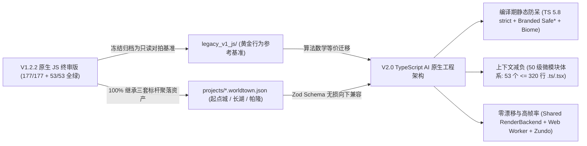
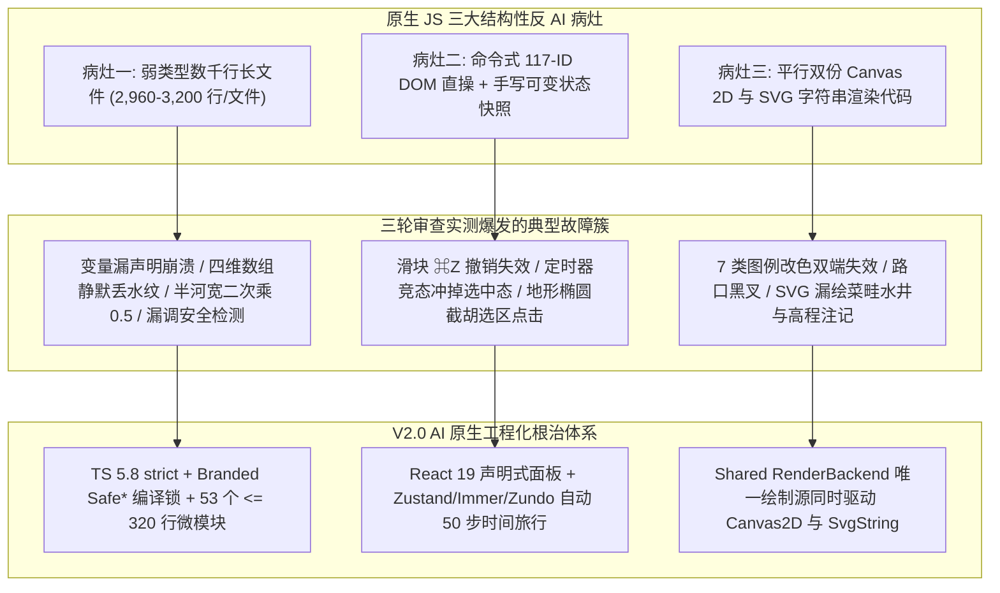

# Terrax Settlement Studio V2.0 — TypeScript 与 AI 原生工程化业务需求文档（BRD）

| 文档属性 | 规范内容 |
| :--- | :--- |
| **项目名称** | `Terrax Settlement Studio`（TERRAX 通用聚落可视化制图与受控抽卡工作台） |
| **文档版本** | `V2.0（TypeScript AI 原生工程化正式基线版）` |
| **演进前身** | `V1.2.2` 原生 JavaScript 终审通过版（`177/177` 无头断言 + `53/53` 独立对抗压测全绿，已冻结归档于 [../legacy_v1_js/README.md](../legacy_v1_js/README.md)） |
| **编制日期** | `2026-11-18` |
| **仓库落位** | `/Users/jrdamocles/code/TERRAX/settlement_studio/`（工程总览见 [../README.md](../README.md)） |
| **体系定位** | 与 `/worldbuilding/`（`Terrax Sky Studio` 天球历法端）并列的仓库级通用建世制图基础设施，专职填补地表 `300 m — 6,000 m` 聚落微观空间层 |
| **关联基线** | [02_PRD_V2_TypeScript架构与模块技术规格书.md](02_PRD_V2_TypeScript架构与模块技术规格书.md) · [03_V2_执行对照计划表与验收溯源矩阵.md](03_V2_执行对照计划表与验收溯源矩阵.md) · [04_V2_DeepSeek_V4.1_Flash_执行提示词.md](04_V2_DeepSeek_V4.1_Flash_执行提示词.md) · [../README.md](../README.md) · [../legacy_v1_js/README.md](../legacy_v1_js/README.md) |
| **目标实施方** | `deepseek v4.1 flash`（本文档锁定全部业务与架构目标 `V2-G01`—`V2-G07`、非目标边界 `NG-01`—`NG-04`、防呆矩阵 `V2-R01`—`V2-R06` 及一票否决硬门禁 `V2-BG-01`—`V2-BG-10`） |

> **核心定位与演进声明**：在 TERRAX 全尺度建世工具谱系中，`/worldbuilding/` 负责 `L0` 全天球星场、多体轨道星历与 103 星座划界（产出 `.worldsky`），`/地图/` 承载 `L1` 全行星 `3000 × 6000` 经纬格网（`0.06° ≈ 7.35 km`）高程、水系与政区通路数理底座，而 `/settlement_studio/` 专职填补 `L2` 聚落微观尺度（`300 m — 6,000 m` 图幅）的山水等高线控制、多边形选区受控抽卡、零穿模硬裁剪与出版级双端成图空白（产出 `.worldtown.json` 及高清 `PNG / SVG`）。在 V1.2.2 纯原生 JS 版本完成全部核心几何定型并通过三轮严苛对抗终审后，V2.0 正式启动 **TypeScript 5.8 + React 19 + Zustand/Zundo + Zod + Web Worker + Shared RenderBackend** 的 AI 原生工程化升级，将质量保障从「事后人工多轮抓回归」升级为「编译期静态锁死 + 微模块低熵隔离 + 同源双端唯一渲染源」。下游 [02_PRD_V2_TypeScript架构与模块技术规格书.md](02_PRD_V2_TypeScript架构与模块技术规格书.md)、[03_V2_执行对照计划表与验收溯源矩阵.md](03_V2_执行对照计划表与验收溯源矩阵.md) 与 [04_V2_DeepSeek_V4.1_Flash_执行提示词.md](04_V2_DeepSeek_V4.1_Flash_执行提示词.md) 均严格服从本文档确立的目标与硬门禁。

---

## 第一章 文档元信息、世界观定位传承与 V2.0 演进背景

### 1.1 TERRAX 四级空间谱系与核心业务场景沉淀

TERRAX 仓库在宏观地球物理推演（母星半径 `R = 7,016.8 km`、地表重力 `1.05g`、`1.18 atm`、`26` 地球小时平均太阳本地日）与逾二十五万字纪实方志文稿（《候选第六稿》、四卷 `16` 篇《待定故事集》`S01`—`S04`、四卷地方志与大国志 `G01`—`G04`）之间，依托 `Terrax Settlement Studio` 打通了 `L2` 聚落微观空间断层：

| 空间层级 | 典型物理跨度 | 仓库工具或数据载体 | 空间表达职责与上下游协同关系 |
| :--- | :--- | :--- | :--- |
| **L0 天球历法层** | 全天球视界 | `Terrax Sky Studio`（`/worldbuilding/`） | 双月七行星星历与星座历法，不涉地表聚落平面 |
| **L1 大陆政区层** | `100 km — 8,000 km` | `/地图/`（`lake_bed_dem.bin`、`*.npz`、`B政局_*.geojson`） | 单格 `0.06° ≈ 7.35 km`，向本工作台提供只读经纬度高程、坡向与河网初值 |
| **L2 聚落微观层** | **`300 m — 6,000 m`** | **`Terrax Settlement Studio`（`/settlement_studio/`）** | **河阶峡谷等高线编辑、纯净河渠正交桥、9 类选区秒级抽卡、22 类微缩图形图例成图** |
| **L3 室内器物层** | `0.1 m — 50 m` | 案卷白描与器物考据（老榆梁暗楔、水锤、木牍） | 属文字考据与单体插画范畴，不在城镇总平面图内展开 |

在 V1.2 阶段（参见归档基线 [../legacy_v1_js/docs/01_BRD_业务需求文档.md](../legacy_v1_js/docs/01_BRD_业务需求文档.md)），项目已完成四大核心业务场景验证并沉淀了三套可直接复用的世界观标杆聚落工程（保存于 `projects/*.worldtown.json`）：

1. **`UC-01` 三大重头方志与故事现场精准还原**：
   - **起点都城 `Lōsrūmūra`**（`42.51°E, 35.19°N`，基准高 `484 m`，图幅 `3,200 m`）：北接西北流向淡水支流 `R1966`（东关砂岩窄槽 `72 m` 至北埠回水湾 `160 m`），含东关分水堰饮污双渠、`+6 m` 砾基夯土内城 `walled_city`、三木合契议事厅与四仓 `citadel`、西坡换装道客舍街 `town_blocks`、南门灰粪柴市 `market` 及城外条垄农田 `farmland`，总计 `14` 个选区、近 `2,900` 栋沿街密排屋宇。
   - **长湖复市镇 `Simibihmāh / Qar-iq`**（`35.61°E, 28.53°N`，基准高 `424 m`，图幅 `2,600 m`）：东北临 `L6` 半咸水湖湾（`414 m`），西北设前 `405` 年黑石大疫界圈 `exclusion` 禁建选区（圈内严格零建筑、零耕作、零树木），西坡布设伊珂免税暗渠与 `45 m` 等距清淤竖井串，湖滨排布盐鱼互市坪 `market`、分级晒盐池 `saltpan` 与双片 `town_blocks`，总计 `11` 个选区、逾 `1,540` 栋建筑。
   - **帕隆双生铁寨**（`29.04°E, 14.58°N`，谷底约 `1,650 m`，图幅 `1,400 m`）：南北双非对称陡岭夹峙深切 V 形停战峡谷，中央急溪保持纯净无沙岛水面，仅在暗梁渡口显式安放 `7` 块花岗岩底礁（`reefs`），两岸窄阶地框绘 `village` 散居村寨（`maxSlopeDeg = 28°`，两侧陡崖自动零建房），错落生成顺坡农舍、虚线菜畦围栏与水力锻锤地标。
2. **`UC-02` 次级村镇与驿铺十分钟量产**：面向四卷志书数十处次级节点（如双井驿、苇口埠、沙坝城、汇口边镇、护商石驿），支持导入经纬度初值后在 `10 分钟` 内完成勾画山水干道、框选抽卡与导出成图。
3. **`UC-03` 案卷写作前空间步距、视线高差与春汛淹没推演**：依托公制比例尺、状态栏实时 `(X m, Y m, Z m, 坡度°)` 读数与等高线高程截断，精确核验涉案场所步行刻数、高台通视遮挡及涨水淹没线。
4. **`UC-04` 跨气候带四主题十二色槽换肤与双模出版导出**：支持经典暖羊皮纸、古志水墨（`gazetteer_ink` / `archival_parchment`）、寒海冷灰青（`boreal_slate`）、旱原砂岩（`arid_ochre`）一键换肤，分别导出含中文微缩图形图例正图与无字纯净底图（`1x / 2x / 3x PNG` 与独立分层 `SVG`）。

### 1.2 为什么在 V1.2.2 通过三轮终审后立即启动 V2.0 TypeScript 工程化升级

V1.2.2 原生 JS 版本历经「首轮双线对抗审计 -> 二轮回归复审 -> 三轮收口终审」，最终通过了内置无头套件 `177/177` 项断言与只读独立对抗脚本 `53/53` 项针对性压测，全部历史缺陷与二轮回归清零，且上层仓库三套核验脚本退出码全为 `0`。然而，恰恰是这三轮真刀真枪的开发与审计全过程，揭示出**零构建原生 JavaScript 架构在 AI 主导开发模式下已触及工程可维护性天花板**：

1. **大文件弱类型导致 AI「改东坏西」的边际成本急剧攀升**：V1.2 核心文件 `gacha_zone_engine.js` 膨胀至约 `2,960` 行、`app.js` 膨胀至约 `3,200` 行。没有静态类型系统守护，轻量高速模型（`deepseek v4.1 flash`）在二轮修复河道急弯自交时，仅因将一段循环粘贴到水渠函数而漏声明局部变量 `halfWidths`，便直接制造出新的 `ReferenceError` 运行时崩溃；在调整水路点击拾取时，仅因将地形椭圆挪前一行，便锁死了全城过半选区的鼠标点击。
2. **双份平行 Canvas / SVG 渲染代码构成永久性失步陷阱**：V1.2 将屏幕渲染（`canvas_renderer.js`）与矢量导出（`exporter.js`）分写为两套各自逾千行的独立过程式代码。任何一处制图规则调整（双遍路缘消黑叉、22 类图例自定义改色、虚线菜畦、集市水井、计曲线高程字、双线内图框缩放）都必须在两套异构 API 中手工同步两遍，极易遗漏。
3. **主线程同步重算与 117 个硬编码 DOM ID 制约交互上限**：全量地形、SDF 距离场与数千屋宇剖分均在主线程同步执行，大图幅复杂城池连续交互时挤占渲染帧预算；`index.html` 与 `app.js` 之间靠 `117` 个 DOM `id` 命令式手工绑事件与手写 JSON 字符串快照栈，滑块事件时序稍有偏差便导致撤销栈整体失效。
4. **最佳升级窗口已成熟**：此时核心数学模型（偏心椭圆等高线、跟手推拉高斯核、512² 双遍 Chamfer SDF + 全边段解析碰撞裁剪、有界 Lloyd Voronoi + OBB 沿街屋宇剖分、斜交全跨度正交桥）与三套 `.worldtown.json` 真实数据已完成 100% 终审验真。将 V1.2.2 原封冻结至 `legacy_v1_js/` 作为**黄金行为对拍基准（Golden Reference Oracle）**，同步构建面向 AI 最友好的 **V2.0 TypeScript 微模块工程体系**，能够将后续迭代的一次生成准确率、运行帧率与编译自检速度提升一个数量级。

---

## 第二章 V1.2 原生 JS 三轮开发与审查实证复盘（Empirical Post-Mortem）

本章基于 V1.2 首轮审计（留言板 `#120`、`#121`）、二轮回归复审（`#126`、`#127`）与三轮终审（`#131`）的真实实测证据，逐一复盘 `deepseek v4.1 flash` 在原生 JS 架构下真实踩过的 **7 项首轮 P0 阻断缺陷**与 **2 项二轮「打地鼠」回归缺陷**，提炼 V2.0 架构设计的第一手实证依据。

### 2.1 首轮对抗性审查暴露的 7 项真实 P0 缺陷深度复盘

| 缺陷编号 | 真实发生的 P0 缺陷现场与实测后果 | 原生 JS 工程病根剖析 | V2.0 TypeScript 架构级根治机制 |
| :--- | :--- | :--- | :--- |
| **`V1-P0-1`** | **`buildWallSystem` 城墙与道路求交 `rx / sx` 笔误**：求解城墙段 `R=(rx,ry)` 与道路段 `S=(sx,sy)` 交点参数分子误将 `sx` 写为 `rx`，且将全量敌台重复挂到每截断墙。导致《起点城》无路穿内城却隔空炸出 `20` 个幻影城门断口、SVG 重复叠画 `1,080` 个敌台圆；十字大道穿城压测碎成 `40` 段墙且仍有 `5` 段横拦马路。 | `2,960` 行巨型脚本内无结构化几何交点类型，单字母局部变量与下标 `[0]/[1]` 混写，底层求交未独立拆出单测。 | 抽离 `src/core/math/polygon.ts` 强类型纯函数 `intersectSegmentsExact` 并配 Vitest 专项单测；`wallBuilder.ts` 严格消费真实交点 `(sx, sy)` 弧长切分豁口，敌台按唯一墙段生成。 |
| **`V1-P0-2`** | **单区重抽 `rerollZoneSeed` 丢弃全局障碍场**：前端按 `R` 重抽单选区时传入 `{ withGrid: false }` 构造空 `ctx`（`grid = null`、`wallsBuilt = []`），导致跨河选区重抽单次将 `195—241` 棵树直接种入 `R1966` 深水河心、`77` 棵种上路心、`231` 棵种入禁建圈，邻区触发 `63` 处穿模红灯。 | 弱类型选项对象允许 `grid: null` 静默混入生成管线；局部重抽函数走捷径绕过了全局障碍场构建。 | `ObstacleContext` 类型强制要求非空 `ObstacleGrid`；`rerollZoneScene` 必须先从最新水路、城墙与禁建圈重建新鲜障碍场并载入邻区屋宇空间哈希，编译期杜绝空上下文调用。 |
| **`V1-P0-3`** | **`buildObstacleGrid` 对 `0.5 * halfWidth` 二次折半且漏填河面内部**：`river.halfWidths` 本已是半河宽，`buildObstacleGrid` 误再次乘以 `0.5` 缩为 `1/4` 河宽且未栅格化 `bankPolygon` 内部。`90 m` 大河深水区 `±38 m` 处竟返回 `+8.65 m` 安全净空，30 组全量压测把 `1,995` 棵树种进河道水面。 | 跨文件字段单位靠人脑记忆，无类型契约区分全宽与半宽；SDF 水体内部零值不变量缺乏模块级守卫。 | `BuiltRiver` 精确锁定 `readonly halfWidths: Float64Array`（严禁二次乘 `0.5`）；`obstacleSdf.ts` 强制对河、湖、渠多边形内部全栅格置零，单测直接断言深水与岸线净空恒为 `0`。 |
| **`V1-P0-4`** | **选区数组顺序导致房屋撞墙**：`compileAllZones` 单遍遍历选区时动态向 `wallsBuilt` 追加城墙。将 `[walled_city, market]` 翻转为 `[market, walled_city]`（模拟先画外坊集市、后画紧邻内城）时，集市生成尚不知城墙存在，当场爆出 `buildingWallHits = 24`。 | 单遍可变状态累加器将「全局刚性障碍提取」与「局部随机街坊生成」混耦合在同一遍历循环内。 | `compileScene.ts` 固化**两阶段全局城墙前置编译**：阶段一先遍历全图选区构建全部 `walled_city / citadel` 城墙并写入全局 SDF；阶段二再无序执行 9 类生成器，任意洗牌恒零撞墙。 |
| **`V1-P0-5`** | **河道贴岸水纹 `ripples` 误包成四维数组**：`buildBankRipple` 已返回三维折线数组 `Polyline[]`，外层汇总误写 `ripples.push(runs)` 而非展开 `push(...runs)`，产生四维数组 `number[][][][]`，致使《起点城》河道水纹在 Canvas 与 SVG 中 `100%` 静默消失（`<polyline>` 数为 `0`）。 | 原生 JS 对嵌套数组维度零静态检查，多套一层数组在运行时不报错，仅导致坐标解析失败静默漏绘。 | 强类型锁定 `type Vec2 = readonly [number, number]`、`type Polyline = ReadonlyArray<Vec2>`、`ripples: ReadonlyArray<Polyline>`；多包一层数组在 `tsc --noEmit` 下 `0.2 秒` 内直接红错阻断。 |
| **`V1-P0-6`** | **滑块撤销失效（`⌘Z` 100% 失灵）**：`app.js` 命令式 `bindRange` 在 `input` 事件中未调 `beginHistory()` 就先原地篡改 `state.project`，松手 `change` 再快照时前后 JSON 恒相等而被丢弃；且笔刷大小滑块误触发全图重编译。 | `3,200` 行命令式 DOM 操作 + 原地可变状态修改 + 手写快照时序，极易写反事件生命周期。 | 采用 `Zustand + Immer + Zundo` 自动不可变 `50` 步时间旅行；视图态经 `partialize` 自动隔离，拖拽开始/结束调 `pause() / resume()` 自动合并为单步撤销记录。 |
| **`V1-P0-7`** | **单遍道路交叉口「黑叉」与双端图例漏改色**：干道在同一循环逐条画深褐路缘与路面，后画路缘切穿先画路面形成十字黑叉；且 `canvas_renderer.js` 与 `exporter.js` 两套平行代码在 `7` 类内置图例中各自硬编码旧色，导致拾色器改色双端失效，菜畦、水井、高程字出现双端漏绘不一。 | 屏幕 Canvas 与导出 SVG 维护两套平行渲染代码，双倍维护面导致 AI 修改一处必漏另一处。 | 抽象唯一 `RenderBackend` 接口，`paintScene.ts`（含双遍道路与三步树冠）及 `paintLegendGlyph.ts`（入口统一计算 `main` 贯穿 22 类分支）**全局只写一遍**，同时驱动双端。 |

### 2.2 二轮修复引发的 2 项「打地鼠（Whack-a-Mole）」回归剖析

在 V1.2.1 二轮修复上述首轮缺陷时，尽管首轮问题大多得到修补，却在同一批改动中派生出 **2 项全新的阻断级 P0 回归**，成为原生 JS 结构性脆弱的最典型实证：

1. **`V1-Reg-1`：`buildCanalGeometry` 复制粘贴漏声明 `halfWidths` 触发运行时 `ReferenceError` 崩溃**
   - **回归现场**：开发者将 `hydro_road_engine.js` 中 `buildRiverGeometry` 的 6 轮急弯防蝴蝶结自交收窄代码直接粘贴进同文件的水渠函数 `buildCanalGeometry`（第 `529—577` 行），但水渠函数顶部仅声明了标量 `widthM / halfW`，从未声明 `halfWidths` 与 `widths` 数组。在常规直线水渠自测中未进入自交修复分支而侥幸蒙混过关；一旦用户绘制 `90° / 150°` 急折角明渠或暗渠，第 `556` 行当场抛出 `ReferenceError: halfWidths is not defined`，中断全图编译并令水渠顶点拖拽连续抛未捕获异常。
   - **根因诊断**：JavaScript 在未执行到的条件分支内对未声明标识符零感知；而在 V2.0 的 `TypeScript 5.8 strict` + `Biome correctness.noUndeclaredVariables: "error"` 双重静态门禁下，此类错误在代码落盘后 `0.2 秒` 内即被 `100%` 捕获，根本不可能流入运行时。
2. **`V1-Reg-2`：`hitObject` 将底层巨型地形椭圆 `shape` 排在 `zone` 之前锁死全城点击**
   - **回归现场**：首轮指出面状 `zone` 遮挡了内部穿过的道路与水渠点击；二轮修改 `app.js:hitObject` 拾取顺序时，开发者顺手把平时不可见的底层巨型地形高程椭圆 `hitShape`（如《起点城》`1960 × 1440 m` 的台地椭圆）也排到了 `hitZoneAt` 之前。结果在默认选择工具（`V`）下点击画布，《起点城》`8/14` 个核心城坊选区、《长湖》`6/11` 个选区被底层地形椭圆 `100%` 截胡抢走焦点，用户完全点不中内城，无法弹出重抽胶囊或按 `R` 重抽。
   - **根因诊断**：`3,200` 行 `app.js` 混杂了工具状态机、拾取几何与 DOM 面板更新，缺乏独立的拾取优先级契约模块与自动化点击回归守卫。V2.0 将拾取逻辑独立封装为 `src/core/hitTest.ts`（`< 200` 行），以强类型枚举锁死九级拾取次序（确保 `zone` 恒优先于 `terrainShape`），并在 `renderer-and-ui-parity.test.ts` 中固化三套预置全部 `30` 个选区重心 `100%` 命中的回归断言。

### 2.3 原生 JS 架构对 AI 模型的三大结构性不友好病灶总结

---

## 第三章 技术栈选型论证（Framework & Toolchain Matrix）

针对本工作台**「`60 — 120 FPS` 高频交互 2D 矢量制图画布 ＋ `deepseek v4.1 flash` 等大模型高准确率编写与长期演进」**的双重核心诉求，本章对当前四大主流前端 TypeScript 技术栈及配套工程工具链展开横向对比论证。

### 3.1 前端视图与状态管理技术栈四维横评矩阵

| 候选技术栈组合 | AI 一次准确率与语料生态 | `60—120 FPS` 高频图形画布性能契合度 | 状态不可变性与时间旅行成本 | 针对 AI 编码的隐蔽陷阱与选型结论 |
| :--- | :--- | :--- | :--- | :--- |
| **`React 19` + `TS 5.8 (strict)` + `Vite 6` + `Zustand 5 (immer + zundo)` + `Zod` + `Tailwind v4`** | **S 级（最高）**：全网与主流大模型训练语料占比绝对第一；函数组件 Props 契约纯正，Tailwind 原子类内聚于同文件 JSX，彻底消除跨文件 CSS 选择器失配与 `117` 个 DOM ID 拼写错误。 | **S 级（动静分离极致契合）**：React 仅接管低频外框面板（顶栏、工具坞、属性卡、弹窗）；中央 `<CanvasStage>` 以 `useRef` + `useStudioStore.subscribe` 搭配 **Web Worker** 独立运行，高频平移缩放、推拉与笔刷全程**零 React 重渲染开销**。 | **极低成本且编译期安全**：`Zod` 单一事实源自动推导类型与校验；`Zustand + Immer + Zundo` 原生支持 `50` 步切片级自动撤销栈与拖拽 `pause/resume` 合并。 | **无结构性暗坑 —— 锁定为 V2.0 唯一正式技术栈（黄金解）**。 |
| **`Vue 3 (<script setup lang="ts">)` + `Pinia` + `Vite`** | **A 级（较高）**：单文件组件模板清晰，但模板隐式解包 `Ref` 与脚本区 `.value` 规则仍偶发 AI 漏写。 | **B 级（存在致命深层 Proxy 陷阱）**：Vue 3 默认对状态内的对象与嵌套数组做递归深层 `Proxy` 响应式劫持。面对单场景 `2,800+` 栋多边形建筑、数万折线顶点及 `Float32Array(66049)` 高程栅格，AI 一旦在任一分支漏标 `shallowRef / markRaw`，拖拽与重抽帧率将断崖暴跌。 | Pinia 无官方轻量不可变切片时间旅行标准件，常需手写深拷贝快照栈，易重蹈 V1.2 时序覆写覆辙。 | **性能防呆脆弱 —— 淘汰**（对高频几何大数组极易因漏写 `markRaw` 引发严重卡顿）。 |
| **`Svelte 5 (Runes)` + `TypeScript`** | **C 级（偏低）**：正处于 Svelte 4（`export let`、\$: 响应式语句、store）向 Svelte 5 Runes（\$state、\$derived、\$props、\$effect）剧烈代际切换期，大模型语料新旧混杂，极易生成混合语法导致编译红错。 | **A 级**：无虚拟 DOM 开销，但 Svelte 5 的 \$state 同样默认对普通数组与对象启用深层信号代理（Deep State Proxy），大几何数组仍需手动改用 \$state.raw。 | 需手写自定义 Runes 历史栈，AI 易在 \$effect 副作用追踪中写出死循环。 | **语料混淆率高 —— 淘汰**（不适合交给轻量高速模型零返工交付）。 |
| **`SolidJS` + `TypeScript`** | **C 级（偏低）**：语法外观酷似 React JSX，但严禁对组件 `props` 进行对象解构、严禁在早返回分支外丢失 getter 上下文。AI 受海量 React 语料惯性影响，极易习惯性写出 `({ zone }) => ...` 导致响应式静默失效。 | **A 级**：细粒度信号更新开销极低。 | 生态较小，缺乏成熟的 TypeScript 严格泛型时间旅行中间件标准方案。 | **解构静默丢响应 —— 淘汰**（产生的界面数值不刷新 Bug 极难静态检出）。 |

### 3.2 配套构建、质量门禁与后端工具链选型论证

1. **构建与模块引擎（`Vite 6` + `pnpm 9 / npm` 双兼容）**：
   - 原生支持 TypeScript 5.8、React Fast Refresh、`@tailwindcss/vite` 零配置文件接入，以及标准 ES Module Web Worker（`new Worker(new URL('./compiler.worker.ts', import.meta.url), { type: 'module' })`）打包；生产构建 `vite build` 直接产出可由本地 `server.py` 托管的纯净静态 `dist/` 目录。
2. **毫秒级静态门禁与测试铁三角（`tsc` + `Biome 1.9.4` + `Vitest 3`）**：
   - 摒弃配置繁琐、启动缓慢且插件版本易冲突的 `ESLint + Prettier`，采用 Rust 原生单二进制 `@biomejs/biome@1.9.4`（毫秒级阻断 `any` 与未声明变量）配合 `tsc --noEmit`（全量类型与品牌防穿模锁核验）与 `Vitest 3`（Node 原生秒级运行核心数学、防穿模压测与双端渲染对拍）。AI 每完成一个里程碑，仅需运行一条 `npm run check`，数秒内即可完成全链路静态与几何自动化核验。
3. **本地持久化与 TERRAX 科学栅格桥接服务（类型化 Python 3 `server.py`）**：
   - 直接复用仓库现成 `/Users/jrdamocles/code/TERRAX/worldbuilding/venv/bin/python3`（内置 `numpy`），以 Python `typing` 全量类型注解重构单文件 `server.py`：既负责托管 `dist/` 生产前端与 `projects/*.worldtown.json` 多线程原子持久化（`mkstemp + fsync + replace`），又以 `np.memmap(..., mode="r")` 只读方式毫秒级切片读取 `/地图/lake_bed_dem.bin`、`global_owner.npz`、`map_lake_mask.npz` 与 `rendered_centerlines.npz`，避免在前端工具链引入任何笨重的 C++ 原生 Node 编译依赖。

---

## 第四章 七大核心业务与架构目标（`V2-G01` — `V2-G07`）

V2.0 确立 **7 项核心业务与架构目标**，完整覆盖工程可靠性、几何正确性、AI 可维护性、双端同源渲染、高频交互体验、建世业务美学与仓库资产兼容，并与下游 `02_PRD_V2` 模块及第 7 章十大硬门禁严格双向绑定：

| 目标编号 | V2.0 核心业务与架构目标 | 承接 V1.2 目标 | 对应 `02_PRD_V2` 里程碑 | 绑定验收硬门禁 |
| :--- | :--- | :--- | :--- | :--- |
| **`V2-G01`** | **编译期静态安全与零未定义崩溃** | 工程底座升级 | `M0`（脚手架与 Schema） | `V2-BG-01`、`V2-BG-09` |
| **`V2-G02`** | **类型级物理防穿模与纯净水文锁** | `BRD-G02`、`BRD-G03` | `M1`、`M2`、`M3` | `V2-BG-02`、`V2-BG-05` |
| **`V2-G03`** | **AI 友好的 50 级微模块上下文架构（53 个 `.ts/.tsx` `<= 320` 行）** | 工程可演进升级 | `M0` — `M6` 全域 | `V2-BG-03` |
| **`V2-G04`** | **同源双端渲染引擎（Shared `RenderBackend`）** | `BRD-G04`、`BRD-G05` | `M4`（同源渲染导出） | `V2-BG-04` |
| **`V2-G05`** | **动静分离 `60—120 FPS` 交互与时间旅行状态机** | `BRD-G01` | `M0`、`M3`、`M5` | `V2-BG-06`、`V2-BG-07` |
| **`V2-G06`** | **完整保留并精进全部业务能力与浅色纸本测绘美学** | `BRD-G01`—`BRD-G05` | `M1` — `M5` 全域 | `V2-BG-05`、`V2-BG-06`、`V2-BG-08` |
| **`V2-G07`** | **100% 资产向下兼容与仓库零侵入** | `BRD-G06` | `M0`、`M6` | `V2-BG-09`、`V2-BG-10` |

### 4.1 `V2-G01`：编译期静态安全与零未定义崩溃

- **严格编译器契约**：`tsconfig.json` 强制开启 `strict: true`、`noUncheckedIndexedAccess: true`（数组下标与字典索引访问自动收窄为 `T | undefined`，从根源上消灭越界读取产生静默 `NaN`）、`noFallthroughCasesInSwitch: true` 与 `isolatedModules: true`（注：刻意不启用 `exactOptionalPropertyTypes`，以保证 `Zod` `z.infer` 推导类型与 React 19 可选组件 Props 零摩擦兼容）。
- **毫秒级静态禁令门禁**：配置 `@biomejs/biome@1.9.4`，将 `suspicious.noExplicitAny: "error"` 与 `correctness.noUndeclaredVariables: "error"` 设为硬性阻断错误，且全仓严禁使用 `Math.random()`（全部伪随机序列必须由 `src/core/math/rng.ts` 确定性种子发生器产出）。
- **Zod 单一事实源（Single Source of Truth）**：在 `src/schema/`（`geometry.types.ts`、`palette.schema.ts`、`legend.schema.ts`、`project.schema.ts`）中用 `Zod` 统一声明 `.worldtown.json` 的全部数据结构、边界约束与旧版兼容归一化逻辑，通过 `z.infer<typeof TownProjectSchema>` 自动导出全套 TypeScript 静态类型，杜绝手工维护双份 Schema 与 Interface 产生的字段漂移。

### 4.2 `V2-G02`：类型级物理防穿模与纯净水文锁

- **品牌不透明类型防穿模锁（Branded Opaque Types）**：在 `src/core/obstacles/guardSafe.ts` 中定义携带私有 `unique symbol` 品牌标记的 `SafeBuilding`、`SafeFence` 与 `SafeTree` 类型。编译结果场景中的所有屋宇、村寨菜畦围栏与林木数组仅接受上述 `Safe*` 类型，全局唯有三个守门函数 `guardSafeBuilding`、`guardSafeFence`、`guardSafeTree` 有权铸造该类型。守门函数内部强制串行执行：
  1. **阶段一（`512×512` 双遍 Chamfer SDF 极速初筛）**：水体（河岸多边形、湖海、明渠）内部全栅格强制置零，严禁对 `river.halfWidths` 二次乘 `0.5`；
  2. **阶段二（全顶点 + 边中点 + 全边段精确解析距离复检）**：强制满足河湖水岸退界 `>= 8.0 m`、水渠退界 `>= 0.5 * widthM + 4.0 m`、主次干道退界 `>= 0.5 * widthM + 2.5 m`、城墙退界 `>= 0.5 * wallThicknessM + 3.0 m`、邻屋净距 `>= 0.8 m`、`exclusionPolys` 禁建多边形零侵入（同时覆盖屋宇、农田、盐池、菜畦与树木）、地表坡度 `<= maxSlopeDeg`（屋宇未过检时支持中心 `0.82` 比例收缩二次挽救）。任何选区生成器若遗漏调用守门函数，TypeScript 编译器直接拒绝通过。
- **两阶段全局城墙前置编译（Two-Phase Global Wall Pre-Compilation）**：`src/core/compileScene.ts` 架构级固化两阶段管线——阶段一先遍历全图全部选区，统一调用 `wallBuilder.ts`（严格按真实线段交点 `(sx, sy)` 切分城门豁口）构建所有 `walled_city` 与 `citadel` 城垣并注入全局 `ObstacleGrid`；阶段二在完整全局刚性障碍场下分发执行 9 类选区生成器，彻底消除因用户创建选区先后顺序不同导致的房屋撞墙。
- **纯净水文与斜交修正正交桥锁**：`riverCanal.ts` 锁死河流几何 `islands: readonly never[]` 恒为空数组 `[]`（严禁随机生成河心小沙岛，水中岩体仅由显式 `project.reefs` 生成），河流与明暗水渠均显式声明 `Float64Array` `halfWidths` 执行急折弯防蝴蝶结自交夹紧，贴岸水纹严格锁定三维类型 `ReadonlyArray<Polyline>`；`reefRoadBridge.ts` 跨水正交桥梁采用**斜交全跨度修正公式** `bridgeLength = (riverWidth + 8.0 + (roadWidth + 3.0) * cosAlpha) / Math.max(0.35, sinAlpha)`（豁免 `fords` 浅滩渡口并做 `35 m` 邻近去重），确保任意斜交角度下桥面四个角点 `100%` 稳落两岸干陆。

### 4.3 `V2-G03`：AI 友好的微模块上下文架构

- **50 级高内聚微模块架构（精确锁定 `src/` 下 `53` 个 `.ts/.tsx` 微模块）与硬行数红线**：将工程源码精确规划为 `src/` 下 **`53` 个职责单一的 `.ts / .tsx` 微模块**（另含 `1` 个 `src/styles/atelier.css`，外加 `5` 个 `tests/` 自动化验证套件与类型化 `server.py`）。每个 `.ts / .tsx` 文件设计目标控制在 **`100 — 300` 行**，物理行数硬上限严格锁定为 **`<= 320` 行**。
- **9 类选区生成器完全解耦**：将 `walled_city`（`walledCity.ts`）、`town_blocks`（`townBlocks.ts`）、`village`（`village.ts`）、`citadel`（`citadel.ts`）、`market`（`market.ts`）、`farmland`（`farmland.ts`）、`saltpan`（`saltpan.ts`）、`woodland`（`woodland.ts`）以及城墙系统（`wallBuilder.ts`）拆分为各自约 `120 — 260` 行的独立模块（`exclusion` 禁建选区由全局障碍预提取与编辑态提示层处理）。AI 修改任一类选区或日后扩展第 `10` 种选区（如梯田茶园、船坞水寨），仅需读写单个独立文件并在 `compileScene.ts` 注册一行分发映射，上下文消耗极低且对其他模块零耦合。

### 4.4 `V2-G04`：同源双端渲染引擎（Shared `RenderBackend`）

- **唯一绘制逻辑源**：定义平台无关的 `src/renderer/RenderBackend.ts` 接口，由 `src/renderer/paintScene.ts`（地图 `14` 层画家算法）与 `src/renderer/paintLegendGlyph.ts`（`14` 类内置 + `8` 类自定义共 `22` 类微缩真图形图例）作为**全局唯一绘制源**，同时驱动屏幕交互/高清 PNG 离屏位图后端 `Canvas2DBackend.ts` 与无损分层矢量后端 `SvgStringBackend.ts`。
- **核心制图细节同源锁死**：
  1. **第 7 层双遍道路融合**：先遍历全量主次干道、内部支巷与村径绘制 Pass 1 深褐路缘 `roadCasing`，再遍历全量道路绘制 Pass 2 亮米白路面 `roadFill`，彻底根除交叉口「黑叉」割裂；
  2. **第 11 层三步融合树冠**：通过 `drawCirclesMergedPass` 依次执行「全量东南微阴影 -> 全量 `r + 1.8 m` 深绿外扩墨边圆 -> 全量 `r` 无描边叶绿圆」三独立遍，呈现树丛内部零重叠杂线的纯正手绘云朵状树冠；
  3. **22 类微缩图形图例 100% 响应改色**：`paintLegendGlyph.ts` 在入口统一求值 `const main = itemColorOverride?.trim() ? itemColorOverride : defaultColor` 并强制贯穿全部 `22` 个绘制分支，严禁在任何分支硬编码颜色字面量；
  4. **四角图饰智能包络避让**：`furnitureLayout.ts` 精确计算左上标题牌匾、右上指北针、左下公制比例尺与右下视口浮动工具胶囊的像素包络框，确保图例框在 `top-left / top-right / bottom-left / bottom-right` 四角切换时 `100%` 零遮挡重叠。

### 4.5 `V2-G05`：动静分离 `60—120 FPS` 交互与时间旅行状态机

- **Web Worker 后台异步编译与双模降级**：`src/worker/compiler.worker.ts` 与 `src/worker/sceneCompilerClient.ts` 将高程场合成、Marching Squares、水路求交、SDF 距离场及 Voronoi 街坊生成移出主线程，通过递增序列号 `requestId` 实现「最新请求优先、自动丢弃过期帧」；在 Vitest / Node 无 `Worker` 环境下自动透明降级为同步函数调用，保证生产丝滑与无头测试双全。
- **零 React 重渲染高频视口**：`<CanvasStage>` 通过 `useRef` 直接操控 HiDPI `<canvas>`（精确对齐 `devicePixelRatio` 逻辑像素换算）并通过 `useStudioStore.subscribe` 订阅数据变化，React 19 仅在低频选中对象切换或面板表单编辑时更新 DOM，保障画布平移、光标不动点缩放、等高线实时推拉与笔刷涂抹稳守 `60 — 120 FPS`。
- **Zundo 50 步不可变时间旅行**：`src/store/useStudioStore.ts` 通过 `temporal(immer(...), { limit: 50, partialize })` 自动维护 `project` 的 `50` 步撤销/重做栈（执行 `undo / redo` 时保持当前镜头 `zoom / pan` 不跳变），并提供 `beginContinuousEdit()` 与 `endContinuousEdit()`（封装 `pause()` / `resume()`）将滑块连续拖动、顶点拖拽、等高线推拉及单笔涂抹收敛为原子单步历史。

### 4.6 `V2-G06`：完整保留并精进全部业务能力与浅色纸本测绘美学

- **全量业务能力无损继承与精进**：完整覆盖全域高程参数与 `[minContourElev, maxContourElev]` 区间截断、偏心椭圆山包（二次正根核控制哪侧等高线密哪侧疏且峰顶一阶导数为零无尖刺）与山脊/冲沟/陡坎左右独立坡宽、鼠标按住等高线跟手拖拽推拉（路径子步细分 + 梯度自适应限幅 + 余弦归零高斯核，零 8 字自交）与四支高程笔刷（`raise / lower / smooth / flatten` + `Alt` 海拔吸管）、100% 清零蝌蚪尖刺纹（`showScarpTicks` 默认关闭，开启时仅绘 `4.0 m` 下坡向垂直细短齿线）、多边形选区 `9` 类内容 `< 80 ms` 新鲜障碍场独立重抽与加锁、拾取优先级锁定 `zone` 排在 `terrainShape` 之前、自定义图例未盖章时恒保持 `autoPresent = true` 显示。
- **地图内部 Watabou 城村统一质感 + 外框全新浅色纸本测绘工坊 UI**：
  - 图面内部延续 Watabou 经典暖灰绿羊皮纸钢笔淡彩质感（密排沿街屋宇东南微阴影、留白亮色街巷、平行裁剪耕垄、分级盐畦），实现都城、市镇与高山村寨视觉规则 `100%` 统一，支持 `4` 套主题（含方志别名映射）与 `12` 色槽自定义调色；
  - 软件外框 UI 基于 `Tailwind CSS v4`（`@theme` 令牌化）全新独立打造**「浅色纸本测绘工坊（Light Cartographer's Atelier）」**（暖亚麻工作台底 `#f4f1ea`、象牙卡纸面板 `#faf8f3`、羊皮纸次级底 `#efeae0`、黄铜描边细框 `#d5cdbd`、古墨主字 `#2b2620`、松针绿主强调色 `#365942`、陶土红选中/警示色 `#b55838` 及完整支持 `ā ē ī ō ū` 长音符的衬线/无衬线字体栈），**严禁照搬或混用 `/worldbuilding/` 暗黑星空深色界面样式**。

### 4.7 `V2-G07`：100% 资产向下兼容与仓库零侵入

- **既有 `.worldtown.json` 100% 无损兼容**：`project.schema.ts` 与 `normalizeProject` 原生兼容 V1.2.2 已交付的三套标杆工程文件（`projects/起点城_Losrumura.worldtown.json`、`projects/长湖_复市镇.worldtown.json`、`projects/帕隆_峡谷铁寨.worldtown.json`），完整解析 `sculptDeltaB64`（兼容旧别名 `sculptDeltaBase64` / `sculptDelta`）高程微雕增量、自定义色板、自定义图例及地标旁注，往返导入导出零信息丢失。
- **黄金对拍基准保留与仓库零侵入**：`legacy_v1_js/` 作为冻结只读的 V1.2.2 黄金参考基准永久保留于 `settlement_studio/legacy_v1_js/` 内；V2.0 全部新增或变更文件 `100%` 收敛于 `/Users/jrdamocles/code/TERRAX/settlement_studio/` 内，对 `/地图/` 下科学栅格文件严格只读，绝不触碰 `/worldbuilding/` 或 `/候选工作区/` 下任何文件。

---

## 第五章 非目标与范围克制边界（`NG-01` — `NG-04`）

为确保工程复杂度高度可控、核心抽卡制图工作流纯粹高效，V2.0 明确划定以下 **4 条刚性非目标红线（Non-Goals）**，实施过程中严禁越界扩写：

- **`NG-01`：【核心交互红线】严禁实现单栋房屋的手动新建、点选、拖拽、旋转或删除**
  - **克制依据**：单座市镇或都城动辄包含 `1,500 — 3,000` 栋密排屋宇。若引入单栋建筑级手工 CRUD、顶点编辑或自由拖拽旋转，将迫使拾取树、Zundo 快照负载与实时碰撞裁剪退化为重型 CAD 软件，彻底破坏「山水干道定骨架 -> 多边形选区定边界 -> Seed 秒级受控抽卡出有机街坊」的高效范式。局部空间定制统一通过**编辑多边形选区顶点、划定 `exclusion` 禁建留白切口、单设 `citadel` 大院选区、加盖 `landmarks` 地标符号以及单选区 `< 80 ms` 独立重抽与锁定**完成；工具栏与检视器中严禁出现任何单栋房屋编辑工具。
- **`NG-02`：不引入重量级 WebGL / Three.js 3D 引擎或重型 GIS 地图库**
  - **克制依据**：严守二维正射纸本钢笔淡彩矢量测绘定位，不构建三维建筑白模或透视漫游视口，不引入 `Three.js`、`Babylon.js`、`Mapbox GL`、`Leaflet`、`OpenLayers` 等重型第三方图形或瓦片地图库，亦不引入不可控的随机粒子水力侵蚀仿真。
- **`NG-03`：不接入云端数据库、远程服务端架构或多用户协同鉴权**
  - **克制依据**：坚持单机本地优先（Local-First）文件资产工作流，聚落工程唯一持久化格式为本地结构化 `.worldtown.json`；后端仅保留单一轻量级、零外部框架依赖的类型化 Python 标准库 HTTP 服务 `server.py`（托管静态 `dist/`、本地 `projects/` 原子读写、只读桥接本地 TERRAX 地理栅格），不引入任何数据库、用户登录鉴权或云同步服务。
- **`NG-04`：绝不写入或污染 `settlement_studio/` 以外的任何 TERRAX 目录**
  - **克制依据**：严格遵守仓库级物理隔离边界，严禁在 `/Users/jrdamocles/code/TERRAX/` 根目录、`/地图/`、`/worldbuilding/` 或 `/候选工作区/` 下新建、修改文件或残留 `.pyc / __pycache__` 缓存，确保上层文稿、故事集与方志集核验脚本 `100%` 零受扰。

---

## 第六章 面向 `deepseek v4.1 flash` 的六大工程风险与防呆矩阵（`V2-R01` — `V2-R06`）

结合轻量高速模型 `deepseek v4.1 flash` 在现代前端工具链配置、高阶泛型推导、无头测试环境差异及复杂几何边界上的典型行为特征，制定以下 **6 项工程风险与硬性防呆锁矩阵**：

| 风险编号 | 面向 `deepseek v4.1 flash` 的潜在工程风险 | 触发机理与故障后果 | 规格级硬性防呆规避约束（已在 `02_PRD_V2` 逐字锁死） |
| :--- | :--- | :--- | :--- |
| **`V2-R01`** | **Corepack 交互确认提示挂起非交互终端** | `package.json` 含 `packageManager` 字段时，Node v22 Corepack 首次运行 `pnpm` 可能弹出 `[Y/n]` 交互下载确认，永久卡死自动化命令行。 | 安装命令统一强制前置 `COREPACK_ENABLE_DOWNLOAD_PROMPT=0 pnpm install`（受限环境支持无缝回退 `npm install`）；`.npmrc` 设 `strict-peer-dependencies=false`；`package.json` 的 `scripts` 内部直接调用 `tsc / biome / vitest / vite`，确保 `npm run check` 与 `pnpm check` 双通。 |
| **`V2-R02`** | **Tailwind CSS v4 与 v3 旧版语法混写** | 大模型预训练语料以 Tailwind v3 为主，极易惯性生成 `tailwind.config.js` 或 `@tailwind base/components/utilities;` 导致 v4 编译报错或浅色主题样式全丢。 | 在 `02_PRD_V2` 逐字锁死 `vite.config.ts`（接入 `@tailwindcss/vite` 的 `tailwindcss()` 插件）与 `src/styles/atelier.css`（唯一入口 `@import "tailwindcss";` + `@theme { ... }` 令牌），**明令禁止新建 `tailwind.config.js` 或 `postcss.config.js`**。 |
| **`V2-R03`** | **Zundo 泛型中间件签名推导失败** | `Zustand 5` 嵌套 `temporal(immer(...), { partialize })` 时，若未显式声明历史切片配置泛型而直接内联 `partialize`，TS `strict` 会报复杂高阶中间件类型不匹配，诱使模型写 `any` 破门禁。 | 在 `02_PRD_V2` 第 3.6 节直接提供经静态验证的 `useStudioStore.ts` **逐字精确泛型配置范式**（显式锁定 `ZundoOptions<StudioState, StudioHistorySlice>`，其中 `StudioHistorySlice = Pick<StudioState, 'project'>`，并封装 `pause / resume` 拖拽合并），免除模型自行推导高阶中间件类型。 |
| **`V2-R04`** | **Biome 格式化风格误杀阻断质量门禁** | 若门禁跑 `biome check`，代码缩进、单双引号或行宽折行细微风格差异会导致逻辑完全正确的代码退出码非零，引发无意义返工；或模型捏造不存在的 Biome 规则名。 | 逐字锁死经 `@biomejs/biome@1.9.4` 实测合法的 `biome.json`；将**门禁检查与代码美化分离**——`npm run check` 仅串跑 `biome lint src tests`（严抓 `noExplicitAny`、`noUndeclaredVariables` 等真实缺陷），格式化独立为 `npm run format`（`biome format --write src tests`）。 |
| **`V2-R05`** | **Web Worker 在 Vitest Node 环境抛未定义异常** | 浏览器使用 `new Worker(new URL(...), { type: 'module' })`，但 Vitest（`environment: 'node'`）无全局 `Worker` 类，直接调用会导致全套单元测试崩溃。 | 在 `src/worker/sceneCompilerClient.ts` 强制实现**双模透明客户端**：运行时检测 `typeof Worker === 'undefined'` 时自动降级直接同步调用 `compileSettlementScene` / `rerollZoneScene`，浏览器环境走带 `requestId` 去重的异步 Worker 通道。 |
| **`V2-R06`** | **V1.2.2 历史 8 大几何与渲染深坑在重写时回归** | 重写 `src/` 下 53 个 TS/TSX 微模块时，若未对照历史踩坑点，极易重现城墙 `rx/sx` 笔误、水渠漏 `halfWidths`、半河宽二次折半、斜交桥角泡水、地形椭圆截胡点击等旧疾。 | 保留 `legacy_v1_js/` 作只读对拍参考，在 `02_PRD_V2` 附录专设**《V1.2.2 历史八大易错陷阱防回归速查表》**，并将全部 8 项边界条件写入 `tests/*.test.ts` 作为一票否决回归断言。 |

---

## 第七章 十大一票否决验收硬门禁（`V2-BG-01` — `V2-BG-10`）

V2.0 工程交付实行**十大硬门禁一票否决制**。`deepseek v4.1 flash` 完成全部里程碑编码后，以下 **`V2-BG-01` 至 `V2-BG-10`** 每一道门禁的量化判据必须 `100%` 实测达标方可准予验收收口：

1. **`V2-BG-01`：TS 零错误与零 `any` / 零 `Math.random` 门禁**
   - `tsc --noEmit`（`strict: true` + `noUncheckedIndexedAccess: true`）类型检查退出码为 `0`（错误数 `= 0`）；`biome lint src tests` 退出码为 `0`；`src/` 下显式 `any`、`@ts-ignore`、`@ts-expect-error`、`TODO`、`FIXME` 及 `src/core/` 下 `Math.random(` 命中数严格等于 **`0`**（`tests/` 同样严禁显式 `any`、`@ts-ignore`、`TODO`、`FIXME`，仅允许在品牌类型编译锁负向单测中使用 `@ts-expect-error`）。
2. **`V2-BG-02`：Branded `Safe*` 编译期防穿模锁与零碰撞审计全绿门禁**
   - 场景输出中的建筑、菜畦围栏与树木严格采用品牌不透明类型 `SafeBuilding`、`SafeFence`、`SafeTree`，仅能经由 `guardSafe.ts` 唯一守门函数构造；在三套预置工程及极端弯曲大河、斜交双干道、急折角明暗渠、城垣、陡坡（`> 28°`）、凹多边形选区与 `exclusion` 禁建圈压测场下（含选区随机逆序洗牌及 `30+` 组随机种子全量编译与单区重抽），`verifyZeroCollisions` 审计的屋宇对路/水/墙/禁建/邻屋碰撞数、菜畦越界压路入水数、树木入水压路入禁建圈数 **`100%` 恒等于 `0`**。
3. **`V2-BG-03`：单文件微模块行数门禁（`src/` 下全部 `.ts/.tsx` `<= 320` 行）**
   - `src/` 目录下全部 `53` 个 `.ts / .tsx` 微模块（另含 `1` 个 `atelier.css`）结构完整、职责正交，常规模块行数落在 `100 — 300` 行设计区间，且**全目录任意单个 `.ts / .tsx` 文件总行数严格 `<= 320` 行（超限文件数 `= 0`）**；`9` 类选区生成器完全独立分文件实现。
4. **`V2-BG-04`：Shared `RenderBackend` Canvas/SVG 100% 同源一致性门禁**
   - `Canvas2DBackend` 与 `SvgStringBackend` `100%` 共用唯一 `paintScene.ts`（14 层画家算法）与 `paintLegendGlyph.ts`（22 类微缩真图形图例），零平行重复绘制逻辑；实测验证：① 第 7 层道路严格分 Pass 1 全量路缘 `roadCasing` 与 Pass 2 全量路面 `roadFill` 双遍绘制，路口零「黑叉」；② 第 11 层树冠严格执行「阴影 -> `r+1.8m` 墨线圆 -> `r` 叶面圆」三步融合，树丛内部零杂线；③ 全部 `22` 类微缩真图形图例（14 内置 + 8 自定义）赋自定义色后在 Canvas 与 SVG 双端 **`22/22`（100%）** 同步响应变色，未盖章 `isCustom` 图例重编译后恒保持显示；④ 图例切换四角停靠时与标题牌、指北针、比例尺、浮动视口胶囊包络框 **`100%` 零重叠**；⑤ 等高线层 **`100%` 零蝌蚪尖刺纹**（开启 `showScarpTicks` 时仅绘 `4.0 m` 下坡垂直细短线）。
5. **`V2-BG-05`：纯净水文（`islands` 恒空、折角防蝴蝶结）与可控等高线门禁**
   - 河流几何 `islands` 类型锁定 `readonly never[]` 且运行时恒为空数组 `[]`（`project.reefs` 为空时水中零孤岛，仅显式放置 `reefs` 时生成岩礁簇并同步图例）；河流与明暗水渠（均显式声明 `Float64Array` `halfWidths`）在 `90° / 120° / 150°` 急折弯及 Z 字弯压测下零异常、零蝴蝶结自交，贴岸水纹严格为三维折线集 `ReadonlyArray<Polyline>`；跨水正交桥夹角偏差 `<= 1°` 且按斜交全跨度公式确保 **`4` 个桥角 `100%` 稳落岸上干陆**；等高线截断、偏心椭圆疏密焦点与左右坡宽平滑无峰顶尖角，Marching Squares 拼接连续长折线（`<= 2` 点碎线段 `= 0`），连续 `100` 次推拉与四支笔刷（`raise / lower / smooth / flatten`）混合微雕零 `NaN / Infinity`、零同层自交、零跨层相交，单次重提耗时 `< 35 ms`。
6. **`V2-BG-06`：9 类选区 `< 80 ms` 新鲜障碍场重抽、`zone` 点击优先于 `terrainShape` 与严守 `NG-01` 门禁**
   - 全部 `9` 类 `ZoneContentType` 正常产出高质量有机几何（坊巷选区真实运行 2 轮有界 Lloyd Voronoi + 半平面防自交内缩 + OBB 沿街紧贴剖分）；单选区重抽 `rerollZoneScene` 必先重建新鲜全局障碍场，单次耗时 **`< 80 ms`**，已加锁选区与山水骨架 `100%` 零变动，改路/改禁建圈后重抽零脏缓存穿模；`hitTest.ts` 确保 `zone` 排在底层 `terrainShape` 之前，三套预置全部 `30` 个选区几何重心点击命中率 **`100%`**；全站严守 `NG-01` 零单栋房屋手工增删改拖拽旋转入口。
7. **`V2-BG-07`：Web Worker 异步编译双模客户端与 Zundo 50 步时间旅行门禁**
   - `sceneCompilerClient.ts` 在浏览器中通过 ES Module Web Worker 后台异步编译并以递增 `requestId` 丢弃过期旧帧，Vitest / Node 无 `Worker` 环境自动无缝同步降级；`useStudioStore` 依托 `Zundo` 支持 `>= 50` 步不可变 `Undo / Redo`（保持当前镜头 `zoom / pan` 位置），且滑块连续拖动、多边形拖点、等高线推拉与笔刷单笔涂抹经 `beginContinuousEdit / endContinuousEdit` 精准合并为单步历史。
8. **`V2-BG-08`：Tailwind v4 浅色纸本测绘工坊 UI（零暗色星空抄袭）与 Watabou 城村统一美学门禁**
   - 样式系统纯粹采用 Tailwind CSS v4（`@import "tailwindcss";` + `@theme` 令牌，零 v3 遗留配置文件），外框呈现独立设计的「浅色纸本测绘工坊」暖浅色视觉（`#f4f1ea` 工作台、`#faf8f3` 面板、`#d5cdbd` 黄铜细框、`#365942` 松针绿、`#b55838` 陶土红，零引用 `/worldbuilding/` 暗色星空样式）；画布内部呈现纯正 Watabou 暖羊皮纸钢笔淡彩质感且城、镇、村视觉规则完全统一，`4` 套主题与 `12` 色槽实时换色双端同步生效。
9. **`V2-BG-09`：V1.2.2 三套 `.worldtown.json` 100% 无损兼容与 `vite build -> dist/` 生产闭环门禁**
   - 既有 `projects/` 下三套 V1.2.2 标杆工程文件（`起点城_Losrumura`、`长湖_复市镇`、`帕隆_峡谷铁寨`）由 Zod `TownProjectSchema` `100%` 无损加载、零穿模编译且往返序列化零丢字段，支持 `1x / 2x / 3x PNG`（正图/底图）与分层闭合 `SVG` 导出；`npm run build` 零错误产出 `dist/` 生产静态包，类型化 `server.py` 完整托管 `dist/`、提供 `/api/projects` 原子读写与 `/api/geo/bootstrap`（及兼容路由）精确返回 TERRAX 只读真值（`42.51°E, 35.19°N` 海拔 `484.9 m`、球面 `cos(lat)` 坡向修正零偏差）。
10. **`V2-BG-10`：`npm run check`、`tests/verify_backend.py` 及上层三套核验脚本退出码全为 `0`（仓库零侵入）门禁**
    - 执行 `npm run check`（`tsc --noEmit && biome lint src tests && vitest run`）退出码严格为 **`0`**；执行 `/Users/jrdamocles/code/TERRAX/worldbuilding/venv/bin/python3 tests/verify_backend.py`（及归档基准 `node legacy_v1_js/tests/verify_headless.mjs`）退出码严格为 **`0`**；以 `python3 -B` 只读联跑上层 `候选工作区/20261116_B大陆文化与历史/核验候选稿.py`、`待定故事集_候选之候选/核验待定故事集.py`、`待定志书集_起点地方志与大国志/核验志书集.py` 退出码全部严格为 **`0`**，`settlement_studio/` 以外任何仓库目录 `100%` 零新增、零修改、零缓存残留。

### 7.1 十大验收硬门禁自动化核验总表

| 门禁编号 | 门禁名称 | 核心覆盖目标与风险 | 自动化核验载体与命令 | 一票否决通过判据 |
| :--- | :--- | :--- | :--- | :--- |
| **`V2-BG-01`** | TS 零错误与零 `any` / 零 `Math.random` | `V2-G01`、`V2-R03`、`V2-R04` | `npm run typecheck && npm run lint` + 源码正则扫描 | 退出码 `0`；`src/` 零 `any/@ts-ignore/@ts-expect-error`，`src/core/` 零 `Math.random` |
| **`V2-BG-02`** | Branded `Safe*` 防穿模锁与零碰撞全绿 | `V2-G02`、`V2-R06` | `vitest run tests/generators-and-safety.test.ts` | 30+ 种子全量/重抽/逆序碰撞计数全 `= 0` |
| **`V2-BG-03`** | 单文件微模块行数门禁（`<= 320` 行） | `V2-G03` | 行数统计审计断言（扫描 `src/**/*.{ts,tsx}`） | `53` 个 `src/` `.ts/.tsx` 微模块齐全，单文件最大行数 `<= 320` |
| **`V2-BG-04`** | Shared `RenderBackend` 双端同源一致性 | `V2-G04`、`V2-R06` | `vitest run tests/renderer-and-ui-parity.test.ts` | 双遍路、融合树、22 图例改色、四角避让全过 |
| **`V2-BG-05`** | 纯净水文与可控等高线数学精度 | `V2-G02`、`V2-G06`、`V2-R06` | `vitest run tests/terrain-and-hydro.test.ts` | `islands` 恒空、折弯零异常、4 桥角干陆、零自交 |
| **`V2-BG-06`** | 9 类选区 `< 80 ms` 重抽、拾取优先级与 `NG-01` | `V2-G05`、`V2-G06`、`NG-01` | `vitest run tests/generators-and-safety.test.ts` + UI 对拍 | 重抽 `< 80 ms`、30 选区点击 `100%` 命中、零单屋工具 |
| **`V2-BG-07`** | Worker 双模客户端与 Zundo 50 步撤销栈 | `V2-G05`、`V2-R03`、`V2-R05` | `vitest run tests/schema-and-store.test.ts` | 浏览器/Node 双通、50 步撤销与拖拽合并 `100%` 准确 |
| **`V2-BG-08`** | Tailwind v4 浅色测绘工坊 UI 与城村统一美学 | `V2-G06`、`V2-R02` | `atelier.css` 令牌核验 + `renderer-and-ui-parity.test.ts` | 零 v3 残留、零暗色星空抄袭、4 主题 12 色槽生效 |
| **`V2-BG-09`** | 三套 `.worldtown.json` 无损兼容与生产构建闭环 | `V2-G01`、`V2-G07` | `npm run build` + `tests/schema-and-store.test.ts` | 三预设无损往返、`dist/` 产出完整、`server.py` 托管正常 |
| **`V2-BG-10`** | 全套前后端门禁与上层三套核验脚本全绿 | `V2-G07`、`NG-04`、`V2-R01` | `npm run check` + `python3 tests/verify_backend.py` + 上层三脚本 | 全部命令退出码严格 `= 0`，外部目录零侵入 |
