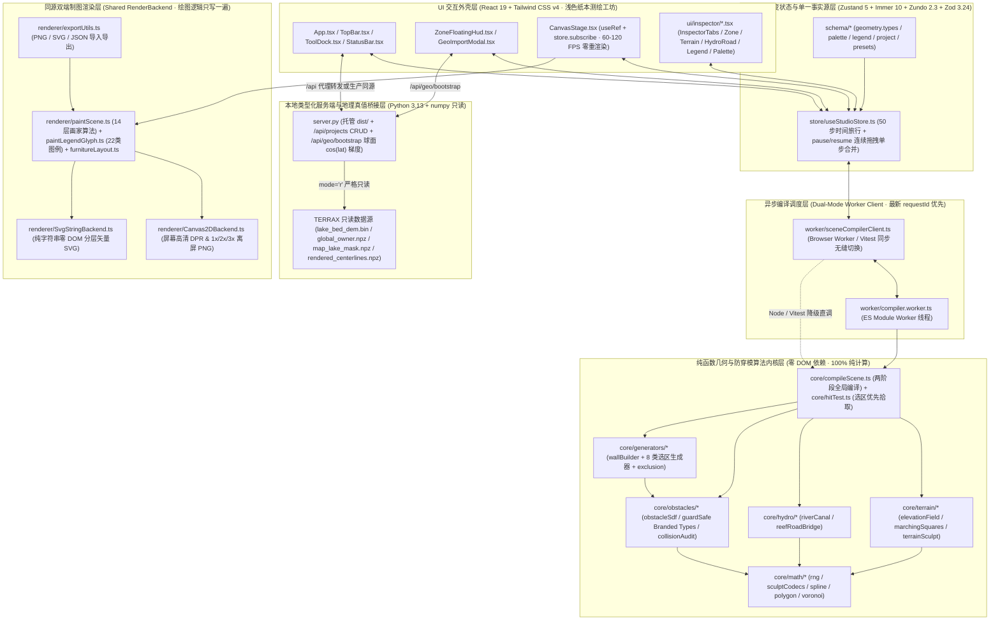
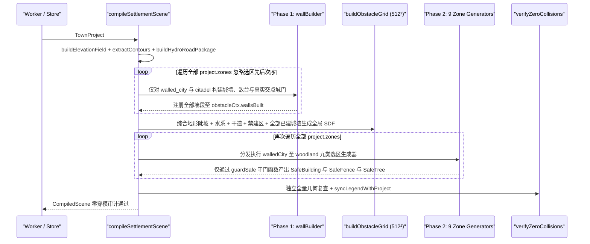

# Terrax Settlement Studio V2.0 TypeScript 架构与模块技术规格书（PRD）

| 文档属性 | 规格内容 |
| :--- | :--- |
| **产品名称** | Terrax Settlement Studio V2.0（TERRAX 通用聚落可视化制图工坊 · AI 原生 TypeScript 架构版） |
| **文档编号** | `TERRAX-SS-PRD-V2-02` |
| **文档版本** | `V2.0.0`（正式执行基线版 — 面向 `deepseek v4.1 flash` 零歧义施工规格） |
| **落盘路径** | `/Users/jrdamocles/code/TERRAX/settlement_studio/docs/02_PRD_V2_TypeScript架构与模块技术规格书.md` |
| **上游业务基线** | [01_BRD_V2_TypeScript工程化业务需求文档.md](01_BRD_V2_TypeScript工程化业务需求文档.md)（`V2-G01`—`V2-G07`、`NG-01`—`NG-04`、`V2-BG-01`—`V2-BG-10`） |
| **下游执行计划** | [03_V2_执行对照计划表与验收溯源矩阵.md](03_V2_执行对照计划表与验收溯源矩阵.md)、[04_V2_DeepSeek_V4.1_Flash_执行提示词.md](04_V2_DeepSeek_V4.1_Flash_执行提示词.md) |
| **工程总览与基准** | [../README.md](../README.md)、只读几何对拍基准 [../legacy_v1_js/README.md](../legacy_v1_js/README.md) |
| **目标技术栈** | 前端：`React 19` + `TypeScript 5.8 (strict)` + `Vite 6` + `Zustand 5` + `Immer 10` + `Zundo 2.3` + `Zod 3.24` + `Tailwind CSS v4`；门禁：`Vitest 3` + `Biome 1.9.4`；后端：`/Users/jrdamocles/code/TERRAX/worldbuilding/venv/bin/python3`（Python 3.13 类型化 HTTP 服务 + `numpy` 只读桥接） |

> **【零歧义施工准则】**
> 本规格书是 `deepseek v4.1 flash` 从零构建 V2.0 全栈工程的唯一权威技术契约。文档已将完整微模块目录树、逐字工程配置文件、Zod 单一事实源 Schema、Zustand/Immer/Zundo 时间旅行状态机、高程场与等高线数学核、纯净水文与斜交正交桥公式、`Branded Safe*` 编译期防穿模锁、两阶段全局场景编译、Web Worker 双模客户端、同源双端 `RenderBackend` 14 层渲染器、React 19 浅色纸本测绘工坊组件契约及类型化 Python `server.py` 全部锁死。编码阶段严禁新增或删减既定模块路径，严禁留下 `TODO / FIXME / placeholder` 占位符，严禁在几何生成链路调用 `Math.random()`，严禁触碰 `/Users/jrdamocles/code/TERRAX/settlement_studio/` 以外的任何仓库文件，且必须将 `/Users/jrdamocles/code/TERRAX/settlement_studio/legacy_v1_js/` 视为严格只读对拍基准。

---

## 第 1 章 系统总体架构与 50 文件微模块蓝图

### 1.1 架构演进设计总则

在 V1.2.2 原生 JavaScript 版本通过全部几何与业务终审（`177/177` 内置断言 + `53/53` 对抗断言通过）的基础上，V2.0 针对大模型编码在长文件弱类型命令式 DOM 架构下易出现的「漏声明局部变量、多维数组嵌套错位、Canvas/SVG 双端修改不同步、命令式撤销栈断链、漏调碰撞校验」五类结构性根因，实施五大工程化升级：

1. **微模块上下文隔离（满足硬门禁 `V2-BG-03`）**：将原单文件数千行的脚本拆解为职责单一的 TypeScript 微模块，`src/` 下每个 `.ts/.tsx` 文件设计目标控制在 `100—300` 行，硬性上限 `<= 320` 行。9 种聚落选区生成器各自独立成文，未来扩展第 10 种选区类型时与其余模块零耦合。
2. **Zod 单一事实源（满足 `V2-G01` 与 `V2-BG-09`）**：由 `src/schema/*.schema.ts` 统一定义运行期校验器与默认值归一化逻辑，通过 `z.infer` 自动推导全局静态类型，100% 无损兼容 `projects/*.worldtown.json` 既有三套世界观工程资产。
3. **编译期物理防穿模锁（满足 `V2-G02` 与 `V2-BG-02`）**：引入 TypeScript 品牌不透明类型 `SafeBuilding`、`SafeFence`、`SafeTree`。除 `src/core/obstacles/guardSafe.ts` 暴露的三枚守门函数外，任何生成器无法在类型层面伪造安全图元，漏调碰撞核验将在 `tsc --noEmit` 阶段直接拦截。
4. **同源双端渲染后端（满足 `V2-G04` 与 `V2-BG-04`）**：抽象 `RenderBackend` 接口，使 14 层画家算法 `paintScene.ts` 与 22 类微缩图形图例 `paintLegendGlyph.ts` 全工程只编写一遍，同时驱动屏幕/离屏 PNG 的 `Canvas2DBackend` 与无损分层矢量的 `SvgStringBackend`。
5. **动静分离交互与双模异步编译（满足 `V2-G05` 与 `V2-BG-07`）**：React 19 仅负责外围低频工具栏与属性面板；中央 `<CanvasStage>` 通过 `useRef` 与 `useStudioStore.subscribe` 驱动 `60—120 FPS` 原生画布交互；重度几何剖分下沉至 Vite ES Module Web Worker（在 Node/Vitest 无 Worker 环境自动无缝降级为同步调用）。

### 1.2 系统分层交互架构图



### 1.3 完整精确目录文件树（逐字锁定）

整个 V2.0 工程位于 `/Users/jrdamocles/code/TERRAX/settlement_studio/`。除构建产物 `dist/` 与依赖目录 `node_modules/` 外，源码文件树必须与下表逐字精确对齐（包含根目录 7 个配置与服务入口文件、`src/` 下 53 个 `.ts/.tsx` 微模块与 1 个 Tailwind v4 样式文件、`projects/` 下 3 套世界观工程文件、`tests/` 下 5 个自动化测试文件，以及只读归档目录 `legacy_v1_js/`）：

```text
/Users/jrdamocles/code/TERRAX/settlement_studio/
├── README.md                                       # V2.0 工程总览、双通门禁命令与启动指南
├── package.json                                    # 锁定依赖版本与 dev/build/typecheck/lint/format/test/check 脚本
├── .npmrc                                          # 锁定 peer 依赖自动兼容策略
├── tsconfig.json                                   # TypeScript 5.8 strict + noUncheckedIndexedAccess 配置
├── vite.config.ts                                  # Vite 6 + React + Tailwind v4 + /api 代理 + Vitest 配置
├── biome.json                                      # Biome 1.9.4 静态检查与格式化配置
├── index.html                                      # Vite HTML 挂载入口
├── server.py                                       # 类型化 Python 3 服务端（托管 dist/ + 工程 API + TERRAX 地理引导）
├── docs/
│   ├── 01_BRD_V2_TypeScript工程化业务需求文档.md
│   ├── 02_PRD_V2_TypeScript架构与模块技术规格书.md # 本文档
│   ├── 03_V2_执行对照计划表与验收溯源矩阵.md
│   └── 04_V2_DeepSeek_V4.1_Flash_执行提示词.md
├── projects/                                       # 100% 向下兼容的三套世界观精品聚落工程
│   ├── 起点城_Losrumura.worldtown.json
│   ├── 长湖_复市镇.worldtown.json
│   └── 帕隆_峡谷铁寨.worldtown.json
├── legacy_v1_js/                                   # V1.2.2 终审通过版归档（100% 严格只读黄金对拍基准）
├── src/
│   ├── main.tsx                                    # React 19 createRoot 唯一挂载入口
│   ├── styles/
│   │   └── atelier.css                             # Tailwind v4 @import + @theme 浅色纸本测绘工坊样式令牌
│   ├── schema/
│   │   ├── geometry.types.ts                       # 基础几何原语、视口、工具枚举、编译场景与碰撞报告类型
│   │   ├── palette.schema.ts                       # 4×12 HEX 语义调色板、方志主题别名与覆盖解析器
│   │   ├── legend.schema.ts                        # 14 类内置图例 + 8 类自定义徽记 Schema 与自动感知同步器
│   │   ├── project.schema.ts                       # TownProjectSchema 单一事实源、兼容归一化与序列化存取
│   │   └── presets.ts                              # 内置三套世界观工程加载器与空白默认工程工厂
│   ├── core/
│   │   ├── math/
│   │   │   ├── rng.ts                              # FNV-1a 种子哈希与 mulberry32 确定性伪随机生成器
│   │   │   ├── sculptCodecs.ts                     # Float32Array(66049) <-> Int16 小端 0.1m 定点 Base64 编解码
│   │   │   ├── spline.ts                           # 张力 0.5 开/闭 Catmull-Rom 样条、累积弧长与最近点投影
│   │   │   ├── polygon.ts                          # 面积、重心、射线点包含、精确线段相交/间距、半平面裁剪与耳切三角化
│   │   │   └── voronoi.ts                          # 有界 2 轮 Lloyd 松弛 Voronoi 剖分与防蝴蝶结半平面凸内缩
│   │   ├── terrain/
│   │   │   ├── elevationField.ts                   # 257×257 五项高程合成、偏心山包、独立坡宽山脊/陡坎与双线性采样
│   │   │   ├── marchingSquares.ts                  # 16 状态渐近消歧等高线提取、边键哈希拼接、平滑与可选 4m 陡坎短齿线
│   │   │   └── terrainSculpt.ts                    # 等高线命中测试、子步限幅高斯核推拉与四模式涂抹微雕笔刷
│   │   ├── hydro/
│   │   │   ├── riverCanal.ts                       # 零河心岛变宽河道（防蝴蝶结夹紧 + 贴岸水纹）、湖海内纹与明暗渠/坎儿井
│   │   │   └── reefRoadBridge.ts                   # 显式 5-7 边形棱角岩礁簇、三级道路与斜交全跨度正交桥梁求解
│   │   ├── obstacles/
│   │   │   ├── obstacleSdf.ts                      # 512×512 障碍掩码栅格化与双遍 Chamfer SDF 净空距离场
│   │   │   ├── guardSafe.ts                        # Branded SafeBuilding/SafeFence/SafeTree 唯一守门函数与 0.82 收缩挽救
│   │   │   └── collisionAudit.ts                   # 空间哈希桶 SpatialHash 与独立全量零穿模审计器 verifyZeroCollisions
│   │   ├── generators/
│   │   │   ├── wallBuilder.ts                      # 阶段一城垣环、敌台、真实交点 (sx,sy) 城门豁口与门阙构建器
│   │   │   ├── walledCity.ts                       # walled_city 内城街坊屋宇与城门树生成器
│   │   │   ├── townBlocks.ts                       # town_blocks 关厢坊巷生成器与共享递归 OBB 临街切屋算子
│   │   │   ├── village.ts                          # village 顺等高线村径、曲尺三合院与安全菜畦围栏生成器
│   │   │   ├── citadel.ts                          # citadel 堡寨官署中轴正殿、四座高阶公仓与前庭校场生成器
│   │   │   ├── market.ts                           # market 硬化集坪、十字通道、行列货棚与市井水井生成器
│   │   │   ├── farmland.ts                         # farmland 大格 Voronoi 田块、田埂内缩与多角度平行耕垄生成器
│   │   │   ├── saltpan.ts                          # saltpan 主轴正交蒸发盐畦格网与分级卤水透明度生成器
│   │   │   └── woodland.ts                         # woodland 抖动网格成片疏林与 exclusion 禁建保护区处理器
│   │   ├── compileScene.ts                         # 两阶段全局场景编译 compileSettlementScene 与单区重抽 rerollZoneScene
│   │   └── hitTest.ts                              # 严格优先级画布几何拾取器（zone 强制先于 terrainShape）与手柄命中
│   ├── worker/
│   │   ├── compiler.worker.ts                      # Web Worker 后台编译消息监听入口
│   │   └── sceneCompilerClient.ts                  # requestId 最新优先调度与 Browser Worker / Node 同步双模客户端
│   ├── renderer/
│   │   ├── RenderBackend.ts                        # 跨端渲染抽象接口、图元样式契约与视口正逆变换纯函数
│   │   ├── Canvas2DBackend.ts                      # HTML5 Canvas 2D 屏幕与离屏光栅后端实现
│   │   ├── SvgStringBackend.ts                     # 纯字符串拼接零 DOM 无损分层 SVG 后端实现
│   │   ├── furnitureLayout.ts                      # 标题牌、指北针、比例尺、浮动胶囊与四角图例框 AABB 自动避让算法
│   │   ├── paintLegendGlyph.ts                     # 唯一图例绘制源：14 内置 + 8 自定义微缩图形（main 改色全贯穿）
│   │   ├── paintScene.ts                           # 唯一地图绘制源：Watabou 14 层画家算法、双遍道路与三步融合树冠
│   │   └── exportUtils.ts                          # 1x/2x/3x PNG 下载、SVG 导出与 .worldtown.json 本地文件读写
│   ├── store/
│   │   └── useStudioStore.ts                       # Zustand + Immer + Zundo Store（含拖拽 pause/resume 合并与重编联动）
│   └── ui/
│       ├── App.tsx                                 # 四区测绘工作台顶层布局、全局快捷键与初始异步探测
│       ├── TopBar.tsx                              # 工程标题、预设切换、经纬度导入入口、Undo/Redo 与存取导出栏
│       ├── ToolDock.tsx                            # 左侧 12 枚测绘工具状态切换坞（严守 NG-01 无单栋房屋工具）
│       ├── CanvasStage.tsx                         # 中央高帧率 Canvas 交互舞台与 12 工具指针状态机
│       ├── ZoneFloatingHud.tsx                     # 选中选区顶部悬浮抽卡胶囊条（改类型 / R 键秒级重抽 / 锁定）
│       ├── StatusBar.tsx                           # 底部实时世界坐标、海拔、坡度、要素统计与零穿模绿灯状态栏
│       ├── GeoImportModal.tsx                      # TERRAX 经纬度地理上下文检索与一键生成底图弹窗
│       └── inspector/
│           ├── InspectorTabs.tsx                   # 右侧 320px 检视器 5 标签页容器路由
│           ├── ZonePanel.tsx                       # 选区属性卡（名称、类型、密度、坡度上限、街宽、城墙参数与重抽）
│           ├── TerrainPanel.tsx                    # 地形与等高线属性卡（基准高程、斜坡、等高距、截断区间、笔刷与选中图元）
│           ├── HydroRoadPanel.tsx                  # 水系礁石道路桥梁属性卡（河宽、明暗渠、路级、渡口与岩礁参数）
│           ├── LegendPanel.tsx                     # 图形图例可视化编辑器与新增 8 类自定义徽记卡片
│           └── PalettePanel.tsx                    # 4 套主题卡片、12 色槽拾色器覆盖与多档位 PNG/SVG 导出面板
└── tests/
    ├── schema-and-store.test.ts                    # M0 测试：Zod 兼容归一化、Base64 定点误差、图例同步、Zundo 撤销合并
    ├── terrain-and-hydro.test.ts                   # M1-M2 测试：偏心山包、等高线拼接无自交、推拉笔刷、零河心岛、急弯水渠、斜交桥
    ├── generators-and-safety.test.ts               # M3 测试：9 类选区非空产出、两阶段顺序无关零撞墙、50 种子零穿模、Worker 双模
    ├── renderer-and-ui-parity.test.ts              # M4-M5 测试：Canvas/SVG 同源指令对拍、22 图例改色、四角避让、zone 拾取优先级、行数门禁
    └── verify_backend.py                           # M6 测试：server.py 全端点、起点城真值、路径穿越拦截与 TERRAX 仓库零侵入核验
```

### 1.4 微模块依赖分层与单文件行数预算表（硬门禁 `V2-BG-03`）

1. **硬门禁 `V2-BG-03` 判定标准**：`src/` 目录下任意 `.ts` 或 `.tsx` 文件物理总行数（`wc -l`）设计目标为 **`100—300` 行**，硬上限不得超过 **`320` 行**。`tests/renderer-and-ui-parity.test.ts` 中必须内置一项自动化扫描断言，递归遍历 `src/**/*.{ts,tsx}` 校验每个文件行数 `<= 320`，超限即判测试失败。
2. **单向无环依赖铁律（DAG）**：底层模块严禁反向引用高层模块，严禁任何循环 `import`：
   - `L0（基础类型与数学层）`：`src/schema/geometry.types.ts`、`src/core/math/*`（零外部业务依赖）；
   - `L1（领域 Schema 层）`：`src/schema/palette.schema.ts`、`legend.schema.ts`、`project.schema.ts`、`presets.ts`（仅依赖 `zod`、`L0` 与 `../../projects/*.worldtown.json`）；
   - `L2（地形与水路几何层）`：`src/core/terrain/*`、`src/core/hydro/*`（仅依赖 `L0`、`L1`）；
   - `L3（障碍场与品牌安全守卫层）`：`src/core/obstacles/*`（仅依赖 `L0`、`L1`、`L2`）；
   - `L4（选区微模块生成与编译层）`：`src/core/generators/*`、`src/core/compileScene.ts`、`src/core/hitTest.ts`（仅依赖 `L0`—`L3`）；
   - `L5（渲染后端与异步桥接层）`：`src/renderer/*`、`src/worker/*`（依赖 `L0`—`L4`；其中 `SvgStringBackend.ts`、`paintScene.ts`、`paintLegendGlyph.ts`、`furnitureLayout.ts` 严禁访问浏览器 DOM）；
   - `L6（状态仓库与 React UI 层）`：`src/store/useStudioStore.ts`、`src/ui/**`、`src/main.tsx`（仅消费下层导出的强类型接口）。

| 模块分组 | 文件数 | 单文件目标行数区间 | 关键控行工程策略 |
| :--- | :---: | :---: | :--- |
| `src/schema/*.ts` | 5 | `90 — 240` 行 | `presets.ts` 通过 `resolveJsonModule` 直接导入 `../../projects/*.worldtown.json`，严禁把上千行 JSON 字面量硬拷进 TS 源码 |
| `src/core/math/*.ts` | 5 | `90 — 230` 行 | 样条、多边形基础算子与 Voronoi 剖分物理拆分为 3 个独立算子文件 |
| `src/core/terrain/*.ts` | 3 | `140 — 250` 行 | 高程合成、Marching Squares 拼接、交互推拉/笔刷各司其职 |
| `src/core/hydro/*.ts` | 2 | `180 — 260` 行 | 水体/水渠与岩礁/道路/斜交桥分置两文件，共用 `math/spline.ts` 与 `math/polygon.ts` |
| `src/core/obstacles/*.ts` | 3 | `150 — 240` 行 | SDF 栅格距离场、`Safe*` 品牌守卫、独立碰撞审计器三权分立 |
| `src/core/generators/*.ts` | 9 | `110 — 230` 行 | `townBlocks.ts` 导出通用街坊切屋函数供 `walledCity.ts` 复用，消除重复代码 |
| `src/core/{compileScene,hitTest}.ts` + `worker/*` | 4 | `80 — 220` 行 | 编译编排与拾取命中解耦，Worker 脚本仅保留纯粹消息转发封装 |
| `src/renderer/*.ts` | 7 | `120 — 280` 行 | 图例徽记、四角避让布局与 14 层主场景分离，后端实现薄封装 |
| `src/store/useStudioStore.ts` + `src/main.tsx` | 2 | `40 — 260` 行 | Store 专注状态切片、时间旅行控制与编译请求派发 |
| `src/ui/**/*.tsx` | 13 | `90 — 295` 行 | 右侧检视器按 5 个业务域拆成独立面板组件，Tailwind 原子类就地内聚 |

### 1.5 统一世界坐标系与单位铁律

1. **物理长度单位**：全工程内部几何坐标、河宽、渠宽、路宽、屋宇尺寸、退界净空、笔刷半径及地形海拔统一采用**公制米（`m`）**。
2. **世界平面正交系**：图幅范围为正方形 `[0, worldSizeM] × [0, worldSizeM]`（默认 `2400 m`，合法区间 `[600, 8000]`）：
   - 原点 `(0, 0)` 位于图幅**西北角（左上角）**；
   - `+X` 轴水平向右，指向**正东（East）**；
   - `+Y` 轴垂直向下，指向**正南（South）**；
   - 图面恒为**上北（`-Y`）、下南（`+Y`）、左西（`-X`）、右东（`+X`）**。
3. **角度与法向约定**：平面方向角 `angleDeg` 以 `+X`（正东）为 `0°`，顺时针增加（`+Y` 正南为 `+90°`），弧度 `rad = (angleDeg * Math.PI) / 180`。对于有向折线切向量 `T = (tx, ty)`，前进方向的**左侧单位法向量**定义为 `N_left = (ty, -tx)`，**右侧单位法向量**定义为 `N_right = (-ty, tx)`。

---

## 第 2 章 工程脚手架逐字锁定配置（Verbatim Configs — 直接可复制落盘）

> **【防呆死命令】**：`deepseek v4.1 flash` 在执行 `M0 / T-0.1` 时，必须将本章 2.1—2.6 节代码块逐字原样落盘，不得擅自升级主版本号、不得添加 `tailwind.config.js` 或 `postcss.config.js`、不得在 `biome.json` 中捏造不存在的规则键名。

### 2.1 `package.json`（锁定依赖版本与双通门禁脚本）

文件路径：`/Users/jrdamocles/code/TERRAX/settlement_studio/package.json`

```json
{
  "name": "terrax-settlement-studio",
  "version": "2.0.0",
  "private": true,
  "packageManager": "pnpm@9.15.9",
  "type": "module",
  "scripts": {
    "dev": "vite",
    "build": "tsc --noEmit && vite build",
    "typecheck": "tsc --noEmit",
    "lint": "biome lint src tests",
    "format": "biome format --write src tests",
    "test": "vitest run",
    "check": "tsc --noEmit && biome lint src tests && vitest run"
  },
  "dependencies": {
    "immer": "^10.1.1",
    "lucide-react": "^0.475.0",
    "react": "^19.0.0",
    "react-dom": "^19.0.0",
    "zod": "^3.24.2",
    "zundo": "^2.3.0",
    "zustand": "^5.0.3"
  },
  "devDependencies": {
    "@biomejs/biome": "1.9.4",
    "@tailwindcss/vite": "^4.0.9",
    "@types/node": "^22.13.0",
    "@types/react": "^19.0.10",
    "@types/react-dom": "^19.0.4",
    "@vitejs/plugin-react": "^4.3.4",
    "tailwindcss": "^4.0.9",
    "typescript": "^5.8.2",
    "vite": "^6.2.0",
    "vitest": "^3.0.7"
  }
}
```

- **依赖安装规约（防护 `V2-R01` Corepack 交互阻塞）**：
  统一执行 `COREPACK_ENABLE_DOWNLOAD_PROMPT=0 pnpm install` 安装依赖（注入环境变量防止 Corepack 在非交互终端弹出下载确认挂起进程；若受网络或缓存环境限制，允许无缝回退执行 `npm install`）。
- **门禁双通保障**：`scripts` 内全部命令仅调用本地 `node_modules/.bin` 可执行程序，不包含 `pnpm` 专有语法，确保 `pnpm check` 与 `npm run check` 双通道 100% 等价通过。

### 2.2 `.npmrc`（Peer 依赖零冲突配置）

文件路径：`/Users/jrdamocles/code/TERRAX/settlement_studio/.npmrc`

```ini
strict-peer-dependencies=false
auto-install-peers=true
```

### 2.3 `tsconfig.json`（严格静态检查与零摩擦兼容配置）

文件路径：`/Users/jrdamocles/code/TERRAX/settlement_studio/tsconfig.json`

```json
{
  "compilerOptions": {
    "target": "ES2022",
    "lib": ["ES2022", "DOM", "DOM.Iterable"],
    "module": "ESNext",
    "moduleResolution": "Bundler",
    "jsx": "react-jsx",
    "strict": true,
    "noUncheckedIndexedAccess": true,
    "noFallthroughCasesInSwitch": true,
    "isolatedModules": true,
    "resolveJsonModule": true,
    "skipLibCheck": true,
    "noEmit": true
  },
  "include": ["src", "tests", "vite.config.ts"]
}
```

- **编译器选项技术决策说明**：
  1. **开启 `strict: true` + `noUncheckedIndexedAccess: true`**：强制所有数组下标访问 `arr[i]` 与字典键访问 `map[key]` 返回 `T | undefined`，在编译期彻底拦截越界读写与空引用异常。
  2. **不开启 `exactOptionalPropertyTypes`**：Zod 3.24 中 `z.string().optional()` 推导类型为 `string | undefined`；若开启 `exactOptionalPropertyTypes: true`，将与 React 19 可选属性及 Zustand 部分更新对象产生伪冲突。关闭该项可确保 `z.infer<typeof Schema>` 与 React 组件 Props 零摩擦无缝衔接。
  3. **开启 `resolveJsonModule: true` 且不锁死 `rootDir: "src"`**：允许 `src/schema/presets.ts` 与 `tests/*.test.ts` 直接静态导入 `projects/*.worldtown.json` 真值文件，由 Vite 在生产构建时自动内联打包。

### 2.4 `vite.config.ts`（React 19 + Tailwind v4 + Worker + API 代理 + Vitest 一体化配置）

文件路径：`/Users/jrdamocles/code/TERRAX/settlement_studio/vite.config.ts`

```ts
import tailwindcss from '@tailwindcss/vite';
import react from '@vitejs/plugin-react';
import { defineConfig } from 'vitest/config';

export default defineConfig({
  plugins: [react(), tailwindcss()],
  server: {
    host: '127.0.0.1',
    port: 5173,
    strictPort: false,
    proxy: {
      '/api': {
        target: 'http://127.0.0.1:8765',
        changeOrigin: true,
      },
    },
  },
  worker: {
    format: 'es',
  },
  build: {
    target: 'es2022',
    outDir: 'dist',
    emptyOutDir: true,
  },
  test: {
    environment: 'node',
    include: ['tests/**/*.test.ts'],
    testTimeout: 30000,
  },
});
```

> **注意**：此处必须从 `'vitest/config'` 而非 `'vite'` 导入 `defineConfig`，以使 `test` 配置块在 `tsc --noEmit` 检查 `vite.config.ts` 时具备完整类型签名。

### 2.5 `biome.json`（`@biomejs/biome@1.9.4` 精确合法规则配置）

文件路径：`/Users/jrdamocles/code/TERRAX/settlement_studio/biome.json`

```json
{
  "$schema": "https://biomejs.dev/schemas/1.9.4/schema.json",
  "files": {
    "ignoreUnknown": true,
    "ignore": ["dist", "node_modules", "legacy_v1_js", "projects"]
  },
  "formatter": {
    "enabled": true,
    "indentStyle": "space",
    "indentWidth": 2,
    "lineWidth": 100
  },
  "organizeImports": {
    "enabled": true
  },
  "javascript": {
    "globals": ["Buffer", "process", "Transferable", "OffscreenCanvas"]
  },
  "linter": {
    "enabled": true,
    "rules": {
      "recommended": false,
      "correctness": {
        "recommended": true,
        "noUndeclaredVariables": "error",
        "noUnusedImports": "warn",
        "noUnusedVariables": "warn"
      },
      "suspicious": {
        "noExplicitAny": "error",
        "noDebugger": "error"
      }
    }
  }
}
```

- **为何 `npm run check` 使用 `biome lint` 而将格式化独立为 `npm run format`（防护 `V2-R04`）**：
  若在门禁中使用 `biome check`，任何微小的缩进换行或 import 排序差异都会导致退出码非零并中断自检流水线。将 `npm run lint`（`biome lint src tests`）纳入 `npm run check` 硬门禁，专注拦截致命缺陷（未声明变量 `noUndeclaredVariables: "error"` 与显式 `any` 逃逸 `noExplicitAny: "error"`），同时保留 `npm run format` 供代码落盘后一键自动排版，兼顾零容忍静态安全与极速通关效率。

### 2.6 `index.html`、`src/main.tsx` 与 Tailwind v4 `src/styles/atelier.css`

#### （1）`/Users/jrdamocles/code/TERRAX/settlement_studio/index.html`

```html
<!doctype html>
<html lang="zh-CN">
  <head>
    <meta charset="UTF-8" />
    <meta name="viewport" content="width=device-width, initial-scale=1.0" />
    <title>Terrax Settlement Studio V2.0 — 通用聚落可视化制图工坊</title>
  </head>
  <body class="h-screen w-screen overflow-hidden select-none antialiased">
    <div id="root" class="h-full w-full"></div>
    <script type="module" src="/src/main.tsx"></script>
  </body>
</html>
```

#### （2）`/Users/jrdamocles/code/TERRAX/settlement_studio/src/main.tsx`

```tsx
import { StrictMode } from 'react';
import { createRoot } from 'react-dom/client';
import './styles/atelier.css';
import { App } from './ui/App';

const rootEl = document.getElementById('root');
if (!rootEl) {
  throw new Error('Root mount container #root not found in index.html');
}

createRoot(rootEl).render(
  <StrictMode>
    <App />
  </StrictMode>,
);
```

#### （3）`/Users/jrdamocles/code/TERRAX/settlement_studio/src/styles/atelier.css`（Tailwind CSS v4 原生配置）

> **【Tailwind v4 红线（防护 `V2-R02`）】**：必须使用 `@import "tailwindcss";` 与 `@theme { ... }` 语法；**严禁**创建 `tailwind.config.js` / `tailwind.config.ts`，**严禁**写入已废弃的 Tailwind v3 指令 `@tailwind base; @tailwind components; @tailwind utilities;`。同时严守 `V2-BG-08` 浅色纸本测绘工坊视觉基调，严禁出现任何暗黑星空背景（如 `#0b0f19`）或霓虹发光边框。

```css
@import "tailwindcss";

@theme {
  --color-desk: #f4f1ea;
  --color-panel: #faf8f3;
  --color-card: #efeae0;
  --color-card-hover: #e7e0d2;
  --color-input: #ffffff;
  --color-brass: #d5cdbd;
  --color-brass-strong: #b8ad98;
  --color-ink: #2b2620;
  --color-ink-secondary: #4a4339;
  --color-ink-muted: #6e6659;
  --color-on-accent: #faf8f3;
  --color-pine: #365942;
  --color-pine-hover: #294533;
  --color-terracotta: #b55838;
  --color-ochre: #9c7432;
  --color-status-ok: #2d6a4f;
  --color-status-warn: #b55838;

  --font-ui: "Avenir Next", "PingFang SC", "Hiragino Sans GB", "Microsoft YaHei", "Noto Sans SC", sans-serif;
  --font-map-serif: "Palatino Linotype", "Book Antiqua", "Songti SC", "STSong", "Noto Serif SC", serif;
  --font-mono: "SF Mono", "Menlo", "Consolas", monospace;
}

:root {
  --bg-desk: #f4f1ea;
  --bg-panel: #faf8f3;
  --bg-card: #efeae0;
  --bg-card-hover: #e7e0d2;
  --bg-input: #ffffff;
  --bg-hud-float: rgba(250, 248, 243, 0.94);
  --border-brass: #d5cdbd;
  --border-brass-strong: #b8ad98;
  --border-focus: #365942;
  --ink-primary: #2b2620;
  --ink-secondary: #4a4339;
  --ink-muted: #6e6659;
  --accent-pine: #365942;
  --accent-terracotta: #b55838;
  --accent-ochre: #9c7432;
  --status-ok: #2d6a4f;
}

html,
body {
  background-color: var(--bg-desk);
  color: var(--ink-primary);
  font-family: var(--font-ui);
}

/* 细滚动条与黄铜分规质感输入控件定制 */
::-webkit-scrollbar {
  width: 6px;
  height: 6px;
}

::-webkit-scrollbar-track {
  background: #efeae0;
}

::-webkit-scrollbar-thumb {
  background: #b8ad98;
  border-radius: 999px;
}

input[type="range"] {
  accent-color: #365942;
}
```

---

## 第 3 章 Zod 单一事实源 Schema、调色板、图例与 Zustand/Zundo 状态仓库（`M0`）

### 3.1 `src/schema/geometry.types.ts`（全局几何原语与编译产物类型契约）

本文件统一声明无运行时开销的几何原语、常量、工具状态枚举以及编译后场景数据结构（其中安全屋宇、菜畦围栏与树木类型从 `src/core/obstacles/guardSafe.ts` 导入或通过泛型槽桥接，为保持 `L0` 零上层依赖，`geometry.types.ts` 定义基础几何结构，`guardSafe.ts` 在此基础上附加 `unique symbol` 品牌类型并由 `compileScene.ts` 汇聚为 `CompiledScene`）：

```ts
export const SCHEMA_VERSION = '2.0.0' as const;
export const GRID_N = 257 as const;
export const GRID_POINT_COUNT = 66049 as const; // 257 * 257
export const OBSTACLE_GRID_N = 512 as const;

/** 二维世界平面坐标 [wx, wy]，单位：米 (m) */
export type Vec2 = readonly [number, number];

/** 开折线顶点序列（至少 2 点），严禁嵌套为四维数组 */
export type Polyline = ReadonlyArray<Vec2>;

/** 简单闭合多边形外环顶点序列（至少 3 点，首尾不重复存储） */
export type Polygon = ReadonlyArray<Vec2>;

/** 轴对齐包围盒 [minX, minY, maxX, maxY] */
export type BBox = readonly [number, number, number, number];

/** 左侧工具坞锁死 12 枚测绘工具枚举（严守 NG-01：无任何单栋房屋手动编辑工具） */
export const TOOL_IDS = [
  'select', 'contour_drag', 'sculpt_brush', 'add_hill', 'add_ridge', 'draw_river',
  'draw_water_area', 'place_reef', 'draw_road', 'draw_zone', 'place_landmark', 'measure',
] as const;
export type ToolId = (typeof TOOL_IDS)[number];

/** 高程涂抹微雕笔刷四种工作模式 */
export type SculptBrushMode = 'raise' | 'lower' | 'smooth' | 'flatten';

/** 右侧属性检视器五大标签页 */
export type InspectorTabId = 'terrain' | 'hydro_road' | 'zone' | 'legend' | 'palette';

/** 画布视口状态模型 */
export interface ViewportState {
  widthPx: number;
  heightPx: number;
  dpr: number;
  panX: number;
  panY: number;
  zoom: number;
  worldSizeM: number;
}

/** 画布可拾取对象目标（严格对应 hitTest 9 级优先级） */
export type SelectionTargetType =
  | 'landmark' | 'reef' | 'ford' | 'canal' | 'road'
  | 'river' | 'waterBody' | 'zone' | 'terrainShape';

export interface SelectionTarget {
  readonly type: SelectionTargetType;
  readonly id: string;
  readonly name?: string;
}

/** 碰撞冲突明细与全局零穿模核验报告 */
export interface CollisionDetail {
  readonly type: 'water' | 'road' | 'wall' | 'building' | 'exclusion';
  readonly buildingId: string;
  readonly zoneId: string;
}

export interface CollisionReport {
  readonly passed: boolean;
  readonly totalHits: number;
  readonly buildingRoadHits: number;
  readonly buildingWaterHits: number;
  readonly buildingWallHits: number;
  readonly buildingBuildingHits: number;
  readonly buildingExclusionHits: number;
  readonly riverIslands: number;
  readonly details: ReadonlyArray<CollisionDetail>;
}

/** L0 零上层依赖场景基础契约（供 M0 Store 与 M4 渲染层直接引用，M3 用 Safe* 品牌类型收窄） */
export interface BuildingRecordBase {
  readonly id: string;
  readonly zoneId: string;
  readonly zoneName: string;
  readonly contentType: string;
  readonly roofKind: 'inner' | 'town';
  readonly kind: 'house' | 'farmhouse' | 'wing' | 'hall' | 'granary' | 'stall';
  readonly label: string;
  readonly points: Polygon;
  readonly centroid: Vec2;
  readonly areaM2: number;
  readonly ridge: readonly [Vec2, Vec2] | null;
}

export interface FenceRecordBase {
  readonly zoneId: string;
  readonly points: Polyline;
}

export interface TreeRecordBase {
  readonly zoneId: string;
  readonly x: number;
  readonly y: number;
  readonly r: number;
  readonly kind: 'garden' | 'woodland' | 'plaza' | 'field';
}

export interface WallTowerPoint {
  readonly x: number;
  readonly y: number;
  readonly radiusM: number;
  readonly kind: 'tower' | 'gate_tower';
}

export interface GateStructure {
  readonly id: string;
  readonly x: number;
  readonly y: number;
  readonly arc: number;
  readonly angleDeg: number;
  readonly gapHalf: number;
  readonly roadId: string;
  readonly roadName: string;
  readonly roadWidthM: number;
  readonly towers: readonly [Vec2, Vec2];
}

export interface WallSegment {
  readonly id: string;
  readonly zoneId: string;
  readonly thicknessM: number;
  readonly polyline: Polyline;
  readonly closed: boolean;
  readonly gates: ReadonlyArray<GateStructure>;
  readonly towers: ReadonlyArray<WallTowerPoint>;
}

export interface FarmlandPlot {
  readonly id: string;
  readonly zoneId: string;
  readonly polygon: Polygon;
  readonly innerPolygon: Polygon;
  readonly areaHa: number;
  readonly angleDeg: number;
  readonly furrows: ReadonlyArray<Polyline>;
}

export interface SaltpanCell {
  readonly id: string;
  readonly zoneId: string;
  readonly polygon: Polygon;
  readonly opacity: number;
}

export interface MarketApron {
  readonly zoneId: string;
  readonly kind: 'market_apron' | 'parade_ground';
  readonly points: Polygon;
}

export interface WellPoint {
  readonly zoneId: string;
  readonly x: number;
  readonly y: number;
  readonly radiusM: number;
}

export interface CompiledZoneResultBase<
  TBuilding = BuildingRecordBase,
  TFence = FenceRecordBase,
  TTree = TreeRecordBase,
> {
  readonly id: string;
  readonly name: string;
  readonly contentType: string;
  readonly seed: number;
  readonly points: Polygon;
  readonly areaHa: number;
  readonly buildings: ReadonlyArray<TBuilding>;
  readonly walls: ReadonlyArray<WallSegment>;
  readonly towers: ReadonlyArray<WallTowerPoint>;
  readonly internalStreets: ReadonlyArray<Polyline>;
  readonly lanes: ReadonlyArray<Polyline>;
  readonly gardenFences: ReadonlyArray<TFence>;
  readonly trees: ReadonlyArray<TTree>;
  readonly farmlandPlots: ReadonlyArray<FarmlandPlot>;
  readonly saltpanCells: ReadonlyArray<SaltpanCell>;
  readonly marketAprons: ReadonlyArray<MarketApron>;
  readonly wells: ReadonlyArray<WellPoint>;
  readonly exclusionPoly: Polygon | null;
}

export interface CompiledSceneBase<
  TBuilding = BuildingRecordBase,
  TFence = FenceRecordBase,
  TTree = TreeRecordBase,
> {
  readonly schemaVersion: string;
  readonly worldSizeM: number;
  readonly terrain: {
    readonly contours: ReadonlyArray<{
      readonly id: string;
      readonly elev: number;
      readonly isIndex: boolean;
      readonly closed: boolean;
      readonly points: Polyline;
    }>;
    readonly scarpTicks: ReadonlyArray<{
      readonly x1: number;
      readonly y1: number;
      readonly x2: number;
      readonly y2: number;
    }>;
    readonly minElev: number;
    readonly maxElev: number;
  };
  readonly hydro: {
    readonly rivers: ReadonlyArray<{
      readonly id: string;
      readonly name: string;
      readonly centerline: Polyline;
      readonly bankPolygon: Polygon;
      readonly ripples: ReadonlyArray<Polyline>;
      readonly islands: readonly never[];
    }>;
    readonly waterBodies: ReadonlyArray<{
      readonly id: string;
      readonly name: string;
      readonly kind: 'lake' | 'sea';
      readonly shorePoly: Polygon;
      readonly ripples: ReadonlyArray<Polygon>;
    }>;
    readonly canals: ReadonlyArray<{
      readonly id: string;
      readonly name: string;
      readonly style: 'open' | 'qanat';
      readonly centerline: Polyline;
      readonly widthM: number;
      readonly bankPolygon: Polygon;
      readonly shaftPoints: ReadonlyArray<{ readonly x: number; readonly y: number; readonly radiusM: number }>;
    }>;
    readonly reefs: ReadonlyArray<{
      readonly id: string;
      readonly x: number;
      readonly y: number;
      readonly radiusM: number;
      readonly rocks: ReadonlyArray<{ readonly points: Polygon }>;
      readonly foamRing: Polygon;
    }>;
    readonly roads: ReadonlyArray<{
      readonly id: string;
      readonly name: string;
      readonly tier: 'highway' | 'street' | 'lane';
      readonly widthM: number;
      readonly centerline: Polyline;
    }>;
    readonly bridges: ReadonlyArray<{
      readonly id: string;
      readonly x: number;
      readonly y: number;
      readonly corners: readonly [Vec2, Vec2, Vec2, Vec2];
      readonly parapetLeft: readonly [Vec2, Vec2];
      readonly parapetRight: readonly [Vec2, Vec2];
      readonly abutments: ReadonlyArray<readonly [Vec2, Vec2]>;
    }>;
    readonly fordCrossings: ReadonlyArray<{
      readonly id: string;
      readonly x: number;
      readonly y: number;
      readonly tangent: Vec2;
      readonly normal: Vec2;
      readonly riverWidthM: number;
    }>;
    readonly riverIslandCount: number;
  };
  readonly zones: ReadonlyArray<CompiledZoneResultBase<TBuilding, TFence, TTree>>;
  readonly buildings: ReadonlyArray<TBuilding>;
  readonly walls: ReadonlyArray<WallSegment>;
  readonly trees: ReadonlyArray<TTree>;
  readonly farmlandPlots: ReadonlyArray<FarmlandPlot>;
  readonly saltpanCells: ReadonlyArray<SaltpanCell>;
  readonly marketAprons: ReadonlyArray<MarketApron>;
  readonly lanes: ReadonlyArray<Polyline>;
  readonly gardenFences: ReadonlyArray<TFence>;
  readonly internalStreets: ReadonlyArray<Polyline>;
  readonly wells: ReadonlyArray<WellPoint>;
  readonly exclusionPolys: ReadonlyArray<Polygon>;
  readonly collisionReport: CollisionReport;
  readonly stats: {
    readonly compileMs: number;
    readonly zoneCount: number;
    readonly buildingCount: number;
    readonly wallCount: number;
    readonly treeCount: number;
    readonly bridgeCount: number;
    readonly contourCount: number;
    readonly collisionHits: number;
  };
}
```

### 3.2 `src/core/math/rng.ts` 与 `src/core/math/sculptCodecs.ts`

#### （1）`src/core/math/rng.ts`（确定性伪随机源与唯一 ID 生成器）
- **硬性禁令（`V2-BG-01`）**：`src/core/` 下全部模块严禁出现 `Math.random()`，统一使用 FNV-1a `hashSeed` 与 `mulberry32` `createRng`：

```ts
export type RngFn = () => number;

export function hashSeed(input: string | number | null | undefined): number {
  const str = String(input === undefined || input === null ? 1 : input);
  let h = 2166136261 >>> 0;
  for (let i = 0; i < str.length; i += 1) {
    h ^= str.charCodeAt(i);
    h = Math.imul(h, 16777619) >>> 0;
  }
  return (h === 0 ? 1 : h) >>> 0;
}

export function createRng(seed: number | string): RngFn {
  let a = typeof seed === 'number' ? seed >>> 0 : hashSeed(seed);
  if (a === 0) a = 1;
  return function nextFloat(): number {
    a = (a + 0x6d2b79f5) >>> 0;
    let t = Math.imul(a ^ (a >>> 15), 1 | a);
    t = (t + Math.imul(t ^ (t >>> 7), 61 | t)) ^ t;
    return ((t ^ (t >>> 14)) >>> 0) / 4294967296;
  };
}

let uidSeq = 0;
export function createUid(prefix: string, rngOrIndex?: RngFn | number): string {
  const cleanPrefix = prefix.trim().length > 0 ? prefix.trim() : 'id';
  uidSeq += 1;
  if (typeof rngOrIndex === 'function') {
    const token = Math.floor(rngOrIndex() * 1679616).toString(36);
    return `${cleanPrefix}_${token}${uidSeq.toString(36)}`;
  }
  const n = typeof rngOrIndex === 'number' && Number.isFinite(rngOrIndex)
    ? Math.floor(rngOrIndex)
    : uidSeq;
  return `${cleanPrefix}_${n.toString(36)}`;
}
```

#### （2）`src/core/math/sculptCodecs.ts`（`0.1 m` 定点 `Int16` 小端 Base64 双向无损编解码）
- 负责将 `Float32Array(66049)` 限幅在 `[-3200, +3200]` 米内，按 `Math.round(val * 10)` 量化为小端序 `Int16Array` 并转为 Base64 字符串：
  - 若全数组量化后全为 `0`，`encodeSculptDelta` 必须返回空字符串 `""`（保证未微雕工程占 `0` 字节）；
  - `decodeSculptDelta(base64Str, expectedLen = 66049)` 在空串或异常输入下返回全零 `Float32Array(expectedLen)`，往返最大量化误差严格 `<= 0.051 m`；
  - 使用原生 `globalThis.btoa` / `globalThis.atob`（在现代浏览器与 Node.js v22 / Vitest 3 中均原生内置），实现零第三方依赖双端一致运行。

### 3.3 `src/schema/palette.schema.ts`（4×12 HEX 语义色板与方志别名解析）

1. **12 语义色槽键名（`PALETTE_SLOT_KEYS`）**：
   `'paperBg' | 'inkDark' | 'roofInner' | 'roofTown' | 'roadFill' | 'waterFill' | 'waterRipple' | 'treeFill' | 'treeOutline' | 'contourLine' | 'farmlandFill' | 'saltpanFill'`。
2. **4 套内置主题精确 6 位小写 HEX 表（`BUILTIN_PALETTES`）**：
   - `watabou_classic`（经典羊皮纸淡彩·默认）：
     `paperBg: '#f3ede0'`, `inkDark: '#2b2520'`, `roofInner: '#cbb582'`, `roofTown: '#cc9a76'`, `roadFill: '#faf6ed'`, `waterFill: '#8faab3'`, `waterRipple: '#dce7ea'`, `treeFill: '#5b844b'`, `treeOutline: '#2c4024'`, `contourLine: '#9e8c72'`, `farmlandFill: '#dfd8be'`, `saltpanFill: '#cde0e3'`
   - `nordic_fjord`（寒海峡湾石青）：
     `paperBg: '#eaeeef'`, `inkDark: '#1f2930'`, `roofInner: '#b8a98a'`, `roofTown: '#a87e6b'`, `roadFill: '#f7f9fa'`, `waterFill: '#6c8c9e'`, `waterRipple: '#c8dce6'`, `treeFill: '#466952'`, `treeOutline: '#223629'`, `contourLine: '#838e94'`, `farmlandFill: '#d2d9c5'`, `saltpanFill: '#bfd4de'`
   - `arid_oasis`（旱原泉线赭砂）：
     `paperBg: '#f5ead6'`, `inkDark: '#332419'`, `roofInner: '#d8b475'`, `roofTown: '#c98357'`, `roadFill: '#fcf5e8'`, `waterFill: '#74a3a8'`, `waterRipple: '#cde4e6'`, `treeFill: '#6b8e4e'`, `treeOutline: '#354726'`, `contourLine: '#b08d65'`, `farmlandFill: '#e3d6ad'`, `saltpanFill: '#d4e8e6'`
   - `gazetteer_ink`（方志素笺水墨）：
     `paperBg: '#f7f5ef'`, `inkDark: '#222220'`, `roofInner: '#cfc9bc'`, `roofTown: '#b5aea0'`, `roadFill: '#ffffff'`, `waterFill: '#c5d0d4'`, `waterRipple: '#eef3f5'`, `treeFill: '#8c9685'`, `treeOutline: '#3d423a'`, `contourLine: '#9c968c'`, `farmlandFill: '#eae7de'`, `saltpanFill: '#dfe6e8'`
3. **方志主题别名兼容映射表（`THEME_ALIASES`）**：
   ```ts
   export const THEME_ALIASES: Readonly<Record<string, CanonicalThemeId>> = {
     watabou_classic: 'watabou_classic',
     nordic_fjord: 'nordic_fjord',
     arid_oasis: 'arid_oasis',
     gazetteer_ink: 'gazetteer_ink',
     boreal_slate: 'nordic_fjord',
     arid_ochre: 'arid_oasis',
     archival_parchment: 'gazetteer_ink',
   };
   ```
4. **导出函数契约**：
   - `PaletteConfigSchema`：`z.object({ themeId: z.string().default('watabou_classic'), overrides: z.record(z.string(), z.string()).default({}) })`；
   - `resolveThemeId(rawThemeId?: string): CanonicalThemeId`；
   - `getActivePalette(paletteConfig?: PaletteConfig | null): ResolvedPalette`：合并基础主题 12 色与 `overrides` 中匹配 `/^#[0-9a-fA-F]{6}$/` 的小写 HEX 覆盖色，并额外派生常用辅助描边色（如路缘石色 `roadCasing: '#5b4a38'`、城墙填充色 `wallFill: '#504233'`、礁石炭灰色 `reefFill: '#585550'`）。

### 3.4 `src/schema/legend.schema.ts`（14 类内置图例 + 8 类自定义徽记 + `syncLegendWithProject`）

1. **枚举常量锁死**：
   - 14 类内置图例图形枚举 `BUILTIN_GLYPH_TYPES`：
     `'building_inner' | 'building_town' | 'city_wall' | 'road_main' | 'bridge' | 'river' | 'water_body' | 'canal' | 'contour' | 'scarp_tick' | 'farmland' | 'saltpan' | 'tree_cluster' | 'reef'`；
   - 8 类自定义地标徽记枚举 `CUSTOM_GLYPH_TYPES`：
     `'star_fort' | 'tower' | 'well_shrine' | 'ferry_anchor' | 'gate_arch' | 'market_tent' | 'mine_hammer' | 'stele'`；
   - 联合类型 `LegendGlyphType = BuiltinGlyphType | CustomGlyphType`（共 22 类）；
   - `BUILTIN_LEGEND_CATALOG`：按 `order: 10..140` 固化 `roof_inner`、`roof_town`、`city_wall`、`road_highway`、`bridge_ortho`、`river_pure`、`water_lake_sea`、`canal_water`、`contour_line`、`scarp_tick`、`farmland_plot`、`saltpan_plot`、`woodland_tree`、`rock_reef` 的默认中文标签、默认 `glyphType`、默认 `strokeColor` 与关联 `paletteSlot`。
2. **Zod Schema 定义**：
   ```ts
   export const LegendPositionSchema = z.enum([
     'bottom-right',
     'bottom-left',
     'top-right',
     'top-left',
   ]);

   export const LegendItemSchema = z.object({
     key: z.string().min(1),
     isCustom: z.boolean().default(false),
     glyphType: z.string().default('building_town'),
     label: z.string().default('图例项'),
     color: z.string().default(''),
     colorLocked: z.boolean().default(false),
     strokeColor: z.string().default('#2b2520'),
     visible: z.boolean().default(true),
     autoPresent: z.boolean().default(true),
     order: z.number().default(100),
   });

   export const LegendConfigSchema = z.object({
     visible: z.boolean().default(true),
     title: z.string().default('图例 · LEGEND'),
     position: LegendPositionSchema.default('bottom-right'),
     columns: z.union([z.literal(1), z.literal(2)]).default(2),
     items: z.array(LegendItemSchema).default([]),
   });
   ```
3. **`syncLegendWithProject(project, scenePresence, activePalette): LegendConfig` 核心防回归铁律**：
   - **内置图例自动感知与颜色跟随**：根据编译后场景真实存在的要素集合 `ScenePresenceFlags` 更新 14 项内置图例的 `autoPresent`；若某内置图例项 `colorLocked !== true` 且 `isCustom !== true`，保持 `color: ''`（渲染时自动读取当前激活调色板对应色槽，切换主题即实时换色）；若用户在图例编辑器中手动挑选了自定义颜色，则置 `colorLocked = true` 并保留用户设定的 6 位 HEX 色值；同时完整保留用户改写过的 `label`、`visible` 与 `order`。
   - **地标反向补齐**：遍历 `project.landmarks`，若存在 `lm.legendKey` 以 `'custom_'` 开头且尚未在 `legend.items` 中注册的项，自动以 `isCustom: true, glyphType: lm.glyphType, label: lm.label, color: activePalette.treeFill, autoPresent: true, visible: true` 补入图例列表。
   - **未盖章自定义图例持久显示铁律（防回归重点）**：对所有满足 `item.isCustom === true` 的自定义图例项，无论用户当前是否已在画布盖下对应的 `Landmark` 戳记，**一律强制置 `item.autoPresent = true`**（即 `if (item.isCustom) { item.autoPresent = true; }`），彻底杜绝「用户在图例面板新建自定义图例后，下一次场景重编把未盖章图例隐藏吞没」的历史回归缺陷。

### 3.5 `src/schema/project.schema.ts` 与 `src/schema/presets.ts`（100% 向下兼容 V1.2.2 资产）

#### （1）`src/schema/project.schema.ts` 完整结构与兼容归一化规则
必须 100% 覆盖 `起点城_Losrumura.worldtown.json`、`长湖_复市镇.worldtown.json`、`帕隆_峡谷铁寨.worldtown.json` 的**全部 13 个顶层主键**（`schemaVersion`、`meta`、`palette`、`terrain`、`rivers`、`waterBodies`、`canals`、`reefs`、`roads`、`fords`、`zones`、`landmarks`、`legend`）及所有子字段：

1. **9 类选区枚举 `ZONE_CONTENT_TYPES`**：
   `'walled_city' | 'town_blocks' | 'village' | 'citadel' | 'market' | 'farmland' | 'saltpan' | 'woodland' | 'exclusion'`。
2. **地形图元可辨识联合 `TerrainShapeSchema`**：
   - 椭圆类 `HillOrBasinShapeSchema`：`type: 'hill' | 'basin'`，含 `{ id, type, cx, cy, rx >= 25, ry >= 25, angleDeg, deltaElev, focusX, focusY }`（归一化时强制约束 `hill` 的 `deltaElev > 0`、`basin` 的 `deltaElev < 0`，且偏心模长 `Math.hypot(focusX, focusY) <= 0.72`）；
   - 折线类 `LinearTerrainShapeSchema`：`type: 'ridge' | 'valley' | 'scarp'`，含 `{ id, type, points (长度 >= 2), deltaElev, widthLeft >= 20, widthRight >= 20 }`（归一化时强制约束 `valley` 的 `deltaElev < 0`、`ridge/scarp` 的 `deltaElev > 0`）。
3. **`TerrainConfigSchema` 完整 12 字段默认值与微雕增量场多字段名兼容归一**：
   - 完整 12 个持久化字段及默认值锁死如下：
     `baseElev: 450`、`slopeMagM: 18`、`slopeDirDeg: 315`、`contourStep: 5`、`indexEvery: 5`、`minContourElev: -500`、`maxContourElev: 6000`、`showContours: true`、`showScarpTicks: false`、`scarpSlopeThresholdDeg: 26`、`shapes: []`（`z.array(TerrainShapeSchema).default([])`）、`sculptDeltaB64: ''`；
   - 在 `normalizeProject(rawInput: unknown): TownProject` 预处理阶段，对 `raw.terrain` 的微雕字段实施三合一兼容提取：若存在非空字符串 `raw.terrain.sculptDeltaB64` 优先采用；否则若存在非空字符串 `raw.terrain.sculptDeltaBase64` 映射至 `sculptDeltaB64`；否则若 `raw.terrain.sculptDelta` 为字符串则直接采用，若为 `Float32Array` 或数值数组则调用 `encodeSculptDelta` 编码为 `sculptDeltaB64`；最终标准持久化字段名统一为 **`sculptDeltaB64: string`**（与三份既有 `.worldtown.json` 100% 一致）。
4. **其余顶层主键完整契约（凑齐 13 个顶层键）**：
   - `schemaVersion`：`z.string().default(SCHEMA_VERSION)`（读取既有 V1.2.2 工程时原样保留其 `"1.2.0"` 字符串，严禁用 `z.literal('2.0.0')` 拒绝或被 Zod 剥离丢失，确保反序列化—序列化往返深比较 100% 一致）；
   - `meta`：`{ id, name, subtitle, worldSizeM: clamp(600..8000, default 2400), terraxAnchor: { lon, lat, elevM, regionNote? } | null, updatedAt }`；
   - `palette`：`PaletteConfigSchema`（含 `themeId` 默认 `'watabou_classic'` 与 `overrides` 默认 `{}`）；
   - `rivers`：`Array<{ id, name, points (>=2), widthStartM (6..600, default 28), widthEndM (6..600, default 46), carveDepthM (0..120, default 6), rippleLines (0..3, default 3) }>`（严禁接纳任何河心岛字段）；
   - `waterBodies`：`Array<{ id, name, kind: 'lake' | 'sea', points (>=3), rippleLines (0..3, default 3) }>`；
   - `canals`：`Array<{ id, name, style: 'open' | 'qanat', points (>=2), widthM (1.2..60, default 6) }>`；
   - `reefs`：`Array<{ id, x, y, radiusM (4..120, default 14), angleDeg, seed, count (1..3, default 2) }>`；
   - `roads`：`Array<{ id, name, tier: 'highway' | 'street' | 'lane', points (>=2), widthM }>`（缺省宽度：`highway = 14`, `street = 9`, `lane = 5`）；
   - `fords`：`Array<{ id, x, y, radiusM (6..120, default 24), name }>`；
   - `zones`：`Array<{ id, name, contentType, points (>=3), seed (int), locked (bool), density (0.2..1.0, default 0.72), maxSlopeDeg (4..60, default 24), streetWidthM (3..24, default 7.5), wallThicknessM (1.5..16, default 5.5), towerIntervalM (30..320, default 110) }>`；
   - `landmarks`：`Array<{ id, legendKey, glyphType (CustomGlyphType, default 'stele'), label, x, y, showLabel (default true), sizePx (8..48, default 15) }>`；
   - `legend`：`LegendConfigSchema`。
5. **点列去重清洗与导出 API**：
   - 所有 `points` 在归一化时自动剔除相邻距离 `< 1e-7 m` 的重复顶点；闭合多边形若首尾点重合则自动弹出末尾重复点；点数不足最小阈值（折线 `< 2`、多边形 `< 3`）的退化图元自动安全过滤；
   - 导出符号：`TownProjectSchema`、`TerrainConfigSchema`、`TerrainShapeSchema`、`type TownProject = z.infer<typeof TownProjectSchema>`、`normalizeProject(raw: unknown): TownProject`、`serializeProject(project: TownProject): string`、`deserializeProject(jsonText: string): TownProject`。

#### （2）`src/schema/presets.ts`（零冗余静态导入三套真值工程）

```ts
import rawPalong from '../../projects/帕隆_峡谷铁寨.worldtown.json';
import rawLosrumura from '../../projects/起点城_Losrumura.worldtown.json';
import rawChanghu from '../../projects/长湖_复市镇.worldtown.json';
import { type TownProject, normalizeProject } from './project.schema';

export type PresetKey = 'losrumura' | 'changhu' | 'palong' | 'blank';

export interface PresetDescriptor {
  readonly key: PresetKey;
  readonly filename: string;
  readonly label: string;
  readonly build: () => TownProject;
}

export const BUILTIN_PRESETS: ReadonlyArray<PresetDescriptor> = [
  {
    key: 'losrumura',
    filename: '起点城_Losrumura.worldtown.json',
    label: '起点都城 Lōsrūmūra（河阶台地换装都城）',
    build: () => normalizeProject(structuredClone(rawLosrumura)),
  },
  {
    key: 'changhu',
    filename: '长湖_复市镇.worldtown.json',
    label: '长湖复市镇 Simibihmāh（暗渠盐池与禁建疫圈）',
    build: () => normalizeProject(structuredClone(rawChanghu)),
  },
  {
    key: 'palong',
    filename: '帕隆_峡谷铁寨.worldtown.json',
    label: '帕隆双生铁寨（深切峡谷、底礁渡口与陡坎齿线）',
    build: () => normalizeProject(structuredClone(rawPalong)),
  },
  {
    key: 'blank',
    filename: '空白新建聚落.worldtown.json',
    label: '空白测绘图纸（2400m 标准图幅）',
    build: () => createBlankProject(),
  },
];

export function createBlankProject(): TownProject {
  return normalizeProject({
    schemaVersion: '2.0.0',
    meta: {
      id: 'proj_blank',
      name: '新建聚落测绘图',
      subtitle: '2400m 标准测绘平面图',
      worldSizeM: 2400,
      terraxAnchor: null,
      updatedAt: new Date().toISOString(),
    },
  });
}

export function createPresetProject(key: PresetKey = 'losrumura'): TownProject {
  const found = BUILTIN_PRESETS.find((p) => p.key === key);
  return found ? found.build() : BUILTIN_PRESETS[0]!.build();
}
```

### 3.6 `src/store/useStudioStore.ts`（Zustand + Immer + Zundo 时间旅行与连续拖拽合并范式）

> **【TypeScript 泛型防坑指南（防护 `V2-R03`）】**：
> 在 `zundo@^2.3.0` 中，`temporal` 中间件函数自身的第 2、3 个类型参数为 Zustand 内部变异器元组 `Mps` 与 `Mcs`，第 4 个参数才是局部化历史快照类型 `UState`；而配置接口 `ZundoOptions<TState, UState>` 恰好接收两个泛型参数。因此，**必须通过显式声明 `const temporalOptions: ZundoOptions<StudioState, StudioHistorySlice> = { ... }` 来锁定 `partialize` 返回类型**，交由 `temporal(immer(...), temporalOptions)` 自动推导 `Mps / Mcs / UState`，严禁误写 `temporal<StudioState, Pick<...>>(...)` 触发 TS2344 泛型约束报错。

完整精确类型签名与 `beginContinuousEdit / endContinuousEdit` 实现范式如下（注意：为保证 `M0 / T-0.6` 阶段在 `M3` `compileScene.ts` 尚未创建前即可独立通过 `npm run check`，`useStudioStore.ts` 仅从 `../schema/geometry.types` 导入 `CompiledSceneBase` 并将 `compiledScene` 初始置为 `null`，通过 `registerSceneCompiler` 在 `M3/M5` 注入异步/同步编译器）：

```ts
import type { WritableDraft } from 'immer';
import { type TemporalState, type ZundoOptions, temporal } from 'zundo';
import { create, useStore } from 'zustand';
import { immer } from 'zustand/middleware/immer';
import type {
  CompiledSceneBase,
  InspectorTabId,
  SculptBrushMode,
  SelectionTarget,
  ToolId,
  ViewportState,
} from '../schema/geometry.types';
import { type PresetKey, createPresetProject } from '../schema/presets';
import { type TownProject, normalizeProject } from '../schema/project.schema';

export type StudioHistorySlice = Pick<TownProjectHolder, 'project'>;

export type SceneCompilerRunner = (
  project: TownProject,
  zoneId?: string,
) => Promise<{ scene: CompiledSceneBase; updatedSeed?: number } | null>;

interface TownProjectHolder {
  project: TownProject;
}

export interface SculptBrushSettings {
  mode: SculptBrushMode;
  radiusM: number;
  strength: number;
  flattenTargetElev: number;
}

export interface StudioState {
  project: TownProject;
  compiledScene: CompiledSceneBase | null;
  isCompiling: boolean;
  activeTool: ToolId;
  activeTab: InspectorTabId;
  selection: SelectionTarget | null;
  viewport: ViewportState;
  brush: SculptBrushSettings;
  drawZoneContentType: TownProject['zones'][number]['contentType'];
  drawRoadTier: TownProject['roads'][number]['tier'];
  drawLinearShapeType: 'ridge' | 'valley' | 'scarp';
  drawWaterMode: 'lake' | 'sea' | 'open_canal' | 'qanat_canal';
  activeLandmarkKey: string;
  activeLandmarkLabel: string;
  backendOnline: boolean;
  terraxDataAvailable: boolean;
  geoModalOpen: boolean;
  toastMessage: string | null;

  // 核心动作契约
  registerSceneCompiler: (runner: SceneCompilerRunner | null) => void;
  loadProject: (rawOrProject: unknown, resetHistory?: boolean) => void;
  loadPreset: (key: PresetKey) => void;
  mutateProject: (recipe: (draft: WritableDraft<TownProject>) => void, recompile?: boolean) => void;
  setCompiledScene: (scene: CompiledSceneBase | null) => void;
  requestRecompile: () => Promise<void>;
  rerollZone: (zoneId: string) => void;
  rerollAllUnlockedZones: () => void;

  // 连续交互单步撤销合并控制（滑块拖拽、顶点拖拽、等高线推拉、涂抹笔刷共用）
  beginContinuousEdit: () => void;
  endContinuousEdit: (recompileOnEnd?: boolean) => void;
  undoProject: () => void;
  redoProject: () => void;

  // 视口与工具状态切换
  setActiveTool: (tool: ToolId) => void;
  setActiveTab: (tab: InspectorTabId) => void;
  setSelection: (sel: SelectionTarget | null) => void;
  updateViewport: (patch: Partial<ViewportState>) => void;
  updateBrush: (patch: Partial<SculptBrushSettings>) => void;
  setBackendStatus: (online: boolean, terraxAvailable: boolean) => void;
  setGeoModalOpen: (open: boolean) => void;
  showToast: (msg: string | null) => void;
}

const temporalOptions: ZundoOptions<StudioState, StudioHistorySlice> = {
  limit: 50,
  partialize: (state): StudioHistorySlice => ({
    project: state.project,
  }),
  equality: (pastState, currentState) => pastState.project === currentState.project,
};
```

- **连续编辑单步撤销合并精确状态转换协议（`beginContinuousEdit` / `endContinuousEdit`）**：
  为确保滑块连续拖动 30 帧或笔刷连续涂抹 60 帧后按一次 `⌘Z` 能**精准一步退回拖拽前的起始工程 `startProject`**（且绝不丢失首帧快照）：
  1. 模块级维护 `let continuousStartProject: TownProject | null = null;`。
  2. `beginContinuousEdit()`：若 `continuousStartProject === null`，记录 `continuousStartProject = get().project`，并调用 `useStudioStore.temporal.getState().pause()` 暂停 Zundo 历史采集。
  3. 拖拽过程中的所有 `mutateProject(recipe)`：由于处于 `pause()` 状态，Immer 高效生成新 `project` 引用驱动实时预览，但 `pastStates` 栈保持**零中间帧污染**。
  4. `endContinuousEdit(recompileOnEnd = true)`：
     - 取出 `const startProj = continuousStartProject; const finalProj = get().project; continuousStartProject = null;`；
     - 若 `startProj !== null && startProj !== finalProj`：
       先在暂停态执行 `set((draft) => { draft.project = startProj; })`，随即调用 `useStudioStore.temporal.getState().resume()` 恢复追踪，再立即执行 `set((draft) => { draft.project = finalProj; })` —— 此时 Zundo 精确捕获唯一一次 `startProj -> finalProj` 跃迁，将 `{ project: startProj }` 压入 `pastStates`（上限 `50` 步）并清空 `futureStates`；
     - 若 `startProj === finalProj`（仅点击未发生实质修改）：直接调用 `useStudioStore.temporal.getState().resume()`，不产生空历史记录；
     - 若 `recompileOnEnd === true`，触发 `void get().requestRecompile()`。
  5. `undoProject()` 与 `redoProject()`：检查 `useStudioStore.temporal.getState().pastStates.length > 0`（或 `futureStates.length > 0`），调用 `undo()` / `redo()` 后调用 `syncLegendWithProject` 与 `void get().requestRecompile()`，保持当前 `viewport` 缩放平移位置不变。
  6. 导出响应式辅助 Hook：
     ```ts
     export function useTemporalStore<T>(
       selector: (state: TemporalState<StudioHistorySlice>) => T,
     ): T {
       return useStore(useStudioStore.temporal, selector);
     }
     ```

---

## 第 4 章 地形高程场、可控等高线、推拉与涂抹笔刷内核（`M1`）

### 4.1 `src/core/terrain/elevationField.ts`（`257×257` 高程场合成与采样）

1. **数据结构定义**：
   ```ts
   export interface ElevationFieldData {
     readonly gridN: 257;
     readonly worldSizeM: number;
     readonly cellSizeM: number; // worldSizeM / 256
     readonly elevation: Float32Array; // 长度 66049
     readonly sculptDelta: Float32Array; // 长度 66049
     readonly minElev: number;
     readonly maxElev: number;
   }
   ```
2. **五项叠加高程合成公式（`buildElevationField(project: TownProject): ElevationFieldData`）**：
   格点 `(gx, gy)`（`0 <= gx, gy <= 256`）映射世界坐标 `wx = gx * cellSizeM, wy = gy * cellSizeM`，线性下标 `idx = gy * 257 + gx`：
   ```text
   elevation[idx] = terrain.baseElev
                  + evalBaseSlope(wx, wy, worldSizeM, terrain.slopeMagM, terrain.slopeDirDeg)
                  + sum_{shape in terrain.shapes} evalTerrainShape(shape, wx, wy)
                  + sculptDelta[idx]
                  - evalRiverCarve(project.rivers, wx, wy)
   ```
   - **背景斜坡项 `evalBaseSlope`**：设 `half = 0.5 * worldSizeM`，`rad = slopeDirDeg * Math.PI / 180`，投影 `proj = ((wx - half) * Math.cos(rad) + (wy - half) * Math.sin(rad)) / Math.max(worldSizeM, 1)`，返回 `-slopeMagM * proj`（沿 `slopeDirDeg` 下坡方向海拔递减）。
   - **偏心椭圆山包/盆地项 `evalHillOrBasin`（二次正根有效半径核，控制局部疏密且峰值零尖刺）**：
     1. 将 `(wx - cx, wy - cy)` 旋转 `-angleDeg` 并除以 `(rx, ry)` 得局部单位圆盘坐标 `(u, v)`；若 `u * u + v * v >= 1.0` 直接返回 `0`；
     2. 偏心焦点 `(fu, fv) = (focusX, focusY)` 模长限幅 `<= 0.72`；
     3. 令 `(du, dv) = (u - fu, v - fv)`，`d = Math.hypot(du, dv)`；若 `d < 1e-8` 返回 `shape.deltaElev`；
     4. 单位射线方向 `(dirU, dirV) = (du / d, dv / d)`，求解单位圆边界交点二次方程 `|(fu, fv) + r * (dirU, dirV)|^2 = 1` 的正根有效半径：
        `b = fu * dirU + fv * dirV`，`c = 1.0 - (fu * fu + fv * fv)`，
        `rEff = -b + Math.sqrt(Math.max(1e-9, b * b + c))`；
     5. 归一化距离 `q = Math.min(1.0, d / Math.max(rEff, 1e-6))`，采用双二次平滑衰减核 `W(q) = (1 - q * q)^2`，返回 `shape.deltaElev * W(q)`。该核在 `q = 0`（山顶/盆底）与 `q = 1`（坡脚边界）处一阶导数恒等于 `0`，偏心侧 `rEff` 短故等高线紧密陡峭，背侧 `rEff` 长故等高线舒展平缓，且山顶绝无圆锥折角尖刺。
   - **山脊（`ridge`）、冲沟（`valley`）与河阶陡坎（`scarp`）左右独立坡宽公式**：
     先将控制点经 `sampleCatmullRom(shape.points, 8, false)` 平滑为折线（构建图元级预采样缓存以加速 `66,049` 点求值）：
     1. 求 `(wx, wy)` 到平滑折线的最近投影点 `(cx, cy)`、最近距离 `dist`、所在段单位切向量 `(tx, ty)` 及纵向归一化弧长 `sAlong in [0, 1]`；
     2. 侧向判定叉积 `sideProj = (wx - cx) * ty - (wy - cy) * tx`：`sideProj >= 0` 取左侧坡宽 `wSide = Math.max(20, shape.widthLeft)`，`sideProj < 0` 取右侧坡宽 `wSide = Math.max(20, shape.widthRight)`；
     3. 首尾柔化系数 `endTaper`：`edgeS = Math.min(sAlong, 1.0 - sAlong)`，当 `edgeS < 0.12` 时 `t = edgeS / 0.12, endTaper = t * t * (3 - 2 * t)`，否则 `1.0`；
     4. 若为 `ridge` 或 `valley`：`dist >= wSide` 返回 `0`，否则 `q = dist / wSide`，返回 `shape.deltaElev * endTaper * (1 - q * q)^2`；
     5. 若为 `scarp`（河阶陡坎）：右侧下坡带（`sideProj < 0`）当 `dist < widthRight` 时令 `u = 1.0 - dist / widthRight`，返回 `shape.deltaElev * endTaper * (u * u * (3 - 2 * u))`；左侧高阶台面带（`sideProj >= 0`）在 `dist <= 0.7 * widthLeft` 保持平顶 `shape.deltaElev * endTaper`，在 `(0.7 * widthLeft, widthLeft)` 令 `qb = (dist - 0.7 * widthLeft) / (0.3 * widthLeft)`，返回 `shape.deltaElev * endTaper * (1 - qb * qb)^2`。
   - **河床下切项 `evalRiverCarve`**：
     对每条平滑河流中心线求最近距离 `d` 与纵向比例 `u`，该处半河宽 `halfW = 0.5 * (widthStartM + (widthEndM - widthStartM) * u)`，下切影响半宽 `carveRadius = 2.2 * halfW`；当 `d < carveRadius` 时 `q = d / carveRadius`，下切量为 `carveDepthM * (1 - q * q)^2`，多河交汇处取 `Math.max`。
3. **连续场采样函数**：
   - `sampleElevation(field: ElevationFieldData, wx: number, wy: number): number`：四角双线性插值；
   - `sampleGradient(field: ElevationFieldData, wx: number, wy: number): { dzdx: number; dzdy: number }`：步长 `h = field.cellSizeM` 中心差分；
   - `sampleSlopeDeg(field: ElevationFieldData, wx: number, wy: number): number`：`Math.atan(Math.hypot(dzdx, dzdy)) * (180 / Math.PI)`。

### 4.2 `src/core/terrain/marchingSquares.ts`（渐近消歧等高线拼接与零蝌蚪纹陡坎短齿线）

1. **输出类型定义**：
   ```ts
   export interface ContourLine {
     readonly id: string;
     readonly elev: number;
     readonly isIndex: boolean;
     readonly closed: boolean;
     readonly points: Polyline;
   }

   export interface ScarpTickSegment {
     readonly x1: number;
     readonly y1: number;
     readonly x2: number;
     readonly y2: number;
   }
   ```
2. **`extractContours(field: ElevationFieldData, config: TownProject['terrain']): ContourLine[]`**：
   - 若 `config.showContours === false`，返回 `[]`；
   - 扫描高度区间 `[Math.max(field.minElev, config.minContourElev), Math.min(field.maxElev, config.maxContourElev)]`，按 `step = Math.max(1, config.contourStep)` 枚举水平面 `level`，标记计曲线 `isIndex = Math.round(level / step) % Math.max(1, config.indexEvery) === 0`；
   - 对 `256 × 256` 单元格计算四角掩码 `mask = (v0 >= level ? 1 : 0) | (v1 >= level ? 2 : 0) | (v2 >= level ? 4 : 0) | (v3 >= level ? 8 : 0)`，四条边线性插值求交点，鞍点 `mask === 5` 与 `mask === 10` 严格采用四点均值 `centerAvg = 0.25 * (v0 + v1 + v2 + v3)` 渐近消歧（`mask === 5`: `centerAvg >= level ? [[3, 2], [0, 1]] : [[3, 0], [1, 2]]`；`mask === 10`: `centerAvg >= level ? [[3, 0], [1, 2]] : [[0, 1], [3, 2]]`）；
   - **整数网格边唯一键无缝拼接**：顶边 `'H_' + gx + '_' + gy`、底边 `'H_' + gx + '_' + (gy + 1)`、左边 `'V_' + gx + '_' + gy`、右边 `'V_' + (gx + 1) + '_' + gy`。通过 `Map<string, number[]>` 建立邻接表，在线性时间内将全部离散单元边段串接为完整连续闭合环或图幅边界开折线（严禁退化为未拼接的 2 点碎线段集合）；
   - **2 轮保拓扑平滑**：闭合环首尾循环滤波 `P'[i] = 0.2 * P[i-1] + 0.6 * P[i] + 0.2 * P[i+1]`，开折线固定首尾端点仅平滑内部节点。
3. **`extractScarpTicks(contours, field, config): ScarpTickSegment[]`（严守 `V2-BG-04` 零蝌蚪纹禁令）**：
   - **默认关闭**：当 `config.showScarpTicks === false`（默认值）时，直接返回 `[]`；全工程代码中严禁出现任何圆头黑点配尾巴的「蝌蚪尖刺纹」或锯齿三角形示坡纹；
   - **开启态标准短齿线**：仅当 `config.showScarpTicks === true` 时，遍历 `isIndex === true` 的计曲线，每隔 `22 m` 弧长采样一点 `P = (px, py)`；若 `sampleSlopeDeg(field, px, py) >= config.scarpSlopeThresholdDeg`（默认 `26°`）且梯度模长 `gradNorm > 1e-6`，沿下坡单位向量 `down = (-dzdx / gradNorm, -dzdy / gradNorm)` 生成实长恒为 **`4.0 m`** 的极细垂直短线段 `{ x1: px, y1: py, x2: px + 4.0 * down[0], y2: py + 4.0 * down[1] }`。
4. **地形总包封装导出（`TerrainPackage` 与 `buildTerrainPackage`）**：
   ```ts
   export interface TerrainPackage {
     readonly terrainData: ElevationFieldData;
     readonly contours: ReadonlyArray<ContourLine>;
     readonly scarpTicks: ReadonlyArray<ScarpTickSegment>;
     readonly minElev: number;
     readonly maxElev: number;
   }

   export function buildTerrainPackage(project: TownProject): TerrainPackage;
   ```

### 4.3 `src/core/terrain/terrainSculpt.ts`（等高线直接拖拽推拉与四模式微雕笔刷）

1. **`hitTestContourLine(contours: ReadonlyArray<ContourLine>, wx: number, wy: number, toleranceM: number)`**：
   计算 `(wx, wy)` 到所有等高线折线段的最近距离，返回 `dist <= toleranceM` 的最近命中对象 `{ contourId, elev, x, y, dist } | null`。
2. **`applyContourWarpDrag(field: ElevationFieldData, terrainConfig: TownProject['terrain'], dragCtx: ContourDragInput): ContourWarpOutput`**：
   - 输入 `dragCtx`：`{ prevX, prevY, currX, currY, lockedElev, radiusM, strength }`；
   - **路径子步插值**：`sigma = radiusM / 2.2`，`subStepLen = Math.max(4.0, sigma * 0.28)`，子步数 `steps = clamp(Math.ceil(moveDist / subStepLen), 1, 24)`；
   - **梯度自适应限幅**：每子步采样当前 `(px, py)` 的高程 `currentH` 与梯度模长 `gradMag`，计算 `rawDiff = (lockedElev - currentH) * strength`，限幅上界 `maxStep = Math.max(contourStep * 0.45, Math.min(contourStep * 2.0, 0.45 * sigma * Math.max(gradMag, 0.05)))`，令 `deltaCenter = clamp(rawDiff, -maxStep, +maxStep)`；
   - **边界严格归零截断高斯核**：对 `r2 = dx*dx + dy*dy <= radiusM^2` 的格点，权重 `w = (Math.exp(-r2 / (2 * sigma^2)) - edgeBase) / (1 - edgeBase)`（也可乘余弦平滑窗确保边界一阶连续归零），同步累加至 `field.sculptDelta[idx]` 与 `field.elevation[idx]`；
   - 返回更新后的 `{ sculptDeltaB64: encodeSculptDelta(field.sculptDelta), contours: extractContours(field, terrainConfig) }`。因始终作用于单值标量场再提取水平集，数学上保证**零 8 字打结自交、零跨高程相交**。
3. **`applySculptBrush(field: ElevationFieldData, terrainConfig: TownProject['terrain'], brushCtx: SculptBrushInput): ContourWarpOutput`**：
   径向平滑核 `u = 1.0 - (r * r) / (radiusM * radiusM)`，`w = u * u`（`r <= radiusM`）：
   - `'raise'`：`delta = +(contourStep * 0.65) * strength * w`；
   - `'lower'`：`delta = -(contourStep * 0.65) * strength * w`；
   - `'smooth'`：先拷贝笔刷包围盒窗口高程快照 `snapH`，按 `3×3` 高斯-拉普拉斯卷积核 `[1,2,1; 2,4,2; 1,2,1] / 16` 计算邻域均值 `lapAvg`，令 `delta = (lapAvg - snapH[localIdx]) * (0.65 * strength * w)`，快速抚平拉疏过密等高线；
   - `'flatten'`：向目标高程 `flattenTargetElev`（支持画布 `Alt + 左键` 吸取任意点实时海拔写入 `brush.flattenTargetElev`）渐近推平，`delta = (flattenTargetElev - field.elevation[idx]) * (0.45 * strength * w)`。

### 4.4 `src/core/math/spline.ts`、`polygon.ts` 与 `voronoi.ts`（纯几何算子库）

1. **`src/core/math/spline.ts`**：
   - `sampleCatmullRom(points: Polyline, samplesPerSeg = 12, closed = false): Vec2[]`：张力 `0.5` 三次样条加密；开折线首尾用外推镜像幻影控制点 `2*P0 - P1` 与 `2*P_{n-1} - P_{n-2}`，严格经过全部原始控制点；
   - `buildCumulativeLengths(poly: Polyline): { cum: Float64Array; total: number }`；
   - `computeNodeTangents(poly: Polyline, closed: boolean): Vec2[]`；
   - `closestPointOnSegment(px, py, ax, ay, bx, by)` 与 `closestPointOnPolyline(px, py, poly)`。
2. **`src/core/math/polygon.ts`**：
   - `computePolygonAreaSigned(poly: Polygon): number`、`computePolygonAreaHa(poly: Polygon): number`、`computePolygonCentroid(poly: Polygon): Vec2`、`computePolygonBBox(poly: Polyline): BBox`；
   - `pointInPolygon(px: number, py: number, poly: Polygon): boolean`（奇偶射线法）；
   - `intersectSegmentsExact(a: Vec2, b: Vec2, c: Vec2, d: Vec2): { x: number; y: number; t: number; u: number } | null`（供桥梁与城墙城门豁口共用的唯一精确交点求解器，根除手写分子参数笔误）；
   - `segmentsIntersect(a: Vec2, b: Vec2, c: Vec2, d: Vec2): boolean`、`segmentToSegmentDist(a: Vec2, b: Vec2, c: Vec2, d: Vec2): number`、`minDistPolyToPoly(polyA: Polygon, polyB: Polygon, earlyOutDist?: number): number`、`minDistPolyToPolyline(poly: Polygon, line: Polyline, earlyOutDist?: number): number`；
   - `clipPolygonHalfPlane(poly: Polygon, nx: number, ny: number, offsetC: number): Vec2[]`（Sutherland-Hodgman 单半平面裁剪，保留 `nx * x + ny * y <= offsetC + 1e-7`）；
   - `triangulatePolygon(poly: Polygon): Array<readonly [Vec2, Vec2, Vec2]>`（有界 `O(n^2)` 耳切三角剖分，`guardMax = n * n + 16` 绝不死循环）与 `intersectConvexWithPolygon(convexPoly: Polygon, boundaryPoly: Polygon): Vec2[][]`。
3. **`src/core/math/voronoi.ts`**：
   - `computeVoronoiCells(sites: ReadonlyArray<Vec2>, bbox: BBox, lloydRounds: number, boundaryPoly?: Polygon): Vec2[][]`：以半平面中垂线裁剪构造凸 Voronoi 单元，执行 `clamp(lloydRounds, 0, 6)` 轮重心阻尼松弛（`0.3 * old + 0.7 * centroid`，仅当重心落在 `boundaryPoly` 内时更新），最终通过 `intersectConvexWithPolygon` 与任意凸/凹选区边界精确求交，产出零重叠凸片集合；
   - `insetConvexPolygon(convexPoly: Polygon, insetDistM: number): Vec2[]`：对每条边求指向重心的内法向平移 `insetDistM` 后连续调用 `clipPolygonHalfPlane`，自动吞并坍缩短边，数学上 **100% 杜绝内缩蝴蝶结自交**；
   - `insetPolygonSafe(poly: Polygon, insetDistM: number): Vec2[]`：兼容凸/凹选区边界的安全内缩封装。

---

## 第 5 章 纯净水文、显式岩礁、道路与斜交正交桥梁内核（`M2`）

### 5.1 `src/core/hydro/riverCanal.ts`（纯净河道、湖海内纹与防崩溃明暗水渠）

> **【硬门禁 `V2-BG-05` 水文铁律】**：
> 1. 河流与水渠绝不生成任何随机河心小岛或心滩，`BuiltRiver['islands']` 类型锁死为 `readonly never[]`，运行期恒为空数组 `[]`；
> 2. 贴岸水纹类型锁死为 `ReadonlyArray<Polyline>`（三维坐标结构 `ReadonlyArray<ReadonlyArray<Vec2>>`），子函数返回折线数组时必须使用扩展运算符 `ripples.push(...segs)` 推入，严禁多套一层变成四维数组导致静默漏画；
> 3. `buildRiverGeometry` 与 `buildCanalGeometry` 均必须**显式声明 `const halfWidths = new Float64Array(centerline.length)`** 并执行急弯防蝴蝶结自交夹紧，严禁漏声明局部变量触发 `ReferenceError`。

#### （1）核心输出接口契约

```ts
import type { Polygon, Polyline, Vec2 } from '../../schema/geometry.types';

export interface BuiltRiver {
  readonly id: string;
  readonly name: string;
  readonly points: Polyline;
  readonly centerline: Polyline;
  readonly cumLen: Float64Array;
  readonly totalLen: number;
  readonly widthStartM: number;
  readonly widthEndM: number;
  readonly halfWidths: Float64Array;
  readonly bankPolygon: Polygon;
  readonly ripples: ReadonlyArray<Polyline>;
  readonly islands: readonly never[]; // 恒为 []
  readonly carveDepthM: number;
  widthAtU: (u: number) => number;
}

export interface BuiltWaterBody {
  readonly id: string;
  readonly name: string;
  readonly kind: 'lake' | 'sea';
  readonly shorePoly: Polygon;
  readonly centroid: Vec2;
  readonly areaM2: number;
  readonly ripples: ReadonlyArray<Polygon>;
}

export interface QanatShaftPoint {
  readonly x: number;
  readonly y: number;
  readonly radiusM: number;
  readonly sAlong: number;
}

export interface BuiltCanal {
  readonly id: string;
  readonly name: string;
  readonly style: 'open' | 'qanat';
  readonly centerline: Polyline;
  readonly cumLen: Float64Array;
  readonly totalLen: number;
  readonly widthM: number;
  readonly halfWidths: Float64Array;
  readonly bankPolygon: Polygon;
  readonly shaftPoints: ReadonlyArray<QanatShaftPoint>;
}
```

#### （2）变宽河道与防蝴蝶结折角收敛算法（`buildRiverGeometry`）
1. 样条加密：`centerline = sampleCatmullRom(river.points, 14, false)`，计算累积弧长 `cum`、总长 `total` 与单位切向序列 `tangents`。
2. 逐点半宽与曲率预夹紧：声明 `const halfWidths = new Float64Array(centerline.length);`。对第 `k` 点（`u = cum[k] / total`），线性插值河宽 `w = Math.max(6, widthStartM + (widthEndM - widthStartM) * u)`，初始 `halfW = 0.5 * w`；若 `0 < k < M - 1`，由前后点弦长 `ds` 与切向夹角 `theta = Math.acos(clamp(dot(t_{k-1}, t_{k+1}), -1, 1))` 估算局部曲率半径 `R = ds / theta`，夹紧 `halfW = Math.min(halfW, Math.max(2.0, R * 0.55))`。
3. 闭合双岸多边形迭代消自交：由左岸 `C_k + halfWidths[k] * N_left` 正序拼接右岸 `C_k - halfWidths[k] * N_left` 逆序得到 `bankPolygon`；执行至多 `6` 轮双岸非邻边相交扫描：一旦检出边 `i` 与边 `j` 相交，将二者映射回中心线索引 `kCenter` 邻域 `[kCenter - 2, kCenter + 2]`，令 `halfWidths[k] = Math.max(2.0, halfWidths[k] * 0.72)` 并重建双岸，确保任意 `90°—150°` S 弯或 Z 字急折河道零蝴蝶结翻转。
4. 贴岸 3 道水纹弦线：对 `offsets = [2.2, 5.0, 8.5]` 的前 `clamp(river.rippleLines, 0, 3)` 档，在满足 `halfWidths[k] > dOff + 1.8` 的连续区间沿左右两岸向水内生成弦线片段 `segs: Polyline[]`，通过 `ripples.push(...segs)` 扁平存入 `ripples`。

#### （3）湖海水纹环（`buildWaterBodyGeometry`）与明暗水渠（`buildCanalGeometry`）
1. **湖海闭合水体**：`shorePoly = sampleCatmullRom(wb.points, 10, true)`；按 `[3.0, 7.0, 12.5]` 米沿顶角平均内法向向内偏移生成 `ripples`；若某圈偏移环面积退化或顶点越出 `shorePoly`，自动回退为向重心比例缩放环 `centroid + (P - centroid) * shrink`。
2. **明渠与坎儿井暗渠**：
   - `centerline = sampleCatmullRom(canal.points, 10, false)`；
   - **必须显式声明** `const halfWidths = new Float64Array(centerline.length).fill(0.5 * Math.max(1.2, canal.widthM));`，并与河道共用同一套最多 `6` 轮双岸自交收缩函数构造 `bankPolygon`，确保任意锐角折弯水渠永不崩溃、永不自交；
   - 当 `canal.style === 'qanat'` 时，从弧长 `45 m` 起每隔 **`45 m`** 线性插值采样一处竖井口 `{ x, y, radiusM: 3.2, sAlong }` 存入 `shaftPoints`（如长湖复市镇伊珂免税暗渠竖井串）。

### 5.2 `src/core/hydro/reefRoadBridge.ts`（显式岩礁、三级道路与斜交全跨度正交桥）

1. **`buildReefGeometry(reef): BuiltReef`**（仅由 `project.reefs` 显式驱动）：
   - 使用确定性 `rng = createRng(reef.seed || hashSeed(reef.id))`；
   - 生成 `count`（`1—3` 枚）簇聚的 **`5—7` 边形硬朗棱角基岩多边形**：顶点极角均匀步进加 `(rng() - 0.5) * 0.36 rad` 抖动，极径按奇偶顶点在 `[0.92, 1.00] * rockRadius` 与 `[0.55, 0.73] * rockRadius` 之间硬切交替（严禁样条圆滑化，确保视觉上与圆形树冠一眼区分）；
   - 生成外扩 `radiusM + 3.5` 的 48 点闭合微波形碎波圈 `foamRing`。
2. **`buildRoadGeometry(road): BuiltRoad`**：
   - `centerline = sampleCatmullRom(road.points, 10, false)`；
   - 三级道路默认宽度锁死：`highway = 14 m`、`street = 9 m`、`lane = 5 m`，保存 `halfWidth = 0.5 * widthM`、累积弧长 `cumLen` 与左右路缘折线。
3. **`solveOrthogonalBridges(roads, rivers, fords)` 斜交全跨度精确公式**：
   - 双重遍历每条道路中心线段 `A_i -> A_{i+1}` 与每条河流中心线段 `B_j -> B_{j+1}`，调用 `intersectSegmentsExact(A_i, A_{i+1}, B_j, B_{j+1})` 求精确交点 `hit = { x, y, t, u }`；
   - **35 m 弧长去重**：同一 `(road.id, river.id)` 组合若在道路累积弧长 `35 m` 内重复相交，仅保留首处交点；
   - **浅滩渡口豁免**：若存在 `f in fords` 满足 `Math.hypot(hit.x - f.x, hit.y - f.y) <= f.radiusM`（如帕隆暗梁渡口），则不架设桥梁，改写入 `fordCrossings`（记录交点、道路切向与河宽，供渲染层绘双排涉水跳石点线）；
   - **斜交全跨度正交桥矩形推导与构造**：
     设交点处道路单位切向量为 `t = (tx, ty)`，道路法向量 `n = (-ty, tx)`；河流中心线单位切向量为 `rd = (rdx, rdy)`；交点纵向比例插值河宽为 `riverWidth = river.widthAtU(uRiver)`，桥面外廓总宽为 `deckWidth = road.widthM + 3.0`。
     为使当道路以锐角 `alpha` 斜穿宽河时，具有宽度 `deckWidth` 的矩形桥面**全部四个角点均稳稳落在两岸陆地外侧至少 `4.0 m` 处**（绝不出现斜交桥钝角侧两个桥角悬空浸入河水中的几何缺陷），计算正弦与余弦分量：
     ```ts
     const sinAlpha = Math.abs(tx * rdy - ty * rdx);
     const cosAlpha = Math.abs(tx * rdx + ty * rdy);
     const deckWidth = road.widthM + 3.0;
     const bridgeLength =
       (riverWidth + 8.0 + deckWidth * cosAlpha) / Math.max(0.35, sinAlpha);
     const hl = 0.5 * bridgeLength;
     const hw = 0.5 * deckWidth;
     const C0: Vec2 = [hit.x - hl * tx - hw * nx, hit.y - hl * ty - hw * ny];
     const C1: Vec2 = [hit.x + hl * tx - hw * nx, hit.y + hl * ty - hw * ny];
     const C2: Vec2 = [hit.x + hl * tx + hw * nx, hit.y + hl * ty + hw * ny];
     const C3: Vec2 = [hit.x - hl * tx + hw * nx, hit.y - hl * ty + hw * ny];
     ```
     同时输出两侧护栏线段 `parapetLeft: [C0, C1]`、`parapetRight: [C3, C2]`，以及四角向外撇开 `3.0 m` 的八字桥台翼线段数组 `abutments`。
4. **模块导出符号与水路总包契约（`HydroRoadPackage` 与 `buildHydroRoadPackage`）**：
   ```ts
   export interface BuiltReef {
     readonly id: string;
     readonly x: number;
     readonly y: number;
     readonly radiusM: number;
     readonly count: number;
     readonly rocks: ReadonlyArray<{ readonly points: Polygon; readonly center: Vec2; readonly radiusM: number }>;
     readonly foamRing: Polygon;
   }

   export interface BuiltRoad {
     readonly id: string;
     readonly name: string;
     readonly tier: 'highway' | 'street' | 'lane';
     readonly widthM: number;
     readonly halfWidth: number;
     readonly centerline: Polyline;
     readonly cumLen: Float64Array;
     readonly totalLen: number;
     readonly leftEdge: Polyline;
     readonly rightEdge: Polyline;
   }

   export interface BuiltBridge {
     readonly id: string;
     readonly roadId: string;
     readonly riverId: string;
     readonly x: number;
     readonly y: number;
     readonly tangent: Vec2;
     readonly normal: Vec2;
     readonly angleDeg: number;
     readonly riverWidthM: number;
     readonly lengthM: number;
     readonly widthM: number;
     readonly corners: readonly [Vec2, Vec2, Vec2, Vec2];
     readonly parapetLeft: readonly [Vec2, Vec2];
     readonly parapetRight: readonly [Vec2, Vec2];
     readonly abutments: ReadonlyArray<readonly [Vec2, Vec2]>;
   }

   export interface FordCrossing {
     readonly id: string;
     readonly fordId: string;
     readonly roadId: string;
     readonly riverId: string;
     readonly x: number;
     readonly y: number;
     readonly tangent: Vec2;
     readonly normal: Vec2;
     readonly riverWidthM: number;
     readonly radiusM: number;
   }

   export interface HydroRoadPackage {
     readonly rivers: ReadonlyArray<BuiltRiver>;
     readonly waterBodies: ReadonlyArray<BuiltWaterBody>;
     readonly canals: ReadonlyArray<BuiltCanal>;
     readonly reefs: ReadonlyArray<BuiltReef>;
     readonly roads: ReadonlyArray<BuiltRoad>;
     readonly bridges: ReadonlyArray<BuiltBridge>;
     readonly fordCrossings: ReadonlyArray<FordCrossing>;
     readonly riverIslandCount: number;
   }

   export function buildHydroRoadPackage(project: TownProject): HydroRoadPackage;
   ```

---

## 第 6 章 编译期防穿模锁（`Branded Safe*`）、9 类微模块生成器、两阶段编译与 Web Worker（`M2/M3`）

### 6.1 `src/core/obstacles/obstacleSdf.ts`（`512×512` 障碍栅格与双遍 Chamfer SDF）

1. **分辨率与栅格化规则**：
   构建 `OBSTACLE_GRID_N = 512`（`stepM = worldSizeM / 511`）的 `blockedMask = new Uint8Array(262144)` 与 `distanceField = new Float32Array(262144)`：
   - **超坡度预筛**：格点局部地形坡度 `> globalMaxSlope`（`Math.max(30, max(zone.maxSlopeDeg) + 6)`）置 `1`；
   - **河流包络与面内填实（严防二次折半陷阱）**：`river.halfWidths[i]` 本身已是半河宽，栅格化河岸包络时半径必须取 `Math.max(river.halfWidths[i], river.halfWidths[i + 1]) + 8.0`（**严禁再乘 `0.5`**），且必须调用 `rasterizePolygonInterior` 将 `river.bankPolygon` 内部整片置 `1`，杜绝宽河中心出现未封堵空洞；
   - **湖海与禁建选区**：`waterBody.shorePoly` 内部整片置 `1` 且岸线包络 `8.0 m` 置 `1`；所有 `contentType === 'exclusion'` 选区多边形内部整片置 `1` 且边界包络 `2.0 m` 置 `1`；
   - **城墙、水渠与干道**：`wallsBuilt` 按 `0.5 * wall.thicknessM + 3.0 m`、`canals` 按 `0.5 * canal.widthM + 4.0 m`、`roads` 按 `0.5 * road.widthM + 2.5 m` 栅格化线段包络。
2. **双遍 Chamfer 欧氏近似距离变换**：
   初始化阻塞格为 `0`、自由格为 `1e6`；前向遍历 `(0..511, 0..511)` 取左/上 `+ 1.0` 与左上/右上 `+ 1.4142135` 最小值，反向遍历 `(511..0, 511..0)` 取右/下 `+ 1.0` 与右下/左下 `+ 1.4142135` 最小值，最后全数组乘 `stepM` 转为米制净空距离场。导出双线性采样函数 `sampleObstacleClearance(grid, worldSizeM, wx, wy): number`。

### 6.2 `src/core/obstacles/guardSafe.ts` 与 `collisionAudit.ts`（品牌不透明安全锁）

> **【硬门禁 `V2-BG-02` 核心机制】**：
> `SafeBuilding`、`SafeFence`、`SafeTree` 携带模块私有 `unique symbol` 品牌属性。`CompiledZoneResult` 与 `CompiledScene` 的结果数组类型强制要求这三种品牌类型；9 个选区生成器文件中严禁使用 `as unknown as Safe*` 类型断言绕过守卫，必须且只能调用 `guardSafeBuilding`、`guardSafeFence`、`guardSafeTree` 完成校验与构造。由于品牌属性仅存在于 TypeScript 类型空间，运行期对象为纯净 JSON/TypedArray 结构，可零开销通过 Web Worker `postMessage` 结构化克隆传输。

#### （1）`src/core/obstacles/guardSafe.ts` 完整类型与守门函数签名

```ts
import type { Polygon, Polyline, Vec2 } from '../../schema/geometry.types';
import type { TownProject } from '../../schema/project.schema';
import type { BuiltRoad } from '../hydro/reefRoadBridge';
import type { BuiltCanal, BuiltRiver, BuiltWaterBody } from '../hydro/riverCanal';
import type { ElevationFieldData } from '../terrain/elevationField';
import type { SpatialHash } from './collisionAudit';
import type { ObstacleGrid } from './obstacleSdf';

declare const SafeBuildingBrand: unique symbol;
declare const SafeFenceBrand: unique symbol;
declare const SafeTreeBrand: unique symbol;

export type BuildingRoofKind = 'inner' | 'town';
export type BuildingArchetype = 'house' | 'farmhouse' | 'wing' | 'hall' | 'granary' | 'stall';
export type TreeArchetype = 'garden' | 'woodland' | 'plaza' | 'field';

export interface SafeBuilding {
  readonly [SafeBuildingBrand]: true;
  readonly id: string;
  readonly zoneId: string;
  readonly zoneName: string;
  readonly contentType: TownProject['zones'][number]['contentType'];
  readonly roofKind: BuildingRoofKind;
  readonly kind: BuildingArchetype;
  readonly label: string;
  readonly points: Polygon;
  readonly centroid: Vec2;
  readonly areaM2: number;
  readonly ridge: readonly [Vec2, Vec2] | null;
}

export interface SafeFence {
  readonly [SafeFenceBrand]: true;
  readonly zoneId: string;
  readonly points: Polyline; // 首尾闭合虚线折线
}

export interface SafeTree {
  readonly [SafeTreeBrand]: true;
  readonly zoneId: string;
  readonly x: number;
  readonly y: number;
  readonly r: number;
  readonly kind: TreeArchetype;
}

export interface WallObstacleRef {
  readonly id: string;
  readonly thicknessM: number;
  readonly polyline: Polyline;
}

export interface ObstacleContext {
  readonly worldSizeM: number;
  readonly elevationField: ElevationFieldData;
  maxSlopeDeg: number;
  readonly riversBuilt: ReadonlyArray<BuiltRiver>;
  readonly waterBodiesBuilt: ReadonlyArray<BuiltWaterBody>;
  readonly canalsBuilt: ReadonlyArray<BuiltCanal>;
  readonly roadsBuilt: ReadonlyArray<BuiltRoad>;
  readonly wallsBuilt: WallObstacleRef[];
  readonly exclusionPolys: Polygon[];
  readonly spatialHash: SpatialHash<SafeBuilding>;
  grid: ObstacleGrid | null;
  buildingSeq: number;
  treeSeq: number;
}

export function guardSafeBuilding(
  candidatePoly: Polygon,
  zone: TownProject['zones'][number],
  meta: { roofKind: BuildingRoofKind; kind: BuildingArchetype; label?: string },
  ctx: ObstacleContext,
): SafeBuilding | null;

export function guardSafeFence(
  fenceRectPoly: Polygon,
  zone: TownProject['zones'][number],
  ctx: ObstacleContext,
): SafeFence | null;

export function guardSafeTree(
  x: number,
  y: number,
  radiusM: number,
  kind: TreeArchetype,
  zone: TownProject['zones'][number],
  ctx: ObstacleContext,
): SafeTree | null;
```

#### （2）三重守门函数精确几何判定细则
1. **底层通用解析复核 `isPolygonSafeAnalytic(poly, ctx, extraMarginM = 0): boolean`**：
   构造测试点集 `testPts = [...poly, centroid, ...edgeMidpoints]`：
   - 图幅内缩边距核验：所有测试点必须落在 `[6.0, ctx.worldSizeM - 6.0]` 内；
   - 地形陡坡核验：所有测试点 `sampleSlopeDeg(ctx.elevationField, px, py) <= ctx.maxSlopeDeg`；
   - SDF 快速预筛：若 `ctx.grid` 存在，`sampleObstacleClearance(ctx.grid, ctx.worldSizeM, centroid[0], centroid[1]) > 0.02`；
   - **河湖水岸硬退界**：任一测试点不得落入 `river.bankPolygon` 或 `wb.shorePoly` 内，且全边段最小距离 `minDistPolyToPoly >= 8.0 + extraMarginM`；
   - **禁建保护区零侵入**：任一测试点不得落入 `exclusionPolys`、任一禁建区顶点不得落入 `poly`，且全边段最小距离 `>= 2.0 + extraMarginM`；
   - **水渠硬退界**：到任一 `canal.centerline` 的 `minDistPolyToPolyline >= 0.5 * canal.widthM + 4.0 + extraMarginM`；
   - **主次干道硬退界**：到任一 `road.centerline` 的 `minDistPolyToPolyline >= 0.5 * road.widthM + 2.5 + extraMarginM`；
   - **城垣硬退界**：到任一 `wall.polyline` 的 `minDistPolyToPolyline >= 0.5 * wall.thicknessM + 3.0 + extraMarginM`；
   - **邻屋硬间距**：通过 `ctx.spatialHash.queryPolygonBBox(poly, 4.0)` 检索邻近已入库 `SafeBuilding`，要求互不包含且边段间距 `>= 0.8 + extraMarginM`。
2. **`guardSafeBuilding` 自适应 `0.82` 收缩挽救**：
   - 先验证 `area >= 18 m^2` 且全部顶点满足 `pointInPolygon(pt, zone.points)`；
   - 若初检未通过 `isPolygonSafeAnalytic`，将 `candidatePoly` 向重心缩放 `0.82` 倍；若缩放后最短边 `>= 4.8 m`、面积 `>= 14 m^2`、全部顶点仍在选区内且通过 `isPolygonSafeAnalytic`，则采纳缩放多边形；否则返回 `null`；
   - 通过后自动生成大屋宇（`areaM2 > 120`）最长边方向中脊线 `ridge`，写入 `ctx.spatialHash.insert(usePoly, safeBldg)` 并返回品牌对象。
3. **`guardSafeFence` 村寨菜畦篱院守卫**：
   验证 `fenceRectPoly` 全部四角顶点位于 `zone.points` 内，且完整通过 `isPolygonSafeAnalytic(fenceRectPoly, ctx, 0)`（严禁村寨虚线菜园跨压道路、伸入河流或叠压厢房），通过后闭合首尾点返回 `SafeFence`。
4. **`guardSafeTree` 植树安全守卫（含禁建疫圈绝对清零保障）**：
   - 验证 `pointInPolygon(x, y, zone.points)`，`r = clamp(radiusM, 2.5, 14)`；
   - **无条件禁建区检查（不依赖 SDF 阈值跳过）**：遍历全部 `ctx.exclusionPolys`，凡 `pointInPolygon(x, y, exPoly)` 或距禁建边界 `< 1.0 m` 一律返回 `null`（确保跨疫圈林地 100% 零植树）；
   - 坡度检查：`kind === 'woodland'` 时要求 `slope <= zone.maxSlopeDeg`，其余庭院树 `slope <= Math.max(zone.maxSlopeDeg, 34)`；
   - 障碍净空检查：SDF `clearance < 2.0` 直接拒绝；当 `!ctx.grid || clearance <= r + 10.0` 时执行解析复查（禁入河湖岸线 `1.0 m`、水渠 `0.5 * widthM + 1.0 m`、道路 `0.5 * widthM + 1.2 m`、城墙 `0.5 * thicknessM + 1.0 m`）；最后检查 `(x, y)` 不得落在任何已入库 `SafeBuilding` 屋面内。

#### （3）`src/core/obstacles/collisionAudit.ts`（`SpatialHash<T>` 与独立审计器 `verifyZeroCollisions`）
`verifyZeroCollisions(project, elevationField, hydro, compiledZones): CollisionReport` 独立于生成器缓存，在全场景编译完成后对全部 `SafeBuilding` 与全部河流、湖海、水渠、干道、城墙、禁建多边形及邻近建筑做无偏全量几何复查，并统计 `riverIslands`；当且仅当 `totalHits === 0 && riverIslands === 0` 时 `passed === true`。

### 6.3 9 类独立选区微模块生成器契约（`src/core/generators/*.ts`）

所有生成器共享统一输入上下文接口 `ZoneGeneratorInput`（含 `{ zone, project, elevationField, obstacleCtx, rng, targetResult }`），各微模块职责锁死如下：

1. **`wallBuilder.ts`（城垣环、敌台与真实交点城门构建器）**：
   - 导出类型与函数：`export type { GateStructure, WallSegment } from '../../schema/geometry.types'`、`export interface WallSystem { readonly walls: ReadonlyArray<WallSegment>; readonly gates: ReadonlyArray<GateStructure>; readonly towers: ReadonlyArray<WallTowerPoint>; }`、`export function buildZoneWallSystem(input: ZoneGeneratorInput): WallSystem`；
   - 将 `zone.points` 按 `16 m` 步长加密为闭合环 `ring`；
   - 遍历 `obstacleCtx.roadsBuilt` 与墙环边段，**统一调用 `intersectSegmentsExact(a, b, c, d)` 获取真实交点 `(hit.x, hit.y)`**（根除手写行列式把 `sx` 误写为 `rx` 的城门错位缺陷），计算豁口半宽 `halfGap = 0.5 * road.widthM + (zone.contentType === 'citadel' ? 3.5 : 4.5)`；
   - 按弧长排序切分独立墙段 `sections`，每座城门与两侧双阙敌台（半径 `5.2 m`）及沿墙每隔 `towerIntervalM` 的马面敌台严格归属唯一墙段并按 `0.1 m` 网格键去重；
   - 将所有墙段立即推入 `obstacleCtx.wallsBuilt` 供全局 SDF 与解析守卫读取。
2. **`townBlocks.ts`（市镇沿街坊巷 + 共享 Voronoi 街坊切屋算子）**：
   - 导出 `generateVoronoiStreetBlocks(input, innerPoly, lotMinM2, lotMaxM2, roofKind)` 与 `compileTownBlocksZone(input)`；
   - 按选区面积与 `zone.density` 计算站点数量 `K = clamp(Math.round(areaHa * (1.8 + density * 2.4)), 3, 44)`，有界拒绝采样（至多 `K * 50` 次）+ `2` 轮 Lloyd 松弛 Voronoi + `insetConvexPolygon(cell, 0.5 * streetWidthM + 1.2)` 生成零自交凸街坊与 `internalStreets`；
   - 显式队列（深度 `<= 7`）沿最长边 `[0.38, 0.62]` 比例递归半平面剖分宗地：临街条带（距街边 `<= 0.75 m`）内缩 `0.62 m` 后送入 `guardSafeBuilding`（纵深 `> 16 m` 自动裁出前堂并在后院经 `guardSafeTree` 种 1 株果木）；街坊腹心封闭宗地留白种庭院树。
3. **`walledCity.ts`（内城城垣与高密街坊）**：
   阶段一已由 `wallBuilder.ts` 建好城墙；阶段二将 `zone.points` 向内安全退界 `zone.wallThicknessM + 5.0 m`，复用 `generateVoronoiStreetBlocks(..., 95, 240, 'inner')` 生成暖黄赭内城屋宇，并在城台内侧广场点缀 `guardSafeTree`。
4. **`village.ts`（顺坡散居村寨与安全菜畦围栏）**：
   采样选区中心地形梯度，取等高线切线方向 `(-dzdy, dzdx)` 生成 `3—4` 条裁剪于选区内的柔和村径 `lanes`；沿村径两侧每隔 `20—36 m` 排布正房（`12×6.5 m`）与曲尺厢房（`8×5 m`，均填 `town` 暖陶土色以保持城村色调统一），院后构造 `14×18 m` 菜畦矩形并**强制经 `guardSafeFence` 校验通过**后存入 `gardenFences`，房前屋后经 `guardSafeTree` 点植果树。
5. **`citadel.ts`（堡寨/官署/石碉）**：
   城墙向内退界 `wallThicknessM + 4.0 m`，沿最长主轴中轴对称生成议事正殿（`30×18 m`）、四角高阶条形公仓（`26×9 m` × 4 座，均走 `guardSafeBuilding` 并带屋脊中线）及前庭校场铺装 `parade_ground`。
6. **`market.ts`（集场/换装货市）**：
   选区内缩 `4.0 m` 生成硬化集坪底面 `market_apron`；沿主轴正交行列排布 `stall` 长条货棚（中央十字留出主通道），全部货棚经 `guardSafeBuilding` 核验入库，并于中心轴布设 `1—3` 处市井水井圆圈 `wells`。
7. **`farmland.ts`（河阶条田/农田）**：
   按每块约 `0.72 ha` 执行 1 轮松弛 Voronoi 剖分，每格内缩 `1.5 m` 作田埂，调用 `polygonTouchesExclusion(inner, obstacleCtx.exclusionPolys, 2.0)` 剔除触碰禁建区的田块，内部按 `[0°, 35°, 75°, 120°]` 随机主垄向裁剪间距 `7.0 m` 的平行耕垄线 `furrows`。
8. **`saltpan.ts`（晒盐池/卤畦）**：
   沿选区主轴铺设 `24×16 m`（留 `2.0 m` 盐埂）正交矩形盐畦格网，剔除越出选区或触碰 `exclusionPolys` 的盐池格，赋予 `0.82—1.0` 微差卤水透明度 `opacity`。
9. **`woodland.ts`（成片疏林与禁建保护区处理）**：
   - `compileWoodlandZone`：按间距 `11 + (1 - density) * 7` 米抖动网格采样候选树点，校验坡度 `<= zone.maxSlopeDeg` 后全部送入 `guardSafeTree`（自动剔除落入水系、道路、房屋与禁建疫圈的树点）；
   - `compileExclusionZone`：不产出任何建筑、田块或树木，记录 `exclusionPoly` 供编辑态虚线渲染（导出态完全留白）。

### 6.4 `src/core/compileScene.ts`（两阶段全局编译铁律与新鲜障碍场单区重抽）



1. **类型收窄导出与两阶段全局编译铁律（`compileSettlementScene(project: TownProject): CompiledScene`）**：
   - **品牌类型收窄导出**：在 `compileScene.ts` 中基于 `geometry.types.ts` 的泛型基础结构导出严格受品牌类型保护的终态类型（天然向上兼容 `useStudioStore` 的 `CompiledSceneBase`）：
     ```ts
     export type CompiledZoneResult = CompiledZoneResultBase<SafeBuilding, SafeFence, SafeTree>;
     export type CompiledScene = CompiledSceneBase<SafeBuilding, SafeFence, SafeTree> & {
       readonly terrain: CompiledSceneBase['terrain'] & { readonly terrainData: ElevationFieldData };
       readonly hydro: HydroRoadPackage;
     };
     ```
   - **根治历史痛点**：在 V1.2 首轮中，若 `project.zones` 数组里紧贴城墙外侧的 `town_blocks` 排在 `walled_city` 之前，编译 `town_blocks` 时城墙尚未生成，导致关厢民居直接骑压在内城墙上。
   - **强制执行序**：`compileSettlementScene` 必须严格分两遍扫描 `project.zones`：**阶段一**只运行全部 `walled_city` 与 `citadel` 的 `buildZoneWallSystem` 将全图所有城垣注册进 `obstacleCtx.wallsBuilt`，然后调用 `buildObstacleGrid` 生成包含全图城墙的 `512×512` SDF；**阶段二**再依次运行全部选区的内容生成器。无论用户如何调换 `project.zones` 顺序，`buildingWallHits` 恒为 `0`。
2. **单选区秒级重抽铁律（`rerollZoneScene(project, zoneId, prevScene?)`）**：
   - 先用 `hashSeed` 生成新确定性 `zone.seed`；
   - **严禁盲目复用过期障碍场（防回归铁律）**：每当用户移动过河流、道路、水渠、禁建区或地形后调用单区重抽，必须基于当前最新 `project` 的地形、水路与全图城墙**重新构建新鲜 `ObstacleGrid` 与其余选区已建要素的 `SpatialHash`**，再单独重编译目标选区并运行 `verifyZeroCollisions` 与 `syncLegendWithProject`，单次重抽耗时严格 `< 80 ms`。

### 6.5 `src/core/hitTest.ts`（画布拾取优先级锁死契约）

> **【硬门禁 `V2-BG-06` 拾取优先级红线】**：
> 底层地形椭圆山包（如起点城横跨半幅地图的 `rx = 980 m, ry = 720 m` 台地椭圆 `shape_terrace_01`）面积巨大且垫在选区下方。`hitTestSceneObject` 必须严格按以下 **9 级由点及线、由小面到大底面** 的顺序判定，**`zone` 必须排在 `terrainShape` 之前**，严禁让底层大地形椭圆截胡上层城池选区点击：

```text
1. landmark      (点状地标徽记，命中半径 max(10m, sizePx / zoom) + tolM)
2. reef          (点状基岩礁石簇，命中半径 reef.radiusM + tolM)
3. ford          (点状浅滩渡口，命中半径 max(8m, 0.55 * ford.radiusM) + tolM)
4. canal         (线状明暗水渠中心线，距离 <= tolM)
5. road          (线状主次干道中心线，距离 <= tolM)
6. river         (线状河流中心线或河岸，距离 <= tolM)
7. waterBody     (闭合湖海多边形内部或岸线，优先于大选区)
8. zone          (多边形抽卡选区，逆序从顶层选区往下测 pointInPolygon 或边框距离 <= tolM)
9. terrainShape  (最底层地形图元：椭圆 hill/basin 或折线 ridge/valley/scarp)
```

其中屏幕拾取容差换算为 `tolM = 9.0 / viewport.zoom`。此外，当已存在当前选中对象 `selection` 时，`hitTestActiveHandles(project, selection, wx, wy, viewport)` 优先检测当前选中选区的顶点柄/边中点加号柄，或当前选中地形图元的中心柄、四正轴缩放柄、正北旋转柄与陶土红偏心菱形焦点柄（`focus`）。

### 6.6 `src/worker/compiler.worker.ts` 与 `sceneCompilerClient.ts`（双模异步编译）

1. **消息协议定义**：
   ```ts
   export interface CompileWorkerRequest {
     readonly requestId: number;
     readonly kind: 'compile_full' | 'reroll_zone';
     readonly project: TownProject;
     readonly zoneId?: string;
   }

   export interface CompileWorkerResponse {
     readonly requestId: number;
     readonly ok: boolean;
     readonly scene?: CompiledScene;
     readonly updatedSeed?: number;
     readonly error?: string;
   }
   ```
2. **`src/worker/compiler.worker.ts`**：监听 `onmessage`，调用 `compileSettlementScene`（或 `rerollZoneScene`），捕获异常包装为 `CompileWorkerResponse` 后通过 `postMessage` 回传主线程。
3. **`src/worker/sceneCompilerClient.ts`（最新请求优先 + Browser/Vitest 双模无缝切换，防护 `V2-R05`）**：
   - 维护单调递增 `latestRequestId`；当旧 `requestId < latestRequestId` 的 Worker 响应晚到时直接静默丢弃（标记 `stale: true`），确保高频交互绝不发生旧帧覆盖新帧的状态回跳；
   - **环境自适应检测**：当 `typeof Worker !== 'undefined'`（真实浏览器环境）时，懒初始化单例 `new Worker(new URL('./compiler.worker.ts', import.meta.url), { type: 'module' })` 异步执行；当 `typeof Worker === 'undefined'`（Node.js / Vitest `environment: 'node'` 单元测试环境）时，自动在同一 Promise 接口下直接调用 `compileSettlementScene(project)` 返回结果，无需任何额外测试桩 Mock。

---

## 第 7 章 同源双端渲染引擎（`Shared RenderBackend`）与导出规范（`M4`）

### 7.1 `src/renderer/RenderBackend.ts`（跨端渲染抽象接口与视口正逆变换）

为彻底消灭 V1.2 中「在 `canvas_renderer.js` 修了双遍道路或图例改色，却在 `exporter.js` 的 SVG 生成器里漏改」的平行代码维护灾难，定义唯一抽象渲染后端接口 `RenderBackend`：

```ts
import type { Polygon, Polyline, Vec2, ViewportState } from '../schema/geometry.types';

export interface StrokeStyle {
  readonly stroke: string;
  readonly lineWidth: number;
  readonly dash?: ReadonlyArray<number>;
  readonly lineCap?: 'round' | 'butt' | 'square';
  readonly lineJoin?: 'round' | 'miter' | 'bevel';
  readonly opacity?: number;
}

export interface ShapeStyle {
  readonly fill?: string;
  readonly fillOpacity?: number;
  readonly stroke?: string;
  readonly lineWidth?: number;
  readonly dash?: ReadonlyArray<number>;
  readonly opacity?: number;
}

export interface TextStyle {
  readonly fontFamily: string;
  readonly fontSizePx: number;
  readonly fontWeight?: number | string;
  readonly italic?: boolean;
  readonly fill: string;
  readonly haloColor?: string;
  readonly haloWidthPx?: number;
  readonly align?: 'left' | 'center' | 'right';
  readonly baseline?: 'top' | 'middle' | 'alphabetic';
}

export interface MergedCircleItem {
  readonly cx: number;
  readonly cy: number;
  readonly r: number;
}

export interface RenderBackend {
  readonly widthPx: number;
  readonly heightPx: number;

  beginLayer(layerId: string): void;
  endLayer(): void;

  pushClipRect(x: number, y: number, w: number, h: number): void;
  popClip(): void;

  pushTransform(tx: number, ty: number, scaleX: number, scaleY: number): void;
  popTransform(): void;

  drawPaperBackground(paperHex: string, withVignette: boolean): void;
  drawRect(x: number, y: number, w: number, h: number, style: ShapeStyle): void;
  drawRoundedRect(x: number, y: number, w: number, h: number, r: number, style: ShapeStyle): void;
  drawPolygon(points: Polygon, style: ShapeStyle): void;
  drawPolygonWithHoles(outer: Polygon, holes: ReadonlyArray<Polygon>, style: ShapeStyle): void;
  drawBatchPolygons(polygons: ReadonlyArray<Polygon>, style: ShapeStyle): void;
  drawPolyline(points: Polyline, style: StrokeStyle, closed?: boolean): void;
  drawSegments(segments: ReadonlyArray<readonly [Vec2, Vec2]>, style: StrokeStyle): void;
  drawBezier(p0: Vec2, cp1: Vec2, cp2: Vec2, p3: Vec2, style: ShapeStyle, closed?: boolean): void;
  drawCircle(cx: number, cy: number, r: number, style: ShapeStyle): void;
  drawArc(
    cx: number,
    cy: number,
    r: number,
    startRad: number,
    endRad: number,
    style: StrokeStyle,
  ): void;
  /** 三步双遍融合树冠核心批处理原语：单遍无内描边批量填圆 */
  drawCirclesMergedPass(circles: ReadonlyArray<MergedCircleItem>, fillStyle: string): void;
  drawText(text: string, x: number, y: number, style: TextStyle): void;
  measureTextWidth(text: string, fontSizePx: number): number;
}
```

同时在本文件导出纯函数视口工具：`createViewport(widthPx, heightPx, worldSizeM, dpr)`、`worldToScreen(wx, wy, vp)`、`screenToWorld(sx, sy, vp)`、`zoomViewportAtScreenPoint(vp, sx, sy, factor)`（`zoom` 夹紧于 `[0.06, 5.0]`，光标指向世界点严格保持不动）、`fitViewportToWorld(vp, widthPx, heightPx, worldSizeM, paddingPx = 40)`。

### 7.2 `Canvas2DBackend.ts` 与 `SvgStringBackend.ts` 实现契约

1. **`src/renderer/Canvas2DBackend.ts`**：
   - 构造函数接收 `(ctx: CanvasRenderingContext2D, widthPx: number, heightPx: number, dpr: number)`，入口统一执行 `ctx.setTransform(dpr, 0, 0, dpr, 0, 0)`；
   - `drawCirclesMergedPass` 在单个 `ctx.beginPath()` 内循环调用 `ctx.moveTo(c.cx + c.r, c.cy); ctx.arc(c.cx, c.cy, c.r, 0, Math.PI * 2);` 后执行一次 `ctx.fill()`，数千棵树仅需 `1` 次 GPU 光栅提交且相邻圆内部零交界黑线；
   - 仅调用标准 Canvas 2D Context 方法，禁止依赖浏览器专有全局 `new Path2D()`，以便测试套件注入轻量 Context Spy 对拍指令流。
2. **`src/renderer/SvgStringBackend.ts`**：
   - **100% 零 DOM 依赖**：纯内存字符串缓冲拼接，可在 Node.js / Vitest 环境直接运行；
   - `beginLayer(layerId)` 输出 `<g id="layer-${layerId}">`，`endLayer()` 输出 `</g>`；`pushClipRect` 自动注册 `<defs><clipPath id="clip-...">` 并包裹 `<g clip-path="url(#clip-...)">`；
   - `drawCirclesMergedPass` 输出独立分组 `<g fill="${fillStyle}">` 内含无 `stroke` 的 `<circle cx="..." cy="..." r="..."/>` 列表，保证矢量无限放大时同样具备 100% 云朵融合树冠效果；
   - `measureTextWidth` 采用确定性中日韩宽字符感知宽度估算（CJK 字符计 `1.0 * fontSizePx`、大写拉丁字母计 `0.64 * fontSizePx`、其余 ASCII 计 `0.54 * fontSizePx`），文本内容强制经过 XML 五字符转义（`& < > " '`）；
   - `toSvgString()` 输出带 `<svg xmlns="http://www.w3.org/2000/svg" width="..." height="..." viewBox="0 0 W H">` 根标签的完整合法 XML 字符串。

### 7.3 `src/renderer/paintScene.ts`（唯一地图绘制源：14 层画家算法）

全工程只在此文件编写一遍 `paintScene(backend: RenderBackend, project: TownProject, scene: CompiledSceneBase | null, viewport: ViewportState, options: PaintSceneOptions): void`（当 `scene === null` 初态时安全降级为空集合绘制底纸与交互框），严格按以下 14 层自底向上输出至任意 `RenderBackend`：

| 图层序号与 `layerId` | 核心绘制内容与防回归硬性规范 |
| :--- | :--- |
| **L01 `paper-bg`** | 调用 `drawPaperBackground(palette.paperBg, !options.cleanPaper)` 铺设羊皮纸底色与柔暗角，随后 `pushClipRect` 裁剪至世界图幅正方形屏幕投影框。 |
| **L02 `land-plots`** | 绘制 `farmlandPlots`（麦黄田块 + `7 m` 平行斜耕垄细线）、`saltpanCells`（`0.82—1.0` 分级淡青卤水格 + 白灰盐埂）、`marketAprons`（浅沙集坪与校场底面）。 |
| **L03 `contours`** | 绘制 `scene.terrain.contours`：首曲线 `0.75 px`（透明度 `0.48`），计曲线 `1.45 px`（透明度 `0.82`）并于平直段加绘白晕高程数字（如 `480m`）；仅当 `showScarpTicks === true` 时以 `0.75 px` 绘制 `4.0 m` 下坡垂直短齿线（**绝对零蝌蚪尖刺纹**）。 |
| **L04 `water-bodies`** | 绘制 `waterBodies` 与纯净变宽 `rivers`（`palette.waterFill` 填色 + 深水岸线墨边 + `palette.waterRipple` 贴岸内缩浅白水纹弦线，自动遮盖水下等高线）。 |
| **L05 `reefs-fords`** | 绘制 `reefs`（`#585550` 硬朗 5—7 边形棱角礁石簇 + 外圈浅白断续碎波虚线）与 `fordCrossings` 双排涉水圆点线。 |
| **L06 `canals`** | 明渠 `open` 绘制双岸砌石水带与中心柔纹；坎儿井 `qanat` 绘制 `#3d6a74` `[8, 6]` 虚线暗渠轴与每隔 `45 m` 的白底深青圆环竖井串。 |
| **L07 `roads-streets`** | **强制双遍无黑叉道路绘制法**：先绘制村寨虚线菜畦 `gardenFences` 与选区内部支巷；再对主次干道执行 **Pass 1（统一绘制全部道路的深褐路缘底线 `roadWidthPx + 2.2 px`，颜色 `#5b4a38`）** -> **Pass 2（统一绘制全部道路的亮米白路面填充线 `roadWidthPx`，颜色 `palette.roadFill`）** -> **Pass 3（仅对 `lane` 叠加中心细虚线）**，从根源上根除十字/丁字路口路缘线互相切穿留下的「黑叉」伪影。 |
| **L08 `bridges`** | 在河流上方绘制斜交全跨度正交木石桥面 `bridge.corners`、两侧加粗深墨石护栏 `parapetLeft / parapetRight` 与四角八字桥台翼 `abutments`。 |
| **L09 `buildings`** | 先统一将全部 `SafeBuilding` 向东南平移 `(+1.8 m, +1.8 m)` 批量绘制 `rgba(43, 37, 32, 0.18)` 落地微阴影；再按 `'inner'`（`palette.roofInner`）与 `'town'`（`palette.roofTown`）分两批填色并勾勒 `1.05 px` `palette.inkDark` 钢笔墨框，最后补绘大屋宇 `ridge` 屋脊中线。 |
| **L10 `walls-wells`** | 绘制厚重城垣折线 `#504233`、实心圆形马面敌台与角楼、沿墙真实切法向定向的城门阙口，以及集市水井圆圈 `wells`。 |
| **L11 `trees-canopy`** | **强制三步双遍融合树冠绘制法**：汇集全场景 `SafeTree`，依次调用三次 `backend.drawCirclesMergedPass`：① 东南偏移 `(+2.2 m, +2.2 m)`、半径 `r + 1.0 m` 的 `rgba(43, 37, 32, 0.15)` 底层柔阴影；② 原位半径 **`r + 1.8 m`** 的 `palette.treeOutline` 深墨绿外廓底盘；③ 原位半径 **`r`** 的 `palette.treeFill` 绿叶面圆，树丛内部 **100% 零交叉黑圈**。 |
| **L12 `landmarks-labels`** | 绘制 `project.landmarks`（衬纸圆底盘 + 调用同一套 `paintLegendGlyph` 绘制徽记 + 白晕书法衬线旁注），以及缩放比例充足时的选区名与河流名斜体注记；随后 `popClip()` 结束地图本体裁剪。 |
| **L13 `cartouche`** | 当 `options.includeCartouche !== false` 时，调用 `computeFurnitureLayout` 获取无重叠包络坐标，绘制双细线内图框、左上主副标题牌匾、右上古典指北针、左下黑白相间公制比例尺，以及调用 `paintLegendGlyph` 逐行渲染的**微缩真图形图例框**。 |
| **L14 `ui-overlay`** | 仅当 `options.isExport !== true`（屏幕交互态）时绘制：选中选区顶点柄/中点加号柄、选中地形椭圆虚线框与陶土红偏心菱形柄、橡皮筋草稿折线、等高线悬停高亮、涂抹笔刷虚线圆环及测距剖面标尺虚线。导出 PNG/SVG 时强制跳过本层。 |

### 7.4 `src/renderer/paintLegendGlyph.ts`（22 类微缩真图形图例唯一绘制源）

> **【硬门禁 `V2-BG-04` 图例改色 100% 响应铁律】**：
> `paintLegendGlyph(backend: RenderBackend, item: LegendItem, x: number, y: number, w: number, h: number, palette: ResolvedPalette): void` 必须在函数入口第一屏锁死主色解析表达式 `const main = itemColorOverride?.trim() ? itemColorOverride : defaultColor`，**且变量 `main` 必须作为主填充/主线条色贯穿以下全部 22 个 `glyphType` 分支，严禁在任何分支（尤其是 `canal`、`scarp_tick`、`reef`、`ferry_anchor`、`mine_hammer`）中硬编码死 HEX 覆盖 `main`**：

```ts
const defaultColor = resolveDefaultGlyphColor(item.glyphType, palette);
const itemColorOverride = item.color;
const main = itemColorOverride?.trim() ? itemColorOverride.trim() : defaultColor;
const ink = item.strokeColor?.trim() ? item.strokeColor.trim() : palette.inkDark;
```

在局部归一化 `28 × 18` 坐标系（通过 `backend.pushTransform(x, y, w / 28, h / 18)` 缩放定位）内，22 类微缩结构几何规范如下：

1. **14 类内置制图图例符号**：
   - `building_inner`：东南微阴影底块 + 一大（`12×8`）一小（`7×5.2`）两枚填 `main` 勾 `ink` 的官署矩形屋顶 + 纵向屋脊中线；
   - `building_town`：阴影底块 + L 形曲尺主屋填 `main` + 矩形小厢房填 `main` + 右上庭院绿树小圆（`palette.treeFill`）；
   - `city_wall`：横贯 `24.8×3.6` 填 `main` 城墙厚带 + 左右两枚半径 `2.5` 实心圆敌台填 `main` + 中央 `paperBg` 城门豁口；
   - `road_main`：横贯 `26×6` 填 `main` 路面带 + 上下双侧 `#5b4a38` 路缘粗线 + 中轴细虚线；
   - `bridge`：竖向 `8×15.2` `palette.waterFill` 水带与水纹 + 横跨水平 `24.8×4.4` 填 `main` 正交桥面 + 上下加粗 `ink` 护栏与四角八字翼线；
   - `river`：三次贝塞尔弯曲 `6.4` 宽 `main` 主水带 + 上下两条 `palette.waterRipple` 贴岸水纹曲线；
   - `water_body`：圆角矩形填 `main` 水体 + 内侧嵌套两圈浅白 `palette.waterRipple` 闭合水纹环；
   - `canal`：上半部画填 `main` 明渠水带，下半部画以 `main`（或深青边衬托 `main` 井圈）串联的两枚坎儿井圆形竖井环；
   - `contour`：上方一条 `1.6` 宽 `main` 计曲线，下方两条 `0.75` 宽 `0.5` 透明度 `main` 首曲线；
   - `scarp_tick`：横贯 `1.5` 宽 `main` 计曲线 + 向下垂直引出 4 根 `4.2` 长 `main` 色示坡短齿线；
   - `farmland`：填 `main` 梯形田畴外框 + 内部 4 条斜向等距耕垄细线；
   - `saltpan`：`2×2` 四宫格蒸发池，以 `0.96 / 0.74` 交替不透明度填 `main` 色，配白灰细盐埂框；
   - `tree_cluster`：三枚交叠圆先调 `drawCirclesMergedPass` 绘 `palette.treeOutline` 外廓再绘 `main` 色叶面，呈零内线融合树丛；
   - `reef`：半透明水底衬块上绘两枚填 `main` 勾 `ink` 的硬朗五边形礁石 + 外围 `palette.waterRipple` 断续碎波弧。
2. **8 类自定义矢量地标徽记**：
   - `star_fort`：以 `(14, 9)` 为中心的八角星芒多边形（外径 `7.4`、内径 `3.4`，半透明填 `main` + 实线勾 `main`）配中心墨点；
   - `tower`：矩形墩台配顶部三雉堞箭楼轮廓填 `main` 勾 `ink`，下开 `paperBg` 券门；
   - `well_shrine`：外大内小同心双圆环勾 `main`，中央绘一枚填 `main` 水滴徽章；
   - `ferry_anchor`：`main` 色竖向锚干、横担、底部半圆锚腕与顶环；
   - `gate_arch`：左右双立柱、横额与攒尖牌楼顶盖填 `main` 勾 `ink`；
   - `market_tent`：三角帐幕主体填 `main` 勾 `ink` + 竖向旗杆与飘旗；
   - `mine_hammer`：交叉双柄配铁锤头与矿钎尖端填 `main` 勾 `ink`；
   - `stele`：圆首圭形石碑填 `main` 勾 `ink` + 碑身三道横铭文细线 + 碑座横线。

### 7.5 `src/renderer/furnitureLayout.ts` 与 `src/renderer/exportUtils.ts`

1. **`furnitureLayout.ts` 四角停靠与包络矩形 AABB 自动避让算法**：
   - 统一计算固定图饰包络盒：`titlePlateRect`（左上 `[30, 28, plateW, plateH]`）、`compassRect`（右上 `[W - 84, 32, 52, 52]`）、`scaleBarRect`（左下 `[26, H - 66, barPx + 16, 40]`），以及屏幕交互态下当选中选区时顶部居中的 `zoneHudRect`（`[W * 0.5 - 230, 12, 460, 44]`）；
   - 根据 `project.legend.position`（`'bottom-right' | 'bottom-left' | 'top-right' | 'top-left'`）、列数 `columns`（`1 | 2`）与可见图例项数 `visibleItems`（过滤条件：`item.visible !== false && item.autoPresent !== false`）计算图例框尺寸 `(boxW, boxH)` 与初始角落锚点；
   - 执行 AABB 碰撞检测（带 `10 px` 安全间距）：若 `legendRect` 与上述任一固定图饰盒发生重叠，自动沿纵向向图幅内侧推开（顶角停靠向下顺延至 `obstacle.y + obstacle.h + 12`，底角停靠向上顺延至 `obstacle.y - boxH - 12`），最后夹紧于 `[margin, W - boxW - margin] × [margin, H - boxH - margin]`，确保任意窄画布或四角落切换下标题牌、指北针、比例尺与图例框 **100% 零重叠遮挡**。
2. **`exportUtils.ts` 多格式高清导出与存取工具**：
   - `renderSceneToSvgString(project, scene, options: { mode: 'full' | 'clean'; basePx?: number }): string`：实例化 `SvgStringBackend(1600, 1600)`，构造满幅导出视口 `zoom = 1600 / worldSizeM`，调用 `paintScene(..., { isExport: true, includeCartouche: mode === 'full' })` 直接产出分层无损 SVG 文本（Node 与浏览器通用）；
   - `exportScenePngBlob(project, scene, options: { scale: 1 | 2 | 3; mode: 'full' | 'clean' }): Promise<Blob>`：创建离屏 `<canvas>`（物理像素 `1600 * scale`，最高 `4800 × 4800 px`），实例化 `Canvas2DBackend` 调用同一个 `paintScene` 输出 PNG；
   - `downloadPngFile`、`downloadSvgFile`、`downloadProjectJsonFile`、`readProjectJsonFromFile(file: File): Promise<TownProject>`。

---

## 第 8 章 React 19 浅色纸本测绘工坊组件契约与服务端/测试契约（`M5/M6`）

### 8.1 13 个 `src/ui/` React 组件职责边界与 Props / Store 切片契约

所有 UI 组件统一采用函数式组件 + Tailwind CSS v4 浅色纸本测绘工坊令牌（`bg-desk`、`bg-panel`、`bg-card`、`border-brass`、`text-ink`、`bg-pine`、`text-terracotta`）编写，图标统一从 `lucide-react` 按需具名导入，所有 `<button>` 显式声明 `type="button"`：

| 序号 | 组件文件路径 | Props 签名 | 订阅 Store 切片与核心交互职责 |
| :---: | :--- | :--- | :--- |
| 1 | `src/ui/App.tsx` | `Record<string, never>`（根组件无外部 Props） | 构建 `100vh × 100vw` 四区测绘台布局（顶栏 `48px` + 左坞 `56px` + 中央画布自适应 + 右检视器 `320px` + 底栏 `30px`）；挂载时异步 `fetch('/api/ping')` 探测后端可用性（失败自动静默切换为离线独立模式，零报错弹窗）；注册全局快捷键监听。 |
| 2 | `src/ui/TopBar.tsx` | `Record<string, never>` | 工程主标题内联编辑框、4 项预设工程切换下拉菜单、`[导入 TERRAX 经纬度]` 按钮（`terraxDataAvailable === false` 时置灰提示离线态）、基于 `useTemporalStore` 的 `撤销 (⌘Z)` / `重做 (⌘⇧Z)` 按钮、本地打开/保存 `.worldtown.json` 与快捷导出按钮。 |
| 3 | `src/ui/ToolDock.tsx` | `Record<string, never>` | 垂直渲染锁死的 12 枚测绘工具图标按钮（`activeTool` 高亮为 `bg-terracotta text-on-accent`），悬浮 Tooltip 显示中文工具名与单键快捷键。**严守 `NG-01`：严禁出现任何单栋房屋新建/移动/删除按钮**。 |
| 4 | `src/ui/CanvasStage.tsx` | `{ onCursorSample?: (sample: CursorTelemetry) => void }` | 维护主 `<canvas>`、`ResizeObserver` 高清 DPR 自适应、滚轮光标不动点缩放、中键/`Space` 平移，以及 12 种测绘工具的完整 `pointerdown / pointermove / pointerup / dblclick / contextmenu` 交互状态机。 |
| 5 | `src/ui/ZoneFloatingHud.tsx` | `Record<string, never>` | 当且仅当 `selection?.type === 'zone'` 时悬浮于画布视口顶部中央（毛玻璃卡纸底 `bg-panel/95 border-brass shadow-md`）：提供选区名称输入、`contentType` 9 类下拉切换、松针绿主按钮 **`[重抽此选区 (R)]`**、选区面积公顷数（`ha`）只读徽章与 `锁定种子` 开关。 |
| 6 | `src/ui/StatusBar.tsx` | `{ telemetry: CursorTelemetry }` | 实时展示光标世界坐标 `X / Y (m)`、双线性插值海拔 `m`、地形坡度 `°`、视口缩放百分比、选区/屋宇/桥梁计数、后端在线/离线徽章，以及空值安全读取 `compiledScene?.collisionReport.passed` 的松针绿 **`✓ 零穿模核验 (0 冲突)`** 状态胶囊（初态 `null` 时显示 `核验中…`）。 |
| 7 | `src/ui/GeoImportModal.tsx` | `Record<string, never>` | 受 `geoModalOpen` 控制的浅色模态窗：输入经度 `lon`、纬度 `lat` 与图幅跨度 `spanM`（并提供起点城 `42.51, 35.19`、长湖 `35.61, 28.53`、帕隆 `29.04, 14.58` 一键填入快捷签），请求 `GET /api/geo/bootstrap`，预览返回真值海拔、海陆/湖泊属性与邻近河流，点击确认自动生成锚定底图工程。 |
| 8 | `src/ui/inspector/InspectorTabs.tsx` | `Record<string, never>` | 顶栏固定 5 枚紧凑标签按钮（`地形`、`水路`、`选区`、`图例`、`配色导出`），选中态底部 `2px` 松针绿指示条，内容区独立纵向滚动；当用户在画布点选某类要素时可自动联动切至对应属性标签页。 |
| 9 | `src/ui/inspector/ZonePanel.tsx` | `Record<string, never>` | 管理当前选中选区或全图选区列表：编辑 `name`、`contentType`、`seed`、`density`、`maxSlopeDeg`、`streetWidthM`、`wallThicknessM`、`towerIntervalM`、`locked`，提供 `[重抽此选区]`、`[重抽全部未锁定选区]` 与 `[删除选中选区]`。 |
| 10 | `src/ui/inspector/TerrainPanel.tsx` | `Record<string, never>` | 编辑全局 `baseElev`、`slopeMagM`、`slopeDirDeg`、`contourStep`、`indexEvery`、`minContourElev`、`maxContourElev`、`showContours`、`showScarpTicks`（默认不勾选）；管理 `sculpt_brush` 四模式切换、半径、强度与台地目标高程；当选中具体 `hill/basin/ridge/valley/scarp` 时展示其专属参数滑块（含 `focusX/focusY` 与 `widthLeft/widthRight`）。 |
| 11 | `src/ui/inspector/HydroRoadPanel.tsx` | `Record<string, never>` | 管理绘图子模式（湖泊/海域/明渠/坎儿井、三级道路预设），并在选中 `river / waterBody / canal / road / reef / ford` 时编辑对应起止河宽、下切深度、水纹道数、渠宽、路宽、礁石半径/簇数或渡口豁免半径。 |
| 12 | `src/ui/inspector/LegendPanel.tsx` | `Record<string, never>` | 控制 `legend.visible`、抬头标题、四角停靠方位（`右下/左下/右上/左上`）与单双列切换；每行渲染 `28×18` 微缩 Canvas 实时预览（调用同一套 `paintLegendGlyph`）、显隐开关、标签改名框、`<input type="color">` 改色器与排序/删除按钮；底部内置 `[+ 新增自定义图例符号]`（8 种矢量徽记任选）与地标盖章联动设置。 |
| 13 | `src/ui/inspector/PalettePanel.tsx` | `Record<string, never>` | 上半部展示 4 套内置主题色卡与 12 语义色槽逐行 `<input type="color">` 覆盖拾色器（配 `[恢复主题默认色]`）；下半部提供 `1x (1600px) / 2x (3200px) / 3x (4800px)` × `完整出版成图 (full) / 纯净底图 (clean)` 的高清 PNG 与分层矢量 SVG 导出按钮。 |

> **【滑块连续拖拽撤销合并统一规约】**：`ZonePanel`、`TerrainPanel`、`HydroRoadPanel` 中所有 `<input type="range">` 控件必须绑定 `onPointerDown={() => beginContinuousEdit()}` 与 `onPointerUp={() => endContinuousEdit()}`（同时绑定 `onPointerCancel={() => endContinuousEdit()}`），确保用户来回拖动滑块时画面实时响应，松手后仅生成 **1 条** 干净的撤销历史记录。

### 8.2 `<CanvasStage>` 动静分离 `60—120 FPS` 渲染循环与 12 工具快捷键表

1. **零 React 重渲染瞬态订阅机制**：
   - 将高频变化的指针世界坐标 `cursorWorldRef`、多边形绘制橡皮筋草稿 `draftPointsRef`、等高线悬停命中 `hoverContourRef`、拖拽手柄上下文 `dragSessionRef` 与测距起止点 `measureSegmentRef` 全部存储在 `useRef` 中，**严禁每帧 `pointermove` 调用 React `setState` 触发整棵组件树重渲染**；
   - 在 `useEffect` 内使用 `useStudioStore.subscribe((state) => ...)` 监听 `project`、`compiledScene`、`viewport`、`selection`、`activeTool`、`brush` 变化，合并至单个 `requestAnimationFrame` 批处理回调中实例化 `new Canvas2DBackend(ctx, vp.widthPx, vp.heightPx, vp.dpr)` 调用 `paintScene(...)`；
   - 当处于 `contour_drag` 或 `sculpt_brush` 连续拖拽期间，主线程直接基于内存 `ElevationFieldData` 增量调用 `applyContourWarpDrag` / `applySculptBrush` 即时重绘流畅等高线，`pointerup` 松手时一次性调用 `endContinuousEdit(true)` 交由 Worker 完成全场景水路建筑联动避让重编。
2. **12 枚测绘工具与全局快捷键锁死映射表**：

| 序号 | `ToolId` | 工具中文名称 | 快捷键 | 核心画布交互行为规范 |
| :---: | :--- | :--- | :---: | :--- |
| 1 | `select` | 选择与手柄微调 | `V` | 按 6.5 节 9 级优先级点选要素；拖拽选区顶点、中点加号柄插点、右键删点、内部平移；拖拽椭圆山包偏心菱形柄/旋转柄/四轴柄 |
| 2 | `contour_drag` | 等高线直接推拉 | `C` | 悬停高亮最近等高线，按下直接向山外拉疏或向山内推密，松手自动单步入撤销栈 |
| 3 | `sculpt_brush` | 高程微雕涂抹笔刷 | `B` | 按住涂抹 `raise / lower / smooth / flatten`；`Alt + 左键` 吸取点击处实时海拔设为 `flattenTargetElev` |
| 4 | `add_hill` | 放置偏心山包/盆地 | `H` | 按下拖出椭圆半径 `rx, ry`（`Shift` 键创建负高差洼地 `basin`，默认创建正高差山包 `hill`） |
| 5 | `add_ridge` | 绘制山脊/冲沟/陡坎 | `G` | 连续左键落点拉出折线，双击或回车结束创建 `drawLinearShapeType` 图元 |
| 6 | `draw_river` | 绘制纯净变宽河流 | `W` | 按上游至下游顺序连续点击控制点，双击闭合提交零沙洲变宽河流 |
| 7 | `draw_water_area` | 绘制湖海/明暗水渠 | `L` | 依 `drawWaterMode` 绘制闭合 `lake / sea` 多边形或折线 `open / qanat` 水渠 |
| 8 | `place_reef` | 点放基岩礁石/渡口 | `K` | 普通点击放置显式棱角岩礁 `Reef`；在道路与河流交点 `32 m` 内点击自动切换「正交桥 <-> 浅滩渡口 `Ford`」 |
| 9 | `draw_road` | 绘制三级主次干道 | `D` | 连续点击绘制 `highway / street / lane`，过河处自动求解斜交全跨度正交木石桥 |
| 10 | `draw_zone` | 绘制多边形抽卡选区 | `Z` | 连续点击框定任意凸/凹多边形（面积 `>= 400 m^2`），双击或点首点闭合立即按 `seed` 生成选区要素 |
| 11 | `place_landmark` | 点放图例地标戳记 | `M` | 在点击处盖下当前选中的图例矢量徽记与旁注标签 `Landmark` |
| 12 | `measure` | 测距与高程剖面尺 | `U` | 按下拖拽测绘虚线，实时浮窗显示水平距离 `ΔD (m)`、高差 `ΔZ (m)` 与平均坡度角 `°` |

- **全局辅助快捷键（在非 `<input>/<textarea>/<select>` 焦点下生效）**：
  - `R`：对当前选中的未锁定 `zone` 立即执行 `rerollZone` 原地换种重抽；
  - `Delete` / `Backspace`：删除当前选中的选区、地形图元、河流、水体、水渠、道路、礁石、渡口或地标；
  - `Escape`：取消未闭合的橡皮筋绘制草稿，或清空当前选中态；
  - `Space + 左键拖拽` 或 `鼠标中键拖拽`：临时切换抓手平移画布视口；
  - `Meta/Ctrl + Z`：触发 `undoProject()`；`Meta/Ctrl + Shift + Z` 或 `Ctrl + Y`：触发 `redoProject()`。

### 8.3 `server.py` Python 3 类型化服务端与 TERRAX 球面地理桥接契约（`M6`）

1. **解释器与类型规范**：
   - 运行解释器唯一锁定为 `/Users/jrdamocles/code/TERRAX/worldbuilding/venv/bin/python3`（Python 3.13 + `numpy`，零额外 pip 安装）；
   - 首行启用 `from __future__ import annotations`，所有类、属性、工具函数与 HTTP Handler 方法必须具备完整 Python 类型注解（`dict[str, Any]`、`list[list[float]]`、`tuple[int, int]`、`Path` 等）。
2. **静态资源与多模式兼容托管**：
   - `STUDIO_DIR: Path = Path(__file__).resolve().parent`；
   - `DIST_DIR: Path = STUDIO_DIR / "dist"`；`PROJECTS_DIR: Path = STUDIO_DIR / "projects"`；
   - 当 `DIST_DIR` 存在时（执行过 `npm run build` 后），根路径 `/` 及静态资源请求直接托管 `DIST_DIR` 下的生产构建产物；当 `DIST_DIR` 尚未构建时（如开发态配合 Vite `:5173` 代理运行或单独执行 `verify_backend.py` 时），`server.py` **绝不报错退出**，所有 `/api/*` 端点照常 `100%` 工作，非 `/api/` 路径返回 `200/404` JSON 提示信息即可。
3. **REST API 完整路由契约**：
   - `GET /api/ping`：返回 `200 OK` JSON `{"ok": True, "service": "terrax-settlement-studio", "version": "2.0.0", "terraxDataAvailable": bool, "distReady": DIST_DIR.exists()}`；
   - `GET /api/projects`：返回 `projects/*.worldtown.json` 文件元数据清单 `{"ok": True, "projects": [...]}`；
   - `GET /api/projects/<filename>`：经 `_safe_project_filename` 校验后返回对应工程完整 JSON（不存在返 `404`，非法路径返 `400`）；
   - `POST /api/projects`：接收 `{"filename": "xxx.worldtown.json", "project": {...}}`，校验 `_safe_project_filename`（剥离路径前缀，严拒 `..`、`/`、`\`、`\x00` 及非 `.worldtown.json` 后缀），采用同目录 `tempfile.mkstemp` + `os.replace` 原子写落盘至 `PROJECTS_DIR`；
   - `DELETE /api/projects/<filename>`：校验 `_safe_project_filename`；对三套受保护的世界观基准工程（`起点城_Losrumura.worldtown.json`、`长湖_复市镇.worldtown.json`、`帕隆_峡谷铁寨.worldtown.json`）返回 `403 Forbidden` 防止误删资产；对用户新建或自动化测试临时工程执行安全删除并返回 `{"ok": True, "deleted": name}`；
   - `GET /api/geo/bootstrap?lon=&lat=&span_m=`（**同时保留兼容别名路由 `GET /api/terrax-context`**，指向同一处理函数）：读取 TERRAX 四大只读数据源并返回局部测绘引导上下文，响应 JSON 键契约精确锁死如下（供前端 `GeoImportModal.tsx` 与后端 `verify_backend.py` 严格对齐）：
     ```json
     {
       "ok": true,
       "query": { "lon": 42.51, "lat": 35.19, "spanM": 2800 },
       "grid": { "row": 913, "col": 3708 },
       "elevM": 484.9,
       "owner": 6,
       "isLand": true,
       "lakeId": 0,
       "lakeLabel": "",
       "isCoastal": false,
       "slopeDirDeg": 312.9,
       "slopeMagM": 16.4,
       "cellSizeM": 7347.96,
       "nearbyRivers": [
         {
           "id": "1966",
           "label": "R1966",
           "category": "major",
           "minDistKm": 14.2,
           "localPoints": []
         }
       ],
       "suggestedRivers": [
         {
           "id": "1966",
           "label": "R1966",
           "category": "major",
           "minDistKm": 14.2,
           "translateM": [0.0, -420.0],
           "localPoints": [[2750.0, 680.0], [120.0, 320.0]]
         }
       ]
     }
     ```
4. **TERRAX 二进制数据源协议与球面 `R = 7016.8 km` 梯度 `cos(lat)` 公式（防回归铁律）**：
   - **严格只读铁律（`V2-BG-10`）**：对 `REPO_ROOT / "地图"` 下全部文件一律仅用只读模式打开（`np.memmap(..., mode="r")`、`np.load(..., allow_pickle=False)`、`open(..., "r", encoding="utf-8")`），严禁向 `settlement_studio/` 之外写入任何字节或缓存。
   - **四大底层数据源精确路径与格式**：
     1. `lake_bed_dem.bin`：`REPO_ROOT / "地图/01_地图成品与复现/03_依据与复现/models/coupled/data/lake_bed_dem.bin"`，`shape=(3000, 6000)`，`dtype="<f4"`（小端 `float32` 米制海拔），分辨率 `RESOLUTION_DEG = 0.06`；行列换算 `col = clip(floor((lon + 180.0) / 0.06), 0, 5999)`，`row = clip(floor((90.0 - lat) / 0.06), 0, 2999)`。实测真值锚点：起点城 `(lon=42.51, lat=35.19)` 对应 `(row=913, col=3708)`，`elevM ≈ 484.9 m`；
     2. `global_owner.npz`：`.../修订数据/20260923_地貌重新推导/global_owner.npz`，键 `"owner"` `shape=(3000, 6000)`，`owner in (6, 7)` 为 B 大陆陆地，`owner == 0` 为大洋（取 `7×7` 窗口判定 `isCoastal`）；
     3. `map_lake_mask.npz`：`.../修订数据/20260926_既定联算同步/map_lake_mask.npz`，键 `"mean_id"` `shape=(3000, 6000)`，`mean_id > 0` 为常年湖泊格点；
     4. `rendered_centerlines.npz` + `centerline_index.json` + `object_index.json`：`points` `shape=(191964, 2)` `float64`，注意第 `0` 列为浮点列号 `col_f`、第 `1` 列为浮点行号 `row_f`（天然按上游源头至下游汇口排列），换算 `seg_lon = col_f * 0.06 - 180.0`，`seg_lat = 90.0 - row_f * 0.06`。
   - **母星球面几何与东西向梯度 `cos(lat)` 修正公式**：
     TERRAX 母星半径 `R = 7016.8 km`（约 `1.098` 倍地球半径），`1°` 纬度弧长 `PLANET_DEG_LAT_M = 122466.0 m`，赤道单格跨度 `GRID_CELL_M = 0.06 * 122466.0 = 7347.96 m`。计算 `3×3` 邻域中心差分坡度时，**东西向物理格距随纬度按 `cos(lat)` 收缩，分母必须乘以 `max(0.15, cos(radians(lat)))`**，严禁遗漏 `cos(lat)` 导致中高纬坡向角偏转失真：
     ```python
     cos_lat_grad: float = max(0.15, math.cos(math.radians(lat)))
     dz_dx: float = (float(dem[row, c1]) - float(dem[row, c0])) / (
         max(1, c1 - c0) * GRID_CELL_M * cos_lat_grad
     )
     dz_dy: float = (float(dem[r1, col]) - float(dem[r0, col])) / (
         max(1, r1 - r0) * GRID_CELL_M
     )
     grad_mag: float = math.hypot(dz_dx, dz_dy)
     slope_dir_deg: float = math.degrees(math.atan2(-dz_dy, -dz_dx)) % 360.0
     slope_mag_m: float = grad_mag * span_m
     ```

### 8.4 五大自动化测试套件验收契约（`tests/*`）

每次执行 `npm run check`（`tsc --noEmit && biome lint src tests && vitest run`）及后端核验脚本时，以下 5 个测试文件必须 100% 真实运行且零跳过通过：

1. **`tests/schema-and-store.test.ts`**：
   - 加载 `projects/` 下全部 3 套 V1.2.2 `.worldtown.json` 文件，验证 `TownProjectSchema` 与 `normalizeProject` 100% 无损解析、序列化往返一致，且兼容 `sculptDeltaB64 / sculptDeltaBase64` 与方志主题别名 `archival_parchment / boreal_slate / arid_ochre`；
   - 验证 `encodeSculptDelta / decodeSculptDelta` 全零返回 `""`、非零往返最大绝对误差 `<= 0.051 m`；
   - 验证 `syncLegendWithProject` 对新建未盖章的 `isCustom: true` 图例项在多次重编译后恒保持 `autoPresent === true`；
   - 验证 `useStudioStore` 的 `beginContinuousEdit()` -> 连续 25 次修改 `project` -> `endContinuousEdit()` 仅在 `temporal.getState().pastStates` 中产生 **1 条** 历史记录，且调用一次 `undoProject()` 精准还原至第 0 帧起始状态，容量严格受限于 `50` 步。
2. **`tests/terrain-and-hydro.test.ts`**：
   - 验证偏心椭圆山包 `evalHillOrBasin` 在焦点处一阶差分连续无尖刺、偏心侧坡度严格大于背侧缓坡；
   - 验证 `extractContours` 拼接产出连续长折线（非零散 2 点碎段）、默认 `showScarpTicks === false` 时 `scarpTicks.length === 0`、连续 20 步 `applyContourWarpDrag` 与 4 种 `applySculptBrush` 后无 `NaN` 且无等高线自交；
   - 验证急弯 S 形/Z 形 `90°—150°` 折角河流与水渠（`open` 与 `qanat`）调用 `buildRiverGeometry / buildCanalGeometry` 零异常、零自交、`islands.length === 0`、`ripples` 严格为三维折线数组；
   - 验证 `solveOrthogonalBridges` 在 `35° / 45° / 60° / 90°` 斜交跨河场景下，桥面四角 `C0..C3` 全部严格落在 `river.bankPolygon` 外部陆地上，且 `fords` 豁免准确生效。
3. **`tests/generators-and-safety.test.ts`**：
   - 逐一编译全部 9 类 `ZONE_CONTENT_TYPES`，断言各类核心几何要素（城墙敌台城门、内城与市镇街坊屋宇、村寨曲尺院与 `SafeFence` 菜畦、官署正殿四仓、集坪货棚水井、农田耕垄、晒盐卤畦、疏林 `SafeTree`、禁建留白）均正常非空生成；
   - **选区顺序无关性测试**：将 `起点城` 的 `project.zones` 正序、逆序、随机打乱编译，断言 `collisionReport.buildingWallHits === 0`；
   - **禁建疫圈林地零植树与改路重抽零脏缓存测试**：构造横跨 `exclusion` 禁建区的 `woodland` 与 `village` 选区连跑 30 轮不同种子，断言落入禁建圈的树木、屋宇、菜畦恒为 `0`；修改道路穿过选区后直调 `rerollZoneScene`，断言单次耗时 `< 80 ms` 且 `collisionReport.totalHits === 0`；
   - **50 组随机种子极限压测**：在三套世界观工程及高密斜交水路综合压力图上循环重抽 50 轮，每轮强制断言 `collisionReport.passed === true`（`totalHits === 0` 且 `riverIslands === 0`），并验证 `sceneCompilerClient` 双模正常返回。
4. **`tests/renderer-and-ui-parity.test.ts`**：
   - **同源双端对拍测试**：使用 Mock `CanvasRenderingContext2D` 驱动 `Canvas2DBackend` 与 `SvgStringBackend` 渲染同一场景，断言双端执行的图层数、双遍道路绘制、三步融合树冠圆数及四角避让后的图例框坐标一致，且导出 SVG 包含合法 `<svg`、`<g id="layer-trees-canopy">` 与 `</svg>`；
   - **22 类图例改色全覆盖测试**：遍历全部 14 类内置 + 8 类自定义 `glyphType`，逐一赋予自定义色 `#e11d48`，断言 Canvas 绘制流与 SVG 输出字符串 **22/22（100%）** 均出现 `#e11d48`；
   - **拾取优先级测试**：在巨型 `hill` 地形椭圆上方叠加 `walled_city / town_blocks` 选区，调用 `hitTestSceneObject` 点击选区内部，断言 100% 命中 `zone` 而非底层 `terrainShape`；
   - **代码洁净度与微模块行数硬门禁扫描（`V2-BG-01` & `V2-BG-03`）**：使用 Node `fs` 扫描 `src/**/*.{ts,tsx}` 全部源码文件，断言：① 每个文件物理行数 `<= 320`；② `src/core/` 下零 `Math.random(` 调用；③ 全目录零 `TODO` / `FIXME` 占位注释。
5. **`tests/verify_backend.py`**：
   - 在随机空闲端口拉起 `server.py` 子进程，实测 `GET /api/ping`、`GET /api/geo/bootstrap?lon=42.51&lat=35.19&span_m=2800`（断言 `row == 913, col == 3708, abs(elevM - 484.9) < 1.0` 且检出 `R1966`）、`GET /api/projects`、`POST /api/projects` + `DELETE /api/projects` 临时工程闭环、受保护内置工程 `DELETE` 返 `403`、以及 `../` 路径穿越攻击返 `400`；
   - 串联调用仓库上层既有核验脚本（如 `/Users/jrdamocles/code/TERRAX/候选工作区/20261116_B大陆文化与历史/核验候选稿.py` 等），断言退出码全为 `0`，证实对 TERRAX 主仓库 100% 零侵入。

---

## 附录 A：V1.2.2 历史八大易错陷阱防回归速查表

`deepseek v4.1 flash` 在编写各模块时，必须逐条对照以下在 V1.2 三轮实战审查中真实踩过的八大高频缺陷，严禁在 V2.0 TypeScript 重构中重蹈覆辙：

| 陷阱编号 | V1.2 历史真实故障现象 | 原始根因剖析 | V2.0 TypeScript 根治位置与强制防线 |
| :---: | :--- | :--- | :--- |
| **TRAP-01** | 城墙城门豁口偏离干道真实交点，甚至切在空墙段上 | 手写线段求交行列式分子时将 `sx` 笔误写成了 `rx` | `wallBuilder.ts` 与 `reefRoadBridge.ts` 严禁手写重复求交公式，统一调用 `src/core/math/polygon.ts` 的 `intersectSegmentsExact(a, b, c, d)` 获取精确 `(hit.x, hit.y)` |
| **TRAP-02** | 绘制 `90°—150°` 急折角水渠时抛出 `ReferenceError: halfWidths is not defined` | 从河道复制自交收敛代码至 `buildCanalGeometry` 时漏声明局部变量 `halfWidths` | `tsconfig.json` `strict: true` + `biome.json` `noUndeclaredVariables: "error"` 编译期直接拦截；`riverCanal.ts` 显式声明 `const halfWidths = new Float64Array(centerline.length).fill(0.5 * widthM)` |
| **TRAP-03** | 宽河岸边或斜交桥头出现建筑浸水、桥角悬在水里 | ① SDF 栅格化误对已是半宽的 `halfWidths` 再乘 `0.5`；② 斜交桥仅按垂直河宽算跨度未补偿斜交角 | ① `obstacleSdf.ts` 直接用 `halfW + 8.0` 并调 `rasterizePolygonInterior` 填实河面；② `reefRoadBridge.ts` 严格执行 `(riverWidth + 8.0 + (roadWidth + 3.0) * cosAlpha) / Math.max(0.35, sinAlpha)` |
| **TRAP-04** | 关厢 `town_blocks` 若排在 `walled_city` 前面，民居直接撞穿内城墙；改路后单区重抽穿模 | 按单遍选区数组顺序边建墙边建房，且单区重抽复用了过期旧障碍场 | `compileScene.ts` 强制执行**两阶段全局编译**（阶段一建全图城墙 + 全局 SDF，阶段二建内容）；`rerollZoneScene` 每次均从当前最新水路城墙重建新鲜 `ObstacleGrid` |
| **TRAP-05** | 河道贴岸水纹在画布与 SVG 上完全消失不显示 | `buildBankRipple` 已返回折线数组 `Polyline[]`，外层用 `.push(...)` 而非 `.push(...segs)` 变成四维数组 `number[][][][]` | `BuiltRiver['ripples']` 强类型锁死为 `ReadonlyArray<Polyline>`，任何维度错位在 `tsc --noEmit` 阶段毫秒级报错拦截 |
| **TRAP-06** | 画布点击起点城内城或议事厅永远选不中选区，总是误选中底层的台地大椭圆 | `hitObject` 将大面积底层地形椭圆 `shape` 放在了 `zone` 之前判定 | `src/core/hitTest.ts` 严格锁死拾取顺序：`landmark -> reef -> ford -> canal -> road -> river -> waterBody -> zone -> terrainShape`（`zone` 铁定先于 `terrainShape`） |
| **TRAP-07** | 部分图例改色失效、Canvas 与 SVG 表现不一致，且新建未盖章自定义图例重编译后消失 | Canvas 与 SVG 分写两份图例代码且部分分支写死 HEX；`syncLegendWithProject` 按地标引用清除了未盖章自定义项 | ① `paintLegendGlyph.ts` 只写一遍，入口 `main` 色贯穿全部 22 个分支；② `legend.schema.ts` 锁死 `if (item.isCustom) item.autoPresent = true` |
| **TRAP-08** | 跨禁建疫圈的疏林在疫圈内长出树木；村寨虚线菜园压上干道；中高纬地形导入坡向偏斜 | 种树因 SDF 净空跳过禁建检查、菜畦漏调碰撞检测、`server.py` 经向差分漏除 `cos(lat)` | ① `guardSafeTree` 无条件核查 `exclusionPolys`，村寨菜畦必过 `guardSafeFence` 品牌类型锁；② `server.py` `dz_dx` 分母严格乘 `GRID_CELL_M * max(0.15, cos(radians(lat)))` |

---

## 附录 B：V2.0 业务目标与十大硬门禁（`V2-BG-01` — `V2-BG-10`）模块映射总表

| 硬门禁编号 | 一票否决门禁核心定义 | 本规格书对应章节 | 责任实现模块与核验测试文件 |
| :--- | :--- | :--- | :--- |
| **`V2-BG-01`** | `tsc --noEmit` 与 `biome lint` 零错误、零显式 `any`、算法层零 `Math.random()` | 第 2.3、2.5、3.2 节 | 全工程配置 + `src/core/math/rng.ts` + `tests/renderer-and-ui-parity.test.ts` |
| **`V2-BG-02`** | `SafeBuilding / SafeFence / SafeTree` 编译期品牌防穿模锁生效，50 种子压测 `totalHits === 0` | 第 6.1 — 6.4 节 | `src/core/obstacles/*`、`src/core/compileScene.ts` + `tests/generators-and-safety.test.ts` |
| **`V2-BG-03`** | 微模块行数硬门禁：`src/` 下全部 `.ts/.tsx` 文件单文件物理行数 `<= 320` 行（目标 `100—300` 行） | 第 1.3、1.4 节 | `src/**/*.{ts,tsx}` 全模块 + `tests/renderer-and-ui-parity.test.ts` 自动行数扫描 |
| **`V2-BG-04`** | `Shared RenderBackend` Canvas/SVG 100% 同源一致（双遍无黑叉道路、三步融合树冠、22 类图例改色、四角避让、零蝌蚪纹） | 第 4.2、7.1 — 7.5 节 | `src/renderer/*` + `tests/renderer-and-ui-parity.test.ts` |
| **`V2-BG-05`** | 纯净水文（`islands` 恒空、折角防蝴蝶结、斜交全跨度桥）与可控等高线（偏心/推拉/四笔刷零自交零 `NaN`） | 第 4.1 — 4.3、5.1 — 5.2 节 | `src/core/terrain/*`、`src/core/hydro/*` + `tests/terrain-and-hydro.test.ts` |
| **`V2-BG-06`** | 9 类选区 `< 80 ms` 新鲜障碍场重抽、`zone` 拾取优先于 `terrainShape`、严守 `NG-01` 零单栋房屋手动编辑 | 第 6.3 — 6.5、8.1 — 8.2 节 | `src/core/generators/*`、`src/core/hitTest.ts`、`src/ui/ToolDock.tsx` |
| **`V2-BG-07`** | Web Worker 最新 `requestId` 优先双模客户端 + Zustand/Zundo 50 步撤销栈与连续拖拽 `pause/resume` 合并 | 第 3.6、6.6 节 | `src/store/useStudioStore.ts`、`src/worker/*` + `tests/schema-and-store.test.ts` |
| **`V2-BG-08`** | Tailwind CSS v4 `@theme` 浅色纸本测绘工坊 UI（零 v3 遗留配置、零暗黑星空抄袭）与 Watabou 城村统一质感 | 第 2.6、3.3、8.1 — 8.2 节 | `src/styles/atelier.css`、`src/schema/palette.schema.ts`、`src/ui/**` |
| **`V2-BG-09`** | V1.2.2 三套 `projects/*.worldtown.json` 100% 无损兼容加载与 `npm run build` -> `dist/` 生产构建零告警闭环 | 第 2.1、2.4、3.5 节 | `src/schema/project.schema.ts`、`src/schema/presets.ts`、`vite.config.ts` |
| **`V2-BG-10`** | `npm run check` / `pnpm check`、`tests/verify_backend.py` 及 TERRAX 上层既有核验脚本退出码全为 `0`（仓库零侵入） | 第 2.1、8.3 — 8.4 节 | `server.py`、`tests/verify_backend.py` |
