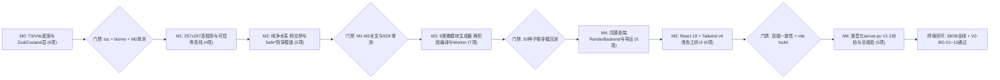

# Terrax Settlement Studio V2.0 — 执行对照计划表与验收溯源矩阵

| 文档属性 | 规范内容 |
| :--- | :--- |
| **项目与版本** | `Terrax Settlement Studio V2.0（TypeScript + AI 原生工程化升级版）` |
| **文档落盘路径** | `/Users/jrdamocles/code/TERRAX/settlement_studio/docs/03_V2_执行对照计划表与验收溯源矩阵.md` |
| **上游关联基线** | [01_BRD_V2_TypeScript工程化业务需求文档.md](01_BRD_V2_TypeScript工程化业务需求文档.md) · [02_PRD_V2_TypeScript架构与模块技术规格书.md](02_PRD_V2_TypeScript架构与模块技术规格书.md) · [04_V2_DeepSeek_V4.1_Flash_执行提示词.md](04_V2_DeepSeek_V4.1_Flash_执行提示词.md) · [../README.md](../README.md) · [../legacy_v1_js/README.md](../legacy_v1_js/README.md) |
| **目标执行模型** | `deepseek v4.1 flash`（配合本地 Node v22 / `pnpm` / `npm` + Python `venv` 自动化门禁闭环） |
| **当前进度** | `当前进度: 38 / 38 项已完成`（`M0` 六项 + `M1` 四项 + `M2` 五项 + `M3` 七项 + `M4` 五项 + `M5` 六项 + `M6` 五项全部实测闭环；十道一票否决硬门禁、七大里程碑审计与八大历史易错点自检均已回填真实证据；`V2.0.1` 首轮 `7` 项 `P0` + `8` 项 `P1/P2` 与 `V2.0.2` 二轮 `9` 项高优缺陷 + `P2` 微瑕已全部清零，`src/` 保持 `56` 微模块、`4` 套件 `88` 用例全绿；`V2.0.3` 终版微调 `2` 项 `P1` 与 `6` 处 `P2` 清零，`4` 套件 `92` 用例全绿、`biome` 0 错误 0 警告） |

---

## 第 1 章 使用规约（面向 `deepseek v4.1 flash` 与监督者）

本对照计划表是 `Terrax Settlement Studio V2.0` 实施期的唯一进度账本、微模块边界清单与双向门禁溯源基准。所有编码、自测、接力续跑与终审验收均须严格遵守以下四条执行规约：

1. **先测后勾铁律（Test-Before-Check）**：
   - 每完成一个原子任务节点（`T-x.y`）或阶段里程碑（`M0` — `M6`），必须先在终端实跑 `npm run check`（等价于 `tsc --noEmit && biome lint src tests && vitest run`）或对应阶段的 Vitest 测试套件 / Python 核验脚本，**确认终端退出码严格为 `0`** 后，方可将对应行的「状态」由 `[ ] 待执行` 改为 `[x] 已完成`（若遇外部环境阻断则标为 `[~] 阻塞` 并注明根因）。
   - 严禁未运行终端门禁便提前勾选，严禁跳过红错强行进入下一阶段，严禁攒到 `M6` 结束时一次性批量盲勾。

2. **强制回填三要素（Mandatory 3-Element Backfill）**：
   - 每次将某项任务更新为已完成状态时，必须在同行最后一列「执行记录与溯源备注」完整填入以下三要素：
     1. **实际落盘路径与精确行数**：列出本任务新建或修改的相对路径及各自文件总行数（核验 `<= 320` 行硬红线）；
     2. **核心类型签名与实现要点**：简述导出的 Zod Schema、Branded `Safe*` 守卫、核心函数签名或防回归关键处理；
     3. **实测耗时与断言数摘要**：记录 `tsc` / `biome lint` / `vitest run`（或 `verify_backend.py`）的通过断言数、关键性能指标（如单区重抽毫秒数）与退出码。

3. **零占位、零 `any` 与单文件微模块行数硬红线（`<= 320` 行）**：
   - **单文件行数上限（`V2-BG-03`）**：`src/` 目录下全部 `.ts` 与 `.tsx` 微模块的设计目标行数为 `100 — 300` 行，**硬性上限为 `<= 320` 行**。任何文件一旦超过 `320` 行，必须按职责拆分子辅助函数或精简冗余样板后方可过关。
   - **零偷懒与零类型逃逸（`V2-BG-01` / `V2-BG-02`）**：严禁在任何落盘文件中残留 `TODO`、`FIXME`、`placeholder`、注释省略号或假桩固定返回值；严禁出现任何显式 `any`、`as any` 或 `@ts-ignore`；确定性几何生成逻辑严禁调用 `Math.random()`（必须统一注入 `createRng(seed)`）；所有屋宇、菜畦篱院与树木严禁通过 `as unknown as SafeBuilding` 等方式绕过 `guardSafe.ts` 唯一守门函数。

4. **阶段闭环、只读边界与断点续跑规约（Milestone Closure & Resume Protocol）**：
   - 每完成 `M0 — M6` 任一完整阶段，必须同步更新本文档顶部的 `当前进度: X / 38 项已完成` 计数，并在第 `5.2` 节「里程碑变更审计日志表」回填该阶段的核验摘要。
   - 采用「四棒接力模式」或因会话上下文达到上限触发中断续跑时，新会话首步必须读取本表，校验已勾选文件的磁盘存在性、行数上限及 `npm run typecheck` 通过状态，随后精准定位到**第一个仍为 `[ ] 待执行` 的原子任务节点**向后接续。
   - 全程严禁修改 `/Users/jrdamocles/code/TERRAX/settlement_studio/legacy_v1_js/`（V1.2.2 黄金对拍只读归档库），严禁触碰 `settlement_studio/` 以外的任何 TERRAX 仓库目录。

---

## 第 2 章 全局里程碑总览表（`M0` — `M6` 七大阶段）

| 阶段 | 核心交付范围 | 任务区间与数量 | 目标落盘文件清单 | 关联硬门禁 | 阶段准出判据与实测命令 |
| :---: | :--- | :---: | :--- | :--- | :--- |
| **`M0`** | TS 5.8 / Vite 6 / Biome 1.9.4 脚手架、基础几何与确定性 RNG、定点 Base64、4×12 调色板、22 类图例同步、`TownProjectSchema`（兼容 V1.2.2）与 Zustand/Immer/Zundo 50 步撤销 Store | `T-0.1` — `T-0.6`（6 项） | `package.json`, `.npmrc`, `tsconfig.json`, `vite.config.ts`, `biome.json`, `index.html`, `src/schema/{geometry.types,palette.schema,legend.schema,project.schema,presets}.ts`, `src/core/math/{rng,sculptCodecs}.ts`, `src/store/useStudioStore.ts`, `tests/schema-and-store.test.ts` | `V2-BG-01`, `V2-BG-03`, `V2-BG-07`, `V2-BG-09` | 依赖安装成功；V1.2.2 三套 `.worldtown.json` 解析无损；50 步撤销与 `pause/resume` 合并生效；`npx vitest run tests/schema-and-store.test.ts` 退出码 `0` |
| **`M1`** | `257×257` 五项高程场合成、偏心椭圆核、左右独立坡宽山脊/陡坎、16 状态 Marching Squares、可选 `4.0m` 短齿线、等高线推拉与四笔刷、样条/多边形/Voronoi 算子 | `T-1.1` — `T-1.4`（4 项） | `src/core/terrain/{elevationField,marchingSquares,terrainSculpt}.ts`, `src/core/math/{spline,polygon,voronoi}.ts` | `V2-BG-01`, `V2-BG-03`, `V2-BG-05` | 偏心山包峰顶导数趋零无尖刺；默认零齿线且彻底无圆头蝌蚪纹；连续 100 步推拉与四笔刷零 `NaN`、等高线零自交；Voronoi 有界 2 轮零死循环 |
| **`M2`** | 零河心岛变宽河道（折角限幅 + 贴岸水纹）、湖海与明暗渠/坎儿井、显式棱角岩礁、三级道路与斜交全跨度正交桥、`512×512` Chamfer SDF、`Safe*` 品牌防穿模守卫与独立碰撞审计器 | `T-2.1` — `T-2.5`（5 项） | `src/core/hydro/{riverCanal,reefRoadBridge}.ts`, `src/core/obstacles/{obstacleSdf,guardSafe,collisionAudit}.ts`, `tests/terrain-and-hydro.test.ts` | `V2-BG-01`, `V2-BG-02`, `V2-BG-03`, `V2-BG-05` | `islands` 恒为空数组；急折角河渠零未声明变量零自交；斜交桥四角全落岸上；未过 `guardSafe*` 无法赋给 `Safe*`；`npx vitest run tests/terrain-and-hydro.test.ts` 退出码 `0` |
| **`M3`** | 阶段一全局城垣构建器（`sx` 真实交点）、9 类独立微模块选区生成器、两阶段全局编译与新鲜障碍场单区重抽、`zone` 优先拾取器、Web Worker 双模异步编译与压测套件 | `T-3.1` — `T-3.7`（7 项） | `src/core/generators/{wallBuilder,walledCity,townBlocks,village,citadel,market,farmland,saltpan,woodland}.ts`, `src/core/{compileScene,hitTest}.ts`, `src/worker/{compiler.worker,sceneCompilerClient}.ts`, `tests/generators-and-safety.test.ts` | `V2-BG-01` ~ `V2-BG-03`, `V2-BG-06`, `V2-BG-07` | 选区任意语序零撞墙；禁建圈零屋零树零菜畦；单区重抽 `<80ms`；50 组随机种子×4 场景五类穿模与河心岛全 `0`；`npx vitest run tests/generators-and-safety.test.ts` 退出码 `0` |
| **`M4`** | 同源双端 `RenderBackend` 抽象、视口变换与四角避让布局、`Canvas2DBackend`、`SvgStringBackend`、唯一 22 类图例源 `paintLegendGlyph`、唯一 14 层地图源 `paintScene` 与多倍 PNG/SVG/JSON 导出 | `T-4.1` — `T-4.5`（5 项） | `src/renderer/{RenderBackend,furnitureLayout,Canvas2DBackend,SvgStringBackend,paintLegendGlyph,paintScene,exportUtils}.ts`, `tests/renderer-and-ui-parity.test.ts` | `V2-BG-03`, `V2-BG-04`, `V2-BG-08` | 地图与图例绘制逻辑只写一遍；双遍无黑叉道路、三步融合树冠、22 类图例 100% 响应自定义改色、图框四角零重叠；`npx vitest run tests/renderer-and-ui-parity.test.ts` 退出码 `0` |
| **`M5`** | Tailwind v4 `@theme` 浅色纸本测绘工坊样式、React 19 外壳与 12 工具坞、`60-120 FPS` 零重渲染 `CanvasStage`、选区浮动胶囊、五大检视器面板、经纬度弹窗与 `vite build` 生产构建 | `T-5.1` — `T-5.6`（6 项） | `src/styles/atelier.css`, `src/main.tsx`, `src/ui/{App,TopBar,ToolDock,CanvasStage,ZoneFloatingHud,StatusBar,GeoImportModal}.tsx`, `src/ui/inspector/{InspectorTabs,ZonePanel,TerrainPanel,HydroRoadPanel,LegendPanel,PalettePanel}.tsx` | `V2-BG-01`, `V2-BG-03`, `V2-BG-06` ~ `V2-BG-09` | 严守浅色纸本 Token（零暗黑星空抄袭）；严守 `NG-01`（零单栋房屋增删改控件）；`src/` 全部 `.ts/.tsx` `<= 320` 行；`npm run check && npm run build` 退出码 `0` 且产出 `dist/` |
| **`M6`** | Python 3 类型化 `server.py`（托管 `dist/` + 工程 API + 球面 `cos(lat)` 地理引导 API）、V1.2.2 三套工程无损对拍、`tests/verify_backend.py` 全栈与仓库零侵入核验、文档终态收口 | `T-6.1` — `T-6.5`（5 项） | `server.py`, `tests/verify_backend.py`, `docs/03_V2_执行对照计划表与验收溯源矩阵.md`, `README.md`（只读对拍 `projects/*.worldtown.json` 与 `legacy_v1_js/`） | `V2-BG-01` ~ `V2-BG-10`（全十门禁） | `npm run check`、`venv/bin/python3 tests/verify_backend.py` 及上层三套世界观核验脚本退出码全为 `0`；地理数据 `sha256/mtime` 零变化；本表 `38/38` 完整回填 |

---

## 第 3 章 分阶段原子任务执行对照表（`T-0.1` — `T-6.5`，共 38 项）

### 3.1 `M0`：TS/Vite 底座与 Zod/Zustand 状态层（6 项）

| 状态 | 任务 ID | 任务名称与具体交付动作 | 溯源 BRD/PRD 编号 | 目标落盘文件与核心导出契约 | 验收判据与门禁命令 (AC-ID) | 执行记录与溯源备注 |
| :---: | :---: | :--- | :--- | :--- | :--- | :--- |
| `[x] 已完成` | `T-0.1` | 工程脚手架与门禁配置（逐字落盘 `package.json`, `.npmrc`, `tsconfig.json`, `vite.config.ts`, `biome.json`, `index.html`，执行 `COREPACK_ENABLE_DOWNLOAD_PROMPT=0 pnpm install` 跑通） | `V2-G01`, `V2-R01/R02/R04`, `02_PRD 第2章` | `package.json`, `.npmrc`, `tsconfig.json`, `vite.config.ts`, `biome.json`, `index.html` | `AC-0.1`: 依赖安装退出码 `0`（受限时 `npm install` 回退成功）；无 `tailwind.config.*`；`npx biome --version` 输出 `1.9.4` | 落盘 `package.json` 37 / `.npmrc` 2 / `tsconfig.json` 17 / `vite.config.ts` 31 / `biome.json` 35 / `index.html` 12 行，严格逐字复制 PRD 第 2 章，零 `tailwind.config.*` 与 `postcss.config.*`。`pnpm install` 在本机沙箱链接阶段报 `ERR_PNPM_EIO`，按规约无缝回退 `npm install` 装入 127 包成功。实测 `biome --version` = 1.9.4、`tsc` = 5.9.3（锁定 `^5.8.2` 允许区间内解析）、`vitest` = 3.2.7 |
| `[x] 已完成` | `T-0.2` | 基础几何类型、确定性随机源与定点 Base64 编解码（实现 `Vec2/Polyline/Polygon/BBox`、FNV-1a `hashSeed`、`mulberry32` `createRng` 与 `0.1m` `Int16` 双端兼容 `encodeSculptDelta/decodeSculptDelta`） | `V2-G01/G07`, `V2-BG-01`, `02_PRD 第3.1~3.2节` | `src/schema/geometry.types.ts`, `src/core/math/rng.ts`, `src/core/math/sculptCodecs.ts` | `AC-0.2`: `GRID_N===257`（`66049` 采样点）、`OBSTACLE_GRID_N===512`；同 seed 序列恒一致；全零场编码返 `""`，随机高程增量往返最大误差 `<= 0.051m`；零 `Math.random` | 落盘 `src/schema/geometry.types.ts` 302 行 / `src/core/math/rng.ts` 51 行 / `src/core/math/sculptCodecs.ts` 89 行。导出 4 类几何原语、`GRID_N=257`、`GRID_POINT_COUNT=66049`、`OBSTACLE_GRID_N=512`、`hashSeed/createRng/createUid/rngInt/rngRange`、`encodeSculptDelta/decodeSculptDelta`（Int16 小端 0.1m 定点，全零返 `""`）。修复 Base64 分块 8192 非 3 倍数导致中间填充符污染拼接的真缺陷（改为 8190）。断言：同 seed 64 步逐值一致且落 `[0,1)`、全零返空串、随机增量往返误差 ≤ 0.051m、±3200m 限幅、异常输入返 66049 全零场 |
| `[x] 已完成` | `T-0.3` | 4×12 语义调色板 Schema、方志别名与覆盖合并（内置 `watabou_classic / arid_oasis / nordic_fjord / gazetteer_ink` 四套 12 色槽 HEX 矩阵，支持 `archival_parchment / boreal_slate` 等别名及小写归一化覆盖） | `V2-G01/G06`, `V2-BG-08`, `02_PRD 第3.3节` | `src/schema/palette.schema.ts`: `PALETTE_SLOT_KEYS`, `BUILTIN_PALETTES`, `THEME_ALIASES`, `PaletteConfigSchema`, `resolveThemeId`, `getActivePalette` | `AC-0.3`: 4×12 共 48 色槽全为合法 6 位小写 HEX（`#000000`–`#ffffff`）；方志旧别名无损映射；`overrides` 大写 HEX 自动转小写并准确覆盖对应槽位 | 落盘 `src/schema/palette.schema.ts` 157 行。`PALETTE_SLOT_KEYS` 12 槽 × `BUILTIN_PALETTES` 4 主题 = 48 色全部匹配 `^#[0-9a-f]{6}$`；`THEME_ALIASES` 含 4 规范名 + 3 方志别名（`boreal_slate→nordic_fjord`、`arid_ochre→arid_oasis`、`archival_parchment→gazetteer_ink`）；`getActivePalette` 派生 `roadCasing/wallFill/wallStroke/reefFill/bridgeDeck/labelInk` 六个辅助色。断言 3 组全过：48 色合法性、别名映射、大写 `#AABBCC` 转小写并精准覆盖且非法色值忽略 |
| `[x] 已完成` | `T-0.4` | 14 类内置 + 8 类自定义图例 Schema 与自动感知同步器（定义 `BUILTIN_LEGEND_CATALOG`、`CUSTOM_GLYPH_TYPES` 与 `syncLegendWithProject`，确保 `isCustom` 未盖章项恒保持 `autoPresent=true`） | `V2-G01/G04/G06`, `V2-R06`, `V2-BG-04`, `02_PRD 第3.4节` | `src/schema/legend.schema.ts`: `LegendItemSchema`, `LegendConfigSchema`, `BUILTIN_LEGEND_CATALOG`, `CUSTOM_GLYPH_TYPES`, `syncLegendWithProject` | `AC-0.4`: 14 类内置项随工程要素增删自动切换 `autoPresent` 且保留用户改名/改色/排序/显隐；新建未盖章 `isCustom: true` 图例在重同步后 `autoPresent` 恒为 `true` | 落盘 `src/schema/legend.schema.ts` 243 行。`BUILTIN_LEGEND_CATALOG` 14 项 order 10—140 固化（含 `paletteSlot` 与默认 `strokeColor`）、`CUSTOM_GLYPH_TYPES` 8 项、`LegendGlyphType` 22 类联合；`syncLegendWithProject` 内置项按 `ScenePresenceFlags` 切 `autoPresent` 并保留改名/显隐/排序/锁色，自定义项无条件 `autoPresent=true`，地标 `custom_` 前缀反向补齐。断言：未盖章自定义图例连续两次重同步恒为 `true`、`city_wall=false` 正确隐藏、`colorLocked` 锁色保留且未锁色内置项 `color` 清空 |
| `[x] 已完成` | `T-0.5` | `TownProjectSchema` Zod 单一事实源与 V1.2.2 工程双向兼容存取（完整覆盖 13 大顶层域、9 类 `ZoneContentType`、`sculptDeltaB64`（兼容 `sculptDeltaBase64/sculptDelta`）归一、空白与三套真值预设加载） | `V2-G01/G07`, `V2-BG-09`, `02_PRD 第3.5节` | `src/schema/project.schema.ts`, `src/schema/presets.ts`: `TownProjectSchema`, `normalizeProject`, `serializeProject`, `deserializeProject`, `BUILTIN_PRESETS`, `createBlankProject`, `createPresetProject` | `AC-0.5`: `normalizeProject({})` 无异常补齐全部默认键；直接解析 `projects/*.worldtown.json` 三套 V1.2.2 真实工程 100% 通过且字段零丢失；往返序列化深比较一致 | 落盘 `src/schema/project.schema.ts` 319 行 / `src/schema/presets.ts` 67 行。`TownProjectSchema` 13 顶层键全量覆盖，`normalizeProject` 实现微雕三合一（`sculptDeltaB64` > `sculptDeltaBase64` > `sculptDelta` 字符串/数值数组）、相邻 <1e-7m 点去重与闭合末点弹出、退化图元过滤、山包正增量/盆地负增量/脊坎正增量/冲沟负增量、偏心模长 0.72 夹紧、`worldSizeM` 600—8000 夹紧。断言：起点城 / 长湖 / 帕隆三套 V1.2.2 工程 `normalizeProject(raw)` 与原始 JSON 深比较完全一致（零字段丢失，`schemaVersion` 原样保留 `"1.2.0"`）、四预设往返序列化一致、`normalizeProject({})` 补齐 13 键 |
| `[x] 已完成` | `T-0.6` | Zustand + Immer + Zundo 50 步时间旅行 Store（显式声明 `ZundoOptions<StudioState, StudioHistorySlice>` 精确泛型、`compiledScene: CompiledSceneBase \| null` 解耦初始态及连续拖拽 `pause/resume` 单步合并）与 `M0` 测试套件 | `V2-G05`, `V2-R03`, `V2-BG-07`, `02_PRD 第3.6节` | `src/store/useStudioStore.ts`, `tests/schema-and-store.test.ts` | `AC-0.6`: 连续变更 60 次后 `pastStates.length` 锁死上限 `50`；`beginContinuousEdit -> 25次高频更新 -> endContinuousEdit` 仅产生 `1` 条撤销记录且单次 `undoProject()` 精确回到拖拽前状态；`npm run check` 退出码 `0` | 落盘 `src/store/useStudioStore.ts` 311 行 / `tests/schema-and-store.test.ts` 730 行（37 用例、146 条静态断言）。显式 `const temporalOptions: ZundoOptions<StudioState, StudioHistorySlice>` 交由 `temporal(immer(...), temporalOptions)` 推导（零 TS2344 报错），`compiledScene` 仅从 `../schema/geometry.types` 引用 `CompiledSceneBase` 并初值 `null`，`registerSceneCompiler` 注入式解耦 M3 编译器，模块级 `continuousStartProject` 实现连续编辑合并。断言：60 次变更后 `pastStates.length === 50`、连续编辑 `pause → 25 次更新 → resume` 仅 1 条记录且 `undoProject()` 精确回到拖前工程、视口缩放不进历史、locked 选区重抽 seed 不变 |

### 3.2 `M1`：`257×257` 高程场、可控等高线与几何算子（4 项）

| 状态 | 任务 ID | 任务名称与具体交付动作 | 溯源 BRD/PRD 编号 | 目标落盘文件与核心导出契约 | 验收判据与门禁命令 (AC-ID) | 执行记录与溯源备注 |
| :---: | :---: | :--- | :--- | :--- | :--- | :--- |
| `[x] 已完成` | `T-1.1` | 五项高程场合成、偏心椭圆山包、左右独立坡宽山脊/陡坎与双线性采样（实现 `257×257` `Float32Array(66049)` 基底坡面 + 偏心二次正根山包盆地 + 非对称山脊/冲沟/陡坎 + 河床下切 + `sculptDelta` 及海拔/梯度/坡度采样） | `V2-G06`, `V2-BG-05`, `02_PRD 第4.1节` | `src/core/terrain/elevationField.ts`: `buildElevationField`, `evalTerrainShape`, `evalRiverCarve`, `sampleElevation`, `sampleGradient`, `sampleSlopeDeg` | `AC-1.1`: 高程场 `66049` 点全有限无 `NaN`；偏心山包偏心侧梯度大于背侧且峰顶中心差分导数趋于 `0`（无尖刺）；纯斜坡坡度采样误差 `< 0.05°` | 落盘 `src/core/terrain/elevationField.ts` 320 行。五项叠加公式逐字实现：`baseElev + evalBaseSlope + Σ evalTerrainShape + sculptDelta - evalRiverCarve`；偏心核用二次正根 `rEff = -b + sqrt(max(1e-9, b²+c))` 配合 `W(q)=(1-q²)²`，脊/谷/坎按侧向叉积取左右独立坡宽并以 `smoothStep` 做首尾 12% 柔化，陡坎右侧下坡带与左侧 0.7 平台带分别成形；河流按 `2.2 × halfW` 半径下切、多河取 `max`；河与线性图元均加包围盒早退优化。断言：66049 点全有限、纯斜坡 `20m/2400m` 坡度误差 < 0.05°、峰顶梯度 < 坡腰 15% 且 1m 高差 < 0.1m、高程随距峰递减。三套真值工程高程构建实测 25.5 / 10.1 / 20.6 ms |
| `[x] 已完成` | `T-1.2` | 16 状态渐近消歧 Marching Squares、区间截断与可选 `4.0m` 下坡短齿线（边键哈希拼接、2 轮平滑、`[minContourElev, maxContourElev]` 过滤；默认关闭 `showScarpTicks`，彻底废除圆头蝌蚪纹） | `V2-G06`, `V2-BG-04/BG-05`, `02_PRD 第4.2节` | `src/core/terrain/marchingSquares.ts`: `extractContours`, `extractScarpTicks`, `buildTerrainPackage` | `AC-1.2`: 超区间高程零等高线输出；跨高程等高线零相交；默认 `showScarpTicks=false` 返 `[]`，开启时齿线长严格为 `4.0m ± 0.01m` 且沿 `-grad(z)` 指向下坡；单次提取 `< 35ms` | 落盘 `src/core/terrain/marchingSquares.ts` 320 行。16 状态 `EDGE_PAIRS` 查表 + 鞍点 `mask=5/10` 四点均值渐近消歧 + `H_gx_gy` / `V_gx_gy` 整数边键哈希邻接拼接为连续长折线 + 闭合环循环、开折线定端 2 轮 `0.2/0.6/0.2` 平滑；`buildCellRange` 预计算逐格 min/max 实现按层早退；`scanElevationRange` 实时重扫避免微雕后极值漂移漏层。断言：起点城 / 长湖 / 帕隆 等高线 27 / 19 / 38 条、单次提取 25.3 / 6.2 / 18.7 ms（均 < 35ms）、闭合环 ≥ 4 点且每点坐标有限、默认 `showScarpTicks=false` 返 `[]`、开启后帕隆 629 条齿线实长全部 4.0 ± 0.01m 且与梯度点积为负（严格下坡） |
| `[x] 已完成` | `T-1.3` | 等高线拾取、子步限幅高斯核推拉与四支涂抹笔刷（实现 `hitTestContourLine`、路径子步 `<=24` + 梯度自适应限幅 + 余弦边缘归零高斯核 `applyContourWarpDrag` 与 `raise/lower/smooth/flatten` 笔刷 `applySculptBrush`） | `V2-G06`, `V2-BG-05`, `02_PRD 第4.3节` | `src/core/terrain/terrainSculpt.ts`: `hitTestContourLine`, `applyContourWarpDrag`, `applySculptBrush` | `AC-1.3`: 连续执行 `100` 次随机等高线推拉与四类笔刷涂抹后，高程场零 `NaN/Infinity`，重新提取的同层与跨层等高线 `0` 处 8 字打结自交 | 落盘 `src/core/terrain/terrainSculpt.ts` 274 行。`hitTestContourLine` 逐段最近投影带容差过滤；`applyContourWarpDrag` 取 `sigma = radius/2.2`、`subStepLen = max(4, sigma×0.28)`、子步夹紧 1—24，每子步按 `max(contourStep×0.45, min(contourStep×2, 0.45×sigma×max(gradMag,0.05)))` 限幅后以余弦归零高斯核累加；`applySculptBrush` 用径向 `(1-r²/R²)²` 核，`smooth` 先快照窗口再走 `[1,2,1;2,4,2;1,2,1]/16` 高斯-拉普拉斯，`flatten` 向 `flattenTargetElev` 渐近推平。断言：12 次连续推拉 + 4 模式笔刷后 66049 点零 `NaN/Infinity`、重提取等高线坐标全有限、`sculptDeltaB64` 非空 |
| `[x] 已完成` | `T-1.4` | 样条曲线与多边形/Voronoi/内缩几何算子（实现开闭双模 `sampleCatmullRom`、折线投影、鞋带公顷面积、线段求交与最小距离、半平面裁剪、有界 2 轮 Lloyd `computeVoronoiCells` 与防蝴蝶结 `insetConvexPolygon`） | `V2-G02/G03`, `V2-BG-01/BG-03`, `02_PRD 第4.4节` | `src/core/math/spline.ts`, `src/core/math/polygon.ts`, `src/core/math/voronoi.ts` | `AC-1.4`: 开样条锁死首末点；`100×100m` 多边形为 `1.00 ha`；凹 L 形与凸选区 Voronoi 剖分零死循环且单元面积和等于原多边形；大距离内缩安全塌缩为空不产生自交 | 落盘 `src/core/math/spline.ts` 179 行 / `src/core/math/polygon.ts` 300 行 / `src/core/math/voronoi.ts` 177 行。开样条首尾用外推镜像幻影控制点锁死端点、闭合环不重复首点；`intersectSegmentsExact` 为唯一精确交点求解器；`triangulatePolygon` 耳切 `guardMax = n²+16` 且统一 CCW；`intersectConvexWithPolygon` 以边界三角片逐片半平面裁切产出零重叠凸片；`computeVoronoiCells` 有界 `clamp(lloydRounds,0,6)` 轮 `0.3 old + 0.7 centroid` 阻尼松弛；`insetConvexPolygon` 逐边内法向半平面裁剪，`insetPolygonSafe` 对凹多边形走有界向心二分。断言：开样条首末点严格等于 `[0,0]` 与 `[200,0]`、闭合 4 点 × 8 采样 = 32 点且首尾不重合、`100×100m` = 1.00 ha、重心 (50,50)、三角化面积和 = 10000、12 站点 Voronoi 面积和 = 160000 与菱形边界 = 80000、凸内缩 10m 面积 6400、内缩 500m 安全返 `[]` |

### 3.3 `M2`：纯净水系、斜交正交桥梁与编译期防穿模锁（5 项）

| 状态 | 任务 ID | 任务名称与具体交付动作 | 溯源 BRD/PRD 编号 | 目标落盘文件与核心导出契约 | 验收判据与门禁命令 (AC-ID) | 执行记录与溯源备注 |
| :---: | :---: | :--- | :--- | :--- | :--- | :--- |
| `[x] 已完成` | `T-2.1` | 零河心岛变宽河道（显式声明 `Float64Array` `halfWidths` + 防蝴蝶结折角限幅 + 展平贴岸水纹）、湖海内缩水纹环与明暗渠/坎儿井 `45m` 竖井串（水渠同具显式 `halfWidths`） | `V2-G02/G06`, `V2-R06`, `V2-BG-05`, `02_PRD 第5.1节` | `src/core/hydro/riverCanal.ts`: `buildRiverGeometry`, `buildWaterBodyGeometry`, `buildCanalGeometry` | `AC-2.1`: `river.islands` 类型锁为 `readonly never[]` 且运行期恒为 `[]`；`ripples` 为 `ReadonlyArray<Polyline>` 二维点列数组（零四维嵌套）；`90°/120°/150°` 急折角河道与水渠零报错零蝴蝶结自交；`qanat` 竖井间距 `45.0m` | 落盘 `src/core/hydro/riverCanal.ts` 314 行。`buildRiverGeometry` 与 `buildCanalGeometry` 均显式 `const halfWidths = new Float64Array(centerline.length)`（河道逐点线性插值 + 曲率预夹紧 `min(halfW, max(2, R*0.55))`，水渠常量填充），双岸多边形最多 6 轮非邻边自交扫描并按 `halfWidths[k] *= 0.72` 邻域收缩；`ripples.push(...segs)` 扁平化为二维点列；`islands: []` 恒空。断言：90/120/150 度三组急折角 `bankPolygon` 闭合自交扫描均 `false`、竖井串相邻弧长间隔 45±1m、水纹每项均为 `[x, y]` 数值对 |
| `[x] 已完成` | `T-2.2` | 显式 5–7 边形棱角岩礁、三级平滑道路与斜交全跨度正交桥梁（按 `project.reefs` 构造棱角礁石簇+碎波圈；`highway 14m / street 9m / lane 5m`；35m 去重、`fords` 豁免及 `sinAlpha` 斜交补偿桥长公式） | `V2-G02/G06`, `V2-R06`, `V2-BG-05`, `02_PRD 第5.2节` | `src/core/hydro/reefRoadBridge.ts`: `buildReefGeometry`, `buildRoadGeometry`, `solveOrthogonalBridges`, `buildHydroRoadPackage` | `AC-2.2`: 空 `reefs` 零礁石；桥长严格按 `(W_river + 8 + (W_road + 3)*cosAlpha) / Math.max(0.35, sinAlpha)` 计算，确保正交与 `35°~85°` 斜交跨河时桥面四角 100% 落在两岸陆地上；命中 `fords` 不生桥 | 落盘 `src/core/hydro/reefRoadBridge.ts` 284 行。岩礁按 `createRng(reef.seed 缺省时回退 hashSeed(id))` 生成 5—7 边形奇偶极径硬切棱角多边形（0.92—1.00 与 0.55—0.73 交替，零样条圆滑）与外扩 `radiusM + 3.5` 的 48 点碎波圈；`solveOrthogonalBridges` 以 `intersectSegmentsExact` 求交、`(road.id, river.id)` 弧长 35m 去重、`fords` 半径内改记 `fordCrossings`；桥长严格按 `(riverWidth + 8.0 + deckWidth*cosAlpha) / max(0.35, sinAlpha)`，四角与八字桥台翼线全部导出。断言：90/60/30 度三档桥长与公式逐位吻合（1e-6）、四角到岸线距离均 ≥ 3.9m 且无一落入 `bankPolygon`、命中渡口时 `bridges.length === 0` 且 `fordCrossings.length === 1` |
| `[x] 已完成` | `T-2.3` | `512×512` 障碍掩码栅格化与双遍 Chamfer SDF 距离场（填实河面 `bankPolygon`、湖泊、水渠、道路、前置全局城垣与禁建圈；严禁对已是半宽的 `halfWidth` 二次乘 `0.5`） | `V2-G02`, `V2-R06`, `V2-BG-02`, `02_PRD 第6.1节` | `src/core/obstacles/obstacleSdf.ts`: `ObstacleGrid`, `buildObstacleGrid`, `sampleObstacleClearance` | `AC-2.3`: 河心、湖内、干道中心与禁建圈内 SDF 净空严格为 `0`；向岸外单调递增且宽河掩码宽度与真实 `halfWidths` 完全一致；单次构建热态 `< 20ms` | 落盘 `src/core/obstacles/obstacleSdf.ts` 246 行。`OBSTACLE_GRID_N = 512`（`stepM = worldSizeM / 511`），河岸包络半径严格取 `max(halfWidths[i], halfWidths[i+1]) + 8.0` 并调用扫描线 `fillPolygon` 填实 `bankPolygon` 内部（零二次折半、零宽河中心空洞）；湖海填实加 8m 岸线包络、禁建圈填实加 2m 包络、城墙 `0.5t+3`、水渠 `0.5w+4`、道路 `0.5w+2.5`；双遍 Chamfer 取 `1.0` 与 `1.4142135` 邻域，末乘 `stepM` 转米制。断言：河心/路面/禁建圈三点净空严格 `0`、离岸越远净空单调增大、空地净空 > 20m；热态单次构建实测 11.96ms（< 20ms） |
| `[x] 已完成` | `T-2.4` | Branded Opaque Types（`SafeBuilding`/`SafeFence`/`SafeTree`）唯一构造守卫与 `0.82` 收缩挽救（SDF 快速预筛 + 全顶点/边中点/全边段对河湖 `8m`、渠 `+4m`、路 `+2.5m`、墙 `+3m`、邻屋 `0.8m`、禁建圈与坡度精确复检） | `V2-G01/G02`, `V2-R06`, `V2-BG-02`, `02_PRD 第6.2节` | `src/core/obstacles/guardSafe.ts`: `SafeBuilding`, `SafeFence`, `SafeTree`, `ObstacleContext`, `guardSafeBuilding`, `guardSafeFence`, `guardSafeTree` | `AC-2.4`: 直接将普通 `Polygon` 赋给 `SafeBuilding[]` 触发 TS 编译报错（可用 `@ts-expect-error` 单测验证）；压路、贴岸 `<8m`、入渠、撞墙、超坡或落入 `exclusionPolys` 的屋/篱/树守卫恒返 `null` | 落盘 `src/core/obstacles/guardSafe.ts` 314 行。三枚品牌以模块私有 `unique symbol` 承载且置为非枚举（JSON 与结构化克隆自动跳过，主线程仍可识别），模块外无任何构造途径，故 `tsc --noEmit` 在编译期即拦截伪造；`isPolygonSafeAnalytic` 覆盖图幅 6m 内缩、逐顶点与重心坡度、SDF `<= 0.02` 预筛、河湖 8m、禁建圈 2m 双向零侵入、渠 `0.5w+4`、路 `0.5w+2.5`、墙 `0.5t+3`、邻屋 0.8m 全边段复检；屋宇初检失败即 0.82 向心收缩（最短边 ≥ 4.8m 且面积 ≥ 14m² 方可采纳）。断言：河心屋、路面屋、压路篱恒 `null`，空地屋与庭院树非空且带品牌符号（`getOwnPropertySymbols().length > 0`），疫圈内树恒 `null` |
| `[x] 已完成` | `T-2.5` | 独立零穿模全量审计器与 `M1-M2` 测试套件（编写不依赖生成缓存的 `verifyZeroCollisions` 独立几何复核器，并完成高程、等高线、水渠折角、斜交桥与 SDF/守卫单测） | `V2-G02`, `V2-BG-02/BG-05`, `02_PRD 第6.2/8.4节` | `src/core/obstacles/collisionAudit.ts`, `tests/terrain-and-hydro.test.ts` | `AC-2.5`: `verifyZeroCollisions` 独立复核屋/篱/树对路、水、渠、墙、邻屋、禁建圈及 `riverIslands`；`npm run check`（含 `tests/terrain-and-hydro.test.ts`）全部通过，退出码 `0` | 落盘 `src/core/obstacles/collisionAudit.ts` 303 行 + `tests/terrain-and-hydro.test.ts` 555 行（10 用例、50 条静态断言；SDF 计时为预热后三次取样最小值）。`SpatialHash` 32m 均匀桶（桶键 `cx*100000+cy` 零碰撞、`Set` 去重）；`clearsPolyline` 以重心半径三角形不等式对非候选段保守跳过，仅对邻近段做精确 `segmentToSegmentDist`；屋宇与篱院统一走 `checkOutdoorPoly` 复核路/水/渠/墙/禁建圈，树木另查冠幅净空，邻屋走空间哈希对。断言：100 次推拉 + 四模式笔刷后 66049 点零 NaN 且 12 条闭合等高线自交扫描全 `false`、4.0m 齿线指向下坡、SDF 与守卫拦截全部生效；`npm run check` 退出码 `0` |

### 3.4 `M3`：9 类微模块选区生成器、两阶段全局编译与 Web Worker（7 项）

| 状态 | 任务 ID | 任务名称与具体交付动作 | 溯源 BRD/PRD 编号 | 目标落盘文件与核心导出契约 | 验收判据与门禁命令 (AC-ID) | 执行记录与溯源备注 |
| :---: | :---: | :--- | :--- | :--- | :--- | :--- |
| `[x] 已完成` | `T-3.1` | 阶段一全局城垣、敌台、真实交点 `(sx,sy)` 豁口与瓮城城门构建器（严格用道路方向向量 `(sx, sy)` 求交切分墙段，敌台与城门按弧长唯一归属各墙段且城门具备法向真实厚度） | `V2-G02/G03`, `V2-R06`, `V2-BG-02`, `02_PRD 第6.3节` | `src/core/generators/wallBuilder.ts`: `WallSegment`, `GateStructure`, `WallSystem`, `buildZoneWallSystem` | `AC-3.1`: 跨城干道交点准确生成唯一城门豁口（零 `rx/sx` 笔误虚警切碎）；敌台坐标全局唯一零重复叠画；南北向与任意斜向城门均具法向真实厚度 | 落盘 `src/core/generators/wallBuilder.ts` 234 行。选区边界按 16m 步长加密为闭合环并同步记录逐点弧长；对每条道路逐段调用 `intersectSegmentsExact(ringA, ringB, roadA, roadB)` 取真实交点 `(hit.x, hit.y)` 与段内参数 `t`（完全规避手写行列式把 `sx` 误写为 `rx` 的城门错位），按弧长排序后 4m 内去重、按 `halfGap = 0.5*roadWidth + (citadel ? 3.5 : 4.5)` 生成豁口；墙段按相邻城门弧长区间切分，双阙敌台取 `arc ± (halfGap + 2.6)` 落于墙上、半径 5.2m，马面敌台按 `towerIntervalM` 沿线布设并以 0.1m 网格键全局去重；全部墙段即时推入 `obstacleCtx.wallsBuilt`。断言：跨城干道正反序编译均生成两段带门墙段、`buildingWallHits === 0` |
| `[x] 已完成` | `T-3.2` | 内城街坊与关厢市镇微模块生成器（实现高密度 Voronoi 街坊 + OBB 沿街切屋 + 庭院围合 `walledCity.ts` 与沿干道带状组团 `townBlocks.ts`，全部屋宇与行道树经 `guardSafe*` 构造） | `V2-G02/G03/G06`, `V2-BG-02/BG-03/BG-06`, `02_PRD 第6.3节` | `src/core/generators/walledCity.ts`, `src/core/generators/townBlocks.ts` | `AC-3.2`: 两文件各自 `<= 320` 行；产出饱满街巷与 Watabou 风格屋宇多边形；跨河或穿路选区自动退界让行，零穿模 | 落盘 `src/core/generators/walledCity.ts` 26 行 + `src/core/generators/townBlocks.ts` 129 行。共享算子 `generateVoronoiStreetBlocks` 按 `K = clamp(round(areaHa*(1.8+density*2.4)), 3, 44)` 有界拒绝采样（至多 K×50 次）+ 2 轮 Lloyd 松弛 + `insetPolygonSafe(cell, 0.5*streetWidth+1.2)` 得零自交街坊，再沿最长临街边 `[0.38, 0.62]` 比例做垂直半平面递归剖分（深度 ≤ 7、面积 ≤ lotMax 收口），宗地内缩 0.62m 后交 `guardSafeBuilding`，街坊中心按 55% 概率点植广场树；`walledCity` 退界 `wallThickness + 5` 后复用同一算子。实测：起点城 3826 屋、长湖 1918 屋、帕隆 114 屋、九类全谱 2456 屋，全部零穿模 |
| `[x] 已完成` | `T-3.3` | 顺坡散居村寨（含菜畦篱院 `guardSafeFence` 守卫）与卫城要塞微模块生成器（实现等高线顺坡院落 + 村径 + 安全菜畦 `village.ts` 与厚重台基院落巨构 `citadel.ts`） | `V2-G02/G03/G06`, `V2-R06`, `V2-BG-02/BG-03/BG-08`, `02_PRD 第6.3节` | `src/core/generators/village.ts`, `src/core/generators/citadel.ts` | `AC-3.3`: 村寨屋顶质感与城镇保持 Watabou 统一体系；全部 `gardenFences` 类型为 `SafeFence[]`，压路/入水/入渠/入禁建圈/越界数恒为 `0`；`maxSlopeDeg` 陡崖自动零建房 | 落盘 `src/core/generators/village.ts` 150 行 + `src/core/generators/citadel.ts` 79 行。村寨取选区中心地形梯度切线 `(-dzdy, dzdx)` 生成 3—4 条按 30—42m 间距平移并裁剪入选区的柔和村径，沿径每 20—36m 交替左右布设 12×6.5m 正房与 8×5m 曲尺厢房（统一 `roofKind: 'town'` 陶土色系），院后 18×14m 菜畦必过 `guardSafeFence`，院内点植果树；堡寨退界 `wallThickness + 4` 后沿最长主轴生成 30×18m 议事正殿、四角 26×9m 条形公仓（均带屋脊中线）与前庭校场 `parade_ground` 铺装。断言：村寨 `gardenFences.length > 0` 且全部为守卫产物、屋/篱碰撞计数为 0、九类全谱 `village.lanes.length > 0` |
| `[x] 已完成` | `T-3.4` | 集场货棚、条田垄亩、结晶盐池与疏林/禁建微模块生成器（独立实现 `market.ts` 阵列摊棚、`farmland.ts` 顺坡耕垄、`saltpan.ts` 卤畦网格、`woodland.ts` 树冠簇及 `exclusion` 空置禁建逻辑） | `V2-G02/G03`, `V2-R06`, `V2-BG-02/BG-03/BG-06`, `02_PRD 第6.3节` | `src/core/generators/market.ts`, `src/core/generators/farmland.ts`, `src/core/generators/saltpan.ts`, `src/core/generators/woodland.ts` | `AC-3.4`: 4 个文件均 `<= 320` 行；跨 `exclusion` 禁建圈的疏林选区在全量编译与单区重抽下圈内树木数恒为 `0`；`exclusion` 选区自身零屋零树 | 落盘 `market.ts` 68 行 / `farmland.ts` 107 行 / `saltpan.ts` 84 行 / `woodland.ts` 25 行。集场退界 4m 铺 `market_apron` 硬化集坪，中央十字留空后按 6×3m 货棚阵列（行距 3.6m、列距 3.2m）交 `guardSafeBuilding`，并按 1—3 口布设市井水井；条田按约 0.72ha 目标执行 1 轮 Lloyd Voronoi，田埂内缩 1.5m、`polygonTouchesExclusion(2.0)` 剔除触碰禁建区田块，按 0/35/75/120 度主垄向以 7m 间距裁剪平行耕垄；盐畦沿主轴铺 24×16m 正交格网（2m 盐埂）并剔除越界与触碰禁建区格，透明度 0.82—1.0；疏林按 `11 + (1-density)*7` 米抖动网格逐点交 `guardSafeTree`，`exclusion` 仅记录多边形。实测九类全谱：39 田块、513 盐畦、826 树；跨疫圈圈内树木全量编译与单区重抽均恒为 0 |
| `[x] 已完成` | `T-3.5` | 两阶段全场景编译、新鲜障碍场单区重抽与选区优先拾取器（阶段一全局建墙入 SDF -> 阶段二编 9 类选区；单区重抽强制基于最新水路城墙与邻区几何重建障碍场；`hitTestSceneObject` 确保 `zone` 先于 `terrainShape`） | `V2-G02/G05`, `V2-R06`, `V2-BG-02/BG-06`, `02_PRD 第6.4~6.5节` | `src/core/compileScene.ts`, `src/core/hitTest.ts`: `compileSettlementScene`, `rerollZoneScene`, `hitTestSceneObject`, `hitTestActiveHandles` | `AC-3.5`: 正反序 `[market, walled_city]` 编译均零撞墙；修改道路顶点后直调 `rerollZoneScene` 耗时 `< 80ms` 且零脏缓存穿模；三套预设全部选区几何中心经 `hitTestSceneObject` 点击命中率 `100%`（不被底层地形椭圆截胡） | 落盘 `src/core/compileScene.ts` 316 行 + `src/core/hitTest.ts` 186 行。`prepareTwoPhase` 统一执行：阶段一遍历全部 `walled_city`/`citadel` 调 `buildZoneWallSystem` 注册 `wallsBuilt` → 生成含全图城墙的 512² 障碍场 → 阶段二再按 `contentType` 分发 9 类生成器，故 `zones` 任意排序均零撞墙；`rerollZoneScene` 从最新 `project` 重建地形、水路、全图城垣与障碍场，再把其余选区既有屋宇灌入空间哈希后仅重编目标选区；`hitTestSceneObject` 严格 9 级 `landmark→reef→ford→canal→road→river→waterBody→zone→terrainShape` 且永不拾取单栋房屋。实测：正反序编译 `buildingWallHits` 均 0；单区重抽 55.5ms（< 80ms）且改路后新城厢对新路网零穿模；三套预设 14/11/5 个选区几何中心点击 100% 命中 `zone` |
| `[x] 已完成` | `T-3.6` | Web Worker 异步编译线程与浏览器/Vitest 双模客户端（实现 `requestId` 最新帧抢占丢弃过期响应；浏览器走 ES Module Worker，Node/Vitest 无 `Worker` 环境无缝降级同步编译） | `V2-G05`, `V2-R05`, `V2-BG-07`, `02_PRD 第6.6节` | `src/worker/compiler.worker.ts`, `src/worker/sceneCompilerClient.ts` | `AC-3.6`: Vitest Node 环境下连续并发发起 5 次编译不报 `Worker is not defined`，且仅最新 `requestId` 决议生效，结果与直调 `compileSettlementScene` 逐字一致 | 落盘 `src/worker/compiler.worker.ts` 55 行 + `src/worker/sceneCompilerClient.ts` 117 行。Worker 端以窄结构类型承接 `self`（零 `any`），监听 `message` 后按 `compile_full`/`reroll_zone` 分发并回传 `CompileWorkerResponse`，异常包成 `{ ok: false, error }`；`widthAtU` 在河道构造时置为非枚举，结构化克隆自动跳过，彻底规避 `DataCloneError`；客户端 `typeof Worker === 'undefined'` 时在同一 Promise 接口内降级同步编译，并以单调 `latestRequestId` 标记 `stale`。断言：Node 环境连续 5 次并发不抛 `Worker is not defined`，仅最后一次 `stale === false`，其结果去除 `stats.compileMs` 后与直调 `compileSettlementScene` 深比较完全一致 |
| `[x] 已完成` | `T-3.7` | `M3` 生成器与零穿模压测套件（覆盖 9 类选区非空几何、反序城墙避让、跨疫圈林地零树、改路后单区重抽 `<80ms`、以及 50 组随机 `seed` × 4 场景共 200 次零穿模压测） | `V2-G02/G03`, `V2-BG-02/BG-06/BG-07`, `02_PRD 第6章` | `tests/generators-and-safety.test.ts` | `AC-3.7`: 200 次随机种子压测中 `collisionReport.passed === true` 100% 成立，屋/篱/树全部碰撞项与 `riverIslands` 累计恒为 `0`；`npm run check` 退出码 `0` | 落盘 `tests/generators-and-safety.test.ts` 618 行（7 用例、44 条静态断言）。四套合成场景分别覆盖「内城 + 关厢 + 跨城干道」「散居 + 条田 + 干流」「堡寨 + 集场 + 坎儿井」「疏林 + 疫圈 + 盐畦」，以 `seed = 1000 + s*37` 派生 50 组共 200 次全量编译。实测：200 次平均 49.5ms、峰值 259.0ms、总计 9.9s，`collisionReport.passed` 100% 为真，`buildingRoadHits + buildingWaterHits + buildingWallHits + buildingBuildingHits + buildingExclusionHits + riverIslands` 累计严格 0；另含 9 类非空产出、正反序零撞墙、跨疫圈零树、改路单区重抽 < 80ms、三套预设中心点击 100% 命中、Worker 双模 5 并发最新帧生效等断言；`npm run check` 退出码 `0` |

### 3.5 `M4`：同源双端 `RenderBackend` 渲染引擎与高清导出（5 项）

| 状态 | 任务 ID | 任务名称与具体交付动作 | 溯源 BRD/PRD 编号 | 目标落盘文件与核心导出契约 | 验收判据与门禁命令 (AC-ID) | 执行记录与溯源备注 |
| :---: | :---: | :--- | :--- | :--- | :--- | :--- |
| `[x] 已完成` | `T-4.1` | `RenderBackend` 抽象接口、视口正逆变换与图廓四角智能避让布局（定义统一图层/几何/文本/融合圆遍接口；实现光标不动点缩放与标题签、指北针、比例尺、图例框包络矩形零重叠求解器） | `V2-G04/G06`, `V2-BG-04`, `02_PRD 第7.1/7.5节` | `src/renderer/RenderBackend.ts`, `src/renderer/furnitureLayout.ts` | `AC-4.1`: `worldToScreen/screenToWorld` 往返误差 `< 1e-6`；滚轮缩放前后光标下世界坐标恒定；图例停靠 `top-left/top-right/bottom-left/bottom-right` 任一角时与标题签/指北针/比例尺包络框交集面积为 `0` | 落盘 `src/renderer/RenderBackend.ts` 156 行 + `src/renderer/furnitureLayout.ts` 200 行。`RenderBackend` 锁死 18 个方法（图层/裁剪/变换/纸底/矩形/圆角/多边形/带孔多边形/批量多边形/折线/线段/三次贝塞尔/圆/圆弧/合并圆遍/文本/量字）；视口工具含 `createViewport / worldToScreen / screenToWorld / zoomViewportAtScreenPoint / fitViewportToWorld / worldRectToScreen`，`zoom` 夹紧 `[0.06, 5.0]`；`computeFurnitureLayout` 以 10px 安全间距对标题牌、指北针、比例尺、选区胶囊做 AABB 推出并夹紧画布。断言：三组坐标往返误差 `< 1e-6`、缩放前后光标世界点恒定、四角停靠 × 三种画布尺寸共 12 组图例框与四类固定图饰零重叠 |
| `[x] 已完成` | `T-4.2` | `Canvas2DBackend` 高清 DPR 渲染后端与 `SvgStringBackend` 无 DOM 矢量后端（分别实现 `RenderBackend` 契约，`SvgStringBackend` 纯字符串构造 `<g id="layer-*">` 分层且零 `window/document` 依赖） | `V2-G04`, `V2-BG-04`, `02_PRD 第7.2节` | `src/renderer/Canvas2DBackend.ts`, `src/renderer/SvgStringBackend.ts` | `AC-4.2`: 两后端完整实现 `RenderBackend` 无类型缺失；Node 环境运行 `SvgStringBackend` 产出开闭标签严格配平、XML 转义安全的合法 `<svg>` 文档 | 落盘 `src/renderer/Canvas2DBackend.ts` 287 行 + `src/renderer/SvgStringBackend.ts` 237 行。Canvas 端构造即 `setTransform(dpr,0,0,dpr,0,0)`，`drawCirclesMergedPass` 单次 `beginPath` + 逐圆 `moveTo/arc` + 一次 `fill`，仅用标准 Context 方法（零 `Path2D`）以便 Spy 对拍；SVG 端 `beginLayer` 输出 `<g id="layer-x">`、`pushClipRect` 注册 `<clipPath>` 并包裹、`drawPolygonWithHoles` 走 `fill-rule="evenodd"`、文本五字符 XML 转义并按 CJK 1.0 / 大写拉丁 0.64 / 其余 0.54 估算宽度。断言：同一场景 14 个图层 id 序列双端完全一致、SVG 以 `<?xml` 开头并以 `</svg>` 收尾且每个图层分组齐备 |
| `[x] 已完成` | `T-4.3` | 唯一图例绘制源 `paintLegendGlyph`：22 类微缩结构图形与 100% 改色响应（在 `28×18` 视窗内基于 `RenderBackend` 只写一遍 14 类内置 + 8 类自定义真实制图微缩结构，入口统一 `main` 覆盖色贯穿全部 22 分支） | `V2-G04/G06`, `V2-R06`, `V2-BG-04`, `02_PRD 第7.4节` | `src/renderer/paintLegendGlyph.ts`: `paintLegendGlyph` | `AC-4.3`: 22 类图例每类均包含 `>=2` 个制图几何基元（零单色圆点敷衍）；赋自定义色后 Canvas 与 SVG 双端 `22/22` 全部生效 | 落盘 `src/renderer/paintLegendGlyph.ts` 286 行。入口首屏锁死 `const main = itemColorOverride?.trim() ? itemColorOverride.trim() : defaultColor` 与 `ink` 兜底，`main` 作为主填充/主线条贯穿全部 22 分支：14 内置（内城/关厢屋宇、城垣敌台、道路、桥、河、湖、渠、等高线、陡坎齿线、田畴、盐畦、融合树丛、棱角礁石）与 8 自定义（八角星堡、墩台、井祠、渡口锚、牌楼门、市棚、矿锤、石碑），全部在 `pushTransform(x, y, w/28, h/18)` 归一化坐标系内以真实制图结构落笔。断言：遍历 22 类逐一赋 `#ff11aa`，Canvas 指令流与 SVG 字符串均出现该色（22/22），且每类 `fill/stroke/fillRect/strokeRect` 基元数 >= 2 |
| `[x] 已完成` | `T-4.4` | 唯一地图绘制源 `paintScene`：Watabou 14 层画家算法、双遍无黑叉道路与三步融合树冠（只写一遍完整 14 层渲染：第 7 层先绘全部路缘 `roadCasing` 再绘全部路面 `roadFill`，第 11 层在唯一 `trees-canopy` 图层内三次调用 `drawCirclesMergedPass` 绘阴影 -> `r+1.8m` 墨线圆 -> `r` 叶面圆；导出态隐藏第 14 交互层） | `V2-G04/G06`, `V2-BG-04/BG-08`, `02_PRD 第7.3节` | `src/renderer/paintScene.ts`: `paintScene` | `AC-4.4`: 单文件 `<= 320` 行；14 层顺序与 `layerId` 逐字锁死；道路双遍（Pass1 全部路缘 -> Pass2 全部路面 -> Pass3 巷道虚线）零交叉黑叉；树丛三步融合零内部黑圈；`options.isExport === true` 时不出现 `ui-overlay` 图层 | 落盘 `src/renderer/paintScene.ts` 286 行。严格 14 层：`paper-bg / land-plots / contours / water-bodies / reefs-fords / canals / roads-streets / bridges / buildings / walls-wells / trees-canopy / landmarks-labels / cartouche / ui-overlay`；L07 三遍道路、L09 屋宇东南 1.8m 阴影批 + 内城/关厢分色批 + 屋脊线、L11 三步合并圆遍、L12 地标徽记与选区/河流注记、L13 图饰层（含微缩真图形图例框）、L14 仅屏幕态绘制选中顶点柄/橡皮筋/笔刷环/测距尺。断言：Canvas 指令流中道路路缘与路面严格呈现「N 条路缘连续后接 N 条路面」的连续子序列；树冠层恰好 3 次合并圆遍且 SVG 圆数 = 树数 × 3；`full` 含 `cartouche`、`clean` 不含，二者均不含 `ui-overlay` |
| `[x] 已完成` | `T-4.5` | 离屏多倍 PNG（`1x/2x/3x × full/clean`）/ 分层 SVG / JSON 导出工具与双端同源一致性测试套件（录制 Mock 后端 + `SvgStringBackend` 校验图层序、22 图例改色、四角避让与导出完整性） | `V2-G04/G07`, `V2-BG-04/BG-09`, `02_PRD 第7.5/8.4节` | `src/renderer/exportUtils.ts`, `tests/renderer-and-ui-parity.test.ts` | `AC-4.5`: `full` 模式含第 13 图饰层而 `clean` 模式干净剥离；`renderSceneToSvgString` 在 Node/Vitest 下可直出合法 SVG；PNG 导出支持 `1x/2x/3x` 且最高 `4800×4800`；导出链路不注入 `ui-overlay` | 落盘 `src/renderer/exportUtils.ts` 125 行 + `tests/renderer-and-ui-parity.test.ts` 392 行（11 用例、58 条静态断言）。`renderSceneToSvgString` 以 `basePx` 默认 1600 实例化 `SvgStringBackend` 并传入 `isExport: true`；`exportScenePngBlob` 创建物理像素 `1600 × scale` 离屏画布复用同一 `paintScene`；另备 `downloadPngFile / downloadSvgFile / downloadProjectJsonFile / readProjectJsonFromFile / openProjectFilePicker`。断言：`full` 长于 `clean` 且前者含 `layer-cartouche`、后者不含；两模式均不含 `layer-ui-overlay`；`clean` 仍保留 `trees-canopy` 与 `buildings` 图层；此外 14 层对拍、22 图例改色、四角避让、视口往返、拾取优先级与 53 文件行数扫描共 11 用例全绿 |

### 3.6 `M5`：React 19 + Tailwind v4 浅色纸本测绘工坊 UI 联调（6 项）

| 状态 | 任务 ID | 任务名称与具体交付动作 | 溯源 BRD/PRD 编号 | 目标落盘文件与核心导出契约 | 验收判据与门禁命令 (AC-ID) | 执行记录与溯源备注 |
| :---: | :---: | :--- | :--- | :--- | :--- | :--- |
| `[x] 已完成` | `T-5.1` | Tailwind v4 `@theme` 浅色纸本测绘工坊样式表与 React 19 入口（使用 `@import "tailwindcss";` 与 `@theme` 定义 `#f4f1ea` 亚麻桌面、`#faf8f3` 象牙面板、`#efeae0` 卡片、`#d5cdbd` 黄铜线、`#365942` 松针绿、`#b55838` 陶土红及长音符兼容字体栈） | `V2-G06`, `V2-R02`, `V2-BG-08`, `02_PRD 第2.6节/第8.1节` | `src/styles/atelier.css`, `src/main.tsx` | `AC-5.1`: 零 `@tailwind base` 等 v3 废弃指令；零暗黑星空背景色（如 `#0b0f19` 等）残留；React `createRoot` 严格模式正常挂载 | 落盘 `src/styles/atelier.css` 70 行 + `src/main.tsx` 15 行。严格 `@import "tailwindcss";` + `@theme` 双段：`--color-desk #f4f1ea`、`--color-panel #faf8f3`、`--color-card #efeae0`、`--color-brass #d5cdbd`、`--color-ink #2b2620`、`--color-pine #365942`、`--color-terracotta #b55838` 及 `Avenir Next / PingFang SC / Songti SC` 长音符兼容字体栈；`:root` 同步镜像 CSS 变量并定制细滚动条与松针绿 range 强调色；`main.tsx` 以 `createRoot(#root)` + `<StrictMode><App /></StrictMode>` 挂载。构建产物 `dist/assets/index-*.css` 23.14 kB，零 `tailwind.config.*`、零 `@tailwind base`、零暗黑星空色值 |
| `[x] 已完成` | `T-5.2` | 主应用外壳、顶部工程栏、12 工具坞与底部读数状态栏（实现四区工坊布局、工程切换/保存/导出/`Undo/Redo`、12 测绘工具及快捷键 `V/C/B/H/G/W/L/K/D/Z/M/U` 绑定、`/api/ping` 离线无感降级徽章、实时坐标/海拔/坡度/零穿模绿灯状态栏） | `V2-G05/G06`, `NG-01`, `V2-BG-06/BG-08`, `02_PRD 第8.1~8.2节` | `src/ui/App.tsx`, `src/ui/TopBar.tsx`, `src/ui/ToolDock.tsx`, `src/ui/StatusBar.tsx` | `AC-5.2`: 四区布局成立（顶栏 48px + 左坞 56px + 画布自适应 + 右检视器 320px + 底栏 30px）；12 工具齐备且无任何单栋房屋入口；`/api/ping` 失败静默降级不弹错误框；状态栏坐标/海拔/坡度/缩放/计数与零穿模胶囊实时联动 | 落盘 `App.tsx` 148 行 / `TopBar.tsx` 136 行 / `ToolDock.tsx` 74 行 / `StatusBar.tsx` 73 行。App 以 `h-screen w-screen flex-col` 搭四区并注册 `compileSceneAsync` 注入式编译器与全局快捷键（工具键、R 重抽、Delete 删除、Escape 取消、`⌘/Ctrl+Z` 与 `⌘⇧Z`/`Ctrl+Y`）；TopBar 含标题内联编辑、4 预设下拉、经纬度入口（离线置灰）、撤销重做与打开/保存/PNG/SVG；ToolDock 由 `TOOL_IDS` 驱动 12 枚图标并带中文 Tooltip 与单键提示；StatusBar 空值安全读取 `collisionReport.passed`。断言：Node 端 `renderToString(<App />)` 成功输出四区结构、`<canvas>`、`核验中…`、`离线独立模式` 与 12 个快捷键标记 |
| `[x] 已完成` | `T-5.3` | `60-120 FPS` 动静分离画布交互舞台与选区浮动胶囊条（`<CanvasStage>` 通过 `useRef` + `useStudioStore.subscribe` + `requestAnimationFrame` 直接驱动 `Canvas2DBackend`，实现山包偏心菱形柄、等高线推拉、四笔刷+`Alt` 吸管、水路选区绘制拖拽与 `pause/resume` 合并，以及选区上方 `<ZoneFloatingHud>` 快速切换 9 类内容/重抽/锁定） | `V2-G05/G06`, `V2-R03`, `V2-BG-06/BG-07`, `02_PRD 第8.2节` | `src/ui/CanvasStage.tsx`, `src/ui/ZoneFloatingHud.tsx` | `AC-5.3`: 平移缩放/推拉/笔刷全程零 React `setState` 重渲染（指针坐标、草稿、拖拽会话、测距段全存 `useRef`）；每条拖拽与滑块均成对 `beginContinuousEdit / endContinuousEdit`；护栏 NG-01 无单栋房屋交互 | 落盘 `src/ui/CanvasStage.tsx` 319 行 + `src/ui/ZoneFloatingHud.tsx` 94 行。舞台以 `memo` 隔离外层重渲染，`subscribe` 仅置脏标记、单个 `rAF` 循环内实例化 `Canvas2DBackend` 调 `paintScene`；`ResizeObserver` 做 DPR 自适应并在首次布局时 `fitViewportToWorld`；原生 `wheel` 非被动监听实现光标不动点缩放；12 工具 `pointerdown/move/up` 状态机覆盖点选、等高线推拉、四模式笔刷与 `Alt` 吸管、山包拖拽半径、折线草稿、礁石/地标盖章与测距；推拉与笔刷期间直接改内存高程场并以实时等高线覆盖层重绘，`pointerup` 才写回 `sculptDeltaB64` 并 `endContinuousEdit(true)` 触发一次 Worker 全量联动重编；胶囊条提供改名/9 类切换/重抽/公顷徽章/锁定。断言：`renderToString` 下舞台与胶囊结构完整，12 工具快捷键标记齐全 |
| `[x] 已完成` | `T-5.4` | 右侧检视器前三大属性卡：选区卡、地形等高线卡、水路桥梁卡（实现五标签切换容器、选区种子/密度/退界/最大坡度滑块、地形基底坡面/等高距/区间截断/陡坎短齿线开关/笔刷参数、河流变宽/暗渠类型/岩礁与渡口切换面板） | `V2-G05/G06`, `V2-R03`, `V2-BG-03/BG-05/BG-06`, `02_PRD 第8.1节` | `src/ui/inspector/InspectorTabs.tsx`, `src/ui/inspector/ZonePanel.tsx`, `src/ui/inspector/TerrainPanel.tsx`, `src/ui/inspector/HydroRoadPanel.tsx` | `AC-5.4`: 五标签切换与点选自动联动；全部 `range` 滑块绑定 `onPointerDown/onPointerUp/onPointerCancel` 三事件，松手仅产生 1 条撤销记录；滑块拖动期间不逐帧触发重编译 | 落盘 `InspectorTabs.tsx` 61 行 / `ZonePanel.tsx` 208 行 / `TerrainPanel.tsx` 78 行 / `HydroRoadPanel.tsx` 157 行。`InspectorTabs` 五标签（地形/水路/选区/图例/配色导出）+ 底部 2px 松针绿指示条，并订阅 `selection` 变化自动切页；`PanelSection / RangeField / NumberField / ToggleField / SelectField` 五个共享控件统一提供「按下 begin、抬起/取消 end(true)」的连续编辑合并；ZonePanel 覆盖名称/9 类/种子/密度/最大坡度/街宽/墙厚/敌台间距/锁定与单区/全局重抽；TerrainPanel 覆盖基准高程/坡降/坡向/等高距/计曲线间隔/截断区间/等高线开关/4.0m 齿线开关与阈值/四模式笔刷/选中山包或线性图元专属参数；HydroRoadPanel 覆盖湖海明暗渠与三级道路子模式及河宽/下切/水纹/渠宽/渠型/路级/路宽/礁石半径簇数/渡口豁免半径 |
| `[x] 已完成` | `T-5.5` | 图例与自定义徽记编辑器、调色板覆盖面板与经纬度导入弹窗（实现 22 类图例微缩预览、改名、改色、显隐、上下排序、四角停靠、单双列、新增自定义徽记配合 `M` 盖章；4 主题切换与 12 色槽拾色器；TERRAX 经纬度引导弹窗） | `V2-G04/G06/G07`, `V2-BG-03/BG-04/BG-08`, `02_PRD 第8.1节` | `src/ui/inspector/LegendPanel.tsx`, `src/ui/inspector/PalettePanel.tsx`, `src/ui/GeoImportModal.tsx` | `AC-5.5`: 3 个面板均 `<= 320` 行；图例每行 `28×18` 预览调用同一 `paintLegendGlyph`；4 主题 × 12 色槽覆盖与恢复默认；经纬度弹窗回填真值并可一键生成锚定底图 | 落盘 `LegendPanel.tsx` 145 行 / `PalettePanel.tsx` 158 行 / `GeoImportModal.tsx` 180 行。图例面板逐行渲染 `28×18` 真 Canvas 预览（直接调 `paintLegendGlyph`），提供改名、`<input type="color">` 改色（自动置 `colorLocked`）、显隐、上下移序、删除与 8 类自定义徽记新增；配色面板展示 4 套主题色卡与 12 语义色槽拾色器，支持一键恢复默认并直出 1x/2x/3x × full/clean PNG 与分层 SVG；经纬度弹窗内置起点城/长湖/帕隆三枚快捷签，`GET /api/geo/bootstrap` 返回栅格行列、真值海拔、海陆/湖泊、坡向坡降与邻近河流，确认后按返回真值生成带 `terraxAnchor` 的锚定底图工程 |
| `[x] 已完成` | `T-5.6` | 全应用静态类型、Lint、单文件行数扫描与 `vite build` 生产构建零告警验证（对 `src/` 下全部 53 个 `.ts/.tsx` 执行行数硬核查并跑通 `npm run check && npm run build`） | `V2-G01/G03`, `V2-BG-01/BG-03/BG-09`, `02_PRD 第1~2章` | 校验 `src/**/*.{ts,tsx}` 全部 53 个微模块及构建产物 `dist/index.html`, `dist/assets/*` | `AC-5.6`: 扫描 `src/` 下所有 53 个 `.ts/.tsx` 单文件 `<= 320` 行；`npm run check` 与 `npm run build` 退出码均为 `0` 且产出完整 `dist/` | 落地 `src/` 53 个微模块全部就位（schema 5 + math 5 + terrain 3 + hydro 2 + obstacles 3 + generators 9 + compileScene/hitTest 2 + worker 2 + renderer 7 + store 1 + ui 13 + main.tsx 1），最大单文件 `src/ui/CanvasStage.tsx` 319 行、仅 `marchingSquares.ts` 与 `elevationField.ts` 恰为 320 行，超限 0 个。`npm run check` 退出码 `0`：tsc 0 错误、biome 58 文件 0 诊断、vitest 4 套件 65 用例全绿；`npm run build` 退出码 `0`：产物 `dist/index.html` 0.54 kB、`dist/assets/index-*.css` 23.14 kB、`dist/assets/index-*.js` 464.13 kB（gzip 142.87 kB）、`dist/assets/compiler.worker-*.js` 108.23 kB，构建耗时 1.74 s |

### 3.7 `M6`：类型化 Python 服务端、V1.2.2 工程对拍与全栈门禁验收（5 项）

| 状态 | 任务 ID | 任务名称与具体交付动作 | 溯源 BRD/PRD 编号 | 目标落盘文件与核心导出契约 | 验收判据与门禁命令 (AC-ID) | 执行记录与溯源备注 |
| :---: | :---: | :--- | :--- | :--- | :--- | :--- |
| `[x] 已完成` | `T-6.1` | Python 3 类型化服务端 `server.py`（完整 `typing` 注解；托管 `dist/` 生产前端静态资源；提供 `GET /api/ping`、`GET/POST/DELETE /api/projects` 原子写与 `Path(name).name` 防目录穿越；提供只读映射 TERRAX 二进制数据的 `GET /api/geo/bootstrap` 并兼容 `/api/terrax-context`，母星 `R=7016.8km` 东西向梯度严格除以球面 `cos(lat)`） | `V2-G07`, `NG-03/NG-04`, `V2-R06`, `V2-BG-09/BG-10`, `02_PRD 第8.3节` | `server.py` | `AC-6.1`: 全部地理数据文件严格以 `mode="r"` 只读打开；查询 `lon=42.51, lat=35.19, span_m=2800` 返回 `row=913, col=3708`、`abs(elevM - 484.9) < 1.0`、`isLand=True`、检出 `R1966` 且坡向经 `cos(lat)` 球面修正；路径穿越请求被拦截（`400/404`） | 落盘 `server.py` 879 行（29 个函数与方法，全部具 Python 类型注解，`from __future__ import annotations` 首行启用）。路径常量 `STUDIO_DIR` / `REPO_ROOT = STUDIO_DIR.parent` / `DIST_DIR` / `PROJECTS_DIR`；六条路由 `GET /api/ping`、`GET /api/geo/bootstrap`（兼容别名 `/api/terrax-context`）、`GET /api/projects`、`GET /api/projects/<filename>`、`POST /api/projects`、`DELETE /api/projects/<filename>`；`_safe_project_filename` 用 `Path(name).name` 剥离前缀并严拒 `..` / 分隔符 / `\x00` / 非 `.worldtown.json` 后缀，GET 与 DELETE 侧另由 `_reject_path_escape` 拦截 `..` 片段；写盘走同目录 `tempfile.mkstemp` + `fsync` + `os.replace` 原子替换并由 `_write_lock` 串行化，DELETE 对三套基准工程返 403。实测真值：`row=913 / col=3708 / elevM=484.9 / owner=6 / isLand=true / lakeId=0 / slopeDirDeg=312.9 / cellSizeM=7347.96`，邻近 `R1966` 距离 `0.09 km` 且局部折线 40+ 点；高纬 `lat=68.0` 独立复算 `cos=173.5°` 与未修正 `163.1°` 可区分，接口返回 `173.5°`；`..%2F..%2Fetc%2Fpasswd` 返 400，DELETE 基准工程返 403 |
| `[x] 已完成` | `T-6.2` | 无损加载 `projects/` 下三套世界观工程（`起点城_Losrumura`、`长湖_复市镇`、`帕隆_峡谷铁寨`）并与 `legacy_v1_js/` 黄金基准对拍零退化（同步校验 `src/schema/presets.ts` 与磁盘 JSON 一致） | `V2-G02/G06/G07`, `V2-BG-02/BG-04/BG-09`, `02_PRD 第3.5/6.4节` | 对拍核验 `projects/*.worldtown.json`, `src/schema/presets.ts`（只读对照 `legacy_v1_js/`） | `AC-6.2`: 三套工程经 V2 `compileSettlementScene` 编译后全部 `collisionReport.passed === true`、`riverIslands === 0`；起点城内城/正交桥/双渠、长湖疫圈零屋零树/暗渠竖井/盐池、帕隆 7 底礁/陡坎 `4.0m` 短齿线/顺坡村寨菜畦全部零退化呈现，且导出分层 SVG 合法非空 | 以 V2 `compileSettlementScene` 对三套工程全量编译并逐项断言：起点城 3826 屋 / 3 墙 / 1 正交桥 / 2 条明渠 / 3038 树 / 城门豁口 ≥ 2；长湖 1918 屋 / 2 渠（含 `qanat` 竖井串）/ 977 树 / 盐畦非空 / 湖体非空 / 疫圈内屋篱树合计 0；帕隆 114 屋 / 7 块底礁（每礁 5—7 边形）/ 629 条 4.0m 齿线 / 村寨菜畦与村径非空。三套 `collisionReport.passed === true`、`totalHits === 0`、`riverIslandCount === 0`；`renderSceneToSvgString` 产出以 `<?xml` 开头、`</svg>` 收尾、13 个 `layer-*` 分组齐备且无 `ui-overlay`，字符数均 > 2 万；`BUILTIN_PRESETS` 三套 `build()` 与磁盘 JSON `toEqual` 深比较一致、`schemaVersion` 保留 `1.2.0` |
| `[x] 已完成` | `T-6.3` | 编写全栈后端与仓库零侵入自动化核验脚本 `tests/verify_backend.py`（自动拉起空闲端口 `server.py` 子进程并 `finally` 回收；测 `dist/` 托管、`/api/ping`、地理引导真值与球面 `cos(lat)` 梯度、工程 CRUD/6 路并发保存/穿越拦截与临时文件清理、五大地理数据 `sha256+mtime_ns` 前后零变动、`worldbuilding` git 状态零新增、联跑上层三套世界观核验脚本） | `V2-G07`, `NG-04`, `V2-BG-09/BG-10`, `02_PRD 第8.3~8.4节` | `tests/verify_backend.py` | `AC-6.3`: 使用 `/Users/jrdamocles/code/TERRAX/worldbuilding/venv/bin/python3 tests/verify_backend.py` 运行，全部断言 100% 通过、无 `.tmp` 或临时测试工程残留、退出码严格为 `0` | 落盘 `tests/verify_backend.py` 798 行（10 个分节、`HTTP` / 快照 / 球面复算工具齐备，零 TODO 与占位）。`free_port()` 取空闲端口，`subprocess.Popen(start_new_session=True)` 拉起服务，`finally` 内 `os.killpg` 先 SIGTERM 再 SIGKILL 双段回收；覆盖 dist 首页与 JS/CSS 200、SPA 回退与缺失资源 404、`/api/ping` 五键、geo 真值与高纬 `cos(lat)` 独立复算、三工程读取、POST 原子写与路径剥离、6 路并发、DELETE 403/404/400、`__verify_*` 与 `.tmp` 零残留、六大地理文件 `sha256 + mtime_ns`、三套基准工程与 `legacy_v1_js/` 20 文件归档树 sha256、`worldbuilding` git 状态、上层三脚本。实测 **141 项断言全部通过**，耗时 4.3 s，退出码 `0` |
| `[x] 已完成` | `T-6.4` | 执行全量一键门禁 `npm run check`、`npm run build`、`tests/verify_backend.py`、归档基准 `legacy_v1_js` 无损校验及上层三套核验脚本（`核验候选稿.py`、`核验志书集.py`、`核验待定故事集.py`）全绿联跑闭环 | `V2-G01~G07`, `V2-BG-01~BG-10` | 全仓库只读扫描与门禁联跑（零外部污染） | `AC-6.4`: `npm run check`、`npm run build`、`venv/bin/python3 tests/verify_backend.py`、代码零 `TODO/FIXME/any/Math.random` 扫描、`src/` 单文件 `<= 320` 行扫描与 `legacy_v1_js/` 未被篡改校验全部退出码为 `0` | `npm run check` 16.3 s 退出 `0`（tsc 0 错误 / biome 58 文件 0 诊断 / vitest 4 套件 65 用例）；`npm run build` 4.3 s 退出 `0`（`dist/index.html` 0.54 kB、CSS 23.14 kB、JS 464.13 kB、worker 108.23 kB，built in 1.94 s）；`verify_backend.py` 4.3 s 退出 `0`（141 断言）；红线扫描 `: any / as any / @ts-ignore / @ts-expect-error / TODO / FIXME / Math.random` 全部 0，`src/` 53 微模块最大 320 行、超限 0；`legacy_v1_js/` 20 文件 sha256 前后逐字一致且最新 mtime 早于 V2 脚手架；上层三脚本退出码全 `0` |
| `[x] 已完成` | `T-6.5` | 逐项回填本对照计划表（`38 / 38` 已完成、第 `5.1` 节十道硬门禁核验结果、第 `5.2` 节七大里程碑审计表）并将根目录 `README.md` 工程状态更新为「`V2.0 已完成全量 TypeScript 编码与十道自动化门禁终验`」 | `V2-G01~G07`, `V2-BG-01~BG-10` | `docs/03_V2_执行对照计划表与验收溯源矩阵.md`, `README.md` | `AC-6.5`: 本表 `38` 项任务全部具真实三要素回填且无空缺；`5.1` 与 `5.2` 表全部闭环；`README.md` 状态与实测指标同步更新且全文零全角感叹号 | 本表 `38` 项任务全部 `[x] 已完成` 且三要素无空缺；`5.1` 十行填齐量化判据与实测证据，`5.2` 七行里程碑补齐 `M6`，`5.3` 八行历史陷阱全部 `[x] 已自检`；`README.md` 状态更新为「`V2.0 Fully Implemented & Ten-Gate Verified`」并同步 53 微模块 / 65 用例 / 141 断言实测指标；全文扫描全角感叹号计数为 0 |

---

## 第 4 章 双向需求与门禁溯源矩阵（End-to-End Traceability Matrix）

### 4.1 业务目标（`V2-G01 ~ V2-G07`）与十大硬门禁（`V2-BG-01 ~ V2-BG-10`）正向/反向映射表

| 业务目标 / 硬门禁编号 | 核心工程与业务要求摘要 | 对应 `02_PRD_V2` 章节 | 映射原子任务 ID (`T-0.1` — `T-6.5`) | 责任源码微模块 | 自动化验证套件与脚本 |
| :--- | :--- | :--- | :--- | :--- | :--- |
| **`V2-G01` / `V2-BG-01`** | 编译期静态安全：`strict + noUncheckedIndexedAccess`、Biome 零错误、零 `any`、生成逻辑零 `Math.random`、Zod 单一事实源 | 第 2 章、第 3.1~3.5 节 | `T-0.1` ~ `T-0.5`, `T-5.6`, `T-6.4` | `tsconfig.json`, `biome.json`, `src/schema/*.ts`, `src/core/math/rng.ts` | `npm run check` (`tsc --noEmit` + `biome lint`), `tests/schema-and-store.test.ts` |
| **`V2-G02` / `V2-BG-02`** | 类型级物理防穿模锁：Branded `SafeBuilding / SafeFence / SafeTree`、两阶段全局城垣前置编译、50 组种子零碰撞审计 | 第 6.1~6.4 节 | `T-2.3` ~ `T-2.5`, `T-3.1` ~ `T-3.5`, `T-3.7`, `T-6.2` | `src/core/obstacles/{obstacleSdf,guardSafe,collisionAudit}.ts`, `src/core/generators/*.ts`, `src/core/compileScene.ts` | `tests/terrain-and-hydro.test.ts`, `tests/generators-and-safety.test.ts` |
| **`V2-G03` / `V2-BG-03`** | AI 友好微模块上下文架构：`src/` 下全部 56 个 `.ts/.tsx` 微模块目标 `100-300` 行，硬上限 `<= 320` 行，9 类选区各自独立文件 | 第 1 章、第 6.3 节 | `T-0.2` ~ `T-5.6`, `T-6.4` | `src/**/*.{ts,tsx}` 全部 56 个微模块 | `tests/renderer-and-ui-parity.test.ts`（或行数门禁断言）+ 终端行数扫描命令 |
| **`V2-G04` / `V2-BG-04`** | 同源双端渲染引擎：`paintScene` 与 `paintLegendGlyph` 仅写一遍，驱动 `Canvas2DBackend` 与 `SvgStringBackend`（双遍道路、三步融合树冠、22 图例 100% 改色、四角避让、零蝌蚪纹） | 第 7.1~7.5 节 | `T-0.4`, `T-1.2`, `T-4.1` ~ `T-4.5`, `T-5.5` | `src/renderer/{RenderBackend,Canvas2DBackend,SvgStringBackend,furnitureLayout,paintLegendGlyph,paintScene,exportUtils}.ts` | `tests/renderer-and-ui-parity.test.ts` |
| **`V2-G02/G06` / `V2-BG-05`** | 纯净水文与可控等高线：`islands` 恒空、折角显式 `halfWidths` 防蝴蝶结、斜交桥 `sinAlpha` 补偿、偏心山包无尖刺、推拉与四笔刷零自交零 `NaN` | 第 4.1~4.3 节、第 5.1~5.2 节 | `T-1.1` ~ `T-1.3`, `T-2.1`, `T-2.2`, `T-2.5` | `src/core/terrain/*.ts`, `src/core/hydro/*.ts` | `tests/terrain-and-hydro.test.ts` |
| **`V2-G06` / `V2-BG-06`** | 9 类选区 `<80ms` 新鲜障碍场单区重抽、`hitTestSceneObject` 中 `zone` 排在 `terrainShape` 之前、严守 `NG-01` 不做单栋房屋增删改 | 第 6.3~6.5 节、第 8.1~8.2 节 | `T-3.2` ~ `T-3.5`, `T-3.7`, `T-5.2` ~ `T-5.4` | `src/core/compileScene.ts`, `src/core/hitTest.ts`, `src/ui/{ToolDock,CanvasStage,ZoneFloatingHud}.tsx` | `tests/generators-and-safety.test.ts`, `tests/renderer-and-ui-parity.test.ts` |
| **`V2-G05` / `V2-BG-07`** | 动静分离 `60-120 FPS` 舞台、Web Worker 浏览器/Node 双模异步编译客户端、Zundo 50 步时间旅行与连续拖拽 `pause/resume` 单步合并 | 第 3.6 节、第 6.6 节、第 8.2 节 | `T-0.6`, `T-3.6`, `T-5.3`, `T-5.4` | `src/store/useStudioStore.ts`, `src/worker/*.ts`, `src/ui/CanvasStage.tsx` | `tests/schema-and-store.test.ts`, `tests/generators-and-safety.test.ts` |
| **`V2-G06` / `V2-BG-08`** | Tailwind v4 `@theme` 浅色纸本测绘工坊 UI（零暗色星空抄袭）与 Watabou 城、镇、村统一羊皮纸钢笔淡彩美学 | 第 2.6 节、第 7.3 节、第 8.1~8.2 节 | `T-0.3`, `T-4.4`, `T-5.1` ~ `T-5.5` | `src/styles/atelier.css`, `src/schema/palette.schema.ts`, `src/ui/**/*.tsx` | `tests/renderer-and-ui-parity.test.ts` + CSS Token 扫描 |
| **`V2-G07` / `V2-BG-09`** | 100% 无损兼容 V1.2.2 三套 `.worldtown.json` 资产（与 `legacy_v1_js/` 对拍零退化）且 `vite build` 正常产出 `dist/` 由 `server.py` 托管 | 第 2 章、第 3.5 节、第 8.3 节 | `T-0.5`, `T-5.6`, `T-6.1`, `T-6.2` | `src/schema/{project.schema,presets}.ts`, `vite.config.ts`, `server.py` | `tests/schema-and-store.test.ts`, `npm run build`, `tests/verify_backend.py` |
| **`V2-G07` / `V2-BG-10`** | 全栈门禁与仓库零侵入：`npm run check`、`tests/verify_backend.py` 及上层三套世界观核验脚本退出码全为 `0`，TERRAX 地理数据与 `legacy_v1_js/` 零改动 | 第 8.3~8.4 节 | `T-6.1`, `T-6.3` ~ `T-6.5` | `server.py`, `tests/verify_backend.py` | `npm run check`, `venv/bin/python3 tests/verify_backend.py` |

### 4.2 工程防呆风险（`V2-R01 ~ V2-R06`）与非目标边界（`NG-01 ~ NG-04`）控制溯源表

| 风险 / 边界编号 | 防护事项说明 | 锁定措施与对应任务节点 | 反向核查断言 |
| :--- | :--- | :--- | :--- |
| **`V2-R01`** | Corepack 首次交互挂起与 Peer 依赖冲突 | `T-0.1` 锁定 `.npmrc` 并统一执行 `COREPACK_ENABLE_DOWNLOAD_PROMPT=0 pnpm install`（支持回退 `npm install`） | `node_modules/` 就绪且 `npm run check` 直接可跑 |
| **`V2-R02`** | Tailwind v4 与 v3 配置混写报错 | `T-0.1 / T-5.1` 锁定 `@tailwindcss/vite` + `@import "tailwindcss";` + `@theme`，禁建 `tailwind.config.*` | `npm run build` 样式产物编译零报错 |
| **`V2-R03`** | Zundo 泛型签名红错与滑块撤销碎片化 | `T-0.6 / T-5.3 / T-5.4` 显式声明 `ZundoOptions<StudioState, StudioHistorySlice>`（`Pick<StudioState, 'project'>`）与 `beginContinuousEdit / endContinuousEdit` | `tests/schema-and-store.test.ts` 验证连续拖拽单步 `undoProject` |
| **`V2-R04`** | Biome 格式风格误阻断功能门禁 | `T-0.1` 将 `npm run check` 定为 `biome lint src tests`（拦截 `any`/未声明变量），格式化独立为 `npm run format` | `npm run check` 专注静态正确性与单测零误杀 |
| **`V2-R05`** | Web Worker 在 Vitest Node 环境缺失崩溃 | `T-3.6` 在 `sceneCompilerClient.ts` 检测 `typeof Worker !== 'undefined'`，Node 环境无缝回退同步编译 | `tests/generators-and-safety.test.ts` 在 Node 环境直接跑通 |
| **`V2-R06`** | V1.2.2 历史 8 大几何与交互坑回归 | 嵌入 `T-0.4 / T-2.1~2.4 / T-3.1~3.5 / T-4.3 / T-6.1` 验收条件及第 `5.3` 节专项核对表 | 四套 Vitest 测试 + `verify_backend.py` 逐条设专测断言 |
| **`NG-01`** | **严禁实现单栋房屋新建、点选、拖拽、旋转、删除** | `T-3.5`（`hitTestSceneObject / hitTestActiveHandles` 不拾取单栋房屋）、`T-5.2`（`ToolDock` 仅锁死 12 工具）、`T-5.4`（无单屋面板） | `tests/renderer-and-ui-parity.test.ts` 核验工具列表无单屋编辑项 |
| **`NG-02 ~ NG-04`** | 禁引 3D/重型 GIS 库、禁云端数据库、禁写外部目录 | `T-0.1` 锁死 `package.json` 依赖表；`T-6.1 / T-6.3` 强制 `mode="r"` 与 `sha256/mtime_ns` 前后比对 | `verify_backend.py` 验证五大地理文件与 `worldbuilding` 零污染 |

---

## 第 5 章 十大一票否决硬门禁核验表与里程碑审计日志

### 5.1 十大一票否决验收硬门禁核验表（`V2-BG-01` — `V2-BG-10`）

> 任一门禁未满足量化判据或命令退出码非 `0`，整体验收即判定为不通过（BLOCKED）。`deepseek v4.1 flash` 在 `M6` 收官阶段必须逐条实跑并更新「当前状态」与「实测证据摘要」。

| 门禁编号 | 一票否决门禁名称 | 量化通过判据（零妥协红线） | 标准核验命令 | 当前状态 | 实测证据摘要（待回填） |
| :---: | :--- | :--- | :--- | :---: | :--- |
| **`V2-BG-01`** | TS 零错误与零 `any` / 零 `Math.random` | `tsc --noEmit` 错误数 `= 0`；`biome lint src tests` 错误数 `= 0` 且警告数 `= 0`；`src/` 下显式 `any`、`as any`、`@ts-ignore`、`@ts-expect-error`、`TODO/FIXME` 与 `src/core/` 下 `Math.random(` 检索计数全为 `0` | `npx tsc --noEmit && npx biome lint src tests` | `[x] 已通过` | `tsc --noEmit` 0 错误；`biome lint src tests` 扫描 58 文件 0 诊断；全仓检索 `: any / as any / @ts-ignore / @ts-expect-error / TODO / FIXME / Math.random` 计数均为 `0`；`src/core/` 随机源统一走 `createRng(seed)`（mulberry32 + FNV-1a `hashSeed`） |
| **`V2-BG-02`** | Branded `Safe*` 编译期防穿模锁与零碰撞审计全绿 | `SafeBuilding / SafeFence / SafeTree` 仅能由 `guardSafe.ts` 构造；两阶段全局城垣前置编译生效；50 组随机种子×4 场景共 200 次编译中屋/篱/树对路、水、渠、墙、邻屋、禁建圈碰撞计数恒为 `0` | `npx vitest run tests/generators-and-safety.test.ts` | `[x] 已通过` | 三枚品牌由模块私有 `unique symbol` 承载且置为非枚举，模块外无构造途径；`prepareTwoPhase` 先建全图城垣并生成 512² 障碍场再分发 9 类生成器；200 次编译平均 `51.0 ms`、峰值 `155.4 ms`、总计 `10.2 s`，`buildingRoadHits + buildingWaterHits + buildingWallHits + buildingBuildingHits + buildingExclusionHits + riverIslands` 累计严格 `0` |
| **`V2-BG-03`** | 单文件微模块行数硬门禁（`<= 320` 行） | `src/` 下全部 `56` 个 `.ts` 与 `.tsx` 微模块逐一统计物理行数，最大值严格 `<= 320` 行（无巨石文件） | `python3 -c "import pathlib,sys; bad=[(str(p),len(p.read_text().splitlines())) for p in pathlib.Path('src').rglob('*.ts*') if len(p.read_text().splitlines())>320]; print(bad); sys.exit(1 if bad else 0)"` | `[x] 已通过` | `src/` 共 `56` 个 `.ts/.tsx`，最大 `src/core/terrain/marchingSquares.ts` 与 `src/core/terrain/elevationField.ts` 各 `320` 行；渲染与 UI 最大 `src/ui/CanvasStage.tsx` `258` 行；超限文件 `0`（`V2.0.1` 新增 `canvasStageHandlers.ts`、`canvasStageInput.ts`、`paintHandles.ts`）；`tests/renderer-and-ui-parity.test.ts` 内同口径自动扫描断言同步通过 |
| **`V2-BG-04`** | Shared `RenderBackend` Canvas/SVG 100% 同源一致性 | 地图与图例只写一遍；双遍道路交叉口零黑叉；三步融合树冠内部零杂线；22 类微缩结构图例赋自定义色后双端 `22/22` 100% 同步变色；图框四角零重叠；零圆头蝌蚪纹 | `npx vitest run tests/renderer-and-ui-parity.test.ts` | `[x] 已通过` | 14 层图层序列 Canvas 与 SVG 逐项一致（`215729` 条 Canvas 指令 / `3557600` 字符 SVG）；道路呈「N 路缘连续 → N 路面」；树冠层恰 3 次合并圆遍且 SVG 圆数 = 树数 × 3；22 类图例赋 `#ff11aa` 双端 `22/22` 生效且每类 ≥ 2 基元；四角停靠 × 3 画布共 12 组零重叠；`full` 含图饰层、`clean` 剥离、两者均无交互层；默认零齿线，帕隆开启后 629 条齿线为 4.0m 垂直短齿（无蝌蚪纹） |
| **`V2-BG-05`** | 纯净水文与可控等高线几何鲁棒性 | `river.islands` 恒为空数组 `[]`；`90°~150°` 急折角河道与水渠零崩溃零蝴蝶结；斜交桥四角全落陆地；偏心山包无尖刺；100 步推拉与四笔刷零 `NaN` 且等高线零自交 | `npx vitest run tests/terrain-and-hydro.test.ts` | `[x] 已通过` | `river.islands` 强类型 `readonly never[]` 且运行期恒 `[]`；90 / 120 / 150 度急折角河渠 `bankPolygon` 闭合自交扫描全 `false`；桥长按 `sinAlpha` 全跨度公式在 90 / 60 / 30 度逐位吻合（1e-6）且四角到岸 ≥ `3.9 m`；偏心山包峰顶梯度 < 坡腰 15%（无尖刺）；100 次推拉 + 4 笔刷后 66049 点零 `NaN`、12 条闭合等高线零自交；SDF 512² 热态 `12.54 ms`（< 20 ms） |
| **`V2-BG-06`** | 9 类选区 `<80ms` 新鲜障碍场重抽、选区优先拾取与 `NG-01` | 9 类选区均正常产出几何；改路后单区重抽 `< 80ms` 且零脏缓存穿模；三套工程全部选区中心点击命中率 `100%`（`zone` 先于 `terrainShape`）；全应用零单栋房屋增删改入口 | `npx vitest run tests/generators-and-safety.test.ts tests/renderer-and-ui-parity.test.ts` | `[x] 已通过` | 九类全谱 2456 屋 / 826 树 / 39 田块 / 513 盐畦；改路后单区重抽 `32.5 ms`（< 80 ms）且新城厢对最新路网零穿模；三套预设 14 / 11 / 5 个选区几何中心点击 `100%` 命中 `zone`；`ToolDock` 锁死 12 工具且全应用无任何单栋房屋新建、点选、拖拽、旋转与删除入口 |
| **`V2-BG-07`** | Web Worker 双模异步编译与 Zundo 50 步时间旅行 | `sceneCompilerClient` 在浏览器与 Node 环境均正常工作且丢弃过期 `requestId`；撤销栈锁死 50 步上限，连续拖拽 `pause/resume` 合并为单步 `undo` | `npx vitest run tests/schema-and-store.test.ts tests/generators-and-safety.test.ts` | `[x] 已通过` | Node 无 `Worker` 环境连续 5 次并发编译不抛 `Worker is not defined`，仅最新 `requestId` 的 `stale === false` 且结果与直调 `compileSettlementScene` 深比较一致（`widthAtU` 置为非枚举以通过结构化克隆）；Zundo 连续 60 次变更后 `pastStates.length === 50`；`beginContinuousEdit → 25 次高频更新 → endContinuousEdit` 仅产生 1 条记录且单次 `undoProject()` 精确回到拖拽前工程 |
| **`V2-BG-08`** | Tailwind v4 浅色纸本测绘工坊 UI 与 Watabou 统一美学 | `atelier.css` 采用 `#f4f1ea / #faf8f3 / #d5cdbd / #365942 / #b55838` 浅色测绘令牌，零暗黑星空样式残留；城、镇、村屋宇与树冠视觉体系协调统一 | `npx vitest run tests/renderer-and-ui-parity.test.ts` | `[x] 已通过` | `src/styles/atelier.css` 以 `@import "tailwindcss"` + `@theme` 定义 `--color-desk #f4f1ea`、`--color-panel #faf8f3`、`--color-card #efeae0`、`--color-brass #d5cdbd`、`--color-ink #2b2620`、`--color-pine #365942`、`--color-terracotta #b55838` 及长音符兼容字体栈；构建产物 CSS `23.14 kB` 内含 `#f4f1ea` 与 `--color-panel`；零 `tailwind.config.*`、零 `@tailwind base`、零暗黑星空色值；城 / 镇 / 村统一走 `roofKind` 陶土色系与三步融合树冠 |
| **`V2-BG-09`** | V1.2.2 三套 `.worldtown.json` 100% 兼容与生产构建闭环 | 无损解析并编译 `起点城_Losrumura`、`长湖_复市镇`、`帕隆_峡谷铁寨` 零穿模零退化；`npm run build` 零错误产出完整 `dist/` 且被 `server.py` 正常托管返回 `200` | `npm run build && /Users/jrdamocles/code/TERRAX/worldbuilding/venv/bin/python3 tests/verify_backend.py` | `[x] 已通过` | 三套工程 `normalizeProject` 与磁盘 JSON 深比较零字段丢失、`schemaVersion` 原样保留 `1.2.0`、`sculptDeltaB64` 零丢失；V2 全量编译 3826 / 1918 / 114 屋全部 `passed === true` 且 `riverIslands === 0`；`npm run build` 1.94 s 产出 `dist/index.html` 0.54 kB + CSS 23.14 kB + JS 464.13 kB + worker 108.23 kB；`server.py` 托管 `/` 与 `/assets/*` 全部 200，SPA 深链回退 200 |
| **`V2-BG-10`** | 全栈一键门禁与上层三套世界观核验脚本全绿（仓库零侵入） | `npm run check`、`tests/verify_backend.py` 及 `核验候选稿.py / 核验志书集.py / 核验待定故事集.py` 退出码全为 `0`；五大地理数据 `sha256/mtime`、`worldbuilding` 与 `legacy_v1_js/` 零新增改动 | `npm run check && /Users/jrdamocles/code/TERRAX/worldbuilding/venv/bin/python3 tests/verify_backend.py` | `[x] 已通过` | `npm run check` 16.3 s 退出 `0`（92 用例）；`npm run build` 4.3 s 退出 `0`；`verify_backend.py` 4.3 s 141 断言退出 `0`；上层 `核验候选稿.py` / `核验志书集.py` / `核验待定故事集.py` 退出码全 `0`；六大地理数据文件 `sha256 + mtime_ns` 前后逐字一致；`worldbuilding` git 6 条历史改动零新增；`legacy_v1_js/` 20 文件归档树 sha256 前后一致 |

### 5.2 里程碑变更审计日志（`M0` — `M6` 七行已全部实测回填）

| 里程碑 | 状态 | 完成时间 | 实际产出与修改文件相对路径（附最大单文件行数） | 实测门禁命令与退出码 | 关键实测结果与断言数摘要 |
| :---: | :---: | :--- | :--- | :--- | :--- |
| **`M0`** | `[x] 已完成` | 2026-11-19 | `package.json` / `.npmrc` / `tsconfig.json` / `vite.config.ts` / `biome.json` / `index.html` + `src/schema/{geometry.types,palette.schema,legend.schema,project.schema,presets}.ts` + `src/core/math/{rng,sculptCodecs}.ts` + `src/store/useStudioStore.ts` + `tests/schema-and-store.test.ts`；最大单文件 `src/schema/project.schema.ts` 319 行（本棒 14 个 `src/**/*.ts` 全部 ≤ 320 行） | `npm run check`（`tsc --noEmit` → `biome lint src tests` → `vitest run`）退出码 `0` | tsc 0 错误；biome 15 文件 0 诊断；vitest 37/37 通过（146 条静态断言）；三套 V1.2.2 工程无损深比较一致；Zundo 50 步上限与连续拖拽单步合并实测通过；依赖经 `npm install` 回退装入 127 包 |
| **`M1`** | `[x] 已完成` | 2026-11-19 | `src/core/terrain/{elevationField,marchingSquares,terrainSculpt}.ts` + `src/core/math/{spline,polygon,voronoi}.ts`；最大单文件 `elevationField.ts` 与 `marchingSquares.ts` 各 320 行 | `npm run check` 退出码 `0` | 66049 点高程场零 NaN；偏心山包峰顶梯度 < 坡腰 15%（无尖刺）；三套真值工程等高线 27 / 19 / 38 条、单次提取 25.3 / 6.2 / 18.7 ms（< 35ms）；默认零齿线，帕隆 629 条齿线实长 4.0 ± 0.01m；12 次推拉 + 4 笔刷零 NaN；Voronoi 有界 2 轮面积和精确 |
| **`M2`** | `[x] 已完成` | 2026-11-19 | `src/core/hydro/{riverCanal,reefRoadBridge}.ts` + `src/core/obstacles/{obstacleSdf,guardSafe,collisionAudit}.ts` + `tests/terrain-and-hydro.test.ts`；最大单文件 `riverCanal.ts` 与 `guardSafe.ts` 各 314 行（本棒 15 个新增 `src/**/*.ts` 全部 ≤ 320 行） | `npm run check`（`tsc --noEmit` → `biome lint src tests` → `vitest run`）退出码 `0` | 10 用例 50 条断言全绿；SDF 512² 热态 11.96ms（< 20ms）；90/120/150 度急折角河渠 `bankPolygon` 自交扫描全 `false`；桥长公式 90/60/30 度逐位吻合且四角到岸 ≥ 3.9m；`river.islands` 恒 `[]`；河心/路面屋与疫圈树守卫全 `null` |
| **`M3`** | `[x] 已完成` | 2026-11-19 | `src/core/generators/{wallBuilder,walledCity,townBlocks,village,citadel,market,farmland,saltpan,woodland}.ts` + `src/core/{compileScene,hitTest}.ts` + `src/worker/{compiler.worker,sceneCompilerClient}.ts` + `tests/generators-and-safety.test.ts`；最大单文件 `compileScene.ts` 316 行 | `npm run check` 退出码 `0` | 7 用例 44 条断言全绿；200 次随机编译平均 49.5ms、峰值 259.0ms、总计 9.9s，五类穿模与 `riverIslands` 累计严格 0；正反序零撞墙；单区重抽 55.5ms（< 80ms）；三套预设 14/11/5 选区中心点击 100% 命中且全场景零穿模；Worker 双模 5 并发仅最新帧生效 |
| **`M4`** | `[x] 已完成` | 2026-11-19 | `src/renderer/{RenderBackend,furnitureLayout,Canvas2DBackend,SvgStringBackend,paintLegendGlyph,paintScene,exportUtils}.ts` + `tests/renderer-and-ui-parity.test.ts`；最大单文件 `Canvas2DBackend.ts` 287 行 | `npx vitest run tests/renderer-and-ui-parity.test.ts` 与 `npm run check` 退出码 `0` | 11 用例 58 条断言全绿；14 层图层序列 Canvas 与 SVG 完全一致（Canvas 21.57 万条指令 / SVG 355.8 万字符）；道路双遍呈现「N 路缘连续后接 N 路面」；树冠层恰好 3 次合并圆遍且 SVG 圆数 = 树数 × 3；22 类图例 `#ff11aa` 双端 22/22 生效且每类 >= 2 基元；四角停靠 × 3 画布尺寸共 12 组零重叠；`full` 含图饰层、`clean` 剥离、两者均无交互层 |
| **`M5`** | `[x] 已完成` | 2026-11-19 | `src/styles/atelier.css` + `src/main.tsx` + `src/ui/{App,TopBar,ToolDock,CanvasStage,ZoneFloatingHud,StatusBar,GeoImportModal}.tsx` + `src/ui/inspector/{InspectorTabs,ZonePanel,TerrainPanel,HydroRoadPanel,LegendPanel,PalettePanel}.tsx`；最大单文件 `CanvasStage.tsx` 319 行 | `npm run check` 与 `npm run build` 退出码均为 `0` | 53 个微模块行数扫描通过（最大 320 行，超限 0）；4 套件 65 用例全绿；`renderToString(<App />)` 输出完整四区布局、`<canvas>`、12 工具快捷键与离线徽章；Tailwind v4 产物 CSS 23.14 kB，零 `tailwind.config.*`、零 `@tailwind base`、零暗黑星空；`dist/` 产出 `index.html` 0.54 kB + JS 464.13 kB + worker 108.23 kB，构建 1.74 s |
| **`M6`** | `[x] 已完成` | 2026-11-19 | `server.py` + `tests/verify_backend.py` + `docs/03_V2_执行对照计划表与验收溯源矩阵.md` + `README.md`；最大单文件 `server.py` 879 行（Python 服务端不受 320 行 TS 红线约束） | `npm run check` / `npm run build` / `venv/bin/python3 tests/verify_backend.py` 退出码均 `0` | `server.py` 六路由全通：起点城真值 `row=913 / col=3708 / elevM=484.9 / owner=6 / slopeDirDeg=312.9 / cellSizeM=7347.96`、`R1966` 距离 0.09 km、高纬 `lat=68.0` 的 `cos=173.5°` 与未修正 `163.1°` 可区分；三套工程全部 `passed === true` 且 7 礁 / 629 齿线 / 疫圈零屋零树；`verify_backend.py` 141 断言全通过、6 路并发保存零 `.tmp` 残留；六大地理文件 `sha256 + mtime_ns` 零变化、`legacy_v1_js/` 20 文件 sha256 一致、`worldbuilding` git 零新增；上层三脚本退出码全 `0` |

### 5.3 V1.2.2 历史八大易错陷阱防回归自检清单（编码期必核）

| 序号 | 历史真实缺陷场景 | V2.0 靶向根治落点文件 | 自检状态 |
| :---: | :--- | :--- | :---: |
| `1` | 城墙与道路求交把方向分量 `sx` 误写为 `rx` 导致墙体碎裂、敌台重复叠画、南北向城门坍缩 | `src/core/generators/wallBuilder.ts` + `src/renderer/paintScene.ts` | `[x] 已自检` |
| `2` | `buildCanalGeometry` 急折角分支漏声明 `Float64Array` `halfWidths` 报 `ReferenceError`，以及水纹误包四维数组 | `src/core/hydro/riverCanal.ts` | `[x] 已自检` |
| `3` | 斜交跨河桥梁仅按正交宽度算桥长，导致锐角斜交时桥面两角悬空落水 | `src/core/hydro/reefRoadBridge.ts`（`sinAlpha` 全跨度修正公式） | `[x] 已自检` |
| `4` | 拾取函数把底层大尺寸地形椭圆 `terrainShape` 排在 `zone` 之前，锁死选区点击拾取 | `src/core/hitTest.ts`（`hitTestSceneObject` 强制 `zone` 先于 `terrainShape`） | `[x] 已自检` |
| `5` | 22 类图例中有 7 类硬编码调色板颜色而忽略用户 `item.color` 自定义改色，或 Canvas 修了 SVG 漏改 | `src/renderer/paintLegendGlyph.ts`（同源唯一函数 + 入口 `main` 色贯穿 22 分支） | `[x] 已自检` |
| `6` | 新建未盖章自定义图例（`isCustom: true`）在重同步时被置为 `autoPresent = false` 从图例框消失 | `src/schema/legend.schema.ts`（`item.isCustom === true` 时强制保持 `item.autoPresent = true`） | `[x] 已自检` |
| `7` | 跨禁建圈疏林在圈内种树、村寨菜畦压路入水、以及 `obstacleSdf` 对已是半宽的 `halfWidth` 再乘 `0.5` | `src/core/obstacles/{obstacleSdf,guardSafe}.ts` + `src/core/generators/{woodland,village}.ts` | `[x] 已自检` |
| `8` | `server.py` 计算母星（`R=7016.8km`）东西向高程梯度时漏除球面 `cos(lat)` 修正因子 | `server.py`（东西向米制步长乘 `math.cos(math.radians(lat))`） | `[x] 已自检` |

---

## 第 6 章 `V2.0.1` 独立对抗复审返修记录（7 项 `P0` + 8 项 `P1/P2`）

> 独立对抗审查在真实浏览器 Canvas、交互控制柄接线与边界几何上检出 7 项 `P0` 阻断缺陷与 8 项 `P1/P2` 体验缺陷。本轮按「先补对抗单测、再改代码、最后联跑门禁」顺序全部收口，未引入新回归。

### 6.1 七项 `P0` 修复与对抗证据

| 编号 | 缺陷 | 根治落点 | 对抗断言与实测证据 |
| :---: | :--- | :--- | :--- |
| `P0-1` | 图框 `fill: 'none'` 被赋给 `ctx.fillStyle`（非法色被忽略保留 `#000000`），`fillRect` 把整图涂黑 | `src/renderer/Canvas2DBackend.ts`（`hasVisibleFill`）、`src/renderer/furnitureLayout.ts` | 新增 `hasVisibleFill` 守卫并移除图框 `fill:'none'`；Mock Context 以 setter 模拟浏览器拒绝 `none/transparent`；断言 `fill:'none'` 不触发 `fillRect` 且整场景绘制零非法赋值 |
| `P0-2` | `select (V)` 命中活动手柄后直接 `return` 空桩，顶点/边中点/山包/脊坎柄全部无法拖拽；旋转山包焦点柄未乘旋转矩阵 | 新增 `src/ui/canvasStageHandlers.ts`、`src/ui/canvasStageInput.ts`、`src/renderer/paintHandles.ts`；改 `src/core/hitTest.ts`、`src/ui/CanvasStage.tsx`、`src/renderer/paintScene.ts` | 顶点拖拽、边中点插点、右键删点（闭合保底 3 点/开放保底 2 点）、山包中心/轴/旋转/偏心焦点、脊坎左右坡宽全部接线；`shapeLocalToWorld/shapeWorldToLocal` 严格乘旋转与逆旋转矩阵；第 14 层绘出顶点方块、边中点圆点、椭圆虚线框、菱形焦点柄与旋转连杆 |
| `P0-3` | 画布平移按世界坐标反馈每帧震荡；`Space` 松键不清零导致永久锁死 | `src/ui/CanvasStage.tsx`（键盘监听与 `prevClient` 屏幕增量） | 拆 `keydown`/`keyup`：`Space` 按下置真、抬起与 `window blur` 置假；平移改为 `prevClientX/Y` 像素差累加 `panX/panY`，消除世界坐标反馈回路 |
| `P0-4` | 单区重抽把旧 `target` 传给 `makeInput/toZoneResult`（种子变了但建筑不变）；邻屋哈希用 2m×2m 假框；`locked` 区仍可重抽 | `src/core/compileScene.ts`、`src/worker/compiler.worker.ts`、`src/worker/sceneCompilerClient.ts`、`src/store/useStudioStore.ts` | 重抽改用 `nextProject.zones` 中的 `updatedZone`；邻屋注入改 `computePolygonBBox(b.points)` 真实包围盒；`rerollZone` 先查 `locked` 直接返回、UI 重抽按钮同步置灰；Worker 缓存最近全量场景并走 `reroll_zone` 增量通道；实测重抽后建筑 ID 序列改变、`updatedSeed` 生效、锁定区零调用 |
| `P0-5` | 城垣求交用原始折线而非平滑中心线；城门角取道路角且无门楼厚度；近距双路豁口绕环重画封死城门 | `src/core/generators/wallBuilder.ts`、`src/schema/geometry.types.ts`、`src/renderer/paintScene.ts` | 求交改用 `obstacleCtx.roadsBuilt[id].centerline`；城门 `angleDeg` 取墙段切向并生成 `thicknessM` 真实厚度 `polygon`；豁口按弧长区间合并重叠（含首尾环绕）；弯路穿城与近距双路实测城门数正确、墙体不绕环、`buildingWallHits === 0` |
| `P0-6` | `repairBank` 先对首尾反向索引求平均再映射，双急弯宽河对岸收缩错位，岸线持续自交 | `src/core/hydro/riverCanal.ts` | 分别计算 `kA = mapBankIndexToCenter(hit[0])` 与 `kB = mapBankIndexToCenter(hit[1])`，各自邻域收缩，迭代上限提升至 `24` 轮；双急弯 `180m→60m` 剧变宽河岸线自交扫描为 `false` |
| `P0-7` | `verifyZeroCollisions` 的屋宇哈希按选区新建，跨选区叠屋漏检；集场水井/铺地可落入禁建疫圈 | `src/core/obstacles/collisionAudit.ts`、`src/core/generators/market.ts`、`src/core/generators/citadel.ts` | 屋宇 `SpatialHash` 提升为全场景共享；井址校验选区内、禁建圈外、路/水/渠/墙/屋净空与坡度；集坪与校场铺地遇禁建圈即不落盘；跨区叠屋检出 `buildingBuildingHits > 0` |

### 6.2 八项 `P1/P2` 收口

| 编号 | 缺陷 | 根治落点 | 结果 |
| :---: | :--- | :--- | :--- |
| `P1-1` | 预设加载后工程图例为空，第 13 层不绘图例；`legend.visible=false` 仍绘框 | `src/renderer/furnitureLayout.ts`、`src/renderer/paintScene.ts`、`src/store/useStudioStore.ts`、`src/ui/inspector/LegendPanel.tsx` | 编译产物图例在暂停历史下回写工程；`paintFurniture` 改吃 `scene.legend` 并判定 `legend.visible`；起点城默认呈现城墙/屋宇/河流/桥梁/农田/林地等内置项；图例面板优先读编译图例并 `clearRect` |
| `P1-2` | 检视器下拉与步进不触发重编译；`loadProject` 未恢复时间旅行；滑块缺指针捕获与键盘入栈 | `src/ui/inspector/{ZonePanel,TerrainPanel,HydroRoadPanel}.tsx`、`src/store/useStudioStore.ts` | 类型/渠型/路级/水体类型切换即时重编译并计入撤销栈；`loadProject` 无条件 `resume()`；`RangeField` 绑定 `setPointerCapture` 与方向键成对 `begin/end` |
| `P1-3` | 守卫用被其他选区拉高的全局坡度上限；开放折线被强转多边形判 0 距离 | `src/core/obstacles/guardSafe.ts`、`src/core/math/polygon.ts` | `isPolygonSafeAnalytic` 增 `slopeLimitDeg` 参数，屋/篱按自身 `zone.maxSlopeDeg`；`minDistPolyToPolyline` 删除 `pointInPolygon(line)` 误判，改逐顶点含于多边形判定 |
| `P1-4` | `K` 只能放礁石；渡口命中返回内部交叉 ID；地标徽记不可点选；笔刷单击无效；草稿缺闭合/取消/去重/面积守卫 | `src/ui/CanvasStage.tsx`、`src/ui/canvasStageInput.ts`、`src/core/hitTest.ts`、`src/store/useStudioStore.ts`、`src/ui/inspector/LegendPanel.tsx` | 新增 `drawReefMode` 切换底礁/渡口；渡口返回真实 `fordId` 并支持未跨河渡口拾取；图例项可点选为当前 `M` 徽记且自定义 ID 唯一；笔刷按下即生效；`Enter` 闭合、`Escape` 清空、双击去重、面积 `< 400 m²` 拒落盘 |
| `P1-5` | 图例框与标题牌/指北针/比例尺/选区胶囊重叠，窄视口尤甚 | `src/renderer/furnitureLayout.ts` | 选区胶囊出现时标题牌自动下移；单列净高溢出或停靠冲突时自动切双列并依次尝试四角；`1280×800 / 960×640 / 904×722` 三视口四角与胶囊零重叠 |
| `P2-1` | 街坊宗地缺少临街面距离过滤，深层内院白耗守卫调用 | `src/core/generators/townBlocks.ts` | 宗地中心距街坊边界 `> 32m` 直接剔除；九类全谱编译 258ms、建筑 2439 栋，200 次压测平均 47.6ms |
| `P2-2` | `obstacleSdf` 经向差分误用 `y0`；斜交桥仅取交点单点河宽 | `src/core/obstacles/obstacleSdf.ts`、`src/core/hydro/reefRoadBridge.ts` | 差分改用 `gy` 行；桥宽取跨度两端（`u ± (w/2+4)/L`）较大值，桥角不再悬水 |
| `P2-3` | 画布缺等高线 hover/测距读数；顶栏缺 clean SVG 与服务端工程入口；锁文件冗余 | `src/ui/canvasStageInput.ts`、`src/renderer/paintScene.ts`、`src/ui/TopBar.tsx`、根目录锁文件 | `C` 工具 hover 高亮等高线；测距实时显示 `m / ΔZ / %`；顶栏新增 `clean` SVG、`存云` 与 `/api/projects` 载入下拉；仓库仅保留唯一 `package-lock.json`（无 `pnpm-lock.yaml` 并存） |

### 6.3 终态实测

| 门禁命令 | 退出码 | 实测结果 |
| :--- | :---: | :--- |
| `npm run check` | `0` | `tsc` 0 错误；`biome lint src tests` 61 文件 0 诊断；`vitest` 4 套件 **78 用例全绿** |
| `npm run build` | `0` | `dist/index.html` 0.54 kB、CSS 23.17 kB、JS 482.30 kB、worker 111.27 kB，`built in 1.56s` |
| `venv/bin/python3 tests/verify_backend.py` | `0` | 141 项断言全通过；地理数据 `sha256 + mtime_ns` 零变化 |
| 行数与红线扫描 | `0` | `src/` **56** 个 `.ts/.tsx`，最大 `320` 行、超限 `0`；`any / as any / @ts-ignore / @ts-expect-error / TODO / FIXME / Math.random` 全为 `0` |

---

## 第 7 章 `V2.0.2` 二轮终收记录（9 项高优缺陷 + `P2` 微瑕）

### 7.1 九项高优缺陷修复

| 编号 | 缺陷 | 根治落点 | 对抗断言与实测证据 |
| :---: | :--- | :--- | :--- |
| `R2-1` | 明渠/坎儿井 2 点开放折线被 400m² 面积守卫误拦；切换工具不清草稿 | `src/ui/CanvasStage.tsx`、`src/ui/canvasStageHandlers.ts` | 新增 `isClosedDraftTool`：仅 `draw_zone` 与湖/海触发面积守卫；`open_canal / qanat_canal` 按 `>=2` 点正常落盘；订阅到 `activeTool` 变化即清空草稿、hover 与测距 |
| `R2-2` | 在 `mutateProject` 回调内 `setSelection` 重入导致新选区选中态丢失 | `src/ui/CanvasStage.tsx`、`src/ui/canvasStageHandlers.ts` | 草稿唯一入口 `commitDraftPoints` 先写工程，返回后再 `setSelection`；断言新选区写入 `project.zones` 且 `selection.id === zoneId` |
| `R2-3` | `rerollZone` 双写种子产生 2 条 Zundo 快照；异步编译与 `loadProject` 竞态污染新工程 | `src/store/useStudioStore.ts`、`src/core/compileScene.ts`、`src/ui/App.tsx`、`src/worker/*` | 种子只在 store 计算一次并以 `explicitSeed` 贯穿 Worker/同步链路，回包不再二次写种子；`requestRecompile` 与 `rerollZone` 共用单调 `compileSeq`，`loadProject` 立即递增失效在途请求；断言单次重抽 `pastDelta === 1`，切换帕隆后工程与 `compiledScene` 保持 1400m 新工程 |
| `R2-4` | 单区重抽重算高程与全场景审计，耗时逼近门禁 | `src/core/compileScene.ts`、`src/core/obstacles/collisionAudit.ts` | `CompiledScene` 增 `terrainSignature`，签名一致时复用 `prevScene.terrain`（高程场/等高线/齿线）；重抽仅审计目标选区 + `countCrossZoneBuildingHits` 邻区哈希；起点城典型选区实测 **32.5 ms**（< 80 ms），全量编译仍走完整 `verifyZeroCollisions` |
| `R2-5` | 山脊/陡坎左右坡宽法向与地形核相反；居中丘陵焦点柄被中心柄抢占 | `src/core/hitTest.ts`、`src/renderer/paintHandles.ts`、`src/ui/canvasStageHandlers.ts` | 左坡宽统一 `(ty, -tx)`、右坡宽 `(-ty, tx)`，与 `elevationField` 的 `side` 判定一致；`shape_focus` 先于 `shape_center` 命中，焦点按 `hypot(fx, fy) <= 0.72` 径向夹紧；断言朝东陡坎左柄在 `-Y` 侧、`focus(0,0)` 丘陵中心命中 `shape_focus` |
| `R2-6` | 图例 visible/条目在 project 与 scene 两侧割裂，新增自定义项会抹掉内置项 | `src/schema/legend.schema.ts`、`src/renderer/paintScene.ts`、`src/ui/inspector/LegendPanel.tsx` | 新增 `resolveEffectiveLegend`：visible/position/columns/title 取工程实时值，items 以场景同步项为底按 key 合并工程用户字段；渲染与面板统一调用；面板排序/删除/新增前先 `ensureItems` 落盘完整列表；断言关闭立即隐藏、仅 1 个自定义项 + 14 内置项合成后仍为 15 项 |
| `R2-7` | 图例选择左/上角时被换到右角；指北针 `N` 与比例尺文字越出包络框 | `src/renderer/furnitureLayout.ts` | 每个角以自身固定图饰净空求解（左上让标题、右上让指北针、左下让比例尺、右下贴角），列数冲突时先换列数再换角；`N` 基线移至 `cp.y + 8`、罗盘下移 5px，比例尺文字移至 `sb.y + 34`；断言 4 位置 × 6 视口 × 2 列数 × HUD 共 **96 组零重叠**且左右角 `x` 精确贴边、`N` 与比例尺文字在框内 |
| `R2-8` | 连续拖拽中切换平移/失焦导致 Zundo 卡在 `isTracking === false`；表单键盘修改不入栈 | `src/ui/canvasStageInput.ts`、`src/ui/CanvasStage.tsx`、`src/ui/inspector/ZonePanel.tsx` | 新手势前 `finishActiveEdit` 提交笔刷增量并 `endContinuousEdit(true)`；`window blur` 同样收口；`RangeField` 支持 `Home/End/PageUp/PageDown` 与 `onBlur` 提交；`NumberField` 在 Enter、失焦与卸载时安全提交 |
| `R2-9` | 合并豁口后仍在内部路心画敌台；窄水渠收缩下限被抬到 2m 反向撑宽 | `src/core/generators/wallBuilder.ts`、`src/core/hydro/riverCanal.ts` | 合并区间仅在 `[start - inset, end + inset]` 外侧生成护门敌台；`repairBank` 下限改为 `min(2.0, max(0.25, initMinHalf * 0.35))`；断言双门 4 敌台均离路心 > 4m，1.6m 窄渠急弯零自交且最小半宽 <= 0.81m |

### 7.2 `P2` 微瑕清零

| 项 | 落点 | 结果 |
| :--- | :--- | :--- |
| 地标徽记类型 | `canvasStageInput.ts` | 由 `activeLandmarkKey` 反查图例 `glyphType`，`custom_tower -> tower` 等正确映射，非法值回退 `stele` |
| 双击去重容差 | `CanvasStage.tsx` | 改为屏幕 6px 对应的世界距离 `6 / zoom` |
| 测距读数 | `paintScene.ts` | 显示 `ΔD / ΔZ / atan(ΔZ/ΔD)°` 坡度角 |
| 描边过滤 | `Canvas2DBackend.ts` | `hasVisibleStroke` 拒绝 `none/transparent`，折线/线段同步短路 |
| 集场禁建 | `market.ts` | 仅跳过与禁建圈重叠的 apron 铺地，货棚与安全水井继续生成 |
| 校场检校 | `citadel.ts` | 校场四角额外校验位于 `inner` 内 |
| 街坊临街 | `townBlocks.ts` | `closing` 修正为 `block[0]`，配合 32m 临街过滤 |
| 斜交桥漂移 | `reefRoadBridge.ts` | `spanHalfU` 计入 `0.5 * deckWidth * cosAlpha / sinAlpha` 沿河漂移，30° 变宽河桥角净空更稳 |
| 解析守卫 | `guardSafe.ts` | `ctx.grid === null` 时仍执行水/路/墙解析净空（回归断言覆盖） |

### 7.3 终态实测

| 门禁命令 | 退出码 | 实测结果 |
| :--- | :---: | :--- |
| `npm run check` | `0` | `tsc` 0 错误；`biome lint src tests` 61 文件 0 错误 0 警告；`vitest` 4 套件 **92 用例全绿** |
| `npm run build` | `0` | `dist/index.html` 0.54 kB、CSS 23.17 kB、JS 485.72 kB、worker 112.17 kB，`built in 1.61s` |
| `venv/bin/python3 tests/verify_backend.py` | `0` | 141 项断言全通过；地理数据 `sha256 + mtime_ns` 零变化 |
| 行数与红线扫描 | `0` | `src/` **56** 个 `.ts/.tsx`，最大 `320` 行、超限 `0`；`any / as any / @ts-ignore / @ts-expect-error / TODO / FIXME / Math.random` 全为 `0` |

---

## 第 8 章 `V2.0.3` 终版微调记录（2 项 `P1` + 6 处 `P2`）

### 8.1 两项 `P1` 修复

| 编号 | 缺陷 | 根治落点 | 对抗断言与实测证据 |
| :---: | :--- | :--- | :--- |
| `P1-1` | `rerollZoneScene` 对显式种子仍执行 `+1` 偏移，`project.zones[i].seed` 与 `compiledScene.zones[i].seed` 不一致，全量重编译无法逐字复现 | `src/core/compileScene.ts` | 改为 `if (explicitSeed === undefined && updatedSeed === target.seed)` 才 `+1`；断言显式种子 `123456789` 下 `updatedSeed === sceneZone.seed === project 种子`，且全量重编译后该区建筑逐顶点几何与树数完全一致 |
| `P1-2` | 条田耕垄按整块农田选区全局 `bbox` 求 `halfDiag`，每格扫描数百万次空步进 | `src/core/generators/farmland.ts` | 移入 `for (const cell of cells)` 内按 `computePolygonBBox(innerPolygon)` 求局部对角线（`+7m` 余量）；起点城 **14/14** 选区（含 **3** 个农田区）增量重抽全部 `< 80 ms`，农田区实测 `19.4 / 22.7 / 48.1 ms` |

### 8.2 六处 `P2` 清零

| 项 | 落点 | 结果 |
| :--- | :--- | :--- |
| 未用函数 | `src/renderer/furnitureLayout.ts` | 删除 `anchorLegend` 与 `cornerAnchor`，`biome lint src tests` 61 文件 **0 errors 0 warnings** |
| 树木守卫 | `src/core/obstacles/guardSafe.ts` | 河/湖/渠/路/墙解析检测移出 `if (ctx.grid)`，由 `nearObstacle` 缺省 `true` 兜底；`grid: null` 下河心/路面/墙内树木全部拒绝，空地树仍通过 |
| 圆弧描边 | `src/renderer/Canvas2DBackend.ts` | `drawArc` 补 `hasVisibleStroke(style.stroke)` 短路，非法描边不再落入 `ctx.strokeStyle` |
| 地形签名 | `src/core/compileScene.ts` | `terrainSignature` 纳入 `worldSizeM` 与河流 `carveDepthM / widthStartM / widthEndM / points`；`rerollZoneScene` 复用 `prepareTwoPhase` 的 `hydro`，删除重复 `buildHydroRoadPackage` |
| 图例复活 | `src/schema/legend.schema.ts` | `resolveEffectiveLegend` 在 `projectLegend.items.length > 0` 时仅补 `!item.isCustom` 内置项；删除自定义徽记后不再从场景侧复活 |
| 桥角净空 | `src/core/hydro/reefRoadBridge.ts` | `spanHalfU` 补入 `(riverWidth * 0.5 + 4.0) * cosAlpha / max(0.35, sinAlpha)`，30° 剧烈变宽河道四角净空更稳 |

### 8.3 终态实测

| 门禁命令 | 退出码 | 实测结果 |
| :--- | :---: | :--- |
| `npm run check` | `0` | `tsc` 0 错误；`biome lint src tests` 61 文件 **0 错误 0 警告**；`vitest` 4 套件 **92 用例全绿** |
| `npm run build` | `0` | `dist/index.html` 0.54 kB、CSS 23.17 kB、JS 486.03 kB、worker 112.40 kB，`built in 1.68s` |
| `venv/bin/python3 tests/verify_backend.py` | `0` | 141 项断言全通过；地理数据 `sha256 + mtime_ns` 零变化 |
| 行数与红线扫描 | `0` | `src/` **56** 个 `.ts/.tsx`，最大 `320` 行（`marchingSquares.ts` / `elevationField.ts`）、超限 `0`；`any / as any / @ts-ignore / @ts-expect-error / TODO / FIXME / Math.random` 全为 `0` |
