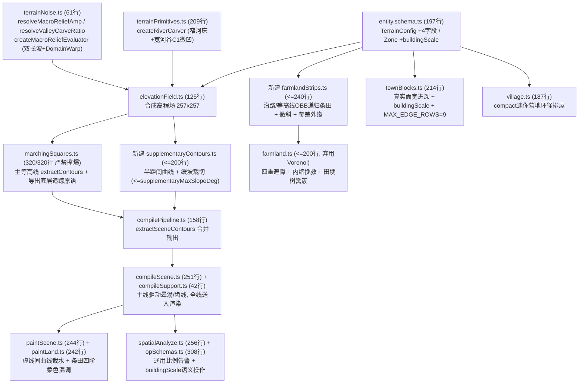

# Settlement Studio V5.0 — 全幅等高线、自然条田与真实比例尺升级规格书

| 文档属性 | 规范内容 |
| :--- | :--- |
| **文档版本** | `V5.0`（地形写实度、自然农田与真实人类比例尺升级） |
| **适用范围** | `/Users/jrdamocles/code/TERRAX/settlement_studio/` |
| **核心定位** | 彻底根治"平原等高线断档如纸上贴山包、Voronoi 条田算法感重且侵路侵水、城镇巨屋稀疏与迷你营地比例失调"三大实测短板 |
| **架构铁律** | `src/` 单文件严格 `<= 320` 行（`marchingSquares.ts` 已占满 `320/320` 行，间曲线必须独立拆分微模块）；零 `any` / 零 `Math.random()` / 零 `TODO`；`src/ai/`、`src/cli/`、`src/mcp/` 与 `.agents/skills/` 100% 脱离特定世界观专有名词；100% 向下兼容既有全部单测（尤其 `terrainNoiseAmpM: 0` 纯解析地形单测）与 3 套受保护基准工程 |

---

## 0. 问题诊断、V5.0 升级目标与验收硬门禁

### 0.1 三大实测短板诊断

基于 V4.0 实图勘测（含 `D203_灰山口与囚禁魔营地.worldtown.json` 2.6 km 图幅与 3 套标杆工程对拍），现有内核存在三项结构性短板：

1. **平原无等高线，地形像"白纸上贴山包"**：
   - `elevationField.ts` 当前仅叠加背景单一斜坡 `evalBaseSlope` + 局部 `TerrainShape` + `terrainNoiseAmpM` 高频微扰（默认 `1.6 m`，最大波长仅 `210 m`）+ 窄河床下切（半径仅 `2.2 * halfW`）。
   - 当图幅较宽而背景坡降温和（如 `worldSizeM = 2600 m`、`slopeMagM = 16 m`、`contourStep = 5 m`）时，全幅平原仅划出 3 条近乎平行的直等高线；河岸外稍远即毫无汇水凹坡，等高线跨河缺乏向上游折曲的自然谷形；缓坡带缺少半距间曲线，导致山包轮廓孤立漂浮在空白底纸上。
2. **Voronoi 条田算法感重、外缘如直边贴纸且不避路水**：
   - `src/core/generators/farmland.ts`（当前 118 行）采用随机撒点 + `computeVoronoiCells` 生成约 `0.72 ha` 凸多边形，整区共用单一 `angleDeg`，田块轮廓呈明显机械蜂窝感。
   - 生成阶段仅做 `polygonTouchesExclusion` 校验，完全未检测干道、河湖、明渠、城墙与坡度上限，导致条田与耕垄直接压过公路、水渠或河岸；大面积选区（如实测 `40.66 ha`、`30.69 ha`）紧贴人工绘制的外框形成僵硬直边贴纸；树冠仅在田角单点撒豆，缺乏真实田埂树篱簇；渲染层（`paintLand.ts`）所有田块同色同深，缺乏休耕、麦金、青苗的自然明暗层次。
3. **城镇屋宇偏巨稀疏、迷你营地比例严重失调**：
   - `src/core/generators/townBlocks.ts`（当前 214 行）现行单栋面宽 `14–28 m`、进深 `12–24 m`、`targetCellM2 = 1850 + (1 - zone.density) * 1500`、`MAX_EDGE_ROWS = 6`，在 20–24 ha 边镇中呈现出巨型稀疏方块而非细密 Watabou 肌理。
   - `src/core/generators/village.ts`（当前 187 行）固定排布 `12–15 m × 6.5–8.1 m` 大农舍、步距 `19–34 m` 并外推 `24 m` 宽 `18×14 m` 大篱院，既无法在 `0.4–0.8 ha` 的 15 人营地中稳定出屋，又逼迫制图者将迷你营地拉大到 `6.85 ha + 1.40 ha`（接近主城三分之一），造成跨要素人类比例尺崩坏。

### 0.2 V5.0 四大核心目标（`V5-G01` — `V5-G04`）

| 目标编号 | 模块归属 | 核心交付目标 |
| :--- | :--- | :--- |
| **`V5-G01`** | `V5-M1` 地形与等高线 | 引入与图幅联动的长波宏观起伏（`macroReliefAmpM`）、宽河谷微凹坡（`valleyCarveRatio`）与独立微模块 `supplementaryContours.ts` 缓坡半距间曲线，实现全幅连续等高线、河谷自然折弯与陡坡自动隐退，同时对 `terrainNoiseAmpM: 0` 纯解析地形保持 100% 零漂移 |
| **`V5-G02`** | `V5-M2` 自然条田重构 | 彻底废除农田 Voronoi 蜂窝，以新建微模块 `farmlandStrips.ts` 的 OBB 递归条带切分 + 微斜偏角 + 参差自然外缘 + 严格障碍避让与安全内缩挽救 + 田埂树篱簇 + 四阶柔色渲染，重塑 Watabou 手绘条田质感 |
| **`V5-G03`** | `V5-M2` 真实比例尺校准 | 引入 `Zone.buildingScale` 参数，校准 `townBlocks.ts` 细密城镇屋宇（`9.5–17.5 m × 8.0–14.5 m`），为 `village.ts` 补齐迷你营地/小村紧凑环径排布，同步升级 `spatialAnalyze.ts` 通用比例告警与 `.agents/skills/` 制图规范红线表 |
| **`V5-G04`** | `V5-M3` 自动化验收与实图重制 | 建立 `tests/v5-realism-and-scale.test.ts` 全套自动化回归测试，按真实人类比例尺重制 `projects/D203_灰山口与囚禁魔营地.worldtown.json` 并导出导览版/标准版 PNG 与 SVG 完成双尺度实图对拍 |

### 0.3 V5.0 架构与数据流总览



### 0.4 工程红线与向下兼容铁律

1. **文件行数铁律**：`src/` 下每一个 `.ts` / `.tsx` 文件物理行数严格 `<= 320` 行。尤其 `src/core/terrain/marchingSquares.ts` 现已精确到达 `320/320` 行，绝不可向该文件堆入半距间曲线实现，必须拆出 `src/core/terrain/supplementaryContours.ts` 并保持 `marchingSquares.ts <= 320` 行。
2. **代码洁净度铁律**：全仓零 `any`、零 `as any`、零 `@ts-ignore`、零 `TODO` / `FIXME`；`src/core/` 与 `src/ai/` 严禁调用 `Math.random()`，全部随机序列必须经由 `src/core/math/rng.ts` 的 `createRng` / `hashSeed` 确定性派生。
3. **世界观彻底解耦铁律**：`src/ai/`、`src/cli/`、`src/mcp/` 及 `.agents/skills/` 内严禁出现任何特定世界观专有名词、宿主目录路径或私有数据脚本引用（已有 `MetaSchema.terraxAnchor` 仅作为通用 `geoAnchor` 兼容映射字段保留，不新增任何耦合词）。
4. **纯解析地形单测零破坏铁律**：所有既有单测（特别是 `tests/contours-and-road-bridge.test.ts`、`tests/terrain-and-hydro.test.ts` 中显式设置 `terrainNoiseAmpM: 0` 的纯解析斜坡/山包测试，以及直接调用 `evalRiverCarve(rivers, x, y)` 的测试）在 V5 升级后必须 100% 原样通过，不得因新默认宏观起伏或宽河谷改变其精确解析高程值。
5. **受保护基准工程零变更铁律**：`projects/起点城_Losrumura.worldtown.json`、`projects/长湖_复市镇.worldtown.json`、`projects/帕隆_峡谷铁寨.worldtown.json` 在本次升级中禁止修改磁盘文件内容，且三套工程编译后均须维持 `collisionHits === 0` 与全部既有基准断言通过。

### 0.5 八道验收硬门禁（`V5-BG-01` — `V5-BG-08`）

| 门禁编号 | 验收维度 | 量化硬指标 | 验证手段 |
| :--- | :--- | :--- | :--- |
| **`V5-BG-01`** | 纯解析兼容守卫 | `terrainNoiseAmpM: 0` 且未显式指定新字段时，`resolveMacroReliefAmp === 0`、`resolveValleyCarveRatio === 0`，纯斜坡高程与旧版逐格误差 `< 1e-6` | `tests/v5-realism-and-scale.test.ts` + 全量既有测试套件 |
| **`V5-BG-02`** | 全幅连续等高线与宽河谷 | 温和坡面平原（`slopeMagM = 8`, `terrainNoiseAmpM = 1.6`）等高线覆盖全部 4 象限；宽河谷河岸外 `1.5 * width` 处存在明显汇水微凹；平原宏观附加坡度 `< 2°` | `tests/v5-realism-and-scale.test.ts` |
| **`V5-BG-03`** | 缓坡间曲线陡坡自隐与裁水 | `isSupplementary === true` 仅出现在 `slope <= supplementaryMaxSlopeDeg` 缓坡；`> 20°` 陡坡零间曲线点；SVG 含细虚线 `dash: [5, 4]`、无高程字、河湖内零穿越 | `tests/v5-realism-and-scale.test.ts` |
| **`V5-BG-04`** | 自然条田去 Voronoi 与零侵障 | `farmland.ts` 零引用 `computeVoronoiCells`；所有条田 `toneShift ∈ [-1, 1]`、单块面积 `0.09–1.2 ha`；任意条田顶点与边中点零落入河湖/干道/明渠/禁建圈；`frayOuter` 外缘具自然参差 | `tests/v5-realism-and-scale.test.ts` + 源码静态检查 |
| **`V5-BG-05`** | 城镇真实比例与性能 | `18–24 ha` 边镇（`density ≈ 0.85`）产出 `240–520` 栋细密屋宇，单屋均面积 `80–260 m²`；`buildingScale` 生效；单区 `rerollZoneScene` 实机耗时 `< 80 ms` | `tests/v5-realism-and-scale.test.ts` |
| **`V5-BG-06`** | 迷你营地紧凑排布 | `0.4–0.8 ha` `village`（含内嵌 `~0.18 ha` `exclusion` 或无贯穿大路）稳定产出 `6–14` 栋紧凑木屋、零穿模、零 `empty_warning` | `tests/v5-realism-and-scale.test.ts` |
| **`V5-BG-07`** | 通用比例告警与工程静态守卫 | `spatialAnalyze.ts` 对 `> 35 ha` 农田及失调迷你区发出通用告警；`src/` 全部文件 `<= 320` 行；零 `any`/`Math.random(`/TODO；AI/CLI/MCP/Skills 零世界观专有名词 | `npm run check` + 静态扫描断言 |
| **`V5-BG-08`** | `D2-03` 重制与三预设零回归 | `D203_灰山口与囚禁魔营地.worldtown.json` 达标（营地 `~0.4–0.7 ha` + 环石空地 `~0.18 ha` + 边镇 `>= 260` 栋 + 零穿模 + 导览/标准版 PNG/SVG 导出对拍通过）；3 套受保护预设零变更零穿模 | CLI `inspect`/`export` + 视觉自检 + `git diff` 核验 |

---

## 1. 模块一（`V5-M1`）：全幅连续等高线与缓坡间曲线引擎

### 1.1 `TerrainConfigSchema` 向下兼容扩展（`src/schema/entity.schema.ts`）

在 `src/schema/entity.schema.ts`（当前 `197` 行）的 `TerrainConfigSchema` 中追加 4 个向下兼容字段：

```ts
export const TerrainConfigSchema = z.object({
  // ...既有字段保持不变（baseElev .. terrainSeed）
  macroReliefAmpM: z.number().min(0).max(60).optional(),
  valleyCarveRatio: z.number().min(0).max(12).optional(),
  showSupplementaryContours: z.boolean().default(true),
  supplementaryMaxSlopeDeg: z.number().min(1).max(20).default(6.5),
  shapes: z.array(TerrainShapeSchema).default([]),
  sculptDeltaB64: z.string().default(''),
});
```

字段设计要点：
- `macroReliefAmpM` 与 `valleyCarveRatio` 故意保持 `.optional()`（不在 Schema 层强行填入非零默认值），以便区分"旧工程/纯解析单测未指定"与"用户显式指定 `0` 或正值"。
- `showSupplementaryContours`（默认 `true`）与 `supplementaryMaxSlopeDeg`（默认 `6.5`）带默认值；由于 `src/ai/opSchemas.ts`（当前 `308` 行）中的 `SetTerrain` 直接派生自 `TerrainConfigSchema.omit({ shapes: true, sculptDeltaB64: true }).partial()`，这 4 个字段将自动进入 `set_terrain` 语义操作与 Zod 严格校验，无需在 `opSchemas.ts` 重复声明。

### 1.2 纯解析保护解析器与长波宏观起伏（`src/core/terrain/terrainNoise.ts`）

在 `src/core/terrain/terrainNoise.ts`（当前 `61` 行，升级后预计 `~125` 行）新增 3 个导出函数：

```ts
import type { TerrainConfig } from '../../schema/entity.schema';

export type TerrainReliefPick = Pick<
  TerrainConfig,
  'macroReliefAmpM' | 'valleyCarveRatio' | 'terrainNoiseAmpM'
>;

/** 宏观起伏振幅解析：显式优先；未显式配置且 terrainNoiseAmpM <= 1e-9 时归 0，100% 保护纯解析单测 */
export function resolveMacroReliefAmp(terrain: Pick<TerrainConfig, 'macroReliefAmpM' | 'terrainNoiseAmpM'>): number {
  if (terrain.macroReliefAmpM !== undefined) {
    return Number.isFinite(terrain.macroReliefAmpM)
      ? Math.max(0, Math.min(60, terrain.macroReliefAmpM))
      : 0;
  }
  return terrain.terrainNoiseAmpM <= 1e-9 ? 0 : 12;
}

/** 宽河谷扩展倍比解析：显式优先；未显式配置且 terrainNoiseAmpM <= 1e-9 时归 0 */
export function resolveValleyCarveRatio(terrain: Pick<TerrainConfig, 'valleyCarveRatio' | 'terrainNoiseAmpM'>): number {
  if (terrain.valleyCarveRatio !== undefined) {
    return Number.isFinite(terrain.valleyCarveRatio)
      ? Math.max(0, Math.min(12, terrain.valleyCarveRatio))
      : 0;
  }
  return terrain.terrainNoiseAmpM <= 1e-9 ? 0 : 5.5;
}

/**
 * 长波宏观起伏求值器：2 个与 worldSizeM 联动的长波八度 + 温和 domain warp。
 * 典型参数 (ampM=12, worldSizeM=2400) 下平原最大附加坡度 < 2°，零破坏建筑与农田可建性。
 */
export function createMacroReliefEvaluator(
  ampM: number,
  worldSizeM: number,
  seed: number,
): (wx: number, wy: number) => number
```

`createMacroReliefEvaluator` 精确数学定义：
1. **早退守卫**：`amp = Number.isFinite(ampM) ? Math.max(0, Math.min(60, ampM)) : 0`；若 `amp <= 1e-9` 或 `!(worldSizeM > 0)` 直接返回 `() => 0`。
2. **温和 Domain Warp（消除双线性值噪声轴向网格感）**：
   - 取 `span = Math.max(600, worldSizeM)`、`warpFreq = 1 / (0.55 * span)`、`warpAmp = 0.10 * span`；
   - `ux = wx + (valueNoise(wx * warpFreq, wy * warpFreq, s + 313) - 0.5) * 2 * warpAmp`；
   - `uy = wy + (valueNoise(wx * warpFreq, wy * warpFreq, s + 617) - 0.5) * 2 * warpAmp`。
3. **双长波八度合成**：
   - 八度 1：波长 `L1 = 0.48 * span`（频率 `f1 = 1 / L1`），权重 `w1 = 1.0`，盐值 `s + 1009`；
   - 八度 2：波长 `L2 = 0.23 * span`（频率 `f2 = 1 / L2`），权重 `w2 = 0.45`，盐值 `s + 2027`；
   - 归一化求值：`raw = ((valueNoise(ux * f1, uy * f1, s + 1009) - 0.5) * 1.0 + (valueNoise(ux * f2, uy * f2, s + 2027) - 0.5) * 0.45) / 1.45`；
   - 返回 `raw * amp`（值域稳定落在 `[-0.5 * amp, +0.5 * amp]`，峰谷总落差可达 `amp`；在 `span = 2400 m, amp = 12 m` 时，平滑三次 Hermite 值噪声最大导数 `1.5`，主波附加坡度约 `arctan(1.5 * 12 / (0.48 * 2400)) ≈ 0.9°`，叠加次波与 warp 仍稳定 `< 2.0°`，既能穿过 `3–5 m` 等高距画出舒展的平原轮廓线，又绝不触碰任何选区的 `maxSlopeDeg` 门槛）。

### 1.3 宽河谷微凹坡与高程场合流（`terrainPrimitives.ts` + `elevationField.ts`）

#### 1.3.1 `src/core/terrain/terrainPrimitives.ts`（当前 `209` 行，预计 `~232` 行）

扩展 `createRiverCarver` 与 `evalRiverCarve` 签名（默认参数 `valleyRatio = 0` 保证所有既有调用点 100% 向下兼容）：

```ts
export function createRiverCarver(river: ProjectRiver, valleyRatio = 0): RiverCarver
export function evalRiverCarve(
  rivers: ReadonlyArray<ProjectRiver>,
  wx: number,
  wy: number,
  valleyRatio = 0,
): number
```

宽河谷 C1 光滑融合下切公式：
- 令 `ratio = Number.isFinite(valleyRatio) ? Math.max(0, Math.min(12, valleyRatio)) : 0`；
- 窄河床参数：沿弧长线性插值半宽 `halfW = 0.5 * (river.widthStartM + (river.widthEndM - river.widthStartM) * nr.sAlong)`（若 `river.widthsM.length === river.points.length` 可按段取实测宽度或沿用现行端点插值），窄下切半径 `carveRadius = 2.2 * halfW`，河床下切深 `depth = river.carveDepthM`；
- 宽河谷参数（仅当 `ratio > 1e-9 && depth > 1e-9`）：
  - 河谷半宽：`valleyRadius = Math.max(carveRadius * 2.5, ratio * 2 * halfW)`；
  - 河谷最大微凹深度：`valleyDepth = Math.min(depth, Math.min(10, 0.55 * depth))`；
  - 包围盒快筛边距同步扩展为 `margin = Math.max(2.2 * maxHalfW, ratio > 1e-9 ? Math.max(2.2 * 2.5 * maxHalfW, ratio * 2 * maxHalfW) : 0) + 1`；
- 求值核函数（保证河心深精准等于 `depth`，窄床边缘 C1 光滑衔接，无尖折点）：
  - 若 `ratio <= 1e-9`：与原版逐字节一致，仅在 `nr.dist < carveRadius` 返回 `depth * (1 - q * q) ** 2`（`q = nr.dist / carveRadius`）；
  - 若 `ratio > 1e-9`：
    - 当 `nr.dist >= valleyRadius` 返回 `0`；
    - 计算河谷项：`qv = nr.dist / valleyRadius`，`valleyCarve = valleyDepth * (1 - qv * qv) ** 2`；
    - 计算窄河床残余项：`bedNorm = nr.dist < carveRadius ? (1 - (nr.dist / carveRadius) ** 2) ** 2 : 0`；
    - 返回 `valleyCarve + (depth - valleyDepth) * bedNorm`。
  - 数学性质验证：`dist = 0` 时返回精确等于 `depth`（不破坏原有河心深）；`dist = carveRadius` 处 `bedNorm = 0` 且导数为 `0`，平滑过渡为 `valleyCarve`；在宽 `valleyRadius` 范围内河谷缓缓向上抬升至平原，令平原等高线跨河时自然折向上游，形成逼真的冲积谷地形态。

#### 1.3.2 `src/core/terrain/elevationField.ts`（当前 `125` 行，预计 `~135` 行）

在 `buildElevationField(project)` 中接入解析器与长波求值器：

```ts
const macroAmp = resolveMacroReliefAmp(terrain);
const valleyRatio = resolveValleyCarveRatio(terrain);
const carvers: RiverCarver[] = project.rivers.map((river) => createRiverCarver(river, valleyRatio));
const macro = createMacroReliefEvaluator(macroAmp, worldSizeM, terrain.terrainSeed);
const noise = createNoiseEvaluator(terrain.terrainNoiseAmpM, terrain.terrainSeed);
```

逐格高程累加顺序为：
`h = terrain.baseElev + evalBaseSlope(...) + sum(shapeEvals) + macro(wx, wy) + noise(wx, wy) + sculptDelta[idx] - maxCarve`。

### 1.4 独立微模块：缓坡间曲线引擎（`src/core/terrain/supplementaryContours.ts`）

#### 1.4.1 `marchingSquares.ts` 零超限保护方案（当前 `320/320` 行）

`src/core/terrain/marchingSquares.ts` 已严格顶到 `320` 行上限，升级改动**严禁**使其超过 `320` 行：
1. 在 `ContourLine`（`src/core/terrain/marchingSquares.ts` 及 `src/schema/scene.types.ts` 内联 `terrain.contours` 项）中增加 1 个可选只读字段：
   ```ts
   export interface ContourLine {
     readonly id: string;
     readonly elev: number;
     readonly isIndex: boolean;
     readonly isSupplementary?: boolean;
     readonly closed: boolean;
     readonly points: Polyline;
   }
   ```
2. 仅将 `marchingSquares.ts` 中已有的内部函数 `buildCellRange`、`traceLevel`、`smoothChain` 补加 `export` 关键字（+0 行），并通过合并 `marchingSquares.ts` 内多余空行或紧缩 `buildTerrainPackage` 返回体，确保该文件物理行数严格保持 `<= 320` 行。

#### 1.4.2 新建 `src/core/terrain/supplementaryContours.ts`（预算 `<= 200` 行）

导出核心函数与契约：

```ts
import type { TownProject } from '../../schema/project.schema';
import type { ElevationFieldData } from './elevationField';
import type { ContourLine } from './marchingSquares';

/**
 * 缓坡半距间曲线提取：
 * 仅在 level = k * step + 0.5 * step 层提取等值线，并按逐点坡度 <= supplementaryMaxSlopeDeg 裁切。
 * 陡坡自动隐退，彻底避免陡山糊黑。
 */
export function extractSupplementaryContours(
  field: ElevationFieldData,
  config: TownProject['terrain'],
): ContourLine[]
```

算法精确步骤：
1. **开关守卫**：若 `config.showContours === false || config.showSupplementaryContours === false` 直接返回 `[]`。
2. **高程区间与半距层遍历**：
   - `step = Math.max(1, Math.round(config.contourStep))`；
   - `range = scanElevationRange(field)`，`lo = Math.max(range.min, config.minContourElev)`，`hi = Math.min(range.max, config.maxContourElev)`；若 `!(hi > lo)` 返回 `[]`；
   - 预计算 `{ min, max } = buildCellRange(field)`；
   - 对 `k = Math.floor(lo / step) - 1` 到 `Math.ceil(hi / step)`，计算 `level = k * step + 0.5 * step`；若 `level < lo || level > hi` 跳过。
3. **逐点缓坡裁切（含闭合环无缝展开）**：
   - 令 `maxSlope = Math.max(1, Math.min(20, config.supplementaryMaxSlopeDeg))`；
   - 对 `traceLevel(field, level, min, max)` 产出的每条链先执行 `smoothChain(chain.pts, chain.closed)`，逐点计算布尔掩码 `gentle[i] = sampleSlopeDeg(field, p[0], p[1]) <= maxSlope`；
   - **全环皆缓坡**（`chain.closed && gentle.every(Boolean)`）：若点数 `>= 4`，直接保留为 `closed: true` 的完整闭合间曲线；
   - **部分被陡坡截断的闭合环**：找到首个 `gentle[i] === false` 的下标 `cutIdx`，从 `cutIdx + 1` 起按模长循环扫描收集所有连续 `gentle` 子段（彻底避免在起点/终点接缝处将同一条缓坡间曲线劈成两截），输出均为 `closed: false`；
   - **开折线**：顺序扫描收集连续 `gentle` 子段，输出 `closed: false`；
   - **去碎片过滤**：丢弃顶点数 `< 3` 或总弧长 `< Math.max(18, 2 * field.cellSizeM)` 的微小碎点，避免山脚噪点斑驳；
   - 每条留存线段输出：
     ```ts
     {
       id: `cts_${k}_${seq}`,
       elev: Math.round(level * 1000) / 1000,
       isIndex: false,
       isSupplementary: true,
       closed,
       points: segment,
     }
     ```

#### 1.4.3 无痛挂载点（`compilePipeline.ts` 与 `compileScene.ts`）

- 在 `src/core/compilePipeline.ts`（当前 `158` 行，远低于 `320` 行）新增导出函数：
  ```ts
  export function extractSceneContours(
    field: ElevationFieldData,
    terrain: TownProject['terrain'],
  ): {
    readonly baseContours: ReadonlyArray<ContourLine>;
    readonly contours: ReadonlyArray<ContourLine>;
  } {
    const baseContours = extractContours(field, terrain);
    const supplementary = extractSupplementaryContours(field, terrain);
    return { baseContours, contours: [...baseContours, ...supplementary] };
  }
  ```
- 在 `src/core/compileScene.ts`（当前 `251` 行）的 `compileSettlementScene` 与 `rerollZoneScene` 中调用 `extractSceneContours(terrainData, project.terrain)`：
  - `baseContours` 传入 `extractScarpTicks(baseContours, ...)` 与 `buildTerrainShading(terrainData, project, baseContours)`，确保陡坎齿线与顺坡晕滃仅基于主等高线派生，不被缓坡间曲线触发重复晕滃；
  - 合并后的 `contours` 存入 `scene.terrain.contours`，供渲染层与统计统一读取。
- `marchingSquares.ts` 原有的 `extractContours` 与 `buildTerrainPackage` 语义保持不变，确保直接单测 `extractContours` 的既有测试零破坏。

### 1.5 渲染样式、缓存签名与检查器控件

1. **`src/renderer/paintScene.ts`（当前 `244` 行，`paintContours`）**：
   - 主计曲线/首曲线样式保持原样（`isIndex ? 1.45 : 0.75`，`opacity: isIndex ? opacity : opacity * 0.72`）；
   - 当 `contour.isSupplementary === true` 时切换为细淡虚线样式：
     ```ts
     const strokeStyle = contour.isSupplementary
       ? { stroke: pal.contourLine, lineWidth: 0.55, dash: [5, 4] as const, opacity: opacity * 0.52 }
       : {
           stroke: pal.contourLine,
           lineWidth: contour.isIndex ? 1.45 : 0.75,
           opacity: contour.isIndex ? opacity : opacity * 0.72,
         };
     ```
   - 沿用同一套 `waterMasks` + `inWater` 逐点断线裁切逻辑，确保间曲线在河湖水面内零穿越；
   - **高程数字防误关守卫**：原 `showLabels` 改为按非间曲线数量判定：`const primaryCount = data.terrain.contours.filter((c) => !c.isSupplementary).length; const showLabels = withLabels && primaryCount <= 90;`，且循环内遇到 `contour.isSupplementary === true` 直接跳过文字标注（间曲线恒不标字）。
2. **`src/core/compileSupport.ts`（当前 `42` 行，`terrainSignature`）与 `compileScene.ts`**：
   - `terrainSignature(project)` 将 `project.terrain` 全对象序列化；由于 4 个新字段均位于 `project.terrain`，改动任意字段（含 `showSupplementaryContours` 或 `supplementaryMaxSlopeDeg`）均自动使 `terrainSignature` 变更，触发 `rerollZoneScene` 重建等高线而非复用过期缓存。
   - 若在 `rerollZoneScene` 中复用 `prevScene` 仅当 `reuseTerrain === true`，因此新字段与缓存一致性天然闭环。
3. **`src/ui/inspector/TerrainPanel.tsx`（当前 `62` 行，预计 `~88` 行）**：
   - 在 `基底坡面` `PanelSection` 补齐：
     - `宏观起伏`：`RangeField`（`min={0} max={60} step={0.5} suffix="m"`，显示 `resolveMacroReliefAmp(terrain)`，写入 `t.macroReliefAmpM = value`）；
     - `河谷宽比`：`RangeField`（`min={0} max={12} step={0.5} suffix="×"`，显示 `resolveValleyCarveRatio(terrain)`，写入 `t.valleyCarveRatio = value`）；
   - 在 `等高线` `PanelSection` 补齐：
     - `缓坡间曲线`：`ToggleField`（绑定 `terrain.showSupplementaryContours`，触发即时重编）；
     - `间曲线最大坡度`：`RangeField`（`min={1} max={20} step={0.5} suffix="°"`，绑定 `terrain.supplementaryMaxSlopeDeg`）。

---

## 2. 模块二（`V5-M2`）：Watabou 风格自然条田重构

### 2.1 `FarmlandPlot` 场景类型扩展（`src/schema/scene.types.ts`）

在 `src/schema/scene.types.ts`（当前 `281` 行）的 `FarmlandPlot` 增加 1 个可选只读字段（100% 向下兼容既有消费方）：

```ts
export interface FarmlandPlot {
  readonly id: string;
  readonly zoneId: string;
  readonly polygon: Polygon;
  readonly innerPolygon: Polygon;
  readonly areaHa: number;
  readonly angleDeg: number;
  readonly furrows: ReadonlyArray<Polyline>;
  /** 确定性色调偏移 [-1, 1]：供渲染层执行休耕/麦金/熟褐/青苗四阶柔色混调 */
  readonly toneShift?: number;
}
```

### 2.2 新建微模块：OBB 递归自然条田切分器（`src/core/generators/farmlandStrips.ts`）

新建 `src/core/generators/farmlandStrips.ts`（预算 `<= 240` 行），彻底替代机械蜂窝式的 `computeVoronoiCells`。

#### 2.2.1 导出契约

```ts
import type { Polygon, Polyline, Vec2 } from '../../schema/geometry.types';
import type { RngFn } from '../math/rng';
import type { BuiltCanal } from '../hydro/riverCanal';
import type { BuiltRoad } from '../hydro/reefRoadBridge';
import type { ElevationFieldData } from '../terrain/elevationField';

export interface FarmlandStripCandidate {
  readonly polygon: Polygon;
  readonly angleDeg: number;
  readonly furrowSpacingM: number;
  readonly toneShift: number;
  readonly isPerimeter: boolean;
}

export interface SharedBundSegment {
  readonly a: Vec2;
  readonly b: Vec2;
}

export interface SubdivideFarmlandInput {
  readonly zonePolygon: Polygon;
  readonly frayOuter: boolean;
  readonly rng: RngFn;
  readonly elevationField: ElevationFieldData;
  readonly roads: ReadonlyArray<BuiltRoad>;
  readonly canals: ReadonlyArray<BuiltCanal>;
}

export interface SubdivideFarmlandOutput {
  readonly strips: ReadonlyArray<FarmlandStripCandidate>;
  readonly sharedBunds: ReadonlyArray<SharedBundSegment>;
}

export function subdivideFarmlandStrips(input: SubdivideFarmlandInput): SubdivideFarmlandOutput
```

#### 2.2.2 五步核心算法规格

1. **主轴方向求解（`resolveDominantAxis`）**：
   - 计算 `zonePolygon` 的质心 `c` 与包围盒 `bbox`（外扩 `140 m` 检索窗口）。
   - **优先级 1（临近干道/明渠切向）**：遍历所有 `tier !== 'lane'` 的 `roads` 与全部 `canals`，查找折线段到选区外框或质心的最小距离 `bestDist`。若 `bestDist <= 180 m`，取最近折线段的切向角 `Math.atan2(dy, dx)` 作为初始主轴角 `baseAngleRad`，令条田自然依附官道或灌溉干渠铺展。
   - **优先级 2（等高线切向回退）**：若周边无临近路渠，调用 `sampleGradient(elevationField, c[0], c[1])`；当坡度梯度模长 `> 1e-4` 时取等高线切向 `Math.atan2(g.dzdx, -g.dzdy)` 叠加确定性小偏角 `((rng() - 0.5) * 14 * Math.PI) / 180`；纯平坦地形则沿选区最长主轴方向并加确定性偏角。
2. **OBB 递归条带切分（`splitRecursive`）**：
   - 目标单块物理规格：
     - 目标面积区间：`0.28 — 0.65 ha`（即 `2800 — 6500 m²`）；
     - 期望长宽比：`1.6:1 — 3.8:1`；
     - 单条宽度：`32 — 75 m`；
     - 最大递归深度：`MAX_DEPTH = 9`；最小面积早退：`1600 m²`（避免产生碎渣）。
   - 在当前局部坐标系 `ux = [cos(ang), sin(ang)]`、`uy = [-sin(ang), cos(ang)]` 下，将多边形全部顶点投影计算 `(minU, maxU)` 与 `(minV, maxV)`，得 `spanU = maxU - minU`、`spanV = maxV - minV`、`area = |computePolygonAreaSigned(poly)|`。
   - **停止判据**：满足 `area <= targetMaxM2`（每支递归独立在 `3600–6500 m²` 间采样目标值）且 `Math.min(spanU, spanV) <= 75` 且 `Math.max(spanU, spanV) / Math.max(1, Math.min(spanU, spanV)) <= 4.0`；或 `depth >= MAX_DEPTH`；或 `Math.min(spanU, spanV) < 32`。
   - **切分轴与非对称比例选择**：
     - 若 `spanU >= spanV` 且 `spanU / Math.max(1, spanV) >= 1.45`：切 U 轴（按 `0.40 + rng() * 0.20` 比例，尽量切出宽 `32–75 m` 的条带）；
     - 若局部过方（`aspect < 1.45`）且 `area > 4200 m²`：故意沿一轴按非对称比例（`0.36–0.64`）切出狭长条带；
     - 其余按较长轴切分。
   - **微斜偏角扰动与精确半平面裁剪**：
     - 为消除死板正交棋盘感，每次切分在切线法向角上附加确定性微偏角 `jitterDeg = (rng() < 0.5 ? -1 : 1) * (4 + rng() * 4)`（即 `±4° — ±8°`）；
     - 利用现有 `clipPolygonHalfPlane(poly, nx, ny, offsetC)` 与反向 `clipPolygonHalfPlane(poly, -nx, -ny, -offsetC)`（`src/core/math/polygon.ts`）一分为二；
     - 记录本次切线与 `poly` 的交线段作为共享内部田埂（`sharedBunds`），供下游沿田埂生成成簇树篱；
     - 子块继续递归时以 `45%` 概率继承略微偏转的切线角，形成 Watabou 风格自然拼合的田畴群。
3. **参差自然外缘（Frayed Perimeter，消灭直边贴纸）**：
   - 对每块叶子条田检测是否触及 `zonePolygon` 外轮廓（任意顶点到 `zonePolygon` 任意边距离 `< 4.0 m` 即标记 `isPerimeter = true`）。
   - 当 `frayOuter !== false` 且 `isPerimeter === true` 时：
     - 确定性退缩/跳格策略：若该外缘条田面积较小（`< 0.35 ha`）或为角部孤立块，以 `28%` 概率整块跳过；否则以 `42%` 概率对其朝向外边界的一侧施加 `4 — 14 m` 退让裁剪（沿外缘内法向用 `clipPolygonHalfPlane` 裁退），使大片农田边缘呈现自然交错的阶梯田垄，彻底消除"沿着手画直边贴了一张网格贴纸"的违和感。
4. **单块独立耕垄方向与间距**：
   - 遍历该条田全部边，求出最长边方向角 `longEdgeDeg`（归一化至 `[0, 180)`）；
   - `80%` 概率取 `angleDeg = longEdgeDeg`（顺长边起垄），`20%` 概率取 `angleDeg = (longEdgeDeg + 90) % 180`（横垄对比）；
   - `furrowSpacingM = 5.5 + rng() * 2.0`（`5.5 — 7.5 m` 确定性微调）。
5. **色调偏移派生**：
   - 对每块条田生成 `toneShift ∈ [-1, 1]`：融合块级随机值与轻量空间相位，避免相邻所有田块颜色完全一致或过度花哨，为渲染层提供稳定四阶色阶驱动。

### 2.3 重构 `src/core/generators/farmland.ts`（预算 `<= 200` 行）

重构要点：
1. **彻底移除 Voronoi**：删除 `computeVoronoiCells` 导入与全部随机撒点代码；仅保留 `insetPolygonSafe` 与既有导出的 `polygonTouchesExclusion`（供可能存在的外部单测兼容调用）。
2. **严格四重障碍避让 + 一次安全内缩挽救**：
   对 `subdivideFarmlandStrips` 输出的每块 `strip`：
   - 先执行田埂内缩 `inner0 = insetPolygonSafe(strip.polygon, 1.4)`，若顶点数 `< 3` 或面积 `< 900 m²`（`0.09 ha`）直接丢弃；
   - 定义多点安全检查函数 `checkPlotClearance(poly, zone, obstacleCtx)`，采集 `poly` 的质心、全部顶点与全部边中点，核验全部 4 项硬约束：
     1. 障碍距离场守卫：若 `obstacleCtx.grid !== null`，对全部采样点校验 `sampleObstacleClearance(grid, worldSizeM, x, y) >= 0.8`（512² SDF 已光栅化河湖 `bankPolygon + 8 m`、干道 `0.5 * width + 2.5 m`、明渠 `0.5 * width + 4 m`、城墙 `0.5 * thick + 3 m`、禁建圈与刚性足印）；若 `grid === null`（极少数直接单测场景），回退逐一校验河湖多边形、干道折线与明渠折线精确距离；
     2. 禁建圈精确守卫：`!polygonTouchesExclusion(poly, obstacleCtx.exclusionPolys, 2.0)`；
     3. 坡度守卫：全部采样点满足 `sampleSlopeDeg(elevationField, x, y) <= zone.maxSlopeDeg`；
     4. 边界守卫：全部顶点位于 `[8, worldSizeM - 8]` 内部。
   - **一次安全内缩挽救**：若 `inner0` 未通过检查，但质心本身未落入障碍且坡度合格（即仅外缘轻微擦边），根据采样到的最小欠量执行一次安全二次内缩 `rescued = insetPolygonSafe(inner0, 3.8)`（并同步收缩外框 `outer = insetPolygonSafe(strip.polygon, 3.8)`）；若 `rescued` 顶点数 `>= 3`、面积 `>= 900 m²` 且二次 `checkPlotClearance` 全部通过，则采纳 `rescued`；否则整块丢弃。由此保证**零农田、零耕垄画到公路、河湖、水渠或城墙之上**。
   - 通过避障的条田按自身的 `angleDeg` 与 `furrowSpacingM` 在局部包围盒内裁剪平行耕垄 `furrows`，写入 `targetResult.farmlandPlots`（含 `toneShift: strip.toneShift`）。
3. **成簇田埂树篱（废除田角单点撒豆）**：
   - 遍历 `sharedBunds`（仅保留两端点附近存在留存条田且长度 `>= 22 m` 的共享内部田埂）；
   - 以确定性概率（约 `38%`）在田埂中段选定锚点，沿田埂切向紧密排布 `count = 2 + Math.floor(rng() * 4)`（即 `2 — 5` 棵）树冠，间距 `4.5 — 7.8 m`、横向微偏移 `±1.5 m`、半径 `3.0 — 5.0 m`；
   - 每棵均经 `guardSafeTree(tx, ty, r, 'field', zone, obstacleCtx)` 守卫入库，形成极具欧洲/方志手绘感的田埂树篱灌木丛。

### 2.4 条田四阶柔色渲染（`src/renderer/paintLand.ts`）

升级 `src/renderer/paintLand.ts`（当前 `242` 行，预计 `~262` 行）中的 `paintFarmland`：

```ts
function farmlandToneColor(pal: ResolvedPalette, toneShift: number): string {
  if (toneShift < -0.35) {
    const t = 0.16 + Math.min(1, (-0.35 - toneShift) / 0.65) * 0.06; // 16%..22%
    return mixHex(pal.farmlandFill, pal.paperBg, t);
  }
  if (toneShift < 0.15) {
    return mixHex(pal.farmlandFill, pal.paperBg, 0.05);
  }
  if (toneShift < 0.55) {
    const t = 0.12 + ((toneShift - 0.15) / 0.4) * 0.06; // 12%..18%
    return mixHex(pal.farmlandFill, pal.roofTown, t);
  }
  const t = 0.10 + Math.min(1, (toneShift - 0.55) / 0.45) * 0.06; // 10%..16%
  return mixHex(pal.farmlandFill, pal.treeFill, t);
}
```

渲染层级规范：
1. **外田埂浅底**：`plot.polygon` 填 `mixHex(pal.farmlandFill, pal.paperBg, 0.42)`、`opacity: 0.78`；
2. **四阶柔色内块**：`plot.innerPolygon` 填 `farmlandToneColor(pal, plot.toneShift ?? 0)`、`opacity: 0.90`，描极浅田埂细线（`stroke: mixHex(pal.farmlandFill, pal.inkDark, 0.18)`, `lineWidth: 0.45`）；
3. **柔和平行耕垄**：`plot.furrows` 用 `stroke: mixHex(fillColor, pal.inkDark, 0.24)`、`lineWidth: 0.38`、`opacity: 0.34` 绘制，在 4 套内置配色主题（`watabou_classic` / `nordic_fjord` / `arid_oasis` / `gazetteer_ink`）下均保持温润协调、不抢主聚落线稿层次。

---

## 3. 模块三（`V5-M2`）：聚落真实人类比例校准与制图规范

### 3.1 `buildingScale` 参数全链路打通

| 文件 | 当前行数 | 变更内容 |
| :--- | :---: | :--- |
| `src/schema/entity.schema.ts` | `197` | `ZoneSchema` 新增 `buildingScale: z.number().min(0.45).max(1.6).optional()`（未设时生成器语义默认 `1.0`，零破坏旧工程 JSON） |
| `src/ai/opSchemas.ts` | `308` | `PlaceZone` 新增 `buildingScale: z.number().min(0.45).max(1.6).optional()`（严格保持 `<= 320` 行） |
| `src/ai/opProjectHandlers.ts` | `308` | `placeZone` 新建选区时若 `op.buildingScale !== undefined` 透传 `buildingScale: op.buildingScale`；更新选区时由既有 `applyDefined(target, zoneFields)` 自动写入 |
| `src/ui/inspector/ZonePanel.tsx` | `108` | 在 `密度` 滑块下方新增 `建筑尺度` `RangeField`（`value={zone.buildingScale ?? 1}`, `min={0.45}`, `max={1.6}`, `step={0.05}`, `digits={2}`, `suffix="×"`） |

### 3.2 城镇屋宇真实人类比例校准（`src/core/generators/townBlocks.ts`）

在 `src/core/generators/townBlocks.ts`（当前 `214` 行，预计 `~224` 行）执行以下精确比例校准：

| 参数项 | V4 旧值 | V5 真实人类比例新值（`scale = zone.buildingScale ?? 1`） | 工程意图 |
| :--- | :--- | :--- | :--- |
| `MAX_EDGE_ROWS` | `6` | `9` | 允许较长临街边连续排布 7–9 栋紧凑民宅，消除街角空洞 |
| 单栋面宽 `widthM` | `14 + rng() * 14`（`14–28 m`） | `(9.5 + rng() * 8.0) * scale`（默认 `9.5–17.5 m`） | 对齐中世纪/前现代市镇真实两间—三间门面尺度 |
| 单栋进深 `depthM` | `12 + rng() * 12`（`12–24 m`） | `(8.0 + rng() * 6.5) * scale`（默认 `8.0–14.5 m`） | 消除巨型厂房感，中庭庭院留白更自然 |
| 沿街退线 `setback` | `1.4 + rng() * 0.8` | `(1.1 + rng() * 0.7) * scale` | 与收窄屋宇比例协调 |
| 屋间步进间隔 | `1.2 + rng() * 1.4` | `(0.9 + rng() * 1.1) * scale` | 细密临街立面节奏，同时保留消防/巷隙 |
| 最小临街边长 | `len < 15` | `len < 10.5 * scale` | 不漏掉中小型街坊短边 |
| 街坊目标面积 `targetCellM2` | `1850 + (1 - zone.density) * 1500` | `(1250 + (1 - zone.density) * 1150) * scale * scale` | 20 ha 边镇街坊块数自然提升，单块尺寸更贴合手绘 Watabou 街网 |
| Voronoi 站点数上限 `k` | `Math.min(240, ...)` | `Math.min(280, ...)` | 兼容 40–55 ha 都城（如 `起点城`），同时确保 `rerollZoneScene` 单区耗时 `< 80 ms` |
| 最小街坊面积过滤 | `blockArea < lotMinM2 * 0.8` | `blockArea < lotMinM2 * 0.65 * scale * scale` | 防止缩小 `buildingScale` 时有效街坊被误丢弃 |

校验指标：
- `18–24 ha` 边镇（`density: 0.82–0.92`, `buildingScale: 1.0`）稳定产出 **`280 — 480` 栋**细密 Watabou 屋宇；
- 3 套受保护基准工程（`起点城_Losrumura`、`长湖_复市镇`、`帕隆_峡谷铁寨`）全量编译保持 `collisionHits === 0` 且不超时。

### 3.3 迷你营地与散居村落紧凑排布（`src/core/generators/village.ts`）

在 `src/core/generators/village.ts`（当前 `187` 行，预计 `~255` 行）中引入自适应紧凑模式与环空地排屋机制：

1. **紧凑模式自动判定**：
   ```ts
   const areaHa = Math.abs(computePolygonAreaSigned(zone.points)) / 10000;
   const scale = Math.max(0.45, Math.min(1.6, zone.buildingScale ?? 1));
   const compact = areaHa < 1.5 || scale < 0.85;
   const effScale = compact ? Math.min(1.0, scale) : scale;
   ```
2. **紧凑模式与标准村落参数精确对照**：

| 参数项 | 标准散居村落（`!compact`） | 紧凑营地 / 小村（`compact`） |
| :--- | :--- | :--- |
| 正房长度 `lengthM` | `(10.5 + rng() * 3.5) * effScale`（`10.5–14.0 m`） | `(6.5 + rng() * 4.0) * effScale`（`6.5–10.5 m`） |
| 正房宽度 `widthM` | `(6.0 + rng() * 1.6) * effScale`（`6.0–7.6 m`） | `(4.5 + rng() * 2.3) * effScale`（`4.5–6.8 m`） |
| 沿骨架步距 | `19 + rng() * 15`（`19–34 m`） | `11 + rng() * 7`（`11–18 m`），起排 `4 + rng() * 3` |
| 垂向退线偏移 | `7.5 + rng() * 3.5` | `4.2 + rng() * 2.4`（单侧外排环径时仅取外法向，避免挤入中心空地） |
| 曲尺厢房 | 正常尝试（`8×5 m * effScale`） | `30%` 概率小棚（`5.2×3.6 m * effScale`），避免挤爆小选区 |
| 菜畦篱院 | 偏移 `24 m`、`18×14 m` 篱院 | **取消 `24 m` 大篱院**；仅 `25%` 概率生成贴屋紧凑小篱栏（偏移 `7.5 m`、`7×5 m`）或无篱院 |
| 院边树 | 距菜畦中心 `r = 4.2–5.8 m` | 距屋后 `6–10 m`、`r = 2.8–4.4 m` |

3. **迷你营地环路 / 环空地骨架生成（`buildCompactRingSpines`）**：
   - 当 `compact === true` 且未指定 `zone.ribbonSpine` 时：
     - **情形 A（内嵌仪式/集会空地）**：检测 `obstacleCtx.exclusionPolys` 中是否有质心落入 `zone.points` 的禁建空地 `innerEx`；若有，对 `innerEx` 外扩约 `6.5 m`（沿质心径向外推或取 `zone.points` 与 `innerEx` 的中位环带），构造闭合/半闭合环状营地小径，并沿环径**单侧朝外**紧密排布木屋（木屋正面朝向中心空地），避免压入 `innerEx` 或超出 `zone.points`；
     - **情形 B（无内嵌空地且无穿区干道）**：优先以 `insetPolygonSafe(zone.points, Math.min(12, inradius * 0.35))` 形成内部环状小径（闭合环）供双侧或外侧紧凑排屋；若多边形过窄退化，则回退 `contourFallbackLanes` 并将 `spacing` 收紧至 `16–22 m`（原 `30–42 m` 在 `0.5 ha` 选区仅能塞 1 条线导致产屋不足）。
     - 若存在穿区干道但步距仍偏少（如仅擦过选区一角导致产屋 `< 4`），补跑内部紧凑支径作为补充，确保 `0.4 — 0.8 ha` 的 15 人营地稳定产出 **`6 — 14` 栋**真实比例木屋。

### 3.4 AI 选址诊断比例健康告警（`src/ai/spatialAnalyze.ts`）

在 `src/ai/spatialAnalyze.ts`（当前 `256` 行，升级后预计 `~284` 行）的 `collectWarnings` 中追加通用比例健康告警（严禁硬编码任何世界观名词）：

1. **超大单片农田告警**：
   ```ts
   if (zone.contentType === 'farmland' && zone.areaHa > 35) {
     warnings.push(
       `农田选区「${zone.name}」(${zone.id}) 单片面积 ${zone.areaHa.toFixed(1)} ha 偏大，建议拆分为多片 6–24 ha 沿河/沿路独立条田带以获得自然田向与避障余量`,
     );
   }
   ```
2. **迷你选区与跨类型尺度失调告警**：
   - 当 `zone.contentType === 'walled_city' && zone.areaHa < 4.0`：提示城垣退界后净面积过小，建议扩大至 `14–55 ha` 或改用 `citadel` / `village`；
   - 当 `zone.contentType === 'village' && zone.areaHa > 12.0`：提示村落选区面积偏大（`> 12 ha`），建议拆分为多处散村或改用 `town_blocks`；
   - 当 `zone.contentType !== 'exclusion' && zone.areaHa < 1.2 && zone.buildingCount > 0 && zone.buildingCount / Math.max(0.05, zone.areaHa) > 45`：提示迷你选区屋宇过密，建议下调 `density` 或适当微调 `buildingScale`。

### 3.5 Skill 制图规范与操作速查补齐

需同步更新 `.agents/skills/settlement-studio-mapper/references/` 下两份通用参考文档（保持 100% 脱离特定世界观专有名词）：

1. **`.agents/skills/settlement-studio-mapper/references/cartography-standards.md`**：新增《跨要素真实比例尺红线表》：

| 要素类别 | 推荐 `contentType` | 建议占地面积 | 推荐 `buildingScale` | 典型屋宇产出 | 制图要点 |
| :--- | :--- | :--- | :--- | :--- | :--- |
| 临时营地 / 山林哨所（10–30 人） | `village` | `0.25 — 0.8 ha` | `0.65 — 0.85` | `6 — 14` 栋 | 可内嵌 `0.08 — 0.25 ha` 环石/篝火空地 `exclusion`，严禁拉大至数公顷 |
| 散居村落 / 桥头小聚落 | `village` / 小型 `town_blocks` | `1.5 — 4.0 ha` | `0.85 — 1.0` | `15 — 55` 栋 | 沿官道、溪岸或等高线带状舒展，保持外缘自然衰减 |
| 边镇 / 关厢集镇 | `walled_city` + `town_blocks` | `14 — 25 ha` | `0.95 — 1.05` | `250 — 480` 栋 | 城垣内配 `1.5 — 3.5 ha` 官署 `citadel` 与 `2 — 4 ha` 集场 `market` |
| 区域都城 / 州府大城 | `walled_city` + 外围 `town_blocks` | `30 — 55 ha` | `1.0 — 1.1` | `500 — 950` 栋 | 须配合 `3000 — 3600 m` 图幅，保持城廓占全图 `15% — 30%` 黄金留白 |
| 独立条田带 | `farmland` | `6 — 24 ha`（硬警戒 `> 35 ha`） | 不适用 | `12 — 55` 块条田 | 优先拆成 3–6 片沿河谷/干道舒展的中小型条田带，保留 `frayOuter: true` |

2. **`.agents/skills/settlement-studio-mapper/references/ops-cheatsheet.md`**：
   - 在 `set_terrain` 示例与说明中补入 V5 地形参数：`macroReliefAmpM`（`0–60`，默认非零噪声时 `12`）、`valleyCarveRatio`（`0–12`，默认非零噪声时 `5.5`）、`showSupplementaryContours`（默认 `true`）、`supplementaryMaxSlopeDeg`（`1–20`，默认 `6.5`）；
   - 在 `place_zone` 示例与说明中补入 `buildingScale`（`0.45–1.6`，默认 `1.0`；迷你营地推荐 `0.70–0.80`）。

---

## 4. 模块四（`V5-M3`）：自动化验收、重制 `D2-03` 实图对拍与质量红线

### 4.1 自动化测试清单（`tests/v5-realism-and-scale.test.ts`）

新增独立测试套件 `tests/v5-realism-and-scale.test.ts` 并纳入 `npm run check`，必须完整覆盖以下 8 组必填断言：

| 测试组 | 对应门禁 | 必填断言清单 |
| :--- | :--- | :--- |
| **T1 · 纯解析地形零漂移** | `V5-BG-01` | `terrainNoiseAmpM: 0` 且未填 `macroReliefAmpM`/`valleyCarveRatio` 时，两解析器均返回 `0`；纯斜坡项目 `buildElevationField` 采样高程与 `baseElev + evalBaseSlope` 逐点误差 `< 1e-6`；`evalRiverCarve(rivers, x, y)` 默认 `valleyRatio = 0` 在 `dist = 3.0 * halfW` 处返回精确 `0` |
| **T2 · 全幅连续起伏与宽河谷** | `V5-BG-02` | `worldSizeM = 2400`、`slopeMagM = 8`、`contourStep = 5`、`terrainNoiseAmpM = 1.6` 且开启默认 V5 宏观起伏时：平原随机采样点坡度全部 `< 3.5°`（宏观项贡献 `< 2°`）；合并等高线覆盖地图全部 4 象限；含干流时，距河心 `1.5 * width` 处河谷微凹高程显著低于同纬度 `6 * width` 外平原高程 |
| **T3 · 缓坡间曲线与裁水** | `V5-BG-03` | 含平坦平原与 `deltaElev = 95` 陡山的测试图幅中：`scene.terrain.contours.some(c => c.isSupplementary)` 为 `true`；每条 `isSupplementary` 线段全部顶点坡度 `<= supplementaryMaxSlopeDeg + 1.0°`；陡山高坡区（`slope > 20°`）零间曲线顶点；`showSupplementaryContours: false` 时 `isSupplementary` 数量为 `0`；渲染 SVG 的 `layer-contours` 含 `stroke-dasharray="5 4"`，且河湖 `bankPolygon` 内零间曲线顶点与零高程文字 |
| **T4 · 自然条田去 Voronoi 与零侵障** | `V5-BG-04` | 20 ha `farmland` 选区被干道、河道、明渠与 `exclusion` 贯穿时：全部 `farmlandPlots` 均具合法 `toneShift ∈ [-1, 1]`、单块面积位于 `0.09 — 1.2 ha`；所有田块 `innerPolygon` 的顶点与边中点零落入河道 `bankPolygon`、干道路面、明渠水面与禁建圈内；`frayOuter: true` 较 `frayOuter: false` 产出外缘退让差异；`farmland.ts` 源码零出现 `computeVoronoiCells` |
| **T5 · 城镇真实人类比例与重抽性能** | `V5-BG-05` | `20 ha` `walled_city`（`density: 0.88`, `buildingScale: 1.0`）产出 `240 — 520` 栋屋宇，平均单栋占地 `80 — 260 m²`，`collisionHits === 0`；同区设 `buildingScale: 0.7` 后平均单栋面积显著低于 `buildingScale: 1.0`；`rerollZoneScene` 单区重抽耗时实机 `< 80 ms`（测试断言取稳健阈值 `< 250 ms` 并在验收记录实测毫秒数） |
| **T6 · 迷你营地紧凑排布** | `V5-BG-06` | `0.55 ha` `village`（`buildingScale: 0.72`）内嵌 `0.16 ha` `exclusion` 空地，无穿区大路时：稳定产出 `6 — 14` 栋紧凑木屋，单栋占地 `25 — 90 m²`，`collisionHits === 0`，且不触发 `empty_warning` |
| **T7 · 通用比例告警与工程静态守卫** | `V5-BG-07` | 对 `40 ha` 单片 `farmland` 跑 `buildSpatialRadar`，`brief.warnings` 必含单片农田偏大提示；扫描 `src/` 全部 `.ts`/`.tsx` 文件断言物理行数 `<= 320`、零 `Math.random(`（在 `src/core` 与 `src/ai`）、零 `as any` / `: any` / `TODO`；扫描 `src/ai/`、`src/cli/`、`src/mcp/`、`.agents/skills/` 断言零特定世界观专有名词 |
| **T8 · 三预设零回归与 `D2-03` 硬指标** | `V5-BG-08` | `losrumura` / `changhu` / `palong` 编译全部 `collisionHits === 0` 且既有断言通过；加载 `projects/D203_灰山口与囚禁魔营地.worldtown.json` 编译并断言营地面积、环石空地面积、边镇栋数、无 `> 35 ha` 农田告警、间曲线存在、全图零穿模与零 `empty_warning` |

### 4.2 重制 `projects/D203_灰山口与囚禁魔营地.worldtown.json` 实图指标与双尺度对拍

#### 4.2.1 重制前后量化指标对照

| 核验维度 | V4 基线实测（问题态） | V5 重制硬指标 |
| :--- | :--- | :--- |
| **15 人猎人营舍 (`zone_hunter_camp`)** | `6.85 ha`（严重膨胀，占边镇近 1/3） | 压缩至 **`0.40 — 0.70 ha`**（`contentType: "village"`, `buildingScale: 0.72`），稳定产出 **`6 — 14` 栋**紧凑木屋 |
| **营地环石空地 (`zone_camp_symbol`)** | `1.40 ha`（堪比大型城内广场） | 压缩至 **`0.14 — 0.22 ha`**（目标 `~0.18 ha`，`exclusionStyle: "plague_stones"`），与营舍自然合围 |
| **灰山口边镇 (`zone_town_wall`)** | `24.0 ha` 巨屋稀疏 | 校准为 **`18 — 22 ha`**（目标 `~20 ha`），自然产出 **`>= 260` 栋**细密 Watabou 屋宇 |
| **地形等高线体系** | 仅 3 条平原孤线，无河谷微凹与间曲线 | 开启 `macroReliefAmpM: 12–16`、`valleyCarveRatio: 5.5–6.5`、`showSupplementaryContours: true`、`supplementaryMaxSlopeDeg: 6.5`，南麓平原与溪谷等高线全幅连续舒展、陡山自动隐退不糊黑 |
| **农田带划分** | `zone_farm_sw` `40.66 ha`、`zone_farm_se` `30.69 ha`，Voronoi 压路压渠 | 拆分为多片 **`8 — 22 ha`** 沿灰山冷溪河谷与官道舒展的自然条田带（单块 `<= 30 ha`，零 `> 35 ha` 告警），避路避水避禁区、呈四阶柔色与田埂树篱簇 |
| **全局安全与诊断** | 存在比例失调与农田压线 | `collisionHits === 0`、`riverIslands === 0`、`empty_warning === 0`、零地标重叠 |
| **正式出版导出产物** | 仅 V4 初版 | 导出 `exports/D203_灰山口与囚禁魔营地_导览版.{png,svg}` 与 `exports/D203_灰山口与囚禁魔营地_标准版.{png,svg}`（强制 `gridOverlay: false`） |
| **3 套受保护基准工程** | 磁盘基线 | `起点城_Losrumura`、`长湖_复市镇`、`帕隆_峡谷铁寨` 磁盘文件 `git diff` **零变更** |

#### 4.2.2 双尺度视觉对拍必检清单（对齐 9 项视觉矩阵 `VIS-F1`—`VIS-F5` + `VIS-C1`—`VIS-C4`）

完成 `D2-03` 重制后，必须通过 `npm run studio -- render` 与 `export` 生成全图（`--grid` 审图版 + 正式导出导览/标准双版）与四处局部特写 PNG，按以下 9 项逐条视觉复核：
1. **全图宏观尺度（`VIS-F1`—`VIS-F5`，`导览版` 与 `标准版` 全幅 `>= 1800 px`）**：
   - `VIS-F1`（全幅连续等高线与地势连贯性）：整幅平原与溪谷可见轻柔连绵的等高线，彻底消除"白纸上贴山包"观感；跨灰山冷溪自然折向上游，河湖水面内零穿越线。
   - `VIS-F2`（缓坡间曲线层次感）：缓坡与宽谷地带呈现细淡虚线半距间曲线且不打高程字；陡峭山脊与悬崖处自动隐退，绝无黑糊一团。
   - `VIS-F3`（自然条田版图与空间避让）：农田呈 Watabou 风格长条拼布与参差外缘，无直边贴纸感与 Voronoi 蜂窝算法感，零压盖公路、水渠或河面。
   - `VIS-F4`（跨要素真实比例关系）：灰山口边镇（`~20 ha`，`>= 260` 栋屋宇）、南关厢、西溪桥头与 15 人猎人营地（`~0.4—0.7 ha`）的体量对比符合真实人类比例尺。
   - `VIS-F5`（版式图饰、标注与导览索引）：标题牌、比例尺、指北针、图例框与导览目录严守地图纸框内零越界零重叠；正式导出图严格不含坐标辅助网格（`gridOverlay: false`）；中文地名清晰零叠字。
2. **特写 A · `VIS-C1`（灰山口边镇街坊特写 `--crop-zone zone_town_wall`）**：城垣、门楼、治安所院署与 `>= 260` 栋细密 Watabou 民宅（面宽 `9.5—17.5 m`）层次分明，定向沿街与院落留白自然，无稀疏巨屋感，零屋压路、零屋压城墙、零跨区重叠。
3. **特写 B · `VIS-C2`（深山猎人营地特写 `--crop-zone zone_hunter_camp`）**：`~0.4—0.7 ha` 选区内稳定分布 `6—14` 栋小尺度紧凑木屋，围绕 `~0.18 ha` 环石空地（`zone_camp_symbol`）紧凑错落并被秋霜冷杉林掩映，环石圈内零闯入建筑或树木，零巨屋、零穿模。
4. **特写 C · `VIS-C3`（河谷条田与路水交界特写 `--crop-zone` 主农田片区）**：长条形田块依路/依谷铺展、带 `±4°—8°` 微斜与自然参差外缘、呈 4 阶柔和微色差、独立长边平行耕垄与极浅田埂；共享田埂可见 `2—5` 棵成簇树篱；公路、明渠与溪岸两侧留出干净退距，零条田或耕垄压路压水。
5. **特写 D · `VIS-C4`（河谷等高线与缓坡间曲线交界特写 `--crop-bbox` 溪谷山麓交界区）**：宽河谷等高线沿灰山冷溪自然向上游折弯、跨河水面处干净裁断；缓坡处细淡虚线间曲线与实线首曲线过渡自然，进入陡坡后平滑断开隐退。

### 4.3 里程碑实施顺序与文件行数预算总表

| 阶段 | 文件路径 | 变更类型 | 当前行数 | V5 预计行数 | 硬上限 |
| :--- | :--- | :--- | :---: | :---: | :---: |
| `V5-M1` | `src/schema/entity.schema.ts` | 修改 | `197` | `~203` | `320` |
| `V5-M1` | `src/schema/scene.types.ts` | 修改 | `281` | `~284` | `320` |
| `V5-M1` | `src/core/terrain/terrainNoise.ts` | 修改 | `61` | `~125` | `320` |
| `V5-M1` | `src/core/terrain/terrainPrimitives.ts` | 修改 | `209` | `~232` | `320` |
| `V5-M1` | `src/core/terrain/elevationField.ts` | 修改 | `125` | `~135` | `320` |
| `V5-M1` | `src/core/terrain/marchingSquares.ts` | 微调导出 | `320` | `<= 320` | `320` |
| `V5-M1` | `src/core/terrain/supplementaryContours.ts` | **新建** | `0` | `~145` | `200` |
| `V5-M1` | `src/core/compilePipeline.ts` | 修改 | `158` | `~172` | `320` |
| `V5-M1` | `src/core/compileScene.ts` | 修改 | `251` | `~258` | `320` |
| `V5-M1` | `src/renderer/paintScene.ts` | 修改 | `244` | `~256` | `320` |
| `V5-M1` | `src/ui/inspector/TerrainPanel.tsx` | 修改 | `62` | `~88` | `320` |
| `V5-M2` | `src/core/generators/farmlandStrips.ts` | **新建** | `0` | `~210` | `240` |
| `V5-M2` | `src/core/generators/farmland.ts` | 重构 | `118` | `~175` | `200` |
| `V5-M2` | `src/renderer/paintLand.ts` | 修改 | `242` | `~262` | `320` |
| `V5-M2` | `src/core/generators/townBlocks.ts` | 修改 | `214` | `~224` | `320` |
| `V5-M2` | `src/core/generators/village.ts` | 修改 | `187` | `~255` | `320` |
| `V5-M2` | `src/ai/opSchemas.ts` | 修改 | `308` | `~309` | `320` |
| `V5-M2` | `src/ai/opProjectHandlers.ts` | 修改 | `308` | `~310` | `320` |
| `V5-M2` | `src/ai/spatialAnalyze.ts` | 修改 | `256` | `~284` | `320` |
| `V5-M2` | `src/ui/inspector/ZonePanel.tsx` | 修改 | `108` | `~114` | `320` |
| `V5-M2` | `.agents/skills/settlement-studio-mapper/references/cartography-standards.md` | 修改 | `44` | `~65` | — |
| `V5-M2` | `.agents/skills/settlement-studio-mapper/references/ops-cheatsheet.md` | 修改 | `238` | `~255` | — |
| `V5-M3` | `tests/v5-realism-and-scale.test.ts` | **新建** | `0` | `~340` | — |
| `V5-M3` | `projects/D203_灰山口与囚禁魔营地.worldtown.json` + `exports/` | 重制导出 | — | — | 零穿模 |
