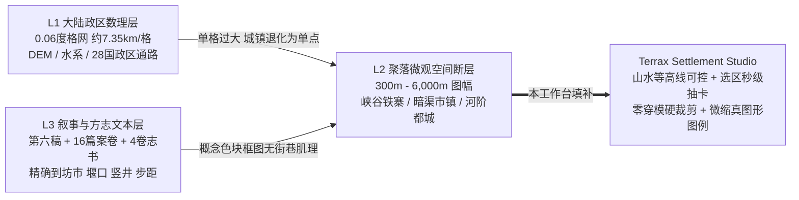
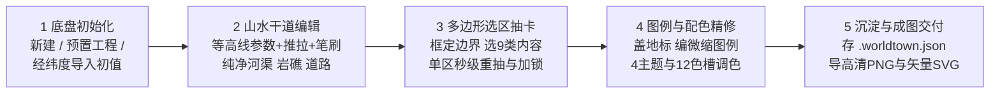

# Terrax Settlement Studio 聚落可视化制图工作台 — 业务需求文档（BRD）

| 文档属性 | 规范内容 |
| :--- | :--- |
| **项目名称** | `Terrax Settlement Studio`（TERRAX 通用聚落可视化制图与受控抽卡工作台） |
| **文档版本** | `V1.2（正式执行基线版）` |
| **编制日期** | `2026-11-18` |
| **仓库落位** | `/Users/jrdamocles/code/TERRAX/settlement_studio/` |
| **体系定位** | 与 `/worldbuilding/`（`Terrax Sky Studio` 星空创作端）并列的仓库级通用建世制图基础设施 |
| **关联基线** | [02_PRD_产品需求与技术规格书.md](02_PRD_产品需求与技术规格书.md) · [03_执行对照计划表与验收溯源矩阵.md](03_执行对照计划表与验收溯源矩阵.md) |
| **目标实施方** | `deepseek v4.1 flash`（本文档锁定全部业务目标、范围红线、防呆约束与量化验收门禁） |

> **定位声明**：在 TERRAX 建世工具体系中，`/worldbuilding/` 负责天球星场、多体轨道星历与星座划界（产出 `.worldsky`），`/settlement_studio/` 专职填补地表 `300 m — 6,000 m` 聚落微观尺度的山水编辑、受控街坊抽卡与出版成图空白（产出 `.worldtown.json` 及高清 `PNG / SVG`）。下游 [02_PRD_产品需求与技术规格书.md](02_PRD_产品需求与技术规格书.md)（`FR-01`—`FR-10`）与 [03_执行对照计划表与验收溯源矩阵.md](03_执行对照计划表与验收溯源矩阵.md)（`M0`—`M6`）均严格服从本文档确立的业务目标（`BRD-G01`—`BRD-G06`）与验收门禁（`BG-01`—`BG-08`）。

---

## 第一章 项目背景与世界观尺度断层分析

### 1.1 TERRAX 既有两层核心资产盘点

当前 TERRAX 仓库已完成宏观地球物理推演与微观人文纪实编纂两层核心积累：

1. **大陆与政区数理层（宏观 `0.06° ≈ 7.35 km` 原生格网）**
   依托全行星 `3000 × 6000` 经纬格网（分辨率 `0.06°`，赤道及中低纬单格约 `7.35 km`；母星参数 `1.05g`、`1.18 atm`、`26` 地球小时平均太阳本地日），`/地图/` 已完备沉淀陆表及湖床高程栅格 `lake_bed_dem.bin`、海陆与内流归属掩膜 `global_owner.npz` 及 `map_lake_mask.npz`、上下游拓扑水系中心线 `rendered_centerlines.npz`、干旱度气象场 `meteorology__meteorology.npz`，以及合相历 `1123` 年 B 大陆 `28` 个世俗政权（含中央高地 `H1` 非主权圣域与 `D1/D2` 牧约井站软控制包络）的 `B政局_国家.geojson`、`B政局_一级区.geojson`、`B政局_治所.geojson`、`B政局_都城.geojson` 与有向水陆通行时效网 `B政局_通路_有向.json`。
2. **叙事与纪实方志文本层（逾二十五万字空间档案）**
   在《候选第六稿》（`01`—`07` 篇地理、比较史、十语词库、三千年史、基层矛盾与交流网络）基线下，已建成四卷 `16` 篇纪实案卷《待定故事集》（`S01`—`S04`），以及两卷起点内外圈地方志（`G01` 起点本境 `E1` 与 `R1966` 河谷、`G02` 长湖西南 `E2` 与东岸北道诸镇）和两卷八大国志（`G03` 北方内陆四国、`G04` 东翼西廊南方四国）。文本对城垣街坊、引排水堰、暗渠竖井、疫界石圈及涉案场所步行刻数均有精确纪实设定。

### 1.2 「300 m — 6,000 m」聚落微观空间层的结构性空白

对照全尺度建世谱系，宏观政区舆地与微观纪实文本之间横亘着一层长期缺失的空间可视化断层：

| 空间层级 | 典型物理跨度 | 仓库现有工具或数据载体 | 聚落表达能力与核心痛点 |
| :--- | :--- | :--- | :--- |
| **L0 天球历法层** | 全天球视界 | `Terrax Sky Studio`（`/worldbuilding/`） | 完备覆盖恒星、双月七行星星历与 103 星座，不涉地表聚落 |
| **L1 大陆政区层** | `100 km — 8,000 km` | `lake_bed_dem.bin`、`B政局_*.geojson` 及舆地脚本 | 单格 `7.35 km`，数万人首都不足半格，只能缩略为一颗圆点或星标 |
| **L2 聚落微观层** | **`300 m — 6,000 m`** | **此前空白（`Terrax Settlement Studio` 目标层）** | **缺失河阶等高线、街巷顺坡肌理、水工堰渠与真实规模对比平面图** |
| **L3 室内器物层** | `0.1 m — 50 m` | 案卷白描与器物考证（榆梁暗楔、木牍、水锤） | 属文字与单体插画范畴，无需在城镇总平面展开室内墙体 |

这一断层带来三项直接业务痛点：① **规模级差失焦**：百户级高山峡谷铁寨（帕隆双生铁寨）、数千人湖岸暗渠复合镇（长湖复市镇）与数万人河阶换装都城（起点城 `Lōsrūmūra`）在区域舆地图上均只是一个点，无法传达体量级差；② **概念框图失真**：用简单几何框绘制的示意图（如早期 `G01b`）仅有空洞色块，无法表现成百上千栋沿街屋宇顺应等高线与河湾生长的真实肌理；③ **动线推演易错**：缺乏带公制比例尺与精确高差的聚落沙盘，写稿时难以直观核验潜行步距、视线遮挡与涨水淹没边界。

---

## 第二章 前期方案探索复盘与失败根因诊断

立项前，项目先后实测了**外部现成生成器**与**纯 Python 脚本盲跑静态样图**两条路径，其复盘结论构成 V1.2 全部需求的直接依据。

### 2.1 外部现成工具（Watabou MFCG / Village Generator）复盘

拆解用户确认的 Watabou City 参考图，其**四大审美价值值得完全继承**：① 克制的 `7` 语义色钢笔淡彩与暖灰绿羊皮纸底纹（`#ebe9d5` 底纸、内城暖黄赭 `#cbb582`、关厢村落陶土赭红 `#cc9a76`、衙署深赭金 `#bfa168`、深褐城垣 `#504233`、青灰水体 `#a5bfbb`、叶绿树簇 `#5b844b`）配东南微阴影；② 街坊向内缩进留出亮米白负空间街道（`#f7f5e8`），沿街剖分共墙或窄缝密排屋宇并围合小内院；③ 双遍绘制法（先画深绿外扩墨边圆、再填叶绿圆）融合成无内部杂线的手绘云朵状树冠；④ 不规则外围农田按主轴裁剪平行耕垄细线。

但 Watabou 存在 **4 项不可克服的业务局限**：
1. **无等高线山脉与自由河湖水工编辑**：画布默认为无高差平地，无法绘制河阶陡坎、深切峡谷、分叉河渠、分水堰与内陆咸水湖湾；
2. **`Warp` 仅为事后极坐标网格硬拉扯**：拉扯不感知地形坡度且令屋宇畸变，一旦重抽（Reroll）或改路则全部手动调整归零，无法做到“锁死山水骨架、仅重抽局部街坊”；
3. **Village 完全闭源不可编，城村视觉规则割裂**：城市与村落分属独立黑盒工具，笔触、线宽与色板互不兼容，无法统一呈现都城、市镇与高山村寨；
4. **无法按世界观划定多边形功能区与禁建区**：无法在同一画布自主框定晒盐池、条垄田、黑石大疫禁建圈及暗渠清淤竖井等制度化空间。

### 2.2 纯 Python 脚本盲跑静态样图复盘（5 大实测业务缺陷）

前期在候选目录尝试用纯 Python 脚本生成静态样图，经用户实测审阅暴露出 **5 大致命业务缺陷**：

1. **图例缺失与不明符号污染**：脚本在山脊两侧程序化撒布未定义的“蝌蚪状/水滴尖刺状”示坡纹，并在地表散落无说明黑点圈，既违背等高线测绘规范又无对应图例，严重破坏图面自解释性。
2. **空间穿模违背基本物理常识**：各图层顺序叠画且仅做粗略中心点掩膜过滤，导致主干道路、河流、水渠直接切穿房屋，或房屋骑建于河道水面与道路之上，跨河桥梁亦未对齐道路切向而斜交错位悬空。
3. **水文失真（无故滋生河心小岛）**：河道拓宽逻辑混入随机噪声分汊，致使普通几十至百米宽的窄河道内随机冒出大量香肠状河心小沙岛；现实水文与方志设定中除显式基岩礁石外绝不应存在此类碎岛。
4. **等高线与水路缺乏交互控制**：纯代码模式下无法直观控制等高线“从多少米到多少米、范围多大、哪边密哪边疏”，微调一条山脊或河湾需反复改代码重跑看图，反馈链极长。
5. **生成范围与内容不可控**：无法在画布上用鼠标自由框定“这块区域范围多大、边界贴哪条路、里面抽卡生成何种内容”，街坊常越界溢出或与山水脱节。

| 评估维度 | Watabou 外部工具 | 纯 Python 静态脚本样图 | `Terrax Settlement Studio`（V1.2 基线） |
| :--- | :--- | :--- | :--- |
| **质感与城村统一** | 城市佳，城村规则割裂 | 混入怪异蝌蚪尖刺噪点 | **对齐 Watabou 钢笔淡彩质感，城、镇、村统一** |
| **等高线交互控制** | 无等高线地形 | 盲改代码猜参数，无疏密手柄 | **高程截断 ＋ 偏心疏密手柄 ＋ 直接推拉 ＋ 四支笔刷** |
| **河道纯净与桥梁** | 仅极简固定水岸模板 | 窄河乱生香肠小岛，桥梁斜歪 | **默认河道 100% 纯净无岛（仅显式岩礁），桥自动正交** |
| **零穿模物理保障** | 平地内部无外部水渠碰撞 | 频繁发生路穿房、水穿房 | **512×512 SDF ＋ 解析线段硬裁剪，穿模计数恒为 0** |
| **选区与图形图例** | 无多边形选区与图形图例 | 范围死板，缺图例且有不明黑点 | **多边形 9 类内容秒级抽卡 ＋ 全要素微缩真图形图例** |

---

## 第三章 核心业务目标体系（`BRD-G01` — `BRD-G06`）

针对前期痛点确立 **6 项核心业务目标**，与下游 PRD 模块及验收门禁双向绑定：

| 目标编号 | 核心业务目标 | 解决的前期根因 | PRD 模块 | 验收门禁 |
| :--- | :--- | :--- | :--- | :--- |
| **`BRD-G01`** | **宏观地理确定性与局部受控抽卡协同** | 山水不可编；范围失控重跑慢 | `FR-02/06/10` | `BG-04/07` |
| **`BRD-G02`** | **物理与空间常识 100% 零违背** | 路水穿房、桥歪斜、陡崖建房 | `FR-05/07` | `BG-01` |
| **`BRD-G03`** | **水系纯净度与地貌真实性** | 窄河生沙岛；等高线疏密失控 | `FR-03/04/05` | `BG-02/03` |
| **`BRD-G04`** | **图面 100% 自解释与全要素图例可编辑** | 蝌蚪尖刺黑点污染；缺真图例 | `FR-03/08` | `BG-05` |
| **`BRD-G05`** | **地图质感对齐 Watabou（城村统一）＋ 界面全新设计** | 城村割裂；防照搬暗黑星空 UI | `FR-01/09` | `BG-06` |
| **`BRD-G06`** | **仓库通用资产沉淀与多格式交付** | 临时脚本无法回溯重编与复用 | `FR-02/09/10` | `BG-07/08` |

- **`BRD-G01` 宏观地理确定性与局部受控抽卡协同**：山水等高线、河湖海岸、明暗水渠、主次干道及多边形选区（`Zone`）边界 100% 由用户可控可编（支持可选从 TERRAX 经纬度导入真实高程、坡向与水路初值）；选区内部提供 **9 类可选生成内容**（`walled_city` 城垣内城、`town_blocks` 无墙市镇、`village` 散居村寨、`citadel` 衙署公仓大院、`market` 市集码头坪、`farmland` 条垄农田、`saltpan` 分级晒盐池、`woodland` 林地园囿、`exclusion` 禁建留白区），依托确定性 `seed` 在画布原地 `< 80 ms` 秒级抽卡生成，支持单选区独立重抽、锁定满意选区及 `40` 步撤销回退。
- **`BRD-G02` 物理与空间常识 100% 零违背**：建立硬性几何退界（河湖岸退界、水渠退界、道路退界、城墙退界、最大可建坡度阈值）与双重碰撞裁剪机制，彻底消灭路穿房、水穿房、墙穿房、侵入禁建区与陡崖建房；凡道路跨河跨渠处自动沿道路切线生成正交木石桥梁；拖拽修改水路或坡度时受影响选区自动重算避让。
- **`BRD-G03` 水系纯净度与地貌真实性**：默认河道与水渠保持 100% 纯净连续水面与贴岸平行水纹，严禁随机生成河心小沙岛，水中岩体仅在用户显式放置基岩礁石（`reefs`）时出现；等高线实现**“参数化非对称铺底（基准高、最低至最高截断海拔、等高距、山包偏心疏密焦点、山脊左右坡宽）＋ 鼠标直接按住等高线拖拽推拉 ＋ 四支涂抹笔刷（刷高、刷低、平滑刷疏、定高台地）微雕”**三合一控制。
- **`BRD-G04` 图面 100% 自解释与全要素图例可编辑**：彻底废除蝌蚪尖刺纹与无说明黑点（陡坎短齿线默认关闭，仅显式开启时绘标准细短垂线并入图例）；凡画布现存要素必在图例框内自动生成**真实微缩图形图例**（非单调圆点），并全面开放图例改名、改色、单条显隐、四角停靠切换与新增自定义图例符号盖章能力。
- **`BRD-G05` 地图质感对齐 Watabou（城村统一）＋ 软件界面全新独立设计**：地图内部保持 Watabou City 经典暖羊皮纸钢笔淡彩质感、密排沿街屋宇与双遍云朵融合树冠，并无缝统一覆盖市镇与高山村寨，提供 `4` 套主题与 `12` 色槽手动调色；软件外框 UI **全新独立设计为「浅色纸本测绘工坊（Light Cartographer's Atelier）」**（暖亚麻桌面 `#f4f1ea`、象牙卡纸面板 `#faf8f3`、黄铜细框 `#d5cdbd`、松针绿 `#365942` 与陶土红 `#b55838`），**严禁照搬 `Terrax Sky Studio` 暗黑星空风**。
- **`BRD-G06` 仓库通用资产沉淀与多格式交付**：独立落户 `/settlement_studio/`，工程保存为结构化 `.worldtown.json`（含随机种子与高程微雕增量）可随时回溯重编，支持静态离线与本地 Python 服务双模运行，并提供 `1x / 2x / 3x` 高清 PNG（含图例成图 / 纯净底图）与独立矢量 SVG 导出。

---

## 第四章 核心用户场景与标准作业流（`UC-01` — `UC-04`）

### 4.1 `UC-01`：既有重头故事与方志现场精准还原（三大标杆闭环）

1. **起点都城 `Lōsrūmūra`（`42.51°E, 35.19°N`，基准高 `484 m`，图幅 `3,200 m`）**：经 `/api/terrax-context` 导入西北流向淡水支流 `R1966` 与东北疏林低山初值 → 手调东关砂岩矮嘴窄槽（`72 m`）与北埠 `Lōsmā` 回水宽湾（`160 m`），加绘东关总分水堰及饮污双渠，用定高台地笔刷抹出 `+6 m` 砾石内城高阶 → 框绘内城 `walled_city`、三木合契议事厅与公仓 `citadel`、西坡换装道（老榆梁客舍所在）`town_blocks`、南门灰粪柴市 `market` 及城外 `farmland` → 分区抽卡锁定并加盖分水堰、滑道地标，成图嵌入《G01 起点本境地方志》卷二与《S01 老榆梁下的第十二夜》。
2. **长湖复市镇 `Simibihmāh / Qar-iq`（`35.61°E, 28.53°N`，基准高 `424 m`，图幅 `2,600 m`）**：绘制东北侧 `L6` 半咸水湖湾（`414 m`）与西坡冲积扇缓坡等高线 → 在西北角框绘凸多边形 `exclusion` 禁建选区（前 `405` 年 `poēk / pōq-at` 黑石大疫界圈，确保圈内零建筑零耕作）→ 绘制西坡伊珂免税暗渠，用“暗渠竖井”自定义图例等距点放七口清淤石井圈（精准定位第三竖井“哭井”与西井母祠）→ 湖滨框绘盐鱼互市坪 `market`、`saltpan` 晒盐池与东西两片 `town_blocks` 街坊，重抽选优后嵌入《G02》与《S01 哭井与滚汤》。
3. **帕隆双生铁寨（`29.04°E, 14.58°N`，谷底约 `1,650 m`，图幅 `1,400 m`）**：用两条非对称山脊叠加等高线向谷底推挤，塑造深切 V 形停战峡谷 → 绘制中央急溪（默认纯净无沙岛），仅在暗梁渡口显式放置 `7` 块花岗岩底礁（`reefs`）→ 在南北两岸窄阶地各框绘一片 `village` 散居村寨选区（设 `maxSlopeDeg = 28°`，两侧陡崖自动零建房），抽卡生成顺等高线错落的曲尺院落与菜园围篱，点放十二座水力锻锤与哨塔地标，嵌入《G04》与《S04 隔溪敲石声》。

### 4.2 `UC-02`：地方志次级村镇、渡口与驿铺快速量产

面向四卷志书中数十处次级节点（如 `P1` 双井驿、苇口埠 `Louvamavarnmāh`、沙坝城 `Sālmāh-tīnmāh`、`N2-02` 汇口边镇 `Lūvama-Tōka`、`D2-03` 灰山口护商石驿 `χan-ul`），创作者通过“导入经纬度初值 → 3 分钟勾画等高线与水路干道 → 框选 2—4 个选区连抽数次定稿 → 存 `.worldtown.json` 导 `2x PNG`”标准流水线，在 **10 分钟内**完成单镇高质量成图。

### 4.3 `UC-03`：故事写作前的空间距离、高差视线与潜行/水淹动线推演

创作者在动笔撰写新案卷前，利用画布公制比例尺与底部状态栏实时世界坐标 `(X m, Y m)`、地表海拔 `Z m`、坡度 `°` 读数，精确测算涉案建筑间真实米数与 `26` 小时本地日步程刻数，核验高台建筑（如 `F2` 七柱水殿、司辰官坛石矶）对河滩的通视遮挡高差，并通过等高线截断直观推演春汛涨水对低洼船闸与关厢的淹没范围。

### 4.4 `UC-04`：跨气候带聚落手动换色与导出嵌稿

针对 B 大陆多元地理带——远北 `50.73°N` `Y3` 捕鲸峡湾与岛 `12` 东岬港（切换 `boreal_slate` 寒海冷灰青主题）、`D2` 百日泉道旱原绿洲（切换 `arid_ochre` 旱原砂岩主题）、西廊 `V1` 赤渠旧城排卤水城与 `F1` 河都三级船闸（切换 `archival_parchment` 古志暖褐水墨或手动微调 `12` 色槽），一键分别导出**含中文微缩图形图例的导览正图**与**无字纯净底图 / 矢量 SVG**，无缝嵌入 Markdown 文稿或高清归档。

---

## 第五章 业务范围边界与刻意克制项（Scope & Non-Goals）

### 5.1 V1.2 正式纳入范围（In-Scope）

- **地形与等高线**：全域高程参数与最低/最高截断控制、非对称山包（偏心焦点）与山脊/沟谷/台地坎（左右坡宽）、鼠标直接按住等高线拖拽推拉、四支高程涂抹笔刷（刷高/刷低/平滑/定高台地）。
- **水路与正交桥梁**：纯净变宽河流（零自动沙岛）、湖海多边形、明暗水渠、显式基岩礁石（`reefs`）、三级道路及跨水自动正交木石桥梁。
- **多边形抽卡与零穿模**：多边形选区顶点增删平移与公顷面积计算、`9` 类生成内容切换、单选区独立抽卡与加锁、`40` 步撤销重做、`512×512` SDF ＋ 解析线段双重硬碰撞零穿模裁剪。
- **图例、配色与交付**：自动同步微缩真图形图例（支持改名、改色、显隐、四角停靠与自定义图例盖章）、Watabou 城村统一渲染、`4` 主题 ＋ `12` 色槽、全新浅色测绘工坊 UI、`.worldtown.json` 持久化、`1x/2x/3x` PNG 与 SVG 导出、Python 经纬度桥接与静态离线双模兼容。

### 5.2 V1.2 刻意不做项（Non-Goals）与核心克制依据

1. **【核心克制】V1.2 明确不做单栋房屋的手动增删、顶点拖拽、旋转或自由摆放**
   中型市镇与都城通常含 `500 — 2,500` 栋密排屋宇。若引入单栋手工 CRUD 与拖拽，子图元拾取、局部持久化与二次穿模校验复杂度将指数级膨胀，极易引发状态错乱。本版专注把**“多边形选区边界编辑 ＋ `exclusion` 禁建留白切口 ＋ 独立 `citadel` 大院与地标点放 ＋ 单选区秒级重抽 ＋ 100% 零穿模避让”**做到极致。
2. **不做 3D 白模与透视视口**：严守二维正射纸本平面定位，不引入 WebGL / Three.js。
3. **不做水力侵蚀仿真**：保障等高线 100% 服从手控意图与毫秒响应，不跑随机粒子侵蚀。
4. **不做室内平面图（Floorplan）与洞穴剖面图**：`< 50 m` 室内结构不属于聚落总图范畴。
5. **不做市民动态模拟与重型前端打包链**：零 npm 第三方框架依赖，单机开箱即用。

---

## 第六章 业务风险识别与规避策略（面向 `deepseek v4.1 flash`）

针对后续执行编码的轻量高速模型 `deepseek v4.1 flash` 易在复杂几何边界、跨文件契约与长代码细节上产生偏差的特性，制定以下业务与架构级防呆策略：

| 风险编号 | 潜在工程风险场景 | 业务危害 | 架构与规格级防呆规避约束 |
| :--- | :--- | :--- | :--- |
| **`R-01`** | **凹选区街坊剖分死循环或崩溃** | 页面假死或选区无房 | 禁写易退化 Fortune 扫描线；锁死“确定性撒点 ＋ 2 轮 Lloyd 松弛 ＋ Sutherland-Hodgman 半平面裁剪”并设迭代上限。 |
| **`R-02`** | **仅测建筑中心点漏放屋角穿模** | 屋角入水压路违背常识 | 强制“阶段一 `512×512` SDF 初筛 ＋ 阶段二全顶点、边中点与全边段精确解析距离复检”，导出 `verifyZeroCollisions` 压测。 |
| **`R-03`** | **硬拽等高线二维顶点自交打结** | 等高线穿插、逆序或 `NaN` | 禁直接改折线顶点；鼠标推拉改为局部高斯核平滑更新底层 `257×257` 高程场 `sculptDelta`（带限幅），再由 Marching Squares 重提闭合线。 |
| **`R-04`** | **河道急弯翻转或残留河心沙岛** | 河岸破面或窄河冒出沙洲 | 控制线先经 Catmull-Rom 重采样平滑；明令禁止自动沙岛分支，断言 `reefs` 为空时水中孤岛数恒为 `0`。 |
| **`R-05`** | **多模块导出签名或 JSON 字段错位** | 联调报错或存取丢数据 | 零构建原生 ES Module，在 `02_PRD` 写死 7 个 JS 模块精确导出名与 `.worldtown.json` 完整 Schema。 |
| **`R-06`** | **UI 抄袭暗色星空风或图例仅画圆点** | 外壳违和、图例失明 | 在 `02_PRD` 锁死浅色测绘工坊 CSS 变量与每类地物微缩真图形绘制规格，设为执行红线。 |
| **`R-07`** | **脚本误改既有设定或候选文稿数据** | 破坏既有 SHA-256 基线 | 物理隔离于 `/settlement_studio/`，DEM/水系一律只读，总验收运行上层 `核验候选稿.py` 校验零改动。 |

---

## 第七章 硬性业务验收门禁（`BG-01` — `BG-08`）

以下 **8 道业务验收门禁** 实行一票否决制，全部量化判据通过方可结项：

- **`BG-01` 零穿模门禁**：在含弯曲河流、交叉道路、水渠、城垣、陡坡（`> 28°`）与禁建区的压测场景及三大预置工程下，连续随机运行 `50` 组 `seed`，`verifyZeroCollisions` 返回的 `buildingRoadHits`、`buildingWaterHits`、`buildingWallHits`、`buildingExclusionHits`、`buildingBuildingHits` **100% 恒等于 `0`**；跨水桥梁与道路切线夹角偏差 `<= 1°` 且完全覆盖水宽加两端桥台；拖动水路或陡坡后选区自动重算避让并保持零穿模。
- **`BG-02` 纯净河道门禁**：当 `project.reefs` 为空时，任意河宽、曲率与种子下生成的河流及水渠内部沙岛/无故孔洞多边形数量严格等于 **`0`**；仅当显式添加 `reefs` 时水中才生成对应暗色岩礁多边形并自动同步“岩体礁石”图例。
- **`BG-03` 等高线全控门禁**：全域参数精确控制基准高程、等高距及 `minContourElev / maxContourElev` 截断范围（超范围零绘制）；山包偏心焦点 `focusX / focusY` 与山脊 `widthLeft / widthRight` 实时驱动两侧等高线疏密连续渐变且峰顶无尖角；鼠标直接拖拽推拉等高线与四支涂抹笔刷连续操作 `100` 次后，高程场零 `NaN / Infinity`、提取等高线零自交打结，单次重提耗时 `< 35 ms`。
- **`BG-04` 选区原地抽卡门禁**：多边形选区创建、节点增删拖拽、平移与公顷面积计算准确；全部 `9` 类 `contentType` 均正常产出合规几何；点击单选区抽卡在 `< 80 ms` 内原地刷新，已锁定选区与山水干道 `100%` 零变动；支持 `>= 40` 步撤销重做；界面严格不含任何单栋房屋增删改拖拽入口。
- **`BG-05` 图形图例完备门禁**：全局 `100%` 清零蝌蚪尖刺纹与无说明黑点；画布现存全部地物类别 `100%` 自动同步至图例栏并绘制真实微缩图形样本（严禁以纯色圆点替代城墙、道路、耕垄、盐池、树簇等）；图例改名、改色、显隐、四角停靠及新增自定义图例符号盖章全链路实测通过。
- **`BG-06` 全新浅色测绘工坊 UI 门禁**：软件外框严格采用「浅色纸本测绘工坊」暖浅色系（桌面 `#f4f1ea`、面板 `#faf8f3`，零引用 `/worldbuilding/` 暗色样式）；地图内部呈现纯正 Watabou 暖羊皮纸钢笔淡彩质感且城、镇、村笔触与双遍融合树冠完全统一；`4` 套主题与 `12` 色槽实时换色立即生效。
- **`BG-07` JSON 持久化与高清图片导出门禁**：三大预置工程（`起点城_Losrumura`、`长湖_复市镇`、`帕隆_峡谷铁寨`）开箱零报错且零穿模绿灯；含等高线推拉/笔刷微雕、自定义色板与自定义图例的工程经 `.worldtown.json` 导出再导入后 `100%` 无损复现；`1x / 2x / 3x` PNG（含图例成图 / 纯净底图）与独立矢量 SVG 导出合法有效；静态直开 `web/index.html` 与运行 `server.py`（`/api/terrax-context` 准确读取 `42.51°E, 35.19°N` 真值）双模式全功能可用。
- **`BG-08` 仓库既有文件 100% 零侵入门禁**：全部新增文件 `100%` 收敛于 `/Users/jrdamocles/code/TERRAX/settlement_studio/` 内；`git -C /Users/jrdamocles/code/TERRAX/worldbuilding status --porcelain` 输出为空，且运行 `/Users/jrdamocles/code/TERRAX/worldbuilding/venv/bin/python3 候选工作区/20261116_B大陆文化与历史/核验候选稿.py`、`核验待定故事集.py`、`核验志书集.py` 退出码全部严格为 `0`，既有正式数据与候选文稿 SHA-256 指纹 `100%` 零改动。
