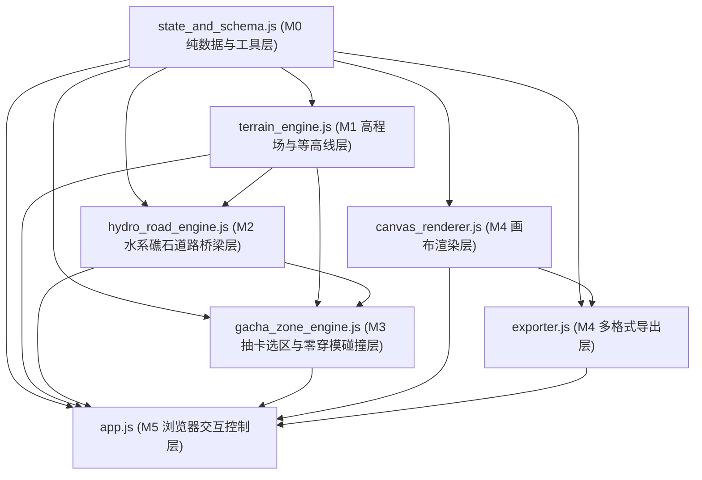

# Terrax Settlement Studio 产品需求与技术规格书（PRD）

| 文档属性 | 规格内容 |
| :--- | :--- |
| **产品名称** | Terrax Settlement Studio（TERRAX 通用聚落可视化制图工坊） |
| **文档编号** | `TERRAX-SS-PRD-02` |
| **文档版本** | `V1.2`（正式执行基线版 — 面向 `deepseek v4.1 flash` 零歧义施工规格） |
| **落盘路径** | `/Users/jrdamocles/code/TERRAX/settlement_studio/docs/02_PRD_产品需求与技术规格书.md` |
| **上游业务基线** | [01_BRD_业务需求文档.md](01_BRD_业务需求文档.md)（`BRD-G01` 至 `BRD-G06`、`BG-01` 至 `BG-08`） |
| **下游执行计划** | [03_执行对照计划表与验收溯源矩阵.md](03_执行对照计划表与验收溯源矩阵.md)、[04_DeepSeek_V4.1_Flash_执行提示词.md](04_DeepSeek_V4.1_Flash_执行提示词.md) |
| **工程总览入口** | [../README.md](../README.md) |
| **目标运行环境** | 前端：原生 ES6 Modules + HTML5 Canvas 2D（零构建步骤、零第三方前端依赖）；后端：`/Users/jrdamocles/code/TERRAX/worldbuilding/venv/bin/python3`（Python 3.13 + `numpy` 标准库 HTTP 服务）；无头核验：Node.js v22+ |

> **【零歧义施工准则】**
> 本文档专为自动化编码模型直接照图施工而编写。所有文件路径、`.worldtown.json` 数据结构、跨模块 `export / import` 函数签名、高程合成与等高线提取数学公式、零穿模两阶段硬碰撞几何算法、CSS 设计变量以及 TERRAX 二进制地理数据读取逻辑均已在本文档中完全锁死。编码阶段须严格遵循本文档命名与参数契约，不得自行删改导出函数名、不得留下任何未实现占位注释、不得触碰 `/Users/jrdamocles/code/TERRAX/settlement_studio/` 目录以外的任何既有仓库文件。

---

## 第 1 章 系统架构总览、锁死目录树与跨模块接口契约

### 1.1 目标工程锁死目录文件树

整个工程独立部署于 `/Users/jrdamocles/code/TERRAX/settlement_studio/`，与 `/Users/jrdamocles/code/TERRAX/worldbuilding/`（Terrax Sky Studio）平级并列。编码交付完成后，目录文件树必须与下表逐字一致：

```text
/Users/jrdamocles/code/TERRAX/settlement_studio/
├── README.md                                    # 工程导引与验收命令说明
├── docs/
│   ├── 01_BRD_业务需求文档.md                   # 业务背景、痛点复盘与 BG-01..BG-08 门禁
│   ├── 02_PRD_产品需求与技术规格书.md           # 本文档：零歧义产品与算法工程圣经
│   ├── 03_执行对照计划表与验收溯源矩阵.md       # M0..M6 原子任务勾选表与双向溯源矩阵
│   └── 04_DeepSeek_V4.1_Flash_执行提示词.md     # 编码执行提示词与防偷懒护栏
├── server.py                                    # 本地轻量 HTTP 服务与 TERRAX 二进制数据只读桥接器
├── web/
│   ├── index.html                               # 浅色纸本测绘工坊单页主视图
│   ├── css/
│   │   └── atelier.css                          # 浅色纸本测绘工坊完整样式表与 CSS 变量
│   └── js/
│       ├── state_and_schema.js                  # M0: Schema 校验、撤销栈、调色板、图例同步与预设模板
│       ├── terrain_engine.js                    # M1: 257x257 高程场、偏心山包、Marching Squares、拖拽推拉与笔刷
│       ├── hydro_road_engine.js                 # M2: 纯净水系（零河心岛）、显式岩礁、多级道路与自动正交桥梁
│       ├── gacha_zone_engine.js                 # M3: 9类多边形抽卡选区生成与 512x512 SDF + 解析几何零穿模引擎
│       ├── canvas_renderer.js                   # M4: Watabou 质感多层渲染器、双遍融合树冠与微缩真图形图例绘制
│       ├── exporter.js                          # M4: 1x/2x/3x 离屏 PNG 导出、独立矢量 SVG 序列化与 JSON 存取
│       └── app.js                               # M5: 画布视口控制、12 工具交互状态机、检视器联动与离线降级启动
├── projects/
│   ├── 起点城_Losrumura.worldtown.json          # 示例1: 42.51E, 35.19N 河阶台地换装都城（484.9 m）
│   ├── 长湖_复市镇.worldtown.json               # 示例2: 35.61E, 28.53N 东廊灌区暗渠互市镇（427.5 m）
│   └── 帕隆_峡谷铁寨.worldtown.json             # 示例3: 29.04E, 14.58N 帕隆停战线峡谷双生铁寨（约1662.6 m）
└── tests/
    ├── verify_headless.mjs                      # Node 无头几何、等高线、50组随机种子零穿模全量核验脚本
    └── verify_backend.py                        # Python 后端 API、起点城真值读取与仓库零侵入核验脚本
```

### 1.2 模块单向依赖关系与无头运行铁律

为确保 `node tests/verify_headless.mjs` 可在不依赖浏览器 DOM 的纯 Node.js v22 环境下直接导入算法内核运行测试，七大前端 JS 模块必须严格遵守单向有向无环图（DAG）依赖顺序，严禁出现循环 `import`：



- **无头兼容硬约束**：`state_and_schema.js`、`terrain_engine.js`、`hydro_road_engine.js`、`gacha_zone_engine.js` 以及 `exporter.js` 中的 `buildSVGString` 在模块顶层与函数执行期严禁直接访问 `window`、`document`、`localStorage` 或 `HTMLCanvasElement`。所有模块统一采用标准相对路径 ES Module 语法（例如 `import { createRng } from './state_and_schema.js';`），完整包含 `.js` 后缀。

### 1.3 统一世界坐标系与单位铁律

1. **物理长度单位**：全系统内部几何坐标、河宽、路宽、屋宇尺寸、退界距离、笔刷半径、高程值统一使用**公制米（`m`）**。
2. **世界平面坐标系**：采用标准俯视制图右手屏幕正交系，画布世界范围定义为正方形 `[0, worldSizeM] × [0, worldSizeM]`（默认 `worldSizeM = 2400`，允许范围 `600` 至 `8000`）：
   - 原点 `(0, 0)` 位于地图西北角（左上角）；
   - `+X` 轴水平向右，指向**正东（East）**；
   - `+Y` 轴垂直向下，指向**正南（South）**；
   - 地图方位恒定为**上北（`-Y`）、下南（`+Y`）、左西（`-X`）、右东（`+X`）**。
3. **角度约定**：平面方向角 `angleDeg` 以 `+X`（正东）为 `0°`，顺时针旋转（向南 `+Y` 为 `+90°`），弧度换算为 `rad = angleDeg * Math.PI / 180`。坡度角 `slopeDeg` 取值 `[0, 90)` 度。

### 1.4 七大 JS 模块精确 `export` 导出签名全表

以下导出符号表为跨文件调用的强制契约，所有模块必须按表内精确名称与参数顺序导出：

#### （1）`web/js/state_and_schema.js` 导出清单

```js
export const SCHEMA_VERSION = '1.2.0';
export const GRID_N = 257;
export const OBSTACLE_GRID_N = 512;
export const BUILTIN_PALETTES = { /* 4套主题 x 12色槽，详第10章 */ };
export const ZONE_CONTENT_TYPES = [
  'walled_city', 'town_blocks', 'village', 'citadel',
  'market', 'farmland', 'saltpan', 'woodland', 'exclusion'
];
export const BUILTIN_LEGEND_CATALOG = [ /* 14项内置图例元数据，详第9章 */ ];
export const CUSTOM_GLYPH_TYPES = [
  'star_fort', 'tower', 'well_shrine', 'ferry_anchor',
  'gate_arch', 'market_tent', 'mine_hammer', 'stele'
];

export function hashSeed(input) {}
export function createRng(seed) {}
export function createUid(prefix, rngOrCounter) {}
export function encodeSculptDelta(float32Arr) {}
export function decodeSculptDelta(base64Str, expectedLen) {}
export function getActivePalette(project) {}
export function createDefaultProject(presetKey) {}
export function getBuiltinPresetProjects() {}
export function normalizeProject(rawObj) {}
export function serializeProject(project) {}
export function deserializeProject(jsonText) {}
export function syncLegendWithProject(project, compiledScene) {}

export class HistoryManager {
  constructor(maxSteps = 40) {}
  reset(initialProject) {}
  beginContinuousAction(projectSnapshot) {}
  commitHistory(currentProject, actionLabel) {}
  canUndo() {}
  canRedo() {}
  undo(currentProject) {}
  redo(currentProject) {}
  getStatus() {}
}
```

#### （2）`web/js/terrain_engine.js` 导出清单

```js
export function buildElevationField(project) {}
export function sampleElevation(terrainData, wx, wy) {}
export function sampleGradient(terrainData, wx, wy) {}
export function sampleSlopeDeg(terrainData, wx, wy) {}
export function evalTerrainShape(shape, wx, wy) {}
export function evalRiverCarve(rivers, wx, wy) {}
export function extractContours(terrainData, terrainConfig) {}
export function extractScarpTicks(contours, terrainData, terrainConfig) {}
export function buildTerrainPackage(project) {}
export function hitTestContourLine(contours, wx, wy, toleranceM) {}
export function applyContourWarpDrag(project, terrainData, dragCtx) {}
export function applySculptBrush(project, terrainData, brushCtx) {}
```

#### （3）`web/js/hydro_road_engine.js` 导出清单

```js
export function sampleCatmullRom(points, samplesPerSeg, closed) {}
export function polylineLength(points) {}
export function closestPointOnSegment(px, py, ax, ay, bx, by) {}
export function closestPointOnPolyline(px, py, polyline) {}
export function buildRiverGeometry(river, worldSizeM) {}
export function buildWaterBodyGeometry(waterBody) {}
export function buildCanalGeometry(canal) {}
export function buildReefGeometry(reef) {}
export function buildRoadGeometry(road) {}
export function solveOrthogonalBridges(roadsBuilt, riversBuilt, fords) {}
export function buildHydroRoadPackage(project, terrainData) {}
```

#### （4）`web/js/gacha_zone_engine.js` 导出清单

```js
export function computePolygonAreaSigned(points) {}
export function computePolygonAreaHa(points) {}
export function computePolygonCentroid(points) {}
export function pointInPolygon(px, py, polygon) {}
export function segmentsIntersect(ax, ay, bx, by, cx, cy, dx, dy) {}
export function segmentToSegmentDist(ax, ay, bx, by, cx, cy, dx, dy) {}
export function clipPolygonHalfPlane(polygon, nx, ny, offsetC) {}
export function computeVoronoiCells(sites, bbox, lloydRounds, boundaryPoly) {}
export function insetConvexPolygon(convexPoly, insetDistM) {}
export function buildObstacleGrid(project, terrainData, hydroRoadData) {}
export function sampleObstacleClearance(obstacleGrid, worldSizeM, wx, wy) {}
export function isPolygonSafe(candidatePoly, obstacleCtx, extraMarginM) {}
export function compileSingleZone(zone, project, terrainData, hydroRoadData, obstacleCtx) {}
export function compileAllZones(project, terrainData, hydroRoadData) {}
export function verifyZeroCollisions(project, terrainData, hydroRoadData, zonesData) {}
export function compileSettlementScene(project) {}
export function rerollZoneSeed(project, zoneId) {}
```

#### （5）`web/js/canvas_renderer.js` 导出清单

```js
export function createViewport(widthPx, heightPx, worldSizeM) {}
export function worldToScreen(wx, wy, viewport) {}
export function screenToWorld(sx, sy, viewport) {}
export function zoomViewportAtScreenPoint(viewport, screenX, screenY, zoomFactor) {}
export function fitViewportToWorld(viewport, widthPx, heightPx, worldSizeM, paddingPx) {}
export function renderMergedTreeCanopy(ctx, trees, viewport, palette) {}
export function drawLegendGlyphCanvas(ctx, legendItem, x, y, w, h, palette) {}
export function renderSceneToCanvas(ctx, project, compiledScene, viewport, renderOptions) {}
```

#### （6）`web/js/exporter.js` 导出清单

```js
export function renderOffscreenPNGCanvas(project, compiledScene, options) {}
export function exportPNGDataURL(project, compiledScene, options) {}
export function downloadPNG(project, compiledScene, options) {}
export function buildLegendGlyphSVG(legendItem, x, y, w, h, palette) {}
export function buildSVGString(project, compiledScene, options) {}
export function downloadSVG(project, compiledScene, options) {}
export function downloadProjectJSON(project) {}
export function readProjectJSONFile(fileObj) {}
```

#### （7）`web/js/app.js` 导出清单

```js
export function createStudioApp(rootDocument) {}
```
（当在浏览器加载 `web/index.html` 时，`app.js` 监听 `DOMContentLoaded` 自动调用 `createStudioApp(document)` 完成挂载初始化。）

---

## 第 2 章 `FR-01` 全新「浅色纸本测绘工坊」UI 视觉与画布视口系统

> **需求溯源**：映射 `BRD-G05`（地图质感对齐 Watabou 城村统一 + 软件界面全新独立设计）与硬性门禁 `BG-06`（全新浅色测绘工坊 UI 门禁）。

### 2.1 `FR-1.1` 视觉风格红线与完整 CSS 变量表（`web/css/atelier.css`）

1. **视觉禁令**：严禁复制或残留 `worldbuilding/`（Terrax Sky Studio）的深黑太空背景、霓虹发光边框或玻璃拟态暗色卡片。全界面采用**「浅色纸本测绘工坊（Light Cartographer's Atelier）」**设计语言，灵感源自亚麻绘图桌垫、象牙白测绘卡纸、黄铜分规细线、松针墨绿印泥与赤陶铅笔标注。
2. **完整 `:root` CSS Token 定义**（必须原样写入 `web/css/atelier.css` 顶部）：

```css
:root {
  /* 桌面与多层纸张背景色 */
  --bg-desk: #f4f1ea;
  --bg-panel: #faf8f3;
  --bg-card: #efeae0;
  --bg-card-hover: #e7e0d2;
  --bg-input: #ffffff;
  --bg-hud-float: rgba(250, 248, 243, 0.94);

  /* 黄铜与卡纸分割线 */
  --border-brass: #d5cdbd;
  --border-brass-strong: #b8ad98;
  --border-focus: #365942;

  /* 钢笔墨色层级 */
  --ink-primary: #2b2620;
  --ink-secondary: #4a4339;
  --ink-muted: #6e6659;
  --ink-on-accent: #faf8f3;

  /* 测绘工坊双核心强调色与状态色 */
  --accent-pine: #365942;          /* 主操作按钮、选区抽卡按钮、通过核验绿灯 */
  --accent-pine-hover: #294533;
  --accent-pine-soft: rgba(54, 89, 66, 0.12);
  --accent-terracotta: #b55838;    /* 激活工具态、地形偏心菱形柄、选中高亮框 */
  --accent-terracotta-soft: rgba(181, 88, 56, 0.14);
  --accent-ochre: #9c7432;         /* 计曲线与测绘标尺提示色 */
  --status-ok: #2d6a4f;            /* 零穿模核验通过绿灯 */
  --status-warn: #b55838;          /* 离线降级或操作提示色 */

  /* 圆角、阴影与尺寸度量 */
  --radius-sm: 4px;
  --radius-md: 6px;
  --radius-lg: 10px;
  --radius-pill: 999px;
  --shadow-panel: 0 2px 10px rgba(43, 38, 32, 0.07);
  --shadow-float: 0 6px 20px rgba(43, 38, 32, 0.13);

  /* 优先保障汉字与拉丁长音符 ā ē ī ō ū ə 清晰渲染的字体栈 */
  --font-ui: "Avenir Next", "PingFang SC", "Hiragino Sans GB", "Microsoft YaHei", "Arial Unicode MS", "Noto Sans SC", sans-serif;
  --font-map-serif: "Palatino Linotype", "Book Antiqua", "Songti SC", "STSong", "Arial Unicode MS", "Noto Serif SC", serif;
  --font-mono: "SF Mono", "Menlo", "Consolas", monospace;
}
```

### 2.2 `FR-1.2` 宏观界面布局与核心 DOM ID 契约（`web/index.html`）

`web/index.html` 首行使用标准 HTML5 文档类型声明，设置 `<meta charset="UTF-8">`，整页高度锁死 `100vh`（无外层页面滚动条），采用 CSS Grid 构建四区测绘台布局：

```text
+---------------------------------------------------------------------------------------+
| 顶部工程栏 #topbar (高 48px, 背景 --bg-panel, 底边框 1px solid --border-brass)        |
| [徽标 Terrax Settlement Studio] [工程名输入] [示例切换下拉] [导入TERRAX经纬度]        |
|                                       [撤销 ⌘Z] [重做 ⌘⇧Z] [打开JSON] [保存JSON] [导出]|
+--------+-------------------------------------------------------------+----------------+
| 左侧   | 中央主制图视口区 #viewport-wrap (背景 --bg-desk, 相对定位)   | 右侧属性检视器 |
| 工具坞 |                                                             | #inspector     |
| #tool- |   +-----------------------------------------------------+   | (宽 320px,     |
| dock   |   | 悬浮选区抽卡胶囊条 #zone-floating-hud (选中选区时现) |   | 5个顶部Tab页:  |
| (宽    |   | [选区名] [类型下拉] [🎲 重抽此选区 (R)] [锁定开关]   |   | 1. 地形        |
| 56px,  |   +-----------------------------------------------------+   | 2. 水路        |
| 12枚   |                                                             | 3. 选区抽卡    |
| 图标   |              <canvas id="map-canvas"></canvas>              | 4. 图例        |
| 按钮)  |                                                             | 5. 配色与导出  |
|        |                                                             | 独立纵向滚动)  |
+--------+-------------------------------------------------------------+----------------+
| 底部实时测绘状态栏 #statusbar (高 30px, 背景 --bg-panel, 顶边框 1px solid --border-brass)|
| 坐标: X 1240.5 m, Y 860.0 m | 海拔: 484.2 m | 坡度: 6.4° | 缩放: 42% | 屋宇: 618 栋   |
|                                              [后端状态徽章] [✓ 零穿模核验: 0 冲突]    |
+---------------------------------------------------------------------------------------+
```

**左侧垂直工具坞（`#tool-dock`）12 个工具状态机与快捷键锁死定义**：

| 序号 | 工具 `toolId` | 中文提示名称 | 快捷键 | 核心交互职责 |
| :--- | :--- | :--- | :--- | :--- |
| 1 | `select` | 选择与手柄调整 | `V` | 点选地形图元、河流、水渠、道路、抽卡选区、岩礁或地标；拖拽顶点、轴柄、旋转柄、偏心菱形柄或整体平移选区 |
| 2 | `contour_drag` | 等高线直接拖拽推拉 | `C` | 鼠标按住任意等高线直接向内外推拉，实时改变局部等高线疏密走向且永不自交 |
| 3 | `sculpt_brush` | 高程涂抹微雕笔刷 | `B` | 提供 `刷高 / 刷低 / 平滑刷疏 / 定高台地` 四种模式，支持 `Alt+左键` 吸取画布任意点海拔为台地目标高程 |
| 4 | `add_hill` | 放置非对称山包/盆地 | `H` | 在画布点击拖拽创建可调偏心疏密的椭圆山包（正高差）或洼地盆地（负高差） |
| 5 | `add_ridge` | 绘制山脊/冲沟/陡坎 | `G` | 连续点击绘制折线图元（可在右侧切换 `山脊 ridge / 冲沟 valley / 河阶陡坎 scarp`），双击结束 |
| 6 | `draw_river` | 绘制纯净变宽河流 | `W` | 依上游→下游顺序点击绘制河流中心控制点，双击生成零沙洲平滑变宽河道 |
| 7 | `draw_water_area` | 绘制湖泊/海域/水渠 | `L` | 支持绘制闭合湖海多边形（`lake / sea`）或折线式引水明渠/暗渠（`canal`） |
| 8 | `place_reef` | 点放基岩礁石/渡口 | `K` | 在水体内点击放置显式棱角岩礁；或在道路与河流交点点击切换“正交木石桥 / 浅滩渡口” |
| 9 | `draw_road` | 绘制主次干道 | `D` | 连续点击绘制 `主干驿道 highway / 市镇街路 street / 顺坡村径 lane`，过河处自动生正交桥 |
| 10 | `draw_zone` | 绘制多边形抽卡选区 | `Z` | 连续点击框定任意凸/凹多边形范围，双击闭合后立即按所选 `contentType` 与种子生成内部要素 |
| 11 | `place_landmark` | 点放图例地标戳记 | `M` | 将当前选中的内置或自定义图例徽记（8种矢量图形）点放到画布指定位置并附地名注记 |
| 12 | `measure` | 测距与剖面标尺 | `U` | 在画布拉出测绘虚线，实时显示两点水平距离（`m`）、高程差（`ΔZ m`）与平均坡度角（`°`） |

### 2.3 `FR-1.3` 画布视口变换矩阵与平移缩放公式

视口对象 `viewport` 结构固定为：

```js
{
  widthPx: 1200,      // CSS 逻辑像素宽度
  heightPx: 820,      // CSS 逻辑像素高度
  dpr: 2,             // window.devicePixelRatio (限制在 [1, 3])
  panX: 120.0,        // 世界原点 (0,0) 在屏幕 CSS 像素系下的 X 偏移
  panY: 40.0,         // 世界原点 (0,0) 在屏幕 CSS 像素系下的 Y 偏移
  zoom: 0.32,         // 每 1 世界米对应的屏幕 CSS 像素数 (px / m)，限制在 [0.06, 5.0]
  worldSizeM: 2400    // 当前工程世界边长 (m)
}
```

1. **高清 DPR 画布尺寸同步**：
   `canvas.width = Math.round(viewport.widthPx * viewport.dpr)`，
   `canvas.height = Math.round(viewport.heightPx * viewport.dpr)`，
   绘制前统一执行 `ctx.setTransform(viewport.dpr, 0, 0, viewport.dpr, 0, 0)`。
2. **正逆坐标变换精确公式**：
   ```text
   屏幕坐标: sx = wx * viewport.zoom + viewport.panX
             sy = wy * viewport.zoom + viewport.panY

   世界坐标: wx = (sx - viewport.panX) / viewport.zoom
             wy = (sy - viewport.panY) / viewport.zoom
   ```
3. **鼠标滚轮以光标指向点为不动点缩放算法（`zoomViewportAtScreenPoint`）**：
   设滚轮事件在画布内局部 CSS 坐标为 `(sx, sy)`，缩放倍率 `factor = Math.exp(-wheelDeltaY * 0.0015)`：
   ```js
   export function zoomViewportAtScreenPoint(viewport, sx, sy, factor) {
     const wxBefore = (sx - viewport.panX) / viewport.zoom;
     const wyBefore = (sy - viewport.panY) / viewport.zoom;
     const nextZoom = Math.max(0.06, Math.min(5.0, viewport.zoom * factor));
     viewport.zoom = nextZoom;
     viewport.panX = sx - wxBefore * nextZoom;
     viewport.panY = sy - wyBefore * nextZoom;
     return viewport;
   }
   ```
4. **平移交互**：按住鼠标中键（`button === 1`）或按住键盘 `Space` 键配合鼠标左键拖拽，实时累加 `viewport.panX += moveDX`、`viewport.panY += moveDY`，光标样式切换为 `grab / grabbing`。双击缩放百分比按钮执行 `fitViewportToWorld(viewport, widthPx, heightPx, worldSizeM, 36)` 将整幅纸面居中留白显示。

### 2.4 `FR-1.4` 底部实时测绘状态栏与零穿模绿灯指示器

鼠标在画布移动时，每帧通过 `screenToWorld` 换算 `(wx, wy)`，调用 `sampleElevation` 与 `sampleSlopeDeg` 更新底部 `#statusbar`：
- `#status-coords`：`X: 1250.4 m · Y: 980.2 m`（超出图幅时显示 `图幅外`）；
- `#status-elev-slope`：`海拔: 484.9 m · 坡度: 4.2°`；
- `#status-counts`：`选区: 6 · 屋宇: 542 栋 · 桥梁: 3 座`；
- `#status-collision-pill`：读取 `compiledScene.collisionReport`。当 `passed === true` 时应用 `--status-ok` 松针绿底白字样式，文案固定为 `✓ 零穿模核验 (0 冲突)`；若异常测试注入冲突则显示橙红告警数值。

---

## 第 3 章 `FR-02` `.worldtown.json` 完整数据 Schema 与撤销历史栈（`state_and_schema.js`）

> **需求溯源**：映射 `BRD-G01`、`BRD-G06` 与硬性门禁 `BG-07`（工程持久化与可回溯重编）。

### 3.1 `FR-2.1` `.worldtown.json` 完整字段字典与默认值规范

每个聚落工程保存为单一 UTF-8 编码 `.worldtown.json` 文件，顶层结构包含 12 个必选主键。`normalizeProject(rawObj)` 必须对任何缺省字段自动补齐以下默认值：

| 顶层路径 | 字段类型 | 默认值 | 约束说明 |
| :--- | :--- | :--- | :--- |
| `schemaVersion` | `string` | `"1.2.0"` | 固定协议版本号 |
| `meta.id` | `string` | `"proj_default"` | 工程唯一标识 |
| `meta.name` | `string` | `"未命名聚落测绘图"` | 图面主标题（支持中文与拉丁长音符如 `Lōsrūmūra`） |
| `meta.subtitle` | `string` | `"河阶与街坊平面图"` | 图面副标题/比例说明 |
| `meta.worldSizeM` | `number` | `2400` | 正方形测绘图幅世界边长（`600` 至 `8000` 米） |
| `meta.terraxAnchor` | `object \| null` | `null` | 若由经纬度导入，记录 `{ lon, lat, elevM, regionNote }` |
| `meta.updatedAt` | `string` | ISO8601 字符串 | 最后保存时间戳 |
| `palette.themeId` | `string` | `"watabou_classic"` | 枚举：`watabou_classic \| nordic_fjord \| arid_oasis \| gazetteer_ink` |
| `palette.overrides` | `object` | `{}` | 用户对 12 色槽的手动覆盖键值对，如 `{ "roofTown": "#c8926e" }` |
| `terrain.baseElev` | `number` | `450` | 基准海拔（`m`，支持 `-200` 至 `6000`） |
| `terrain.slopeMagM` | `number` | `18` | 全图背景斜坡总高差（`m`，`0` 至 `800`） |
| `terrain.slopeDirDeg` | `number` | `315` | 背景下坡方向角（度，`315` 表示由东南向西北缓降） |
| `terrain.contourStep` | `number` | `5` | 基本等高距（首曲线间距，`1` 至 `100` 米） |
| `terrain.indexEvery` | `number` | `5` | 每隔几条首曲线加粗为计曲线并标注高程数字（默认每 5 条即 `25 m`） |
| `terrain.minContourElev` | `number` | `-500` | 等高线最低绘制截断海拔（`m`） |
| `terrain.maxContourElev` | `number` | `6000` | 等高线最高绘制截断海拔（`m`） |
| `terrain.showContours` | `boolean` | `true` | 是否显示等高线图层 |
| `terrain.showScarpTicks` | `boolean` | `false` | 默认关闭；开启时仅在超陡坡计曲线画 `4 m` 标准垂直短齿线 |
| `terrain.scarpSlopeThresholdDeg` | `number` | `26` | 触发陡坎短齿线的最小坡度阈值（度） |
| `terrain.shapes` | `Array<Shape>` | `[]` | 参数化地形图元数组（`hill \| basin \| ridge \| valley \| scarp`） |
| `terrain.sculptDeltaB64` | `string` | `""` | `257×257` 手工推拉与笔刷微雕增量场的量化 Base64 编码串 |
| `rivers` | `Array<River>` | `[]` | 变宽纯净河流数组（严禁含河心岛字段） |
| `waterBodies` | `Array<WaterBody>` | `[]` | 闭合湖泊（`lake`）或海域（`sea`）多边形数组 |
| `canals` | `Array<Canal>` | `[]` | 人工引水明渠（`open`）或坎儿井暗渠（`qanat`）数组 |
| `reefs` | `Array<Reef>` | `[]` | 用户显式点放的基岩暗礁数组 |
| `roads` | `Array<Road>` | `[]` | 主次道路骨架数组（`highway \| street \| lane`） |
| `fords` | `Array<Ford>` | `[]` | 标记为浅滩渡口而不自动架桥的水路交点坐标数组 |
| `zones` | `Array<GachaZone>` | `[]` | 多边形抽卡选区数组（9 种 `contentType`） |
| `landmarks` | `Array<Landmark>` | `[]` | 画布点放的图例符号地标戳记数组 |
| `legend` | `LegendConfig` | 见下详表 | 图例框停靠方位、标题与完整图例项列表 |

**子对象精确结构契约**：

1. **`Shape`（地形图元对象）**：
   - 当 `type` 为 `"hill"` 或 `"basin"` 时：
     `{ id, type, cx, cy, rx, ry, angleDeg, deltaElev, focusX, focusY }`
     其中 `rx, ry >= 25`（米），`hill` 的 `deltaElev > 0`，`basin` 的 `deltaElev < 0`，偏心量 `focusX, focusY` 满足 `Math.hypot(focusX, focusY) <= 0.72`。
   - 当 `type` 为 `"ridge"`、`"valley"` 或 `"scarp"` 时：
     `{ id, type, points: [[x, y], ...], deltaElev, widthLeft, widthRight }`
     其中 `points.length >= 2`，`widthLeft, widthRight >= 20`（米）。
2. **`River`（纯净河流对象）**：
   `{ id, name, points: [[x, y], ...], widthStartM: 28, widthEndM: 46, carveDepthM: 6.0, rippleLines: 3 }`
   其中 `points` 严格按**上游→下游**排列，`points.length >= 2`。
3. **`WaterBody`（湖海多边形对象）**：
   `{ id, name, kind: "lake" | "sea", points: [[x, y], ...], rippleLines: 3 }`（`points.length >= 3`）。
4. **`Canal`（水渠对象）**：
   `{ id, name, style: "open" | "qanat", points: [[x, y], ...], widthM: 6.0 }`。
5. **`Reef`（显式基岩礁石对象）**：
   `{ id, x, y, radiusM: 14, angleDeg: 20, seed: 101, count: 2 }`。
6. **`Road`（道路对象）**：
   `{ id, name, tier: "highway" | "street" | "lane", points: [[x, y], ...], widthM: 12 }`
   默认宽度：`highway = 14 m`，`street = 9 m`，`lane = 5 m`。
7. **`Ford`（浅滩渡口标记对象）**：
   `{ id, x, y, radiusM: 24, name: "浅滩渡" }`（凡道路与河流交点落在任一 `Ford` 的 `radiusM` 内，跳过自动生桥，改绘涉水渡口点线）。
8. **`GachaZone`（多边形抽卡选区对象）**：
   ```js
   {
     id: "zone_inner_01",
     name: "高阶夯土内城",
     contentType: "walled_city",     // 9种枚举之一
     points: [[920, 860], [1480, 840], [1520, 1340], [900, 1320]],
     seed: 20261118,                 // 整数抽卡种子
     locked: false,                  // 锁定时点击全局重抽不会改变此选区种子，但拖拽水路仍自动做碰撞避让裁剪
     density: 0.72,                  // [0.2, 1.0] 街坊/屋宇排布密度系数
     maxSlopeDeg: 24,                // 允许建房的最大地形坡度角 (度)
     streetWidthM: 7.5,              // 选区内部自动剖分支巷宽度 (m)
     wallThicknessM: 5.5,            // 仅 walled_city / citadel 生效的城垣厚度 (m)
     towerIntervalM: 110             // 城垣敌台/角楼间距 (m)
   }
   ```
9. **`Landmark`（地标戳记对象）**：
   `{ id, legendKey, label: "总分水堰", x: 1680, y: 740, showLabel: true, sizePx: 15 }`。
10. **`LegendConfig`（图例配置对象）**：
    ```js
    {
      visible: true,
      title: "图例 · LEGEND",
      position: "bottom-right",      // "bottom-right" | "bottom-left" | "top-right" | "top-left"
      columns: 2,                    // 1 | 2
      items: [
        {
          key: "roof_inner",         // 内置键或 "custom_xxx"
          isCustom: false,
          glyphType: "building_inner",
          label: "内城官署与公仓屋宇",
          color: "#cbb582",          // 用户可改色，空串则跟随当前调色板对应语义槽
          strokeColor: "#2b2520",
          visible: true,
          autoPresent: true,         // 自动同步扫描标记：当前图面是否存在该要素
          order: 10
        }
      ]
    }
    ```

### 3.2 `FR-2.2` `sculptDelta` 高程微雕场双端兼容 Base64 编码契约

`sculptDelta` 在运行时为长度 `66049`（`257 × 257`）的 `Float32Array`，存储手工推拉等高线与涂抹笔刷产生的高程增量（单位：米，限幅 `[-3200.0, +3200.0]`）。为兼顾 JSON 可读体积与 `0.1 m` 测绘精度，采用 **`0.1 m` 定点量化 `Int16` 小端序 Base64** 序列化：

```js
export function encodeSculptDelta(float32Arr) {
  if ((float32Arr instanceof Float32Array) === false || float32Arr.length === 0) {
    return '';
  }
  let hasNonZero = false;
  const int16 = new Int16Array(float32Arr.length);
  for (let i = 0; i < float32Arr.length; i += 1) {
    const clamped = Math.max(-3200, Math.min(3200, float32Arr[i]));
    const q = Math.round(clamped * 10);
    int16[i] = q;
    if ((q === 0) === false) {
      hasNonZero = true;
    }
  }
  if (hasNonZero === false) {
    return '';
  }
  const bytes = new Uint8Array(int16.buffer);
  if (typeof Buffer === 'function') {
    return Buffer.from(bytes).toString('base64');
  }
  let binary = '';
  const chunk = 8192;
  for (let i = 0; i < bytes.length; i += chunk) {
    binary += String.fromCharCode.apply(null, bytes.subarray(i, i + chunk));
  }
  return btoa(binary);
}

export function decodeSculptDelta(base64Str, expectedLen = 66049) {
  const out = new Float32Array(expectedLen);
  if (typeof base64Str === 'string' && base64Str.length > 0) {
    let bytes;
    if (typeof Buffer === 'function') {
      const buf = Buffer.from(base64Str, 'base64');
      bytes = new Uint8Array(buf.buffer, buf.byteOffset, buf.byteLength);
    } else {
      const bin = atob(base64Str);
      bytes = new Uint8Array(bin.length);
      for (let i = 0; i < bin.length; i += 1) {
        bytes[i] = bin.charCodeAt(i);
      }
    }
    const copyBytes = new Uint8Array(expectedLen * 2);
    copyBytes.set(bytes.subarray(0, Math.min(bytes.length, copyBytes.length)));
    const int16 = new Int16Array(copyBytes.buffer);
    for (let i = 0; i < expectedLen; i += 1) {
      out[i] = int16[i] * 0.1;
    }
  }
  return out;
}
```
> **设计收益**：当用户未动用手工笔刷或推拉时，`sculptDeltaB64` 为空字符串 `""`（占 `0` 字节）；动用笔刷后量化编码体积恒定约 `176 KB`，且在 Node.js 无头测试与全部现代浏览器中零依赖双向无损互通。

### 3.3 `FR-2.3` 确定性伪随机数生成器（`mulberry32`）

任何抽卡选区、岩礁棱角与树冠分布严禁调用 `Math.random()`，必须统一使用 `createRng(seed)` 以保障同一种子在任意设备 100% 复现同一几何结果：

```js
export function hashSeed(input) {
  const str = String(input === undefined || input === null ? 1 : input);
  let h = 2166136261 >>> 0;
  for (let i = 0; i < str.length; i += 1) {
    h ^= str.charCodeAt(i);
    h = Math.imul(h, 16777619) >>> 0;
  }
  return (h === 0 ? 1 : h) >>> 0;
}

export function createRng(seed) {
  let a = (typeof seed === 'number' ? (seed >>> 0) : hashSeed(seed));
  if (a === 0) a = 1;
  return function nextFloat() {
    a = (a + 0x6D2B79F5) >>> 0;
    let t = Math.imul(a ^ (a >>> 15), 1 | a);
    t = (t + Math.imul(t ^ (t >>> 7), 61 | t)) ^ t;
    return ((t ^ (t >>> 14)) >>> 0) / 4294967296;
  };
}
```

### 3.4 `FR-2.4` 标准 `.worldtown.json` 最小完整实例

```json
{
  "schemaVersion": "1.2.0",
  "meta": {
    "id": "proj_losrumura",
    "name": "起点都城 Lōsrūmūra",
    "subtitle": "R1966 南岸高阶台地与分水堰水工平面图",
    "worldSizeM": 2800,
    "terraxAnchor": { "lon": 42.51, "lat": 35.19, "elevM": 484.9, "regionNote": "E1-01 起点河阶本境" },
    "updatedAt": "2026-11-18T09:00:00Z"
  },
  "palette": {
    "themeId": "watabou_classic",
    "overrides": {}
  },
  "terrain": {
    "baseElev": 468,
    "slopeMagM": 16,
    "slopeDirDeg": 300,
    "contourStep": 4,
    "indexEvery": 5,
    "minContourElev": 440,
    "maxContourElev": 540,
    "showContours": true,
    "showScarpTicks": false,
    "scarpSlopeThresholdDeg": 26,
    "shapes": [
      {
        "id": "shape_terrace_01",
        "type": "hill",
        "cx": 1420,
        "cy": 1360,
        "rx": 620,
        "ry": 460,
        "angleDeg": -12,
        "deltaElev": 22,
        "focusX": 0.0,
        "focusY": -0.45
      }
    ],
    "sculptDeltaB64": ""
  },
  "rivers": [
    {
      "id": "riv_r1966",
      "name": "R1966 干流",
      "points": [[2750, 680], [2050, 560], [1280, 490], [480, 390], [40, 310]],
      "widthStartM": 58,
      "widthEndM": 76,
      "carveDepthM": 8.0,
      "rippleLines": 3
    }
  ],
  "waterBodies": [],
  "canals": [
    {
      "id": "can_clean_01",
      "name": "东关饮用净水渠",
      "style": "open",
      "points": [[2120, 580], [1860, 880], [1520, 1120], [1160, 1180]],
      "widthM": 7.0
    }
  ],
  "reefs": [],
  "roads": [
    {
      "id": "rd_p1_main",
      "name": "P1 坡冈车马换装驿道",
      "tier": "highway",
      "points": [[60, 1420], [880, 1340], [1420, 1280], [2180, 1240], [2740, 1310]],
      "widthM": 15
    }
  ],
  "fords": [],
  "zones": [
    {
      "id": "zn_inner_city",
      "name": "砾基夯土内城",
      "contentType": "walled_city",
      "points": [[1060, 1020], [1740, 1040], [1720, 1540], [1040, 1510]],
      "seed": 112301,
      "locked": false,
      "density": 0.78,
      "maxSlopeDeg": 24,
      "streetWidthM": 8.0,
      "wallThicknessM": 6.0,
      "towerIntervalM": 115
    }
  ],
  "landmarks": [
    {
      "id": "lm_weir_01",
      "legendKey": "custom_weir",
      "label": "东关总分水堰",
      "x": 2110,
      "y": 605,
      "showLabel": true,
      "sizePx": 16
    }
  ],
  "legend": {
    "visible": true,
    "title": "图例 · Lōsrūmūra",
    "position": "bottom-right",
    "columns": 2,
    "items": []
  }
}
```

### 3.5 `FR-2.5` 40 步快照撤销/重做历史栈（`HistoryManager`）

1. **存储结构**：维护 `undoStack: Array<{ json: string, label: string }>` 与 `redoStack: Array<{ json: string, label: string }>`，容量上限 `maxSteps = 40`（超出时移除栈底最早元素）。
2. **连续拖拽合并单步机制**：
   - 当用户在 `pointerdown` 开始拖拽顶点、推拉等高线或按下涂抹笔刷时，调用 `history.beginContinuousAction(project)` 暂存起始序列化快照 `pendingBeforeJson`；
   - `pointermove` 期间高频修改内存中的 `project` 与 `terrain.sculptDelta` 并实时重绘，但**绝不向 `undoStack` 压入中间帧**；
   - `pointerup` 时调用 `history.commitHistory(project, actionLabel)`：比对当前 `serializeProject(project)` 与 `pendingBeforeJson`，若内容发生变化，则将 `pendingBeforeJson` 压入 `undoStack` 并清空 `redoStack`。
   - 对离散操作（如点击 `[🎲 重抽此选区]`、新增选区、修改调色板颜色、编辑图例文字），直接先 `beginContinuousAction` 再执行修改并调用 `commitHistory`。
3. **快捷键绑定**：`Meta+Z` / `Ctrl+Z` 触发 `undo`（支持抽卡不满意一键退回上一抽种子），`Meta+Shift+Z` / `Ctrl+Y` 触发 `redo`。

---

## 第 4 章 `FR-03` 统一 `257×257` 高程场与 Marching Squares 等高线提取引擎（`terrain_engine.js`）

> **需求溯源**：映射 `BRD-G01`、`BRD-G03`、`BRD-G04` 与硬性门禁 `BG-03`（等高线全控门禁）、`BG-05`（彻底废除蝌蚪尖刺纹门禁）。

### 4.1 `FR-3.1` `257×257` `Float32Array` 高程合成总公式与插值采样

1. **网格定义**：固定格网分辨率 `GRID_N = 257`（共 `256 × 256` 个正方形单元格，`66,049` 个采样顶点）。单元格物理步长 `cellSizeM = worldSizeM / 256`。格点 `(gx, gy)`（`0 <= gx, gy <= 256`）对应世界坐标：
   ```text
   wx = gx * cellSizeM
   wy = gy * cellSizeM
   线性下标 idx = gy * 257 + gx
   ```
2. **五项叠加合成公式**：
   ```text
   H[idx] = baseElev
          + evalBaseSlope(wx, wy, worldSizeM, slopeMagM, slopeDirDeg)
          + sum_{s in terrain.shapes} evalTerrainShape(s, wx, wy)
          + sculptDelta[idx]
          - evalRiverCarve(project.rivers, wx, wy)
   ```
   其中背景斜坡项公式为：
   ```js
   function evalBaseSlope(wx, wy, worldSizeM, slopeMagM, slopeDirDeg) {
     const half = worldSizeM * 0.5;
     const rad = (slopeDirDeg * Math.PI) / 180;
     const ux = Math.cos(rad);
     const uy = Math.sin(rad);
     // 沿 slopeDirDeg 方向海拔降低，故取负投影归一化到 [-0.5, +0.5]
     const proj = ((wx - half) * ux + (wy - half) * uy) / Math.max(worldSizeM, 1);
     return -slopeMagM * proj;
   }
   ```
3. **双线性插值海拔与中心差分坡度采样**：
   - `sampleElevation(terrainData, wx, wy)`：将 `(wx, wy)` 映射到浮点网格下标 `fx = clamp(wx / cellSizeM, 0, 256)`、`fy = clamp(wy / cellSizeM, 0, 256)`，取四角格点双线性插值返回精确海拔（`m`）。
   - `sampleGradient(terrainData, wx, wy)`：取步长 `h = cellSizeM`，用中心差分求导：
     `dzdx = (sampleElevation(wx + h, wy) - sampleElevation(wx - h, wy)) / (2 * h)`，
     `dzdy = (sampleElevation(wx, wy + h) - sampleElevation(wx, wy - h)) / (2 * h)`。
   - `sampleSlopeDeg(terrainData, wx, wy)`：
     `return Math.atan(Math.hypot(dzdx, dzdy)) * (180 / Math.PI)`。

### 4.2 `FR-3.2` 非对称山包/盆地偏心疏密变换精确数学公式

为实现“在一个椭圆山包/盆地内部自由拖动峰值焦点，使偏心侧等高线加密成陡坡、背侧等高线拉疏成缓坡，且山顶与坡脚两侧一阶导数连续无尖刺”，采用**归一化旋转椭圆射线有效半径变换 + 双二次平滑核**：

```js
export function evalHillOrBasin(shape, wx, wy) {
  const rx = Math.max(25, Number(shape.rx) || 200);
  const ry = Math.max(25, Number(shape.ry) || 200);
  const rad = ((Number(shape.angleDeg) || 0) * Math.PI) / 180;
  const cosA = Math.cos(rad);
  const sinA = Math.sin(rad);

  // 1. 变换至局部椭圆归一化单位圆盘坐标 (u, v)，外边界严格对应 u^2 + v^2 = 1
  const dx = wx - shape.cx;
  const dy = wy - shape.cy;
  const u = (dx * cosA + dy * sinA) / rx;
  const v = (-dx * sinA + dy * cosA) / ry;
  if (u * u + v * v >= 1.0) {
    return 0.0;
  }

  // 2. 限制偏心焦点 (fu, fv) 在半径 0.72 圆盘内，防止贴边奇异
  let fu = Number(shape.focusX) || 0;
  let fv = Number(shape.focusY) || 0;
  const fNorm = Math.hypot(fu, fv);
  if (fNorm > 0.72) {
    fu = (fu * 0.72) / fNorm;
    fv = (fv * 0.72) / fNorm;
  }

  // 3. 计算从偏心峰值指向当前点的方向向量与至单位圆边界的正根距离 rEff
  const du = u - fu;
  const dv = v - fv;
  const d = Math.hypot(du, dv);
  if (d < 1e-8) {
    return shape.deltaElev;
  }
  const dirU = du / d;
  const dirV = dv / d;
  // 求解 |(fu, fv) + r * (dirU, dirV)|^2 = 1  =>  r^2 + 2*b*r - c = 0
  const b = fu * dirU + fv * dirV;
  const c = 1.0 - (fu * fu + fv * fv);
  const rEff = -b + Math.sqrt(Math.max(1e-9, b * b + c));

  // 4. 双二次平滑衰减核 W(q) = (1 - q^2)^2，在 q=0 (山顶) 与 q=1 (坡脚) 导数恒为 0
  const q = Math.min(1.0, d / Math.max(rEff, 1e-6));
  const oneMinusQ2 = 1.0 - q * q;
  return shape.deltaElev * oneMinusQ2 * oneMinusQ2;
}
```

### 4.3 `FR-3.3` 山脊（`ridge`）、冲沟（`valley`）与河阶陡坎（`scarp`）左右独立坡宽公式

给定折线图元控制点序列 `shape.points`（先用 `sampleCatmullRom(shape.points, 8, false)` 平滑加密为折线 `poly`）：
1. 对任意网格点 `Q = (wx, wy)`，求其在折线 `poly` 上的最近投影点 `C = (cx, cy)`、最近距离 `dist = Math.hypot(wx - cx, wy - cy)`、所在折线段的单位正向切向量 `T = (tx, ty)`，以及纵向归一化弧长参数 `sAlong`（取值 `[0, 1]`）。
2. 利用二维叉积判定 `Q` 位于有向折线左侧还是右侧（在 `+X` 东、`+Y` 南坐标系下，前进方向左侧法向量为 `(ty, -tx)`）：
   `sideProj = (wx - cx) * ty - (wy - cy) * tx`
   - 当 `sideProj >= 0` 时处于左侧，取有效坡宽 `wSide = Math.max(20, shape.widthLeft)`；
   - 当 `sideProj < 0` 时处于右侧，取有效坡宽 `wSide = Math.max(20, shape.widthRight)`。
3. **纵向首尾柔化系数 `endTaper`**：为避免山脊两端突兀刀切，令 `edgeS = Math.min(sAlong, 1.0 - sAlong)`，当 `edgeS < 0.12` 时 `t = edgeS / 0.12`、`endTaper = t * t * (3 - 2 * t)`，否则 `endTaper = 1.0`。
4. **分类型高程增量公式**：
   - **`ridge`（山脊，`deltaElev > 0`）与 `valley`（冲沟，`deltaElev < 0`）**：
     若 `dist >= wSide` 返回 `0`；否则 `q = dist / wSide`，返回 `shape.deltaElev * endTaper * (1 - q * q) * (1 - q * q)`。因 `q = 0` 处左右一阶导数均为 `0`，即使 `widthLeft = 70 m, widthRight = 350 m` 亦严格光滑过渡。
   - **`scarp`（河阶台坎，`deltaElev > 0`）**：
     用于塑造起点城 `Lōsrūmūra` 等沿河高阶台地（左侧为高阶平顶台面，右侧为面向低河漫滩的密集等高线陡坎坡面）：
     - 若位于右侧下坡带（`sideProj < 0`）：若 `dist >= widthRight` 返回 `0`；否则令 `u = 1.0 - dist / widthRight`（从坡脚 `0` 升至坎顶 `1`），返回 `shape.deltaElev * endTaper * (u * u * (3 - 2 * u))`；
     - 若位于左侧高阶台面带（`sideProj >= 0`）：在 `dist <= 0.7 * widthLeft` 范围内保持平坦台面高程 `shape.deltaElev * endTaper`；在 `0.7 * widthLeft < dist < widthLeft` 后缘过渡带令 `qb = (dist - 0.7 * widthLeft) / (0.3 * widthLeft)`，返回 `shape.deltaElev * endTaper * (1 - qb * qb) * (1 - qb * qb)`。

### 4.4 `FR-3.4` 河床下切公式 `evalRiverCarve`

对每条河流 `r` 的平滑中心线，求点 `(wx, wy)` 到中心线最近距离 `d`、对应纵向比例 `tAlong in [0, 1]` 及该处半河宽 `halfW = 0.5 * (r.widthStartM + (r.widthEndM - r.widthStartM) * tAlong)`。令下切影响半宽 `carveRadius = halfW * 2.2`：
- 当 `d < carveRadius` 时，`q = d / carveRadius`，下切深度贡献为 `(r.carveDepthM || 6.0) * (1 - q * q) * (1 - q * q)`；多条河流取最大值 `Math.max`。此项确保等高线穿越河谷时自动生成自然指向上游的地形折弯。

### 4.5 `FR-3.5` 线性插值 Marching Squares 16 状态表与折线拼接平滑

1. **生成待提取等高线海拔序列**：
   扫描 `H` 的全局最小/最大值 `[hMin, hMax]`，与 `[terrain.minContourElev, terrain.maxContourElev]` 求交集得到 `[lowE, highE]`。从 `Math.ceil(lowE / step) * step` 到 `Math.floor(highE / step) * step` 按 `step = terrain.contourStep` 枚举每个水平面 `level`，标记 `isIndex = (Math.round(level / step) % terrain.indexEvery === 0)`。
2. **单元格四角编码与四边线性插值**：
   对每个网格单元 `(gx, gy)`（`0 <= gx, gy < 256`）：
   - 四角值：`v0 = H[gy, gx]`（左上，位权 `1`）、`v1 = H[gy, gx+1]`（右上，位权 `2`）、`v2 = H[gy+1, gx+1]`（右下，位权 `4`）、`v3 = H[gy+1, gx]`（左下，位权 `8`）。
   - 状态掩码：
     `mask = (v0 >= level ? 1 : 0) | (v1 >= level ? 2 : 0) | (v2 >= level ? 4 : 0) | (v3 >= level ? 8 : 0)`。
   - 四条边交点线性插值函数（加上 `1e-9` 防除零）：
     - 边 `0`（顶边 `v0 -> v1`）：`t = clamp((level - v0) / (v1 - v0), 0, 1)`，点 `(x0 + t * cellSizeM, y0)`；
     - 边 `1`（右边 `v1 -> v2`）：`t = clamp((level - v1) / (v2 - v1), 0, 1)`，点 `(x1, y0 + t * cellSizeM)`；
     - 边 `2`（底边 `v3 -> v2`）：`t = clamp((level - v3) / (v2 - v3), 0, 1)`，点 `(x0 + t * cellSizeM, y1)`；
     - 边 `3`（左边 `v0 -> v3`）：`t = clamp((level - v0) / (v3 - v0), 0, 1)`，点 `(x0, y0 + t * cellSizeM)`。
   - **完整 16 状态线段连接表（含鞍点 `5` 与 `10` 渐近中心均值拓扑消歧）**：

```js
function getMarchingSegmentsForMask(mask, v0, v1, v2, v3, level) {
  if (mask === 0 || mask === 15) return [];
  if (mask === 1 || mask === 14) return [[3, 0]];
  if (mask === 2 || mask === 13) return [[0, 1]];
  if (mask === 3 || mask === 12) return [[3, 1]];
  if (mask === 4 || mask === 11) return [[1, 2]];
  if (mask === 6 || mask === 9)  return [[0, 2]];
  if (mask === 7 || mask === 8)  return [[3, 2]];
  const centerAvg = 0.25 * (v0 + v1 + v2 + v3);
  if (mask === 5) {
    return centerAvg >= level ? [[3, 2], [0, 1]] : [[3, 0], [1, 2]];
  }
  if (mask === 10) {
    return centerAvg >= level ? [[3, 0], [1, 2]] : [[0, 1], [3, 2]];
  }
  return [];
}
```

3. **网格边唯一键哈希折线拼接（零浮点容差断裂）**：
   每个网格边交点可用整数网格边键唯一标识：水平边键 `'H_' + gx + '_' + gy`（顶边为 `gy`，底边为 `gy + 1`），垂直边键 `'V_' + gx + '_' + gy`（左边为 `gx`，右边为 `gx + 1`）。建立端点邻接表 `Map<edgeKey, Array<segIdx>>`，在线性时间内将离散小线段无缝串接为连续闭合环或图幅边界开折线。
4. **保拓扑柔顺滤波**：对拼接后的每条等高线折线执行 2 轮顶点数不变的邻点加权平滑（闭合环首尾循环，开折线锁死两端图幅边界点）：
   `P_new[i] = 0.2 * P[i - 1] + 0.6 * P[i] + 0.2 * P[i + 1]`。
   返回结构：`Array<{ id, elev, isIndex, closed, points: [[x, y], ...] }>`。

### 4.6 `FR-3.6` 彻底废除蝌蚪尖刺纹与可选标准测绘陡坎齿线

1. **硬性禁令**：代码中严禁绘制任何圆头黑点加长尾巴的“蝌蚪纹”或锯齿三角形尖刺纹。
2. **`extractScarpTicks` 规格**：
   - 当 `project.terrain.showScarpTicks === false`（默认值）时，直接返回空数组 `[]`；
   - 仅当用户手动勾选开启 `showScarpTicks === true` 时，遍历计曲线（`isIndex === true`），每隔 `22 m` 弧长采样一点 `P`，调用 `sampleSlopeDeg` 与 `sampleGradient`：若局部坡度 `slopeDeg >= terrain.scarpSlopeThresholdDeg`（默认 `26°`），则取指向低海拔的下坡单位向量 `downDir = (-dzdx / gradNorm, -dzdy / gradNorm)`，生成一条起点 `P`、终点 `P + 4.0 * downDir`（固定实长 `4.0 m`）的极细垂直短线段，线宽 `0.8 px`，颜色同计曲线棕褐色。

---

## 第 5 章 `FR-04` 三位一体等高线交互编辑规格

> **需求溯源**：映射 `BRD-G03`（参数化铺底 + 直接拖拽推拉 + 涂抹笔刷三合一）与硬性门禁 `BG-03`。

### 5.1 `FR-4.1` 方式一：参数化地形图元可视化手柄拖拽

在 `select`（`V`）工具下点击任一地形图元 `shape`：
1. **椭圆山包/盆地（`hill / basin`）四类交互手柄**：
   - 绘制旋转椭圆虚线外框（`--accent-terracotta` 虚线）；
   - **中心十字圆柄**：拖拽整体平移 `(cx, cy)`；
   - **外圈 4 个正轴白底方柄**（局部 `(±rx, 0)` 与 `(0, ±ry)` 处，边长 `8 px`）：拖拽实时缩放长短半轴 `rx`、`ry`（下限 `25 m`）；
   - **正北延伸旋转圆柄**（局部 `(0, -ry - 24 / zoom)` 处）：拖拽绕 `(cx, cy)` 计算极角更新 `angleDeg`；
   - **内部陶土橙红菱形偏心焦点柄**（位于局部 `(focusX * rx, focusY * ry)` 的世界映射点，边长 `10 px` 实心 `#b55838` 菱形）：拖拽将该点逆变换回局部单位圆坐标更新 `(focusX, focusY)`（自动模长限幅 `<= 0.72`），松手前即可每帧看到偏心侧等高线实时收紧加密、背侧实时舒展变疏。
2. **折线山脊/冲沟/陡坎（`ridge / valley / scarp`）手柄**：
   - 每个折线控制点绘制 `8 px` 实心圆柄供拖拽移动；每段折线中点绘制半透明 `6 px` 小加号圆柄，拖拽中点即在该处插入新控制点；右键点击控制点（当总点数 `> 2` 时）删除该节点；右侧【地形】面板同步提供 `deltaElev`、`widthLeft`、`widthRight` 数值滑块。

### 5.2 `FR-4.2` 方式二：鼠标直接按住等高线拖拽推拉（`Contour Warp Drag`）精确算法

在 `contour_drag`（`C`）工具下，用户无需理解底层图元即可直接捏住画布上任意一条等高线向山外拉宽（变疏）或向山内推挤（加密）：

1. **悬停与按下命中（`hitTestContourLine`）**：
   光标移动时计算到所有可见等高线折线段的最近距离，容差半径 `tolM = Math.max(5, Math.min(32, 12 / viewport.zoom))`。命中最邻近等高线时将其高亮为 `#b55838` 陶土色；`pointerdown` 时锁定目标高程值 `lockedElev = hitContour.elev` 与上一步坐标 `prevWorld = { x: wx, y: wy }`，并开启单步历史记录 `history.beginContinuousAction(project)`。
2. **拖拽移动增量核更新公式（`applyContourWarpDrag`）**：
   为防止鼠标快速划过时留下离散凹坑，以及防止陡坡处过度补偿震荡，必须执行**路径子步插值 + 梯度自适应限幅 + 零边界跳变截断高斯核**：

```js
export function applyContourWarpDrag(project, terrainData, dragCtx) {
  // dragCtx: { prevX, prevY, currX, currY, lockedElev, radiusM, strength }
  const worldSizeM = project.meta.worldSizeM;
  const cellSizeM = worldSizeM / (GRID_N - 1);
  const radiusM = Math.max(30, Number(dragCtx.radiusM) || 180);
  const strength = Math.max(0.15, Math.min(1.0, Number(dragCtx.strength) || 0.68));
  const sigma = radiusM / 2.2;
  const twoSigma2 = 2.0 * sigma * sigma;
  const edgeBase = Math.exp(-(radiusM * radiusM) / twoSigma2);
  const normFactor = 1.0 / Math.max(1e-6, 1.0 - edgeBase);

  const moveDist = Math.hypot(dragCtx.currX - dragCtx.prevX, dragCtx.currY - dragCtx.prevY);
  const subStepLen = Math.max(4.0, sigma * 0.28);
  const steps = Math.max(1, Math.min(24, Math.ceil(moveDist / subStepLen)));
  const contourStep = Math.max(1, project.terrain.contourStep || 5);

  for (let s = 1; s <= steps; s += 1) {
    const t = s / steps;
    const px = dragCtx.prevX + (dragCtx.currX - dragCtx.prevX) * t;
    const py = dragCtx.prevY + (dragCtx.currY - dragCtx.prevY) * t;

    const currentH = sampleElevation(terrainData, px, py);
    const grad = sampleGradient(terrainData, px, py);
    const gradMag = Math.hypot(grad.dzdx, grad.dzdy);

    // 令等高线 lockedElev 跟随至 (px, py) 所需的目标高程差，配梯度限幅防尖峰震荡
    const rawDiff = (dragCtx.lockedElev - currentH) * strength;
    const maxStep = Math.max(
      contourStep * 0.45,
      Math.min(contourStep * 2.0, 0.45 * sigma * Math.max(gradMag, 0.05))
    );
    const deltaCenter = Math.max(-maxStep, Math.min(maxStep, rawDiff));

    const gxMin = Math.max(0, Math.floor((px - radiusM) / cellSizeM));
    const gxMax = Math.min(GRID_N - 1, Math.ceil((px + radiusM) / cellSizeM));
    const gyMin = Math.max(0, Math.floor((py - radiusM) / cellSizeM));
    const gyMax = Math.min(GRID_N - 1, Math.ceil((py + radiusM) / cellSizeM));

    for (let gy = gyMin; gy <= gyMax; gy += 1) {
      const wy = gy * cellSizeM;
      const dy = wy - py;
      for (let gx = gxMin; gx <= gxMax; gx += 1) {
        const wx = gx * cellSizeM;
        const dx = wx - px;
        const r2 = dx * dx + dy * dy;
        if (r2 <= radiusM * radiusM) {
          const w = (Math.exp(-r2 / twoSigma2) - edgeBase) * normFactor;
          const idx = gy * GRID_N + gx;
          terrainData.sculptDelta[idx] += deltaCenter * w;
          terrainData.elevation[idx] += deltaCenter * w;
        }
      }
    }
  }
  project.terrain.sculptDeltaB64 = encodeSculptDelta(terrainData.sculptDelta);
  return extractContours(terrainData, project.terrain);
}
```
> **拓扑防自交数学保证**：因为 `applyContourWarpDrag` 始终作用于单值二维标量场 `elevation[idx]` 并由 Marching Squares 重新提取水平集，在数学上任意两条不同高程等高线绝不可能相交，同一条等高线也绝不可能发生矢量折线常见的“8字打结自交”。

### 5.3 `FR-4.3` 方式三：四支高程涂抹笔刷（`Sculpt Brushes`）精确公式

在 `sculpt_brush`（`B`）工具下，画布光标处实时绘制世界半径为 `brushRadiusM`（范围 `25 — 600 m`，默认 `140 m`）的虚线圆环预览；右侧【地形】面板提供强度滑块 `strength`（`0.05 — 1.0`，默认 `0.35`）与以下四种笔刷子模式：

设笔刷中心 `(px, py)`，对 `r = Math.hypot(wx - px, wy - py) <= brushRadiusM` 的格点 `(gx, gy)`，径向平滑权重定义为 `u = 1.0 - (r * r) / (brushRadiusM * brushRadiusM)`，`w = u * u`：
1. **`raise`（刷高笔刷）**：
   `delta = + (terrain.contourStep * 0.65) * strength * w`，累加至 `sculptDelta[idx]` 与 `elevation[idx]`。
2. **`lower`（刷低笔刷）**：
   `delta = - (terrain.contourStep * 0.65) * strength * w`，累加至 `sculptDelta[idx]` 与 `elevation[idx]`。
3. **`smooth`（平滑刷疏笔刷 — 3×3 拉普拉斯邻域加权混合）**：
   先复制当前局部窗口高程副本 `snapH`，计算格点 `(gx, gy)` 的 `3×3` 邻域均值（四角权重 `1`、四正邻权重 `2`、中心权重 `4`，总除数 `16`）得到 `lapAvg`；令 `diff = (lapAvg - snapH[localIdx]) * (0.65 * strength * w)`，累加至 `sculptDelta[idx]` 与 `elevation[idx]`，快速抚平过密抖动等高线。
4. **`flatten`（定高台地笔刷 + `Alt` 吸管拾取）**：
   按住 `Alt` 键点击画布任意处，立即将该处 `sampleElevation` 填入右侧面板 `targetElev` 输入框（默认 `terrain.baseElev`）；涂抹时令 `diff = (targetElev - elevation[idx]) * (0.45 * strength * w)` 累加至 `sculptDelta[idx]` 与 `elevation[idx]`，数笔即可在山腰或河岸抹出平展的建城台地。

---

## 第 6 章 `FR-05` 纯净水系、显式岩礁、多级道路与自动正交桥梁引擎（`hydro_road_engine.js`）

> **需求溯源**：映射 `BRD-G02`、`BRD-G03` 与硬性门禁 `BG-01`（零穿模与正交桥梁门禁）、`BG-02`（纯净河道零自动沙洲门禁）。

### 6.1 `FR-5.1` Catmull-Rom 样条平滑与几何基础函数

所有河流中心线、湖海岸线、水渠与干道控制点均通过标准张力（`0.5`）Catmull-Rom 三次样条加密为光滑折线：

```js
export function sampleCatmullRom(points, samplesPerSeg = 12, closed = false) {
  if (Array.isArray(points) === false || points.length < 2) {
    return Array.isArray(points) ? points.map((p) => [p[0], p[1]]) : [];
  }
  if (points.length === 2 && closed === false) {
    return [[points[0][0], points[0][1]], [points[1][0], points[1][1]]];
  }
  const n = points.length;
  const getPt = (idx) => {
    if (closed) {
      const k = ((idx % n) + n) % n;
      return points[k];
    }
    if (idx < 0) {
      return [2 * points[0][0] - points[1][0], 2 * points[0][1] - points[1][1]];
    }
    if (idx >= n) {
      return [2 * points[n - 1][0] - points[n - 2][0], 2 * points[n - 1][1] - points[n - 2][1]];
    }
    return points[idx];
  };

  const out = [];
  const segCount = closed ? n : n - 1;
  for (let i = 0; i < segCount; i += 1) {
    const p0 = getPt(i - 1);
    const p1 = getPt(i);
    const p2 = getPt(i + 1);
    const p3 = getPt(i + 2);
    const steps = Math.max(2, samplesPerSeg);
    for (let s = 0; s < steps; s += 1) {
      const t = s / steps;
      const t2 = t * t;
      const t3 = t2 * t;
      const x = 0.5 * (
        (2 * p1[0]) +
        (-p0[0] + p2[0]) * t +
        (2 * p0[0] - 5 * p1[0] + 4 * p2[0] - p3[0]) * t2 +
        (-p0[0] + 3 * p1[0] - 3 * p2[0] + p3[0]) * t3
      );
      const y = 0.5 * (
        (2 * p1[1]) +
        (-p0[1] + p2[1]) * t +
        (2 * p0[1] - 5 * p1[1] + 4 * p2[1] - p3[1]) * t2 +
        (-p0[1] + 3 * p1[1] - 3 * p2[1] + p3[1]) * t3
      );
      out.push([x, y]);
    }
  }
  if (closed === false) {
    out.push([points[n - 1][0], points[n - 1][1]]);
  }
  return out;
}
```

### 6.2 `FR-5.2` 变宽纯净河道与贴岸水纹线生成算法（零河心岛铁律）

> **【BG-02 最高水文红线】**：`buildRiverGeometry` 严禁以任何随机噪声、分叉偏移或布尔挖洞方式在河道内生成河心小岛、心滩或沙洲多边形。返回的河道对象必须显式携带 `islands: []`（空数组），供 `verifyZeroCollisions` 断言核验 `riverIslands === 0`。

给定 `river = { id, name, points, widthStartM, widthEndM, rippleLines }`：
1. 调用 `centerline = sampleCatmullRom(river.points, 14, false)` 获取光滑中心折线 `C_0, ..., C_{M-1}`，计算累积弧长数组 `cumLen[k]` 与总长 `totalLen = Math.max(1e-6, cumLen[M - 1])`。
2. 对每个采样节点 `k`（`0 <= k < M`）：
   - 纵向比例 `u = cumLen[k] / totalLen`；
   - 当前河宽 `widthAtK = Math.max(6, river.widthStartM + (river.widthEndM - river.widthStartM) * u)`，半河宽 `halfW = 0.5 * widthAtK`；
   - 计算前后差分平滑切向量 `T_k = normalize(C_{min(M-1, k+1)} - C_{max(0, k-1)}) = (tx, ty)`，左岸单位法向量 `N_k = (ty, -tx)`；
   - 左岸顶点 `L_k = [C_k[0] + halfW * N_k[0], C_k[1] + halfW * N_k[1]]`；
   - 右岸顶点 `R_k = [C_k[0] - halfW * N_k[0], C_k[1] - halfW * N_k[1]]`。
3. **单一无孔闭合河面多边形**：
   `bankPolygon = [...L_0_to_M_minus_1, ...R_M_minus_1_down_to_0]`。
4. **贴岸向内收缩水纹弦线（`ripples`）**：
   设阶梯内缩距离表 `offsets = [2.2, 5.0, 8.5]`（取前 `clamp(river.rippleLines, 0, 3)` 道）。对每一道内缩距离 `dOff`，筛选满足 `halfW > dOff + 1.8` 的连续采样区间，分别沿左岸向内生成 `L_rip_k = C_k + (halfW - dOff) * N_k`、沿右岸向内生成 `R_rip_k = C_k - (halfW - dOff) * N_k`，输出为浅白细水纹折线数组。

### 6.3 `FR-5.3` 湖泊/海域多边形与明暗水渠几何规则

1. **`buildWaterBodyGeometry(waterBody)`**：
   - 调用 `shorePoly = sampleCatmullRom(waterBody.points, 10, true)` 生成光滑闭合岸线；
   - 利用顶角平均内法向向水体内部偏移 `3.0 m`、`7.0 m`、`12.5 m`，生成 `2—3` 圈闭合贴岸浅色水纹环。
2. **`buildCanalGeometry(canal)`**：
   - 调用 `centerline = sampleCatmullRom(canal.points, 10, false)`；
   - 当 `canal.style === 'open'`（明渠，如起点城饮用净水渠、排碱沟）：按固定半宽 `0.5 * canal.widthM`（默认 `3.0 — 4.0 m`）生成双岸砌石窄水带多边形；
   - 当 `canal.style === 'qanat'`（坎儿井暗渠，如长湖西南东廊与复市镇灌渠）：保留中心线以深青色长虚线 `[8, 6]` 渲染，并每隔 `45 m` 弧长自动生成一枚半径 `3.2 m` 的圆形竖井口坐标点 `shaftPoints`。

### 6.4 `FR-5.4` 显式基岩暗礁生成规则（`buildReefGeometry`）

仅遍历 `project.reefs` 中用户显式点放的礁石记录：
- 使用 `rng = createRng(reef.seed || hashSeed(reef.id))`；
- 每个礁石点生成 `count`（`1 — 3` 枚）紧凑簇聚的 `5 — 7` 边形棱角基岩多边形：极角均匀分布加 `±0.18 rad` 抖动，极径在 `[0.55 * radiusM, 1.0 * radiusM]` 间切换形成硬朗折角（严禁做圆滑样条化，以与圆润树冠严格区分）；
- 同时输出一条外扩 `3.5 m` 的断续碎波细线圈 `foamRing`，渲染时礁体填深青炭灰 `#585550`、墨线勾边，碎波圈用 `waterRipple` 浅白虚线。

### 6.5 `FR-5.5` 多级道路几何规格（`buildRoadGeometry`）

对每条道路 `road`：
- 调用 `centerline = sampleCatmullRom(road.points, 10, false)`；
- 按等级赋予默认参数：
  - `highway`（主干驿道/换装大道）：默认 `widthM = 14`，双侧深褐路缘石描边 + `#faf6ed` 亮米白路面；
  - `street`（市镇坊街）：默认 `widthM = 9`，细褐边线 + `#faf6ed` 路面；
  - `lane`（顺坡山径/村巷）：默认 `widthM = 5`，无硬路缘，单道暖灰白柔线或双细虚线肩带。

### 6.6 `FR-5.6` 自动正交桥梁精确几何求解算法（`solveOrthogonalBridges`）

当任何道路折线穿越任何河流中心线时，系统自动求交并生成严格沿道路走向定向的正交木石桥（除非交点被标记为浅滩渡口）：

```js
export function solveOrthogonalBridges(roadsBuilt, riversBuilt, fords = []) {
  const bridges = [];
  const fordCrossings = [];
  // 返回 { bridges, fordCrossings }
}
```
精确计算步骤如下：
1. 双重遍历每条已采样道路 `road` 的线段 `A_i -> A_{i+1}` 与每条河流 `river` 的中心线段 `B_j -> B_{j+1}`，用参数线性方程求精确交点 `P = (px, py)`。
2. **邻近去重**：同一 `(road.id, river.id)` 对若在弧长 `35 m` 内出现连续多点微交，仅保留首枚交点。
3. **浅滩渡口判别**：检查 `fords` 数组中是否存在 `f` 满足 `Math.hypot(px - f.x, py - f.y) <= (f.radiusM || 24)`：
   - 若命中渡口：不生成桥梁，写入 `fordCrossings` 数组（记录交点 `P`、道路单位切向量 `t`、跨河宽度 `W_river`，渲染时绘制双排涉水圆点线）；
   - 若未命中渡口：进入正交桥梁构造：
     - 取道路在交点 `P` 处的单位切向量 `t = (tx, ty)` 与垂直单位法向量 `n = (-ty, tx)`；
     - 由河流交点所在纵向比例 `u` 插值查询该处精确河面宽度 `W_river`；
     - 令桥梁总跨度长 `lengthM = W_river + 8.0`（两端各伸入坚实河岸 `4.0 m`），桥面总宽 `widthM = road.widthM + 3.0`；
     - 令 `hl = 0.5 * lengthM`，`hw = 0.5 * widthM`，计算严格正交矩形四角世界坐标：
       ```text
       C0 = [px - hl * tx - hw * nx, py - hl * ty - hw * ny]
       C1 = [px + hl * tx - hw * nx, py + hl * ty - hw * ny]
       C2 = [px + hl * tx + hw * nx, py + hl * ty + hw * ny]
       C3 = [px - hl * tx + hw * nx, py - hl * ty + hw * ny]
       ```
     - 生成两侧平行石护栏线段：`parapetLeft = [C0, C1]`、`parapetRight = [C3, C2]`，以及两端桥台八字短翼线（外撇 `3.0 m`）。

---

## 第 7 章 `FR-06` 多边形抽卡选区与 9 类可选生成内容算法（`gacha_zone_engine.js`）

> **需求溯源**：映射 `BRD-G01`、`BRD-G05` 与硬性门禁 `BG-04`（多边形选区原地秒级抽卡门禁）。

### 7.1 `FR-6.1` 选区驱动铁律与交互规格

1. **V1 范围死命令**：**严禁实现任何针对单栋房屋的手动新建、点选、移动、旋转或删除功能**。所有建筑、城墙、田垄、盐池与成片林木均 100% 由 `GachaZone` 多边形选区受控生成。
2. **多边形选区画布交互**：
   - 在 `draw_zone`（`Z`）工具下点击依次落点（实时虚线橡皮筋预览及当前多边形面积公顷数），点击首点或双击闭合创建选区（顶点数 `>= 3`，自交或面积 `< 400 m²` 时忽略）；
   - 在 `select`（`V`）工具下选中任一选区：
     - 拖拽顶点手柄调整范围边界，拖拽边中点加号柄插入新顶点，右键点击顶点（顶点数 `> 3` 时）删除顶点，按住多边形内部空白处整体平移选区；
     - 实时按鞋带公式计算并显示选区面积（公顷 `ha`，保留 2 位小数）：
       `areaHa = Math.abs(computePolygonAreaSigned(zone.points)) / 10000`；
     - 画布视口上方自动浮现 `#zone-floating-hud` 胶囊工具条，提供：`选区名称输入`、`9类生成内容下拉框`、松针绿主按钮 **`[🎲 重抽此选区 (R)]`**（点击或按键盘 `R` 键将 `zone.seed` 更新为新随机整数并仅重算该选区，单次耗时必须 `< 80 ms`）、以及 **`[锁定选区]`** 开关。

### 7.2 `FR-6.2` 零依赖、绝不死循环的凸/凹多边形街坊切分与屋宇排布算法

为杜绝轻量编码模型手写复杂 Fortune 扫描线或非凸布尔裁剪时出现浮点死循环或退化崩溃，必须严格采用以下**半平面裁剪 Voronoi + 2 轮 Lloyd 松弛 + 半平面内缩街坊 + 递归 OBB 沿街切屋**四步确定性算法：

#### 步骤 A：Sutherland-Hodgman 单半平面裁剪基础算子（`clipPolygonHalfPlane`）
保留满足线性不等式 `nx * x + ny * y <= offsetC` 的半平面内侧多边形顶点：

```js
export function clipPolygonHalfPlane(polygon, nx, ny, offsetC) {
  if (Array.isArray(polygon) === false || polygon.length < 3) return [];
  const out = [];
  const count = polygon.length;
  for (let i = 0; i < count; i += 1) {
    const curr = polygon[i];
    const prev = polygon[(i + count - 1) % count];
    const dCurr = nx * curr[0] + ny * curr[1] - offsetC;
    const dPrev = nx * prev[0] + ny * prev[1] - offsetC;
    const currInside = dCurr <= 1e-7;
    const prevInside = dPrev <= 1e-7;

    if ((currInside === prevInside) === false) {
      const denom = dPrev - dCurr;
      const t = Math.abs(denom) < 1e-12 ? 0.5 : dPrev / denom;
      out.push([
        prev[0] + (curr[0] - prev[0]) * t,
        prev[1] + (curr[1] - prev[1]) * t
      ]);
    }
    if (currInside) {
      out.push([curr[0], curr[1]]);
    }
  }
  return out;
}
```

#### 步骤 B：有界 Voronoi 街坊生成与 2 轮 Lloyd 松弛（`computeVoronoiCells`）
1. 求 `zone.points` 的轴对齐包围盒 `[minX, minY, maxX, maxY]`，外扩 `16 m` 构造初始凸矩形 `bboxPoly`；
2. 根据选区面积 `areaHa` 与密度系数计算街坊种子数量 `K = Math.max(3, Math.min(44, Math.round(areaHa * (1.8 + zone.density * 2.4))))`；
3. 用 `rng = createRng(zone.seed)` 在包围盒内做有上限拒绝采样（最多循环 `K * 50` 次，若不足则取多边形重心微扰补足，**绝对有界零死循环**），得到位于 `zone.points` 内部的种子点集 `sites`；
4. 执行 `2` 轮迭代：
   - 对每个站点 `S_i`，令初始单元 `cell = bboxPoly`；对所有其他站点 `S_j`（`j` 不等于 `i`），构造中垂线半平面：
     `dx = S_j[0] - S_i[0]`，`dy = S_j[1] - S_i[1]`，中点 `(mx, my) = 0.5 * (S_i + S_j)`，偏移量 `offsetC = dx * mx + dy * my`，调用 `cell = clipPolygonHalfPlane(cell, dx, dy, offsetC)`；
   - 计算 `cell` 的重心 `C_i`，若 `pointInPolygon(C_i[0], C_i[1], zone.points) === true`，则令 `S_i = [0.3 * S_i[0] + 0.7 * C_i[0], 0.3 * S_i[1] + 0.7 * C_i[1]]`。
5. 最终产出一组互不重叠且严格为**凸多边形**的 Voronoi 单元集合 `cells`；每个单元的边即为选区内部自动生成的次级街巷中线骨架 `internalStreets`。

#### 步骤 C：零自交街坊内缩算法（`insetConvexPolygon`）
求凸单元 `convexPoly` 的重心 `(cx, cy)`。遍历其每条边 `A -> B`：
1. 取边向量 `(ex, ey) = (B[0] - A[0], B[1] - A[1])`，边长 `len = Math.hypot(ex, ey)`（`< 1e-4` 跳过）；
2. 取候选法向量 `(-ey / len, ex / len)`，检查其与指向重心的向量 `(cx - A[0], cy - A[1])` 点积：若点积 `< 0` 则翻转符号得到严格**指向多边形内部**的单位法向量 `(inx, iny)`；
3. 构造向内平移 `insetDistM`（等于 `0.5 * zone.streetWidthM`）后的外法向裁剪半平面：外法向 `(nx, ny) = (-inx, -iny)`，过内移点 `P_in = [A[0] + insetDistM * inx, A[1] + insetDistM * iny]`，令 `offsetC = nx * P_in[0] + ny * P_in[1]`，依次对 `workPoly` 调用 `clipPolygonHalfPlane`；
4. 此算法自动消解短边坍缩，**从根源上杜绝传统顶点角平分线偏移造成的蝴蝶结自交（Bowtie Self-Intersection）**。

#### 步骤 D：街坊递归 OBB 宗地剖分与沿街紧排屋宇生成
对每个内缩后的凸街坊 `blockPoly`（面积 `>= 90 m²`）：
1. 求 `blockPoly` 最长边的方向角作为局部街坊主轴 `(ux, uy)` 与垂直轴 `(vx, vy)`，投影得到局部有向包围盒跨度 `[uMin, uMax] × [vMin, vMax]`；
2. 采用显式固定深度队列（最大递归深度 `depth <= 7`，严禁无界递归）沿较长轴在 `[0.38, 0.62]` 随机比例处用 `clipPolygonHalfPlane` 一分为二，直至子宗地 `lotPoly` 面积落入目标区间（`walled_city`: `95 — 240 m²`；`town_blocks`: `110 — 280 m²`）；
3. **沿街外环过滤与内院留白**：计算每个 `lotPoly` 到原街坊外轮廓 `blockPoly` 各边的最小距离 `distToStreet`：
   - 若 `distToStreet <= 2.5 m`（临街宗地）：取其局部最小有向矩形（或向内微缩 `0.55 m` 屋檐退界后的规整四边/多边形屋面），经第 8 章 `isPolygonSafe` 与 `pointInPolygon(vertex, zone.points)` 双重核验通过后入库为建筑屋面；若屋面纵深 `> 16 m`，将其后半截裁为 L 形或前堂后院，并在院心点放 `1` 株小果木（半径 `3.2 — 4.8 m`）；
   - 若 `distToStreet > 2.5 m`（街坊腹心封闭地块）：不建大屋，自动留作街坊公共内院并点放 `1 — 3` 株庭院绿树。

### 7.3 `FR-6.3` 九类 `zone.contentType` 详细几何产出规则全表

| `contentType` 枚举值 | 中文名称 | 屋面语义色槽 | 核心几何产出规则 |
| :--- | :--- | :--- | :--- |
| `walled_city` | 内城城垣与街坊 | `roofInner` (`#cbb582` 暖黄赭) | ① 沿 `zone.points` 生成闭合厚城垣环（厚 `wallThicknessM`，默认 `5.5 m`），每隔 `towerIntervalM`（约 `110 m`）及转折角生成实心圆形/方形敌台（半径 `5.2 m`）；凡主次干道穿过选区边界处自动断开城墙并绘制双阙城门楼；② 选区向内退界 `wallThicknessM + 5 m` 后执行 Voronoi 街坊 + 沿街高密屋宇剖分 + 内院绿树 |
| `town_blocks` | 市镇沿街坊巷 | `roofTown` (`#cc9a76` 暖陶土) | 无外城墙；直接对选区执行 Voronoi 街坊剖分，生成次级街巷网、紧贴沿街排列的暖陶土屋宇及后院散生绿树 |
| `village` | 顺坡散居村寨 | `roofTown` (`#cc9a76` 暖陶土) | **城村色调统一，肌理差异化**：① 在选区内采样 `2 — 4` 条顺等高线切向延伸的柔和村径（`lane` 宽 `4.5 m`）；② 沿村径两侧每隔 `22 — 38 m` 散落生成正房配东西厢房的“三合院/曲尺院”农舍组合（主屋 `12×6.5 m`、厢房 `8×5 m`，同填 `#cc9a76` 暖陶土）；③ 院后紧贴生成 `14×18 m` 细虚线菜畦围栏与 `2 — 4` 株房前果树 |
| `citadel` | 堡寨/官署/石碉 | `roofInner` (`#cbb582` 暖黄赭) | 外圈厚重石垣与角楼；内部按选区主轴生成中轴对称或三进大院落规整巨构（议事正殿、四座条形高阶公仓、前庭硬化校场留白），屋面加绘屋脊中线 |
| `market` | 集场/换装货市 | `roofTown` (`#cc9a76` 暖陶土) | 选区内缩 `4 m` 绘制浅沙色硬化集场铺装底面与细虚线内界；按行列网格整齐排布 `10×4.5 m` 长条形茶棚、货栈与车马客舍厢房，中央留出十字通道与集市水井圆圈 |
| `farmland` | 河阶条田/农田 | `farmlandFill` (`#dfd8be` 麦禾浅黄) | 用较大间距 Voronoi（每块 `0.35 — 1.2 ha`）加 `clipPolygonHalfPlane` 剖分田块并顺应凹选区边界裁剪；每块田畴内缩 `1.5 m` 作田埂，内部按随机主垄向（`0° / 35° / 75° / 120°`）填充间距 `7 m` 的平行斜耕垄细线，田埂交角偶点零星护田树 |
| `saltpan` | 晒盐池/卤畦 | `saltpanFill` (`#cde0e3` 淡青卤水) | 沿选区最长边定向生成 `24×16 m` 规整正交矩形盐畦格网，格间留 `2.0 m` 灰白盐埂，每格以 `0.82 — 1.0` 微差透明度填充淡青灰卤水色以呈现分级蒸发池质感 |
| `woodland` | 成片疏林/炭林 | `treeFill` (`#5b844b` 融合绿冠) | 不生房屋；在选区内按抖动网格（间距 `11 — 18 m`）生成树冠圆 `{ x, y, r: 4.5..9.5 }`，自动剔除落入水体、道路或禁建区的树点，全部汇入双遍融合树冠渲染队列 |
| `exclusion` | 禁建留白保护区 | 无建筑填充 | 不产出任何屋宇或林木，并将其多边形直接注册进 `ObstacleGrid` 与解析障碍表（编辑态显示极淡陶土斜纹虚线框，导出成图完全留白），用于保护河滩泄洪道、古祭坛或视线通廊 |

---

## 第 8 章 `FR-07` 100% 零穿模双重硬碰撞裁剪引擎（最高工程红线）

> **需求溯源**：直接兑现 `BRD-G02` 与一票否决门禁 `BG-01`（主次道路、河流、湖海、水渠、城墙、禁建区及超坡陡崖与建筑 **100% 零穿模**）。

### 8.1 `FR-7.1` 硬性物理退界安全阈值总表

任何一栋候选建筑屋面多边形的任意点（含四角顶点、四边中点及整条边线段）距离以下要素的净空必须大于或等于表列阈值：

| 障碍要素类别 | 碰撞几何基准 | 硬性安全退界阈值 | 物理与测绘含义 |
| :--- | :--- | :--- | :--- |
| **变宽河流** | `river.bankPolygon` 河岸闭合多边形 | **`8.0 m`**（距水岸线） | 严禁房屋骑河或浸入河漫滩护岸带 |
| **湖泊与海域** | `waterBody.shorePoly` 岸线多边形 | **`8.0 m`**（距水岸线） | 留出滨水步道与防浪岸线 |
| **引水明渠/暗渠** | `canal.centerline` 折线 | `0.5 * canal.widthM + 4.0 m` | 留出巡渠清淤马道，严禁房屋压盖水渠 |
| **主次干道** | `road.centerline` 折线 | `0.5 * road.widthM + 2.5 m` | 彻底消灭干道切穿房屋或骑路违建 |
| **选区内支巷** | 选区 Voronoi 内部街巷段 | `0.5 * zone.streetWidthM + 1.0 m` | 保障坊内街巷通畅连贯 |
| **城垣与敌台** | 城墙中线与敌台圆心 | `0.5 * wallThicknessM + 3.0 m` | 留出城墙内侧顺城马道 |
| **禁建选区** | `contentType === "exclusion"` 多边形 | **`2.0 m`**（严禁入内） | 尊重用户划定的神坛/泄洪禁建区 |
| **相邻已建屋宇** | 已入库建筑多边形 `placedBuildings` | **`0.8 m`** | 杜绝不同选区或同选区房屋互相叠压 |
| **地形陡崖坡度** | `sampleSlopeDeg(terrainData, x, y)` | `<= zone.maxSlopeDeg`（默认 `24°`） | 严禁在密集等高线悬崖陡坡上违章挂房 |

### 8.2 `FR-7.2` 第一阶段：`512×512` 障碍有向距离场栅格（`buildObstacleGrid`）

为在 `< 15 ms` 内极速筛除 90% 以上落入河道、干道或陡崖的候选点，首先构建分辨率 `OBSTACLE_GRID_N = 512` 的 `Float32Array(262144)` 净空距离场（像素步长 `stepM = worldSizeM / 511`）：

1. **障碍掩码栅格化（`blockedMask = Uint8Array(512 * 512)`）**：
   - 遍历全部格点 `(gx, gy)`：若 `sampleSlopeDeg(terrainData, wx, wy) > globalMaxSlope`（或标记进独立坡度栅格），或点落在任一 `river.bankPolygon`、`waterBody.shorePoly`、`exclusion` 选区多边形内，置 `blockedMask[idx] = 1`；
   - 对每条河流中心线段按包络半径 `halfW + 8.0 m`、湖海岸线段按 `8.0 m`、水渠线段按 `0.5 * widthM + 4.0 m`、道路线段按 `0.5 * widthM + 2.5 m`、城墙线段按 `0.5 * wallThicknessM + 3.0 m`，在局部包围盒网格内计算 `closestPointOnSegment` 距离，小于包络半径者一律置 `blockedMask[idx] = 1`。
2. **双遍 Chamfer（`1.0 / 1.4142135`）欧氏近似距离变换**：
   初始化 `dist[idx] = blockedMask[idx] === 1 ? 0.0 : 1e6`。
   - **前向扫描**（`gy` 从 `0` 到 `511`，`gx` 从 `0` 到 `511`）：用左邻 `+ 1.0`、上邻 `+ 1.0`、左上邻 `+ 1.4142135`、右上邻 `+ 1.4142135` 更新最小值；
   - **反向扫描**（`gy` 从 `511` 到 `0`，`gx` 从 `511` 到 `0`）：用右邻 `+ 1.0`、下邻 `+ 1.0`、右下邻 `+ 1.4142135`、左下邻 `+ 1.4142135` 更新最小值；
   - 最终乘以物理格距 `dist[idx] *= stepM` 得到以米为单位的净空距离场。

### 8.3 `FR-7.3` 第二阶段：精确解析几何复核 `isPolygonSafe` 与全局核验器 `verifyZeroCollisions`

仅靠栅格 SDF 可能存在亚像素边角漏判，因此**每一栋候选房屋在入库前必须通过底层精确线段距离算子与 `isPolygonSafe` 的 100% 解析几何复核**：

```js
export function pointInPolygon(px, py, polygon) {
  let inside = false;
  const n = polygon.length;
  for (let i = 0, j = n - 1; i < n; j = i, i += 1) {
    const xi = polygon[i][0], yi = polygon[i][1];
    const xj = polygon[j][0], yj = polygon[j][1];
    const intersect = ((yi > py) === (yj > py) ? false : true) &&
      (px < ((xj - xi) * (py - yi)) / ((yj - yi) + 1e-12) + xi);
    if (intersect) {
      inside = inside ? false : true;
    }
  }
  return inside;
}

function pointToSegmentDist(px, py, ax, ay, bx, by) {
  const vx = bx - ax;
  const vy = by - ay;
  const len2 = vx * vx + vy * vy;
  if (len2 < 1e-12) return Math.hypot(px - ax, py - ay);
  const t = Math.max(0, Math.min(1, ((px - ax) * vx + (py - ay) * vy) / len2));
  return Math.hypot(px - (ax + t * vx), py - (ay + t * vy));
}

export function segmentsIntersect(ax, ay, bx, by, cx, cy, dx, dy) {
  const cross = (ox, oy, px, py, qx, qy) => (px - ox) * (qy - oy) - (py - oy) * (qx - ox);
  const onSeg = (ox, oy, px, py, qx, qy) =>
    Math.min(ox, px) - 1e-9 <= qx && qx <= Math.max(ox, px) + 1e-9 &&
    Math.min(oy, py) - 1e-9 <= qy && qy <= Math.max(oy, py) + 1e-9;

  const d1 = cross(cx, cy, dx, dy, ax, ay);
  const d2 = cross(cx, cy, dx, dy, bx, by);
  const d3 = cross(ax, ay, bx, by, cx, cy);
  const d4 = cross(ax, ay, bx, by, dx, dy);

  if (((d1 > 0 && d2 < 0) || (d1 < 0 && d2 > 0)) && ((d3 > 0 && d4 < 0) || (d3 < 0 && d4 > 0))) {
    return true;
  }
  if (Math.abs(d1) <= 1e-9 && onSeg(cx, cy, dx, dy, ax, ay)) return true;
  if (Math.abs(d2) <= 1e-9 && onSeg(cx, cy, dx, dy, bx, by)) return true;
  if (Math.abs(d3) <= 1e-9 && onSeg(ax, ay, bx, by, cx, cy)) return true;
  if (Math.abs(d4) <= 1e-9 && onSeg(ax, ay, bx, by, dx, dy)) return true;
  return false;
}

export function segmentToSegmentDist(ax, ay, bx, by, cx, cy, dx, dy) {
  if (segmentsIntersect(ax, ay, bx, by, cx, cy, dx, dy)) return 0.0;
  return Math.min(
    pointToSegmentDist(ax, ay, cx, cy, dx, dy),
    pointToSegmentDist(bx, by, cx, cy, dx, dy),
    pointToSegmentDist(cx, cy, ax, ay, bx, by),
    pointToSegmentDist(dx, dy, ax, ay, bx, by)
  );
}

function polygonToPolylineMinDist(poly, polyline) {
  let minD = Infinity;
  for (let i = 0; i < poly.length; i += 1) {
    const a = poly[i];
    const b = poly[(i + 1) % poly.length];
    for (let j = 0; j + 1 < polyline.length; j += 1) {
      const c = polyline[j];
      const d = polyline[j + 1];
      const dist = segmentToSegmentDist(a[0], a[1], b[0], b[1], c[0], c[1], d[0], d[1]);
      if (dist < minD) minD = dist;
      if (minD === 0) return 0;
    }
  }
  return minD;
}

function polygonToPolygonMinDist(polyA, polyB) {
  let minD = Infinity;
  for (let i = 0; i < polyA.length; i += 1) {
    const a = polyA[i];
    const b = polyA[(i + 1) % polyA.length];
    for (let j = 0; j < polyB.length; j += 1) {
      const c = polyB[j];
      const d = polyB[(j + 1) % polyB.length];
      const dist = segmentToSegmentDist(a[0], a[1], b[0], b[1], c[0], c[1], d[0], d[1]);
      if (dist < minD) minD = dist;
      if (minD === 0) return 0;
    }
  }
  return minD;
}

function polygonsOverlapOrTooClose(polyA, polyB, minGap) {
  if (pointInPolygon(polyA[0][0], polyA[0][1], polyB)) return true;
  if (pointInPolygon(polyB[0][0], polyB[0][1], polyA)) return true;
  return polygonToPolygonMinDist(polyA, polyB) < minGap;
}

export function isPolygonSafe(candidatePoly, obstacleCtx, extraMarginM = 0) {
  if (Array.isArray(candidatePoly) === false || candidatePoly.length < 3) {
    return false;
  }
  const centroid = computePolygonCentroid(candidatePoly);
  const testPoints = [...candidatePoly, centroid];
  for (let i = 0; i < candidatePoly.length; i += 1) {
    const a = candidatePoly[i];
    const b = candidatePoly[(i + 1) % candidatePoly.length];
    testPoints.push([0.5 * (a[0] + b[0]), 0.5 * (a[1] + b[1])]);
  }

  // 1. 图幅边界、坡度阈值与 SDF 快速预筛
  const worldPad = 6.0;
  for (let i = 0; i < testPoints.length; i += 1) {
    const px = testPoints[i][0];
    const py = testPoints[i][1];
    if (px < worldPad || py < worldPad || px > obstacleCtx.worldSizeM - worldPad || py > obstacleCtx.worldSizeM - worldPad) {
      return false;
    }
    if (sampleSlopeDeg(obstacleCtx.terrainData, px, py) > obstacleCtx.maxSlopeDeg) {
      return false;
    }
  }

  // 2. 精确复核：严禁落入任何河流面、湖海面、禁建多边形，且边到水岸距离 >= 8.0m
  for (const riv of obstacleCtx.riversBuilt) {
    for (const pt of testPoints) {
      if (pointInPolygon(pt[0], pt[1], riv.bankPolygon)) return false;
    }
    if (polygonToPolygonMinDist(candidatePoly, riv.bankPolygon) < 8.0 + extraMarginM) {
      return false;
    }
  }
  for (const wb of obstacleCtx.waterBodiesBuilt) {
    for (const pt of testPoints) {
      if (pointInPolygon(pt[0], pt[1], wb.shorePoly)) return false;
    }
    if (polygonToPolygonMinDist(candidatePoly, wb.shorePoly) < 8.0 + extraMarginM) {
      return false;
    }
  }
  for (const exZone of obstacleCtx.exclusionPolys) {
    for (const pt of testPoints) {
      if (pointInPolygon(pt[0], pt[1], exZone)) return false;
    }
    if (polygonToPolygonMinDist(candidatePoly, exZone) < 2.0 + extraMarginM) {
      return false;
    }
  }

  // 3. 精确复核：与全部水渠、主次干道、城墙线段的最小线段间距
  for (const canal of obstacleCtx.canalsBuilt) {
    const req = 0.5 * canal.widthM + 4.0 + extraMarginM;
    if (polygonToPolylineMinDist(candidatePoly, canal.centerline) < req) return false;
  }
  for (const road of obstacleCtx.roadsBuilt) {
    const req = 0.5 * road.widthM + 2.5 + extraMarginM;
    if (polygonToPolylineMinDist(candidatePoly, road.centerline) < req) return false;
  }
  for (const wall of obstacleCtx.wallsBuilt) {
    const req = 0.5 * wall.thicknessM + 3.0 + extraMarginM;
    if (polygonToPolylineMinDist(candidatePoly, wall.polyline) < req) return false;
  }

  // 4. 精确复核：利用 32m 空间哈希桶与已入库建筑做精确多边形间距检查 (>= 0.8m)
  const nearbyBldgs = obstacleCtx.spatialHash.queryPolygonBBox(candidatePoly, 4.0);
  for (const other of nearbyBldgs) {
    if (polygonsOverlapOrTooClose(candidatePoly, other.points, 0.8 + extraMarginM)) {
      return false;
    }
  }
  return true;
}
```

- **两级自适应收缩挽救机制**：若某候选建筑 `poly` 初检未通过，生成器将其各顶点向自身重心收缩至 `82%`（若收缩后短边仍 `>= 4.8 m`）再调一次 `isPolygonSafe`；通过则采用收缩后紧凑屋宇，仍不通过则彻底舍弃该屋宇（可在原地若距水路 `> 4 m` 补种 1 株小树），绝不勉强塞入。
- **独立审计函数 `verifyZeroCollisions`**：在全部选区编译完毕后独立遍历最终入库的每一栋建筑与全部水路城墙做二次无偏几何核查，返回固定结构：
  ```js
  {
    passed: true,                  // 当且仅当 totalHits === 0 且 riverIslands === 0 时为 true
    totalHits: 0,
    buildingRoadHits: 0,
    buildingWaterHits: 0,
    buildingWallHits: 0,
    buildingBuildingHits: 0,
    buildingExclusionHits: 0,
    riverIslands: 0,
    details: []
  }
  ```

### 8.4 `FR-7.4` 动态水路与地形编辑联动避让机制

每当用户拖拽任意河流控制点、道路顶点、水渠、禁建区或修改地形高程导致坡度变化时，`compileSettlementScene(project)` 自动保持各选区当前 `zone.seed` 不变，重建 `ObstacleGrid` 并对受影响的选区重新运行碰撞裁剪：原本挡在新道路上的几栋房屋会自动退让消失或缩进，其余街区纹丝不动，底部状态栏始终维持 `✓ 零穿模核验 (0 冲突)` 绿灯。

---

## 第 9 章 `FR-08` 全自动同步 ＋ 完全可自定义编辑的《图形符号图例》与地标系统

> **需求溯源**：映射 `BRD-G04` 与硬性门禁 `BG-05`（图面 100% 自解释、真实微缩图形图例、支持增删改色与自定义地标）。

### 9.1 `FR-8.1` 图面要素自动感知同步引擎（`syncLegendWithProject`）

每次场景重编译后自动调用 `syncLegendWithProject(project, compiledScene)`：
1. 扫描当前图面实际存在的要素集合（是否存在内城暖黄赭屋宇、是否存在市镇/村寨暖陶土屋宇、是否有城垣敌台、是否有主干驿道、是否有次干街巷、是否有正交桥梁、是否有浅滩渡口、是否有河流、是否有湖泊/海域、是否有明渠/坎儿井、是否开启等高线、**是否开启 `showScarpTicks` 陡坎齿线**、是否有农田、是否有晒盐池、是否有林木、是否有基岩暗礁）；
2. 对内置图例项更新 `autoPresent: boolean`：首次出现时自动挂载进 `project.legend.items`（默认 `visible = true`）；当图面已无某类要素（例如关闭了 `showScarpTicks` 或删除了全部盐池）时，将其 `autoPresent` 置为 `false` 并不在成图图例框中渲染，避免虚假空图例；
3. **用户编辑优先保留**：若用户曾修改过某内置图例项的 `label`、`color`、`order` 或手动关闭了 `visible`，同步函数完整保留用户的自定义属性，绝不粗暴重置。

### 9.2 `FR-8.2` 14 类内置图例符号 `28×18 px` 微缩真图形绘制规格表

`drawLegendGlyphCanvas(ctx, item, x, y, w, h, palette)` 与 `buildLegendGlyphSVG` 必须在 `28×18 px` 缩略框内绘制与地图本体一致的**微缩真实制图符号**，严禁仅画单色圆点或色块：

| 内置 `key` | 默认中文标签 | `glyphType` | `28×18 px` 微缩真图形绘制规格 |
| :--- | :--- | :--- | :--- |
| `roof_inner` | 内城官署与公仓 | `building_inner` | 并排一大一小两枚暖黄赭（`#cbb582`）矩形屋顶，配 `#2b2520` `1 px` 钢笔墨框、中脊细线与右下微阴影 |
| `roof_town` | 市镇街坊与村舍 | `building_town` | L 形曲尺院与小厢房两枚暖陶土（`#cc9a76`）屋顶，配深褐墨框与右下角一枚 `2.5 px` 绿树小圆点 |
| `city_wall` | 城垣与敌台城门 | `city_wall` | 横贯 `3.5 px` 粗深墨灰城墙带，左右两侧叠画实心圆形敌台，中央留小豁口表城门 |
| `road_highway` | 主干车马驿道 | `road_main` | 斜贯或水平 `6 px` 宽 `#faf6ed` 亮米白路带，上下双侧勾 `1.2 px` 深褐路缘线 |
| `bridge_ortho` | 正交木石桥梁 | `bridge` | 底层竖向 `10 px` 宽青灰水带，上跨水平 `#faf6ed` 矩形桥面，上下两侧画加粗深墨护栏与八字桥台翼 |
| `river_pure` | 常年河道与流向 | `river` | 弯曲青蓝灰（`#8faab3`）水带底色，贴上下岸向内勾两道 `#dce7ea` 浅白柔和水纹弦线 |
| `water_lake_sea` | 湖泊与近海水域 | `water_body` | 圆角水体块填 `#8faab3`，内侧套两圈闭合浅白水纹环 |
| `canal_water` | 引水明渠/坎儿井 | `canal` | 上半画双细线夹青蓝明渠带，下半画青蓝虚线串两枚空心竖井小圆环 |
| `contour_line` | 等高线（计/首曲线） | `contour` | 上方一条 `1.5 px` 深棕计曲线，下方伴行两条 `0.75 px` 半透明棕褐首曲线 |
| `scarp_tick` | 陡坎示坡测绘齿线 | `scarp_tick` | 一条横贯棕褐计曲线，向下垂直引出 4 根 `4 px` 长极细垂直短齿线（仅 `showScarpTicks` 开启时显现） |
| `farmland_plot` | 河阶条田与灌区 | `farmland` | `#dfd8be` 麦黄梯形田框，内部斜向等距画 4 条浅褐平行耕垄细线 |
| `saltpan_plot` | 晒盐池与卤畦 | `saltpan` | `2×2` 四宫格正交矩形框，交替填深浅两阶 `#cde0e3` 淡青卤水色，白灰细埂分隔 |
| `woodland_tree` | 林木与庭院绿荫 | `tree_cluster` | 三枚相互交叠的圆按双遍法先画 `#2c4024` 外墨圈再填 `#5b844b` 绿叶色，内部零杂线呈云朵状树丛 |
| `rock_reef` | 基岩暗礁与险滩 | `reef` | 青蓝水底上绘两枚深炭灰 `#585550` 棱角五边形礁石，外围环绕一圈浅白断续碎波虚线 |

### 9.3 `FR-8.3` 右侧【图例】检视器面板与自定义符号增改交互

切换到右侧检视器第 4 个标签页 `【图例】` 时，提供以下完整控件：
1. **全局图例框设置**：
   - `显示图面图例框` 开关（对应 `legend.visible`）；
   - `图例主标题` 文本输入框（实时同步画布图例框抬头）；
   - `画布四角停靠方位` 四选一按钮组：`右下角 (默认)`、`左下角`、`右上角`、`左上角`；
   - `排版列数`：`单列` / `双列`。
2. **图例条目逐行可视化编辑器**：
   每行左侧实时渲染 `28×18 px` 微缩真图形 Canvas 预览，右侧依次排列：
   - 显隐复选框（`☑`）；
   - 图例名称 `<input type="text">`（支持即时改名，例如将“内城官署与公仓”改为“三木合契议事厅与高阶仓”）；
   - `<input type="color">` 颜色选择器（一键改写该符号主色）；
   - `↑` / `↓` 顺序微调按钮（自定义项额外带 `×` 删除按钮）；
   - 面板底部提供 `[恢复默认自动图例]` 按钮。
3. **`[+ 新增自定义图例符号]` 与【地标戳记工具 `M`】无缝闭环**：
   点击 `[+ 新增自定义图例符号]` 弹出内联新建卡片，用户可：
   - 从 **8 种标准矢量徽记形状**（`CUSTOM_GLYPH_TYPES`）中任选其一：
     1. `star_fort`（八角星芒 — 王廷/都护官署）
     2. `tower`（方座箭楼 — 烽燧/石碉/望楼）
     3. `well_shrine`（双环水滴 — 泉眼/分水堰/井母祠）
     4. `ferry_anchor`（横杠铁锚 — 船坞/滑道埠头/双牌渡）
     5. `gate_arch`（双柱牌楼 — 关隘/税卡/验契茶棚）
     6. `market_tent`（三角旗帐 — 互市集场/草料行/柴市）
     7. `mine_hammer`（交叉锤钻 — 块炼铁坊/炭窑/盐井）
     8. `stele`（圭首方碑 — 界碑/盟誓石龛/古迹）
   - 设定自定义 HEX 颜色与图例名称（如 `#8c3b2b` + `"司辰河衡分水坛"`），保存后自动追加至图例框；
   - 随后激活左侧工具坞第 11 号工具 `place_landmark`（快捷键 `M`），在右侧选择要盖印的图例项并输入具体地点旁注名，点击画布即可在任意坐标盖下带白边衬底的高清矢量徽记与书法衬线体旁注标签，且可在 `select` 工具下自由拖拽微调位置。

---

## 第 10 章 `FR-09` Watabou 语义调色板、双遍融合树冠渲染与高清导出（`canvas_renderer.js`, `exporter.js`）

> **需求溯源**：映射 `BRD-G05`、`BRD-G06` 与硬性门禁 `BG-07`（四套主题换色、手动 12 色覆盖、高清 PNG 与独立矢量 SVG 导出）。

### 10.1 `FR-9.1` 四套内置主题 × 12 语义色槽完整 6 位小写 HEX 矩阵

`BUILTIN_PALETTES` 必须严格内置以下 4 套经过色相对比校准的 6 位小写 HEX 调色板（确保 HTML `<input type="color">` 原生兼容读取）：

| 语义色槽键名 | 中文名称 | `watabou_classic`（经典羊皮纸淡彩·默认） | `nordic_fjord`（寒海峡湾石青） | `arid_oasis`（旱原泉线赭砂） | `gazetteer_ink`（方志素笺水墨） |
| :--- | :--- | :--- | :--- | :--- | :--- |
| `paperBg` | 底图纸张色 | `#f3ede0` | `#eaeeef` | `#f5ead6` | `#f7f5ef` |
| `inkDark` | 钢笔主墨线色 | `#2b2520` | `#1f2930` | `#332419` | `#222220` |
| `roofInner` | 内城/堡寨屋面色 | `#cbb582` | `#b8a98a` | `#d8b475` | `#cfc9bc` |
| `roofTown` | 市镇/村寨屋面色 | `#cc9a76` | `#a87e6b` | `#c98357` | `#b5aea0` |
| `roadFill` | 干道/街巷路面色 | `#faf6ed` | `#f7f9fa` | `#fcf5e8` | `#ffffff` |
| `waterFill` | 河湖海域水底色 | `#8faab3` | `#6c8c9e` | `#74a3a8` | `#c5d0d4` |
| `waterRipple` | 贴岸水纹弦线色 | `#dce7ea` | `#c8dce6` | `#cde4e6` | `#eef3f5` |
| `treeFill` | 融合树冠叶面色 | `#5b844b` | `#466952` | `#6b8e4e` | `#8c9685` |
| `treeOutline` | 树冠深墨外廓色 | `#2c4024` | `#223629` | `#354726` | `#3d423a` |
| `contourLine` | 等高线棕褐测绘色 | `#9e8c72` | `#838e94` | `#b08d65` | `#9c968c` |
| `farmlandFill` | 河阶农田条垄底色 | `#dfd8be` | `#d2d9c5` | `#e3d6ad` | `#eae7de` |
| `saltpanFill` | 晒盐池卤畦镜面色 | `#cde0e3` | `#bfd4de` | `#d4e8e6` | `#dfe6e8` |

- **手动单色覆盖与主题别名兼容机制（`getActivePalette(project)`）**：
  内置别名映射表 `{ boreal_slate: 'nordic_fjord', arid_ochre: 'arid_oasis', archival_parchment: 'gazetteer_ink' }` 以无缝兼容方志文档简写，解析主题键后返回 `{ ...BUILTIN_PALETTES[resolvedThemeId], ...project.palette.overrides }`。右侧检视器第 5 个标签页 `【配色与导出】` 上半部展示 4 枚主题预设卡片与 12 行 `<input type="color">` 拾色器（配 `[重置配色]` 按钮），用户拨动任一色盘即时触发 `requestAnimationFrame` 全图换色重绘。

### 10.2 `FR-9.2` Canvas 2D 画家算法 14 层标准渲染顺序

`renderSceneToCanvas(ctx, project, compiledScene, viewport, renderOptions)` 必须严格按以下由底向顶的 14 层顺序绘制，确保桥梁横跨水面、屋宇压住阴影、树冠自然掩映：

1. **Layer 01 — 羊皮纸底色与微噪理层**：铺满 `palette.paperBg`，叠加确定性细微亚麻纸纹暗角（导出纯净矢量或快速拖拽时自动轻量化）；
2. **Layer 02 — 农田条垄、晒盐卤畦与集场铺装底层**：先绘 `farmland` 斜垄多边形、`saltpan` 盐池格网与 `market` 浅沙地坪；
3. **Layer 03 — 等高线与可选陡坎短齿线层**：首曲线线宽 `0.75 px`（透明度 `0.48`），计曲线线宽 `1.45 px`（透明度 `0.82`）并在平直段断开标注高程米数（如 `480m`）；若 `showScarpTicks === true` 则加绘 `4.0 m` 垂直短齿线；
4. **Layer 04 — 湖海与纯净变宽河道水体层**：填充 `palette.waterFill`，勾勒 `1.1 px` 深水岸墨边，绘制向内收缩的 `palette.waterRipple` 浅白贴岸水纹线（河面穿过处自动遮盖水下陆地等高线）；
5. **Layer 05 — 显式基岩暗礁与浅滩渡口层**：绘制 `#585550` 棱角礁石簇、碎波虚线圈，以及 `fordCrossings` 涉水双排点线；
6. **Layer 06 — 明渠与坎儿井暗渠层**：绘制砌石明渠水带或坎儿井虚线竖井串；
7. **Layer 07 — 选区内部街巷、村径与主次干道层**：采用双遍路缘法（Pass 1 先按 `roadWidth + 2px` 画深褐路缘底线，Pass 2 按 `roadWidth` 画 `palette.roadFill` 亮白路面，使道路交叉口自动平滑融通无接缝杂线），并绘村寨虚线菜畦；
8. **Layer 08 — 自动正交桥梁层**：在河流之上绘制正交桥面填充、两侧加粗深墨护栏与八字桥台翼线；
9. **Layer 09 — 屋宇东南微阴影与钢笔淡彩屋顶层**：
   - 先对全部建筑统一向东南偏移 `(+1.8 m, +1.8 m)` 绘制 `rgba(43, 37, 32, 0.18)` 落地投影；
   - 再按屋宇所属类型填充 `palette.roofInner` 或 `palette.roofTown`，勾勒 `1.05 px` `palette.inkDark` 钢笔外框；对面积 `> 120 m²` 的规整矩形大屋宇沿最长轴中线加绘一条 `0.65 px` 浅墨屋脊线；
10. **Layer 10 — 城垣、角楼敌台与城门阙楼层**：绘制厚重深墨灰城墙环、每隔 `110 m` 的实心敌台与跨路城门楼；
11. **Layer 11 — Watabou 双遍融合树冠层**：汇集 `woodland` 成片林、街坊内院树、村舍果木与田埂树，调用 `renderMergedTreeCanopy`；
12. **Layer 12 — 地标戳记与地名书法注记层**：绘制 `project.landmarks` 的 8 种矢量徽记及白边描底衬线文字注记，以及选区/河流名称注记；
13. **Layer 13 — 成图图饰层（当 `renderOptions.includeCartouche === true` 时绘制）**：绘制图幅内边框双细线、左上/顶部主副标题签条、古典十字指北针、自适应公制比例尺（如 `0 — 100 — 200 — 500 m` 黑白相间标尺）以及停靠在指定四角的**微缩真图形图例框**；
14. **Layer 14 — 交互编辑覆盖层（仅屏幕交互态绘制，导出 PNG/SVG 时强制关闭）**：选中图元外框、偏心菱形柄、选区多边形顶点柄、涂抹笔刷圆环及测距标尺虚线。

### 10.3 `FR-9.3` 双遍融合树冠绘制精确实现（`renderMergedTreeCanopy`）

为彻底消除多棵树木圆形相交处在树丛内部留下的凌乱黑圈，必须严格按三步两遍法绘制全部树木集合 `trees = Array<{ x, y, r }>`：

```js
export function renderMergedTreeCanopy(ctx, trees, viewport, palette) {
  if (Array.isArray(trees) === false || trees.length === 0) return;
  const zoom = viewport.zoom;
  const outlinePadM = 1.8;

  // Step 0: 统一底层东南柔阴影
  ctx.save();
  ctx.fillStyle = 'rgba(43, 37, 32, 0.15)';
  ctx.beginPath();
  for (let i = 0; i < trees.length; i += 1) {
    const tr = trees[i];
    const sx = (tr.x + 2.2) * zoom + viewport.panX;
    const sy = (tr.y + 2.2) * zoom + viewport.panY;
    const sr = Math.max(1.5, (tr.r + 1.0) * zoom);
    ctx.moveTo(sx + sr, sy);
    ctx.arc(sx, sy, sr, 0, Math.PI * 2);
  }
  ctx.fill();

  // Pass 1: 统一绘制全部树圆的外扩墨绿轮廓底盘 (r + 1.8m)
  ctx.fillStyle = palette.treeOutline;
  ctx.beginPath();
  for (let i = 0; i < trees.length; i += 1) {
    const tr = trees[i];
    const sx = tr.x * zoom + viewport.panX;
    const sy = tr.y * zoom + viewport.panY;
    const sr = Math.max(1.8, (tr.r + outlinePadM) * zoom);
    ctx.moveTo(sx + sr, sy);
    ctx.arc(sx, sy, sr, 0, Math.PI * 2);
  }
  ctx.fill();

  // Pass 2: 统一无描边填充全部树圆叶面色 (r)，彻底抹平相邻树圆内部交界线
  ctx.fillStyle = palette.treeFill;
  ctx.beginPath();
  for (let i = 0; i < trees.length; i += 1) {
    const tr = trees[i];
    const sx = tr.x * zoom + viewport.panX;
    const sy = tr.y * zoom + viewport.panY;
    const sr = Math.max(1.0, tr.r * zoom);
    ctx.moveTo(sx + sr, sy);
    ctx.arc(sx, sy, sr, 0, Math.PI * 2);
  }
  ctx.fill();
  ctx.restore();
}
```

### 10.4 `FR-9.4` 高清离屏 PNG 与独立矢量 SVG 导出规格（`exporter.js`）

1. **PNG 高清光栅导出（`renderOffscreenPNGCanvas` / `downloadPNG`）**：
   - 支持分辨率档位 `scale`：`1x`（`1600 × 1600 px`）、`2x`（`3200 × 3200 px`，默认推荐嵌稿分辨率）、`3x`（`4800 × 4800 px` 印刷级大图）；
   - 支持成图模式 `mode`：
     - `"full"`（含标题签条、指北针、比例尺与图形符号图例框的完整出版成图）；
     - `"clean"`（仅含地图本体要素、不含图例标题框的纯净底图，供外部二次排版）；
   - 创建离屏 `<canvas>`，构造精确铺满 `[0, worldSizeM]` 的离屏 `exportViewport = { widthPx: basePx, heightPx: basePx, dpr: scale, panX: 0, panY: 0, zoom: basePx / worldSizeM, worldSizeM }`，调用同一套 `renderSceneToCanvas`（置 `isExport: true, includeCartouche: mode === 'full'`），通过 `canvas.toBlob` 触发 `<a download="工程名_2x.png">` 下载。
2. **独立矢量 SVG 导出（`buildSVGString` / `downloadSVG`）**：
   - 纯字符串拼接生成合法的独立 XML/SVG 文档（无 DOM 依赖，在 Node `verify_headless.mjs` 中可直接调用校验 XML 结构完整性）；
   - 顶层 `<svg xmlns="http://www.w3.org/2000/svg" width="1600" height="1600" viewBox="0 0 W W">`（`W = project.meta.worldSizeM`），内嵌 `<style>` 声明字体栈；
   - 严格按相同 13 层 `<g id="layer-...">` 输出 `<rect>`、`<path>`、`<polygon>`、`<polyline>`、`<circle>` 与 `<text>`；其中树冠同样拆为 `<g id="trees-shadow">`、`<g id="trees-outline">`（`r + 1.8`）与 `<g id="trees-fill">`（`r`）三组 `<circle>` 以保持矢量缩放下 100% 融合树冠效果；当 `mode === 'full'` 时调用 `buildLegendGlyphSVG` 输出完整矢量图例框与比例尺。

---

## 第 11 章 `FR-10` 本地 Python 服务端、TERRAX 地理数据桥接与全量验收规格

> **需求溯源**：映射 `BRD-G01`、`BRD-G06` 与硬性门禁 `BG-07`、`BG-08`（仓库既有文件 100% 只读零侵入门禁）。

### 11.1 `FR-10.1` `server.py` 启动契约与仓库只读边界

1. **启动命令**：
   `/Users/jrdamocles/code/TERRAX/worldbuilding/venv/bin/python3 /Users/jrdamocles/code/TERRAX/settlement_studio/server.py --port 8765`
   （通过 `argparse` 支持 `--port` 默认 `8765`、`--host` 默认 `127.0.0.1`）。
2. **路径推导与文件安全红线**：
   - `STUDIO_DIR = Path(__file__).resolve().parent`（即 `/Users/jrdamocles/code/TERRAX/settlement_studio`）；
   - `REPO_ROOT = STUDIO_DIR.parent`（即 `/Users/jrdamocles/code/TERRAX`）；
   - `WEB_DIR = STUDIO_DIR / "web"`，`PROJECTS_DIR = STUDIO_DIR / "projects"`；
   - **绝对零侵入铁律**：对 `REPO_ROOT / "地图"` 下的全部 `.bin`、`.npz`、`.json` 数据文件**仅允许以只读模式（`mode="r"`）打开读取**，严禁写入、修改时间戳或创建临时缓存文件到 `settlement_studio/` 目录之外；`POST /api/projects` 保存工程时必须用 `Path(filename).name` 剥离一切路径分隔符并强制校验后缀为 `.worldtown.json`，仅允许落盘至 `PROJECTS_DIR`。

### 11.2 `FR-10.2` TERRAX 四大底层地理数据源精确读取与坐标换算契约

经实测核验，TERRAX 全行星格网分辨率固定为 `RESOLUTION = 0.06`（度/格），全图尺寸 `3000 行 × 6000 列`，行号 `0` 为 `90°N`、行号 `2999` 为 `90°S`，列号 `0` 为 `180°W`、列号 `5999` 为 `180°E`。`server.py` 必须严格使用以下精确相对路径与换算公式：

```python
from pathlib import Path
import json
import math
import numpy as np

STUDIO_DIR = Path(__file__).resolve().parent
REPO_ROOT = STUDIO_DIR.parent
BASE_MAP_DIR = REPO_ROOT / "地图/01_地图成品与复现/03_依据与复现"
SOURCE_DATA_DIR = BASE_MAP_DIR / "models/coupled/data"

DEM_BIN_PATH = SOURCE_DATA_DIR / "lake_bed_dem.bin"
OWNER_NPZ_PATH = BASE_MAP_DIR / "修订数据/20260923_地貌重新推导/global_owner.npz"
LAKE_NPZ_PATH = BASE_MAP_DIR / "修订数据/20260926_既定联算同步/map_lake_mask.npz"
CENTERLINES_NPZ_PATH = SOURCE_DATA_DIR / "water_vectors/rendered_centerlines.npz"
CENTERLINE_IDX_PATH = SOURCE_DATA_DIR / "water_vectors/centerline_index.json"
OBJECT_IDX_PATH = BASE_MAP_DIR / "修订数据/20260927_对象与分区标注/object_index.json"

RESOLUTION_DEG = 0.06
PLANET_DEG_LAT_M = 122466.0  # 母星约 1.098 倍地球半径 (7016.8 km)，1纬度约 122.47 km

def lonlat_to_rowcol(lon: float, lat: float):
    col = int(np.clip(math.floor((lon + 180.0) / RESOLUTION_DEG), 0, 5999))
    row = int(np.clip(math.floor((90.0 - lat) / RESOLUTION_DEG), 0, 2999))
    return row, col

# 1. 高程场只读内存映射: shape=(3000, 6000), dtype="<f4" (小端 float32, 单位: 米)
#    实测核验基准点: 起点城 Lōsrūmūra (lon=42.51, lat=35.19) -> row=913, col=3708, elev ≈ 484.88 m
dem_mmap = np.memmap(DEM_BIN_PATH, dtype="<f4", mode="r", shape=(3000, 6000))

# 2. 海陆板块归属: key="owner", shape=(3000, 6000), owner in (6, 7) 为 B 大陆陆地, owner == 0 为大洋
owner_arr = np.load(OWNER_NPZ_PATH)["owner"]

# 3. 湖泊与冰盖掩码: keys=("mean_id", "ice"), mean_id > 0 表示常年湖泊格点
with np.load(LAKE_NPZ_PATH) as lake_npz:
    lake_id_arr = lake_npz["mean_id"]

# 4. 全球河流矢量中心线: points shape=(191964, 2), dtype=float64
#    注意列序: points[:, 0] 为浮点列号 col_f, points[:, 1] 为浮点行号 row_f
#    顶点排列顺序天然为: 上游源头 (points[start]) -> 下游汇口 (points[start + count - 1])
#    精确经纬度换算公式:
#      lon = col_f * 0.06 - 180.0
#      lat = 90.0 - row_f * 0.06
```

**局部窗口提取与世界坐标映射规则（`/api/terrax-context`）**：
给定请求参数 `lon`、`lat` 与目标聚落图幅边长 `span_m`（默认 `2800` 米，搜索外扩窗口 `±0.25°` 以捕获邻近干支流）：
1. 读取中心格点 `(row, col)` 的真值海拔 `centerElevM = round(float(dem_mmap[row, col]), 1)`、`isLand = bool(int(owner_arr[row, col]) in (6, 7))`、`lakeId = int(lake_id_arr[row, col])`；
2. 利用 `(row ± 1, col ± 1)` 3×3 邻域中心差分估算区域宏观背景坡向角 `slopeDirDeg` 与图幅内背景高差 `slopeMagM`；
3. 遍历 `centerline_index.json` 中每条河流折线，筛选出局部搜索框内经过的河段，计算其距 `(lon, lat)` 最近距离；将距离最近的前 `1 — 3` 条河段按局部正交投影换算到 `[0, span_m] × [0, span_m]` 平面米坐标（若最近大河在宏观格网上距中心 `1 — 5 km`，可提供 `suggestedRivers` 平移贴合进图幅北侧/西侧供一键导入，严格保持 `points` 上游→下游顺序不变）。

### 11.3 `FR-10.3` 后端 REST API 端点契约与无后端纯静态降级保障

| HTTP 方法与路径 | 请求参数 / 请求体 | 响应状态与 JSON 结构契约 |
| :--- | :--- | :--- |
| `GET /api/ping` | 无 | `200 OK`: `{"ok": true, "service": "terrax-settlement-studio", "terraxDataAvailable": true, "version": "1.2.0"}` |
| `GET /api/terrax-context` | `?lon=42.51&lat=35.19&span_m=2800` | `200 OK`: `{"ok": true, "query": {"lon": 42.51, "lat": 35.19, "spanM": 2800}, "grid": {"row": 913, "col": 3708}, "elevM": 484.9, "owner": 6, "isLand": true, "lakeId": 0, "isCoastal": false, "slopeDirDeg": 302.5, "slopeMagM": 16.4, "nearbyRivers": [{"id": "1966", "label": "R1966", "category": "major", "minDistKm": 14.2, "localPoints": [[...]]}]}` |
| `GET /api/projects` | 无 | `200 OK`: `{"ok": true, "projects": [{"filename": "起点城_Losrumura.worldtown.json", "name": "起点都城 Lōsrūmūra", "updatedAt": "..."}]}` |
| `GET /api/projects/<filename>` | URL 路径文件名 | `200 OK`: 直接返回对应的 `.worldtown.json` 完整 JSON 对象（不存在返回 `404`） |
| `POST /api/projects` | `{"filename": "xxx.worldtown.json", "project": {...}}` | `200 OK`: `{"ok": true, "filename": "xxx.worldtown.json", "savedBytes": 18420}` |

- **纯静态无后端 100% 离线可用保障**：
  前端 `app.js` 初始化时异步探测 `fetch('/api/ping')` 并包裹 `try / catch`：当用户未启动 `server.py`（如使用任意静态服务器或直接静态托管打开 `web/index.html`）导致请求失败时，绝不抛出未捕获异常阻塞界面，仅将底部后端徽章置为 `离线独立模式` 并禁用顶栏 `[导入 TERRAX 经纬度]` 弹窗按钮；此时内置 3 套完整预设模板（固化在 `getBuiltinPresetProjects()` 中）、全部 12 项编辑工具、选区抽卡、自定义图例、配色切换、本地 JSON 文件导入导出及高清 PNG/SVG 下载均 **100% 正常可用**。

### 11.4 `FR-10.4` 三套内置精品零穿模示例工程规格（`projects/*.worldtown.json`）

交付时必须在 `/Users/jrdamocles/code/TERRAX/settlement_studio/projects/` 下生成并实测核验以下 3 套世界观真实聚落工程文件（同时同步内嵌至 `getBuiltinPresetProjects()`）：

| 示例文件名 | 锚定经纬度与真值高程 | 推荐主题 | 必须包含的核心空间要素与世界观地标 |
| :--- | :--- | :--- | :--- |
| `起点城_Losrumura.worldtown.json` | `42.51°E, 35.19°N`，DEM 真值 `484.9 m`（基准 `484 m`），图幅 `3200 m` | `watabou_classic` | 北侧由东南向西北流的纯净变宽大河 `R1966`（零河心岛，含东关砂岩窄槽与北埠回水宽湾）；中央陡坎高阶台地（`scarp` / 偏心 `hill`）；东关引饮用净水明渠入内城与南排污碱渠；西出 `P1` 坡冈换装主干驿道与跨河正交木石大桥；`walled_city` 砾基夯土内城、`citadel` 三木合契议事厅与四座高阶公仓、`town_blocks` 西坡老榆梁客舍换装街区、`market` 南门灰粪柴市、`farmland` 四郊河阶麦粟条田，地标含“东关总分水堰”、“司辰河衡官坛”、“北埠浅船滑道坞” |
| `长湖_复市镇.worldtown.json` | `35.61°E, 28.53°N`（`Simibihmāh / Qar-iq`），DEM 真值 `427.5 m`（湖岸 `414 m`），图幅 `2600 m` | `arid_oasis` | 东北侧 `L6` 半咸水湖湾（`waterBodies`）与西坡冲积扇缓倾等高线；西北角框绘 `exclusion` 禁建选区（前 `405` 年黑石大疫禁建界圈，圈内零建筑零耕作）；西坡引出的 `qanat` 伊珂免税暗渠（含第三竖井“哭井”等七口清淤石井圈）；东西两片 `town_blocks` 沿街互市坊巷、湖滨 `market` 盐鱼互市坪、`saltpan` 卤水晒盐池畦、`farmland` 渠灌旱谷条田，地标含“第三竖井（哭井）”、“西井母共祭祠”、“分水铜尺公所” |
| `帕隆_峡谷铁寨.worldtown.json` | `29.04°E, 14.58°N`，DEM 真值 `1662.6 m`（谷底约 `1650 m`），图幅 `1400 m` | `nordic_fjord` | 南北两条非对称山脊夹峙的深切 V 形停战峡谷（开启 `showScarpTicks: true` 展示标准陡坎短齿线）；中央湍急山溪（默认河面纯净无沙岛，仅在暗梁渡口显式放置 `7` 块花岗岩基岩底礁 `reefs`）；跨溪正交木石廊桥与盘山换畜石道；南北两岸窄阶地各框绘一片 `village` 散居村寨选区（`maxSlopeDeg: 28`，陡崖自动零建房，顺等高线排布曲尺院落与虚线菜园）及山腰 `woodland` 薪炭林，地标含“水力锻锤铁坊”、“暗梁渡口礁滩”、“停战线哨塔望碉” |

### 11.5 `FR-10.5` 自动化验收脚本契约与端到端门禁核查矩阵

#### （1）前端无头几何与零穿模压测脚本（`tests/verify_headless.mjs`）
使用 `node /Users/jrdamocles/code/TERRAX/settlement_studio/tests/verify_headless.mjs` 直接运行，必须执行并全部断言通过（退出码 `0`）：
1. **Schema 与 Base64 往返一致性测试**：验证 `encodeSculptDelta / decodeSculptDelta` 最大量化误差 `<= 0.051 m`，验证 `HistoryManager` 40 步上限与撤销/重做精确还原；
2. **高程场与等高线拓扑测试**：验证偏心山包在峰值与边界处无 `NaN / Infinity`，验证连续 20 步 `applyContourWarpDrag` 与 4 种 `applySculptBrush` 后提取的全部等高线折线无 `NaN`、无跨高程相交；
3. **九类选区全覆盖与耗时测试**：逐一编译全部 9 种 `ZONE_CONTENT_TYPES`，断言每种类型在对应几何字段（屋宇、城墙、田垄、盐池、树冠、禁建留白）正常非空产出，且单选区 `rerollZoneSeed` 重编耗时 `< 80 ms`；
4. **50 组随机种子零穿模极限压测（核心红线断言）**：在含交叉河流、湖泊、水渠、多条斜交干道、陡崖与多选区的综合场景及全部 3 套 `projects/*.worldtown.json` 示例工程上，连续循环跑 **50 组不同随机种子**，每一轮强制断言：
   - `report.passed === true`
   - `report.buildingRoadHits === 0`
   - `report.buildingWaterHits === 0`
   - `report.buildingWallHits === 0`
   - `report.buildingBuildingHits === 0`
   - `report.buildingExclusionHits === 0`
   - `report.riverIslands === 0`
5. **图例同步与 SVG 导出核验**：验证 `syncLegendWithProject` 自动感知与自定义项保留，验证 `buildSVGString` 产出的字符串包含合法 `<svg`、`<g id="trees-outline">`、`<g id="trees-fill">` 与闭合 `</svg>`。

#### （2）后端地理桥接与仓库零侵入核验脚本（`tests/verify_backend.py`）
使用 `/Users/jrdamocles/code/TERRAX/worldbuilding/venv/bin/python3 /Users/jrdamocles/code/TERRAX/settlement_studio/tests/verify_backend.py` 运行，必须断言通过（退出码 `0`）：
1. 在临时空闲端口拉起 `server.py` 子进程，请求 `GET /api/ping` 断言 `ok == True` 且 `terraxDataAvailable == True`；
2. 请求 `GET /api/terrax-context?lon=42.51&lat=35.19&span_m=2800`，断言返回 `grid == {"row": 913, "col": 3708}`、`abs(elevM - 484.9) < 1.0`、`isLand == True`、`lakeId == 0` 且成功检出 `R1966` 河段；
3. 请求 `GET /api/projects` 断言 3 套示例工程齐全可读且 JSON Schema 合法；
4. 调用仓库既有校验脚本 `/Users/jrdamocles/code/TERRAX/候选工作区/20261116_B大陆文化与历史/核验候选稿.py`，断言其退出码恒为 `0`，证明既有世界观与地理基准数据 100% 零受扰。

#### （3）BRD 业务目标与硬性门禁全量覆盖映射核查表

| 上游业务编号 | 核心业务目标 / 硬性验收门禁 | 本 PRD 落地章节与需求编号 | 核心责任代码模块 |
| :--- | :--- | :--- | :--- |
| `BRD-G01` | 宏观地理确定性与局部受控抽卡协同 | `FR-02`, `FR-03`, `FR-05`, `FR-06`, `FR-10` | `state_and_schema.js`, `terrain_engine.js`, `hydro_road_engine.js`, `gacha_zone_engine.js`, `server.py` |
| `BRD-G02` / `BG-01` | 物理常识零违背、100% 零穿模与正交桥梁门禁 | `FR-5.6`, `FR-7.1` — `FR-7.4` | `hydro_road_engine.js`, `gacha_zone_engine.js` |
| `BRD-G03` / `BG-02` / `BG-03` | 纯净无小岛河道、显式岩礁与三位一体等高线全控门禁 | `FR-3.1` — `FR-3.6`, `FR-4.1` — `FR-4.3`, `FR-5.2`, `FR-5.4` | `terrain_engine.js`, `hydro_road_engine.js`, `app.js` |
| `BRD-G04` / `BG-05` | 废除蝌蚪尖刺纹、真实微缩图形图例同步与自定义地标门禁 | `FR-3.6`, `FR-8.1` — `FR-8.4` | `state_and_schema.js`, `canvas_renderer.js`, `exporter.js`, `app.js` |
| `BRD-G05` / `BG-06` | 地图质感对齐 Watabou 城村统一 + 全新浅色纸本测绘工坊 UI 门禁 | `FR-1.1` — `FR-1.4`, `FR-6.3`, `FR-9.1` — `FR-9.3` | `web/index.html`, `web/css/atelier.css`, `canvas_renderer.js` |
| `BRD-G06` / `BG-04` / `BG-07` | 选区原地秒级抽卡、`.worldtown.json` 持久化与高清 PNG/SVG 导出门禁 | `FR-2.1` — `FR-2.5`, `FR-6.1`, `FR-9.4`, `FR-10.4` | `state_and_schema.js`, `gacha_zone_engine.js`, `exporter.js`, `projects/*.worldtown.json` |
| `BG-08` | 仓库既有文件与世界观资产 100% 只读零侵入门禁 | `1.1`, `FR-10.1`, `FR-10.5` | `server.py`, `tests/verify_backend.py` |
